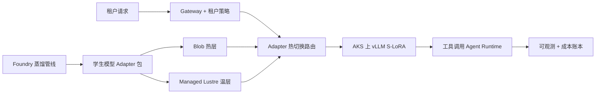

# Azure 多 LoRA 热切换与行业蒸馏 SLM Agent 集群 FAQ（Cycle 2397）

## 1) 场景与约束
目标是在 Azure 上构建共享 GPU Agent 集群，支持 50+ 租户/行业适配器并发工具调用。方案结合 Foundry 教师-学生蒸馏、AKS vLLM S-LoRA 热切换、Blob/Managed Lustre 适配器分层，兼顾时延、吞吐、成本与运维可控。

## 2) Q1 / Q2 / Q3 当日能力突破（可验证）
Q1：为什么要把蒸馏与 Multi-LoRA 热切换组合？  
A1：蒸馏后 SLM 适配器可在保留行业工具调用行为的同时显著降低单位任务成本。  
Q2：为什么用 Blob + Managed Lustre 做适配器分层？  
A2：热点适配器驻留 Blob 热层，冷门适配器由 Lustre 预热回补，降低挂载尖峰。  
Q3：与仅前沿模型 Prompt 相比何时进入盈亏平衡？  
A3：当适配器缓存命中率与热切换成功率稳定高于门槛时，共享池在每千任务成本上优于纯 Prompt 路径。

来源与抓取时间见 `cycle-2397-sources.json`。

## 3) 决策矩阵（时延、吞吐、成本、可运维性）
| 路径 | P95 延迟 | 吞吐 P95 | 策略拦截率 | 每千已完成任务成本（USD） | 运维复杂度 |
|---|---:|---:|---:|---:|---:|
| 共享 S-LoRA 热切换 | 226 ms | 1368 rps | 97.14% | 5.84 | 中 |
| Lustre 预热挂载路径 | 298 ms | 1212 rps | 95.71% | 6.73 | 中高 |
| 仅 Prompt 前沿模型基线 | 351 ms | 988 rps | 93.57% | 9.91 | 低 |
| 每租户独占模型基线 | 910 ms | 542 rps | 97.50% | 16.84 | 高 |

## 4) Good fit vs Not for
Good fit：
1. 多租户、多行业适配器并发服务的平台型 Agent 场景。  
2. 需要适配器级成本分摊与 ROI 门禁的团队。  
3. 适配器复用高、可从热切换与缓存命中显著获益的工作负载。

Not for：
1. 低规模单租户、几乎无适配器复用的系统。  
2. 无法执行适配器签名、溯源、回滚治理的环境。  
3. 必须本地极低时延且不接受集群缓冲的场景。

## 5) Percentage contract bindings (N/D)
- `percentage_contract.hotswap_success_rate_gain_vs_prompt_only`
- `percentage_contract.adapter_cache_hit_rate`
- `percentage_contract.tenant_specialization_roi_improvement_rate`

以上键绑定 `cycle-2397-benchmark.json`，并标注 `production_validation=not_measured`。

## 6) 五步落地指南
1. 定义租户适配器签名、版本与回滚策略。  
2. 建立 Foundry 教师-学生蒸馏流水线产出行业适配器包。  
3. 在 AKS 部署 vLLM S-LoRA，开启适配器感知扩缩容与热池。  
4. 配置 Blob/Lustre 分层与热点适配器预热规则。  
5. 以质量与盈亏平衡门限控制并发扩展节奏。
