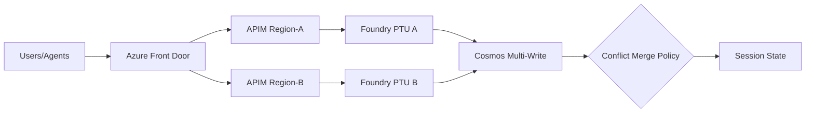

# Azure Multi-Region Active-Active DR for Production AI Agents FAQ (Cycle 2383)

## 1) Scenario and constraints
The goal is production-grade active-active DR using Azure Front Door + multi-region APIM AI Gateway + Foundry regional PTU/global spillover + Cosmos multi-write conflict merge to achieve low RTO/RPO with controlled FinOps.

## 2) Q1 / Q2 / Q3 Daily capability breakthroughs (verifiable)
Q1: What is the key gain of active-active over active-passive?  
A1: Reduced switchover interruption and lower single-region exposure windows.  
Q2: Why pin quota before spillover?  
A2: To prevent uncontrolled cross-region burst costs.  
Q3: How do you govern multi-write conflicts?  
A3: Apply deterministic conflict rules with auditable merge lineage.

Source links and fetch timestamp (UTC) are listed in `cycle-2383-sources.json`.

## 3) Decision matrix (RTO/RPO, quota, cost)
| Path | P95 latency | RTO/RPO controllability | Quota governance | Cost/session | Ops complexity |
|---|---:|---:|---:|---:|---:|
| Front Door + APIM | 276 ms | high | medium-high | 0.00635 | medium |
| Foundry PTU spillover | 314 ms | medium-high | high | 0.00711 | medium-high |
| Cosmos multi-write merge | 247 ms | high | medium | 0.00588 | medium |
| DR guard lane | 314 ms | high | high | 0.00612 | medium-high |

## 4) Good fit vs Not for
Good fit:
1. Coding Agent sandboxes requiring session re-entry after cross-region failover.
2. Browser/CUA clusters requiring active-active ingress with quota control.
3. Multi-tenant SaaS requiring region pinning and bounded spillover.
4. Regulated finance requiring auditable RTO/RPO and conflict merge traceability.

Not for:
1. Single-region control plane with manual failover scripts.
2. Global spillover without quota pinning.
3. Multi-write enabled without conflict policy or drill evidence.

## 5) Percentage contract bindings (N/D)
- `percentage_contract.active_active_failover_sla_rate`
- `percentage_contract.conflict_resolution_success_rate`
- `percentage_contract.quota_pinning_finops_gain_pts`

These keys bind to `cycle-2383-benchmark.json` with `production_validation=not_measured`.

## 6) Five-step rollout
1. Configure dual-region APIM with Front Door health probes.
2. Set Foundry PTU regional quota pinning and spillover thresholds.
3. Enable Cosmos multi-write with deterministic conflict merge.
4. Run failover drills and capture measured RTO/RPO.
5. Review quota and spillover cost weekly to tune FinOps.
