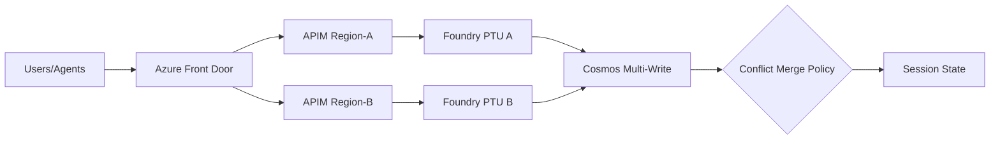

# Azure 生产 AI Agent 多区域主动-主动容灾 FAQ（Cycle 2383）

## 1) 场景与约束
目标是构建生产级主动-主动容灾：通过 Azure Front Door + 多区域 APIM AI Gateway + Foundry 区域 PTU/Global Spillover + Cosmos 多写冲突合并，实现低 RTO/RPO 与可控 FinOps。

## 2) Q1 / Q2 / Q3 当日能力突破（可验证）
Q1：主动-主动相比主备的核心收益？  
A1：降低切换时间并减少单区域故障暴露窗口。  
Q2：为什么要配额钉住再溢出？  
A2：避免跨区流量失控导致成本突增。  
Q3：多写冲突如何治理？  
A3：使用确定性冲突策略并保留审计合并链路。

来源与抓取时间（UTC）写入 `cycle-2383-sources.json`。

## 3) 决策矩阵（RTO/RPO、配额、成本）
| 路径 | P95 延迟 | RTO/RPO 可控性 | 配额治理 | 单会话成本 | 运维复杂度 |
|---|---:|---:|---:|---:|---:|
| Front Door + APIM | 276 ms | 高 | 中高 | 0.00635 | 中 |
| Foundry PTU 溢出 | 314 ms | 中高 | 高 | 0.00711 | 中高 |
| Cosmos 多写合并 | 247 ms | 高 | 中 | 0.00588 | 中 |
| DR 防护通道 | 314 ms | 高 | 高 | 0.00612 | 中高 |

## 4) Good fit vs Not for
Good fit：
1. Coding Agent sandbox：要求跨区故障切换后会话可重入。  
2. Browser/CUA 集群：需要区域入口高可用与配额约束。  
3. 多租户 SaaS：需要租户配额钉住和跨区溢出边界。  
4. 金融合规：需要 RTO/RPO 审计证据和冲突合并可追溯。

Not for：
1. 单区域控制平面 + 人工脚本切换。  
2. 无配额钉住就直接全局溢出。  
3. 多写开启但无冲突策略与演练证据。

## 5) Percentage contract bindings (N/D)
- `percentage_contract.active_active_failover_sla_rate`
- `percentage_contract.conflict_resolution_success_rate`
- `percentage_contract.quota_pinning_finops_gain_pts`

以上键绑定 `cycle-2383-benchmark.json`，并标注 `production_validation=not_measured`。

## 6) 五步落地指南
1. 配置双区域 APIM 与 Front Door 健康探测。  
2. 设置 Foundry PTU 区域配额钉住与溢出阈值。  
3. 在 Cosmos 启用多写与确定性冲突合并。  
4. 运行故障演练并记录 RTO/RPO 实测值。  
5. 周度复盘配额与溢出成本，持续优化 FinOps。
