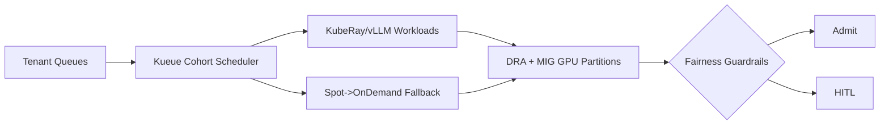

# Azure Multi-Tenant AKS Agent Cluster Fair-Share Scheduling FAQ (Cycle 2381)

## 1) Scenario and constraints
The goal is fair-share governance for multi-tenant agent clusters by combining Kueue cohort lending/preemption, KubeRay/vLLM inference workloads, AKS Spot-to-OnDemand fallback, and DRA/MIG partitioning to balance throughput, latency, and cost.

## 2) Q1 / Q2 / Q3 Daily capability breakthroughs (verifiable)
Q1: Why prioritize queue fairness governance first?  
A1: Without it, high-value tenants can starve under bursty batch traffic.  
Q2: What is critical for Spot fallback?  
A2: Preserving critical queue SLOs during eviction spikes to avoid availability collapse.  
Q3: When does MIG partitioning pay off?  
A3: In mixed workloads where partition templates can map to workload profiles.

Source links and fetch timestamp (UTC) are listed in `cycle-2381-sources.json`.

## 3) Decision matrix (fairness, fallback, utilization, cost)
| Path | P95 latency | Fairness guarantee | Fallback stability | Cost/session | Ops complexity |
|---|---:|---:|---:|---:|---:|
| Kueue Cohort | 283 ms | high | medium-high | 0.00772 | medium |
| KubeRay/vLLM | 271 ms | medium-high | medium | 0.00779 | medium-high |
| Spot fallback lane | 312 ms | medium | high | 0.00612 | medium |
| DRA+MIG partition lane | 247 ms | high | medium-high | 0.00591 | medium-high |

## 4) Good fit vs Not for
Good fit:
1. Coding Agent sandbox with mixed batch + interactive queues and anti-starvation controls.
2. Browser/CUA clusters needing tenant quotas with controlled preemption.
3. Multi-tenant SaaS requiring cohort lending and cost attribution.
4. Regulated finance requiring strict tenant isolation and auditable fallback paths.

Not for:
1. Shared GPU pools without tenant budgets or quota classes.
2. Spot-first strategy without deterministic On-Demand fallback SLO.
3. Preemption without replay and compensation contracts.

## 5) Percentage contract bindings (N/D)
- `percentage_contract.kueue_fairshare_sla_rate`
- `percentage_contract.spot_fallback_success_rate`
- `percentage_contract.mig_partition_efficiency_gain_pts`

These keys bind to `cycle-2381-benchmark.json` with `production_validation=not_measured`.

## 6) Five-step rollout
1. Define queue classes and cohort boundaries by tenant tier.
2. Configure reclaimable lending and preemption for premium queues.
3. Add Spot eviction detection and On-Demand fallback policy.
4. Map workload profiles to DRA/MIG partition templates.
5. Review fairness, fallback success, and cost/session weekly.
