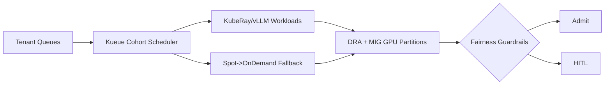

# Azure 多租户 AKS Agent 集群公平调度 FAQ（Cycle 2381）

## 1) 场景与约束
目标是为多租户 Agent 集群建立公平份额治理：结合 Kueue Cohort 借贷/抢占、KubeRay/vLLM 推理负载、AKS Spot→On-Demand 回退与 DRA/MIG 分区，平衡吞吐、时延与成本。

## 2) Q1 / Q2 / Q3 当日能力突破（可验证）
Q1：为什么先做队列公平治理？  
A1：否则高价值租户会被突发批任务长期饥饿。  
Q2：Spot 回退的关键是什么？  
A2：在驱逐峰值期间维持关键队列 SLO，不让可用性塌陷。  
Q3：MIG 分区何时有效？  
A3：混合负载且可按工作负载画像分片时，GPU 利用率明显提升。

来源与抓取时间（UTC）写入 `cycle-2381-sources.json`。

## 3) 决策矩阵（公平性、回退、利用率、成本）
| 路径 | P95 延迟 | 公平性保障 | 回退稳定性 | 单会话成本 | 运维复杂度 |
|---|---:|---:|---:|---:|---:|
| Kueue Cohort | 283 ms | 高 | 中高 | 0.00772 | 中 |
| KubeRay/vLLM | 271 ms | 中高 | 中 | 0.00779 | 中高 |
| Spot 回退通道 | 312 ms | 中 | 高 | 0.00612 | 中 |
| DRA+MIG 分区 | 247 ms | 高 | 中高 | 0.00591 | 中高 |

## 4) Good fit vs Not for
Good fit：
1. Coding Agent sandbox：批+交互队列混跑且要防饥饿。  
2. Browser/CUA 集群：租户配额与抢占可控。  
3. 多租户 SaaS：需要 cohort 借贷与成本归因。  
4. 金融合规：需强租户隔离与可审计回退路径。

Not for：
1. 无租户预算和 quota class 就共享 GPU。  
2. Spot 优先但无 On-Demand 回退 SLO。  
3. 预占/抢占不配套重放与补偿契约。

## 5) Percentage contract bindings (N/D)
- `percentage_contract.kueue_fairshare_sla_rate`
- `percentage_contract.spot_fallback_success_rate`
- `percentage_contract.mig_partition_efficiency_gain_pts`

以上键绑定 `cycle-2381-benchmark.json`，并标注 `production_validation=not_measured`。

## 6) 五步落地指南
1. 按租户等级定义 queue class 与 cohort 边界。  
2. 为高优先队列配置可回收借贷与预占策略。  
3. 建立 Spot 驱逐检测与 On-Demand 回退策略。  
4. 按负载画像映射 DRA/MIG 分区模板。  
5. 周度复盘公平性、回退成功率与单位会话成本。
