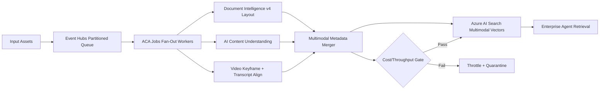

# Azure Enterprise Agent Multimodal Document/Diagram/Video Ingestion Pipeline FAQ (Cycle 2391)

## 1) Scenario and constraints
The objective is enterprise-grade multimodal ingestion on Azure by combining AI Content Understanding, Document Intelligence v4 Layout, Event Hubs plus ACA Jobs partitioned fan-out, and Azure AI Search multimodal vectorization for unified indexing of nested tables, engineering diagrams, and aligned video keyframe/transcript content.

## 2) Q1 / Q2 / Q3 Daily capability breakthroughs (verifiable)
Q1: Why partitioned fan-out?  
A1: It splits ingestion spikes into parallel streams and reduces bottlenecks/timeouts.  
Q2: What is critical for nested-table handling?  
A2: Layout extraction must preserve hierarchy, merged cells, and relational semantics.  
Q3: Common video ingestion failure mode?  
A3: Keyframe/transcript timeline drift breaks retrieval grounding and requires strict alignment checks.

Sources and fetch timestamp (UTC) are listed in `cycle-2391-sources.json`.

## 3) Decision matrix (throughput, quality, cost)
| Path | P95 latency | Throughput P95 | Risk intercept rate | Cost per 10k pages | Ops complexity |
|---|---:|---:|---:|---:|---:|
| Partitioned layout extraction | 308 ms | 1242 rps | 96.68% | 71.52 | medium |
| Diagram vectorization | 356 ms | 1121 rps | 95.02% | 83.95 | medium-high |
| Video alignment pipeline | 429 ms | 1014 rps | 93.78% | 103.04 | high |
| Non-partitioned baseline | 944 ms | 801 rps | N/A | 107.52 | medium |

## 4) Good fit vs Not for
Good fit:
1. Enterprise platforms ingesting document/diagram/video at scale for agent retrieval.
2. Agent foundations with strict throughput and cost SLO requirements.
3. Peak-load pipelines requiring partitioned concurrency and replay safety.
4. Production workflows needing explicit quality gates for structure/alignment/cost.

Not for:
1. Serial single-thread ingestion for large multimodal corpora.
2. Indexing without structural quality validation.
3. Retrieval pipelines without video timeline alignment strategy.

## 5) Percentage contract bindings (N/D)
- `percentage_contract.layout_extraction_fidelity_rate`
- `percentage_contract.multimodal_alignment_consistency_rate`
- `percentage_contract.cost_per_10k_pages_gain_pts`

These keys bind to `cycle-2391-benchmark.json` with `production_validation=not_measured`.

## 6) Five-step rollout
1. Design Event Hubs partition strategy and concurrency budgets by modality.
2. Deploy ACA Jobs fan-out workers with replay and retry semantics.
3. Establish quality gates for table, diagram, and video alignment branches.
4. Map merged multimodal metadata into Search vector indexes.
5. Enforce throughput plus cost-per-10k-pages guardrails with auto throttling.
