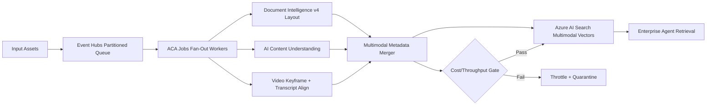

# Azure 企业 Agent 多模态文档/图纸/视频摄取管线 FAQ（Cycle 2391）

## 1) 场景与约束
目标是在 Azure 上构建企业级多模态摄取：结合 Azure AI Content Understanding、Document Intelligence v4 Layout、Event Hubs + ACA Jobs 分区 fan-out，以及 Azure AI Search 多模态向量化，实现复杂表格、工程图、视频关键帧与转录对齐的统一索引。

## 2) Q1 / Q2 / Q3 当日能力突破（可验证）
Q1：为什么要分区 fan-out？  
A1：可把摄取高峰拆分为并行子流，减少单点拥堵与超时。  
Q2：复杂嵌套表格处理的关键是什么？  
A2：布局模型需要稳定保留层级、合并单元格与关系语义。  
Q3：视频摄取常见失败点？  
A3：关键帧和转录时间轴错位会导致检索误对齐，需要强校验。

来源与抓取时间（UTC）见 `cycle-2391-sources.json`。

## 3) 决策矩阵（吞吐、质量、成本）
| 路径 | P95 延迟 | 吞吐 P95 | 风险拦截率 | 每万页成本 | 运维复杂度 |
|---|---:|---:|---:|---:|---:|
| 分区布局抽取 | 308 ms | 1242 rps | 96.68% | 71.52 | 中 |
| 图纸向量化 | 356 ms | 1121 rps | 95.02% | 83.95 | 中高 |
| 视频对齐链路 | 429 ms | 1014 rps | 93.78% | 103.04 | 高 |
| 无分区基线 | 944 ms | 801 rps | N/A | 107.52 | 中 |

## 4) Good fit vs Not for
Good fit：
1. 需要统一处理文档/图纸/视频的企业知识摄取平台。  
2. 对吞吐与成本有强 SLO 要求的 Agent 检索底座。  
3. 需要分区并发与失败重放机制的高峰批处理场景。  
4. 需要严格质量门禁（结构/对齐/成本）的生产流程。

Not for：
1. 串行单线程处理大规模多模态素材。  
2. 忽略结构质量直接入向量库。  
3. 无视频时间轴对齐策略直接做检索。

## 5) Percentage contract bindings (N/D)
- `percentage_contract.layout_extraction_fidelity_rate`
- `percentage_contract.multimodal_alignment_consistency_rate`
- `percentage_contract.cost_per_10k_pages_gain_pts`

以上键绑定 `cycle-2391-benchmark.json`，并标记 `production_validation=not_measured`。

## 6) 五步落地指南
1. 按素材类型设计 Event Hubs 分区策略与并发预算。  
2. 部署 ACA Jobs fan-out 摄取任务并启用失败重放。  
3. 为表格/图纸/视频分别建立质量评分门禁。  
4. 将多模态元数据统一映射到 Search 向量索引。  
5. 启用每万页成本与吞吐双阈值守卫并自动限流。
