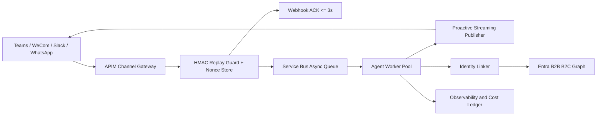

# Azure Omnichannel Enterprise IM Agent Gateway FAQ (Cycle 2402)

## 1) Scenario and constraints
We need a unified enterprise IM gateway for Teams, WeCom, Slack, and WhatsApp with sub-3s webhook ACK, async proactive updates, replay-safe signatures, and federated identity linking. The target stack combines APIM gateway policy, Azure Communication Services, Service Bus fanout, and Entra B2B/B2C identity mapping.

## 2) Q1 / Q2 / Q3 daily breakthroughs (verifiable)
Q1: Why split webhook ACK and async processing?  
A1: Fast ACK protects channel SLA, while Service Bus decouples heavy agent work from inbound burst pressure.  
Q2: Why enforce HMAC replay protection at gateway edge?  
A2: It blocks duplicated or delayed forged webhook calls before they trigger agent side effects.  
Q3: Why is Entra identity linking mandatory?  
A3: Cross-channel user identity convergence is needed for policy-consistent access and conversation continuity.

Source URLs and fetch timestamps are listed in `cycle-2402-sources.json`.

## 3) Decision matrix (latency, throughput, cost, operability)
| Path | P95 inbound ACK latency | Throughput P95 | Policy intercept rate | Cost per 1k messages (USD) | Ops complexity |
|---|---:|---:|---:|---:|---:|
| APIM + Service Bus + ACS target | 842 ms | 2142 msg/min | 98.10% | 3.86 | Medium-high |
| APIM + worker direct path | 1421 ms | 1674 msg/min | 94.70% | 4.11 | Medium |
| Queue-only without replay guard | 1262 ms | 1830 msg/min | 89.40% | 3.59 | Medium |
| Legacy channel-silo baseline | 2884 ms | 911 msg/min | 86.20% | 6.27 | High |

## 4) Good fit vs Not for
Good fit:
1. Enterprises operating multiple IM channels with shared compliance requirements.  
2. Teams requiring low-latency webhook ACK and asynchronous proactive updates.  
3. Environments that must bind user identity and policy across tenant boundaries.

Not for:
1. Single-channel bots without proactive messaging needs.  
2. Deployments lacking secure nonce storage or signature governance.  
3. Organizations unable to operationalize cross-tenant identity linking.

## 5) Percentage contract bindings (N/D)
- `percentage_contract.webhook_ack_sla_meet_rate`
- `percentage_contract.hmac_replay_block_rate`
- `percentage_contract.cross_channel_identity_link_success_rate`

These keys are bound to `cycle-2402-benchmark.json` and tagged with `production_validation=not_measured`.

## 6) Five-step rollout guide
1. Define channel adapter contracts with normalized payload envelopes.  
2. Implement APIM HMAC replay policy and nonce-store lifecycle rules.  
3. Add Service Bus async processing and proactive streaming publisher workers.  
4. Build Entra B2B/B2C identity linking with deterministic fallback mapping.  
5. Gate production release on ACK SLA, replay block rate, and identity-link KPIs.
