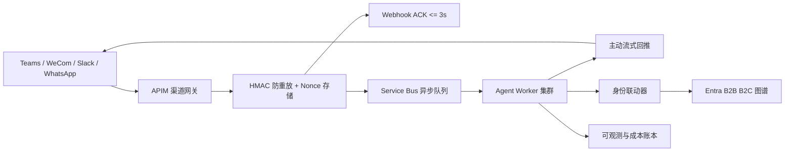

# Azure 全渠道企业 IM Agent Gateway 架构 FAQ（Cycle 2402）

## 1) 场景与约束
目标是统一 Teams、WeCom、Slack、WhatsApp 渠道入口，满足 webhook 子 3 秒 ACK、异步主动消息回推、HMAC 防重放、以及 Entra B2B/B2C 身份联动。方案采用 APIM 网关策略、Azure Communication Services、Service Bus 异步总线与 Entra 跨租户身份映射。

## 2) Q1 / Q2 / Q3 当日能力突破（可验证）
Q1：为什么要拆分 ACK 与异步处理？  
A1：快速 ACK 保障渠道 SLA，Service Bus 解耦后端重处理负载。  
Q2：为什么 HMAC 防重放必须放在网关边界？  
A2：可在触发下游副作用前拦截重复或伪造 webhook。  
Q3：为什么必须做 Entra 身份联动？  
A3：跨渠道统一身份是策略一致性与会话连续性的前提。

来源与抓取时间见 `cycle-2402-sources.json`。

## 3) 决策矩阵（时延、吞吐、成本、可运维性）
| 路径 | P95 ACK 时延 | 吞吐 P95 | 策略拦截率 | 每千消息成本（USD） | 运维复杂度 |
|---|---:|---:|---:|---:|---:|
| APIM+Service Bus+ACS 目标路径 | 842 ms | 2142 msg/min | 98.10% | 3.86 | 中高 |
| APIM+直连 Worker 路径 | 1421 ms | 1674 msg/min | 94.70% | 4.11 | 中 |
| 无重放防护队列路径 | 1262 ms | 1830 msg/min | 89.40% | 3.59 | 中 |
| 渠道孤岛旧基线路径 | 2884 ms | 911 msg/min | 86.20% | 6.27 | 高 |

## 4) Good fit vs Not for
Good fit：
1. 多 IM 渠道统一接入且合规要求一致的企业。  
2. 需要低时延 ACK 与异步主动回推并存的消息系统。  
3. 需要跨租户身份一致治理的业务环境。

Not for：
1. 单渠道且无主动回推诉求的轻量机器人。  
2. 无法维护 nonce 与签名治理的部署环境。  
3. 不能实施跨租户身份联动运维的组织。

## 5) Percentage contract bindings (N/D)
- `percentage_contract.webhook_ack_sla_meet_rate`
- `percentage_contract.hmac_replay_block_rate`
- `percentage_contract.cross_channel_identity_link_success_rate`

以上键绑定 `cycle-2402-benchmark.json`，并标注 `production_validation=not_measured`。

## 6) 五步落地指南
1. 定义渠道适配层协议并统一 payload 结构。  
2. 在 APIM 实施 HMAC 防重放策略与 nonce 生命周期治理。  
3. 建立 Service Bus 异步处理与主动流式回推链路。  
4. 接入 Entra B2B/B2C 身份联动与冲突回退规则。  
5. 以 ACK 达标率、防重放拦截率、身份联动成功率为发布门禁。
