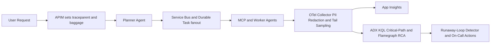

# End-to-End Distributed Tracing, OTel GenAI Semantic Conventions, and Flamegraph RCA for Multi-Agent Graphs FAQ (Cycle 2434)

## 1) Executive summary
This cycle designs production-grade observability for asynchronous multi-agent DAGs on Azure: W3C `traceparent` and `baggage` are propagated across APIM, Service Bus, Durable Task, and MCP hops; OTel GenAI semantic conventions normalize `gen_ai.agent.*`, `gen_ai.usage.*`, `gen_ai.tool.call.*`, and `gen_ai.evaluation.*`; collector-level PII redaction separates always-on structural telemetry from opt-in encrypted payload vaults; and App Insights plus ADX flamegraph analytics isolate critical-path regressions quickly.

## 2) Q1 / Q2 / Q3
Q1: Why does trace context usually break in async A2A and MCP hops?  
A1: Queue and worker boundaries often spawn new spans without forwarding `traceparent`/`baggage`; explicit middleware injection and forward-only lineage contracts are required.
Q2: How does tail sampling reduce observability cost while preserving RCA quality?  
A2: Keep 100% of error/high-latency/low-eval traces and only 5% healthy traces; this preserves failure evidence and cuts ingestion cost significantly.
Q3: How do we debug without leaking prompts that may contain PII?  
A3: Split telemetry into structural spans (hot path) and encrypted payload vault lanes, with collector redaction policies and immutable audit lineage.

## 3) Multi-agent tracing sequence (W3C propagation to ADX flamegraph RCA)

## 4) Decision matrix: App Insights native vs ADX raw OTel lakehouse vs external tracing SaaS
| Option | RCA depth | Cost control | Data governance | Ops complexity | Best fit |
|---|---:|---:|---:|---:|---|
| App Insights native | Medium | Medium | Medium | Low | fast onboarding, low complexity |
| App Insights + ADX raw OTel | Highest | High | Highest | Medium-High | enterprise multi-agent forensic RCA |
| 3rd-party tracing SaaS | High | Medium | Medium | Medium | hybrid cross-cloud observability federation |

## 5) Multi-agent observability production checklist (daily breakthroughs included)
- Enforce W3C `traceparent`/`baggage` propagation contracts at every async boundary.  
- Standardize GenAI semantic fields: `gen_ai.agent.*`, `gen_ai.usage.*`, `gen_ai.tool.call.*`, `gen_ai.evaluation.*`.  
- Apply collector redaction + encrypted payload vault split for zero-leak debugging posture.  
- Enable tail sampling policy: 100% for failures/high latency/low eval, 5% for healthy traces.  
- Daily breakthroughs (fetched on 2026-11-16, official/release-first):  
  - OTel semantic conventions for GenAI telemetry (`measured`).  
  - Azure Monitor OTel integration and ADX KQL critical-path analytics path (`measured` + `anonymized_reported`).  
  - Tail-sampling cost/performance strategy with deterministic replay evidence (`synthetic`).

## 6) Good fit vs Not for with percentage contract bindings
Good fit:  
1. Multi-agent platforms needing deterministic RCA across queue and worker boundaries.  
2. Regulated environments requiring strict telemetry redaction and encrypted payload handling.

Not for:  
1. Pipelines that store prompt/completion payloads directly in clear-text tracing backends.  
2. Async orchestration paths that omit context propagation and expect lineage recovery later.

Percentage contract bindings:
- `percentage_contract.telemetry_ingestion_cost_reduction_tail_vs_head`
- `percentage_contract.async_trace_context_continuity_rate`
- `percentage_contract.pii_zero_leak_redaction_throughput_preservation_rate`
- `percentage_contract.root_cause_mttd_improvement_rate`

These keys bind to `cycle-2434-benchmark.json` with `production_validation=not_measured`.
