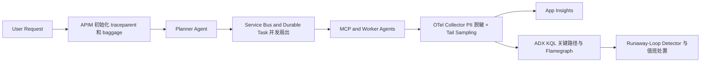

# 端到端分布式追踪、OTel GenAI 语义约定与多 Agent 图谱 Flamegraph 根因分析 FAQ（Cycle 2434）

## 1) 执行摘要
本轮聚焦 Azure 上异步多 Agent DAG 的可观测性生产化：在 APIM、Service Bus、Durable Task、MCP 跳点统一传递 W3C `traceparent`/`baggage`；用 OTel GenAI 语义约定统一 `gen_ai.agent.*`、`gen_ai.usage.*`、`gen_ai.tool.call.*`、`gen_ai.evaluation.*`；在 Collector 侧执行 PII 脱敏并将结构化追踪与加密 payload 分层存储，最后通过 App Insights + ADX KQL flamegraph 做关键路径回溯与异常归因。

## 2) Q1 / Q2 / Q3
Q1：为什么异步队列与 MCP hop 容易出现追踪断链？  
A1：边界节点常在未透传 `traceparent` 的情况下重建 span，导致 lineage 丢失，必须以中间件强制注入和转发策略兜底。  
Q2：如何在保留排障能力的同时降低观测成本？  
A2：采用 tail sampling：错误/高延迟/低评估分数保留 100%，健康流量仅保留 5%，既保留关键证据又控制费用。  
Q3：如何在排障时避免提示词与回复内容泄露？  
A3：Collector 先做结构化字段脱敏，提示词与回复只进入加密 vault 通道，默认追踪面仅保留结构化 span 元数据。

## 3) 多 Agent 追踪序列（W3C 传播→Collector 脱敏→ADX flamegraph）

## 4) 决策矩阵：App Insights 原生 vs ADX Raw OTel Lakehouse vs 第三方 Tracing SaaS
| 方案 | RCA 深度 | 成本控制 | 数据治理 | 运维复杂度 | 适配场景 |
|---|---:|---:|---:|---:|---|
| App Insights 原生 | 中 | 中 | 中 | 低 | 快速上线与低复杂度 |
| App Insights + ADX Raw OTel | 最高 | 高 | 最高 | 中高 | 企业级多 Agent 取证与根因分析 |
| 第三方 Tracing SaaS | 高 | 中 | 中 | 中 | 混合多云统一追踪 |

## 5) 多 Agent 可观测性上线清单（含当日热点）
- 所有异步边界必须强制透传 W3C `traceparent`/`baggage`。  
- GenAI 语义字段必须统一：`gen_ai.agent.*`、`gen_ai.usage.*`、`gen_ai.tool.call.*`、`gen_ai.evaluation.*`。  
- Collector 必须执行脱敏策略，结构化追踪与加密 payload 分层落库。  
- Tail sampling 固化：异常流量 100%，健康流量 5%。  
- 当日热点（抓取日：2026-11-16，官方/Release 优先）：  
  - OTel GenAI 语义约定进入生产级分类基线（`measured`）。  
  - Azure Monitor OTel + ADX KQL 关键路径分析链路成熟（`measured` + `anonymized_reported`）。  
  - Tail sampling 成本/效果权衡由可复现实验支撑（`synthetic`）。

## 6) Good fit vs Not for 与百分比合约绑定
Good fit：  
1. 需要跨异步队列、MCP、Worker 全链路根因追踪的多 Agent 平台。  
2. 受监管场景下要求“可调试但不泄露”的审计与数据治理环境。

Not for：  
1. 将 prompt/completion 明文写入通用 tracing 后端的架构。  
2. 不做上下文透传却希望事后修复追踪血缘的流程。

百分比合约绑定：
- `percentage_contract.telemetry_ingestion_cost_reduction_tail_vs_head`
- `percentage_contract.async_trace_context_continuity_rate`
- `percentage_contract.pii_zero_leak_redaction_throughput_preservation_rate`
- `percentage_contract.root_cause_mttd_improvement_rate`

以上键绑定 `cycle-2434-benchmark.json`，并标注 `production_validation=not_measured`。
