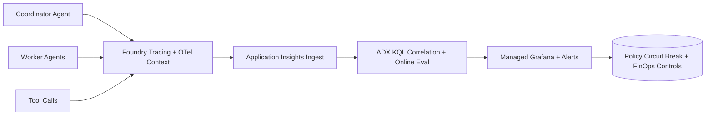

# Azure End-to-End OTel GenAI Semantic Conventions & Agent Observability FAQ: Foundry Tracing + App Insights + ADX + Grafana (Cycle 2375)

## 1) Scenario and constraints
The goal is a production-grade observability loop for multi-agent systems covering span correlation, tenant token FinOps attribution, runaway tool-loop detection, and online evaluation closure. Ingest uses Foundry Tracing + Application Insights, analytics uses ADX KQL, and operations use Managed Grafana alerts wired into policy controls.

## 2) Q1 / Q2 / Q3 Daily capability breakthroughs (verifiable)
Q1: Why emphasize OTel GenAI semantic conventions?  
A1: Unified semantic attributes materially reduce broken parent-child span chains in multi-agent graphs.  
Q2: Why ADX/KQL as the correlation core?  
A2: It supports high-throughput cross-agent trace analytics, attribution, and online-eval extraction.  
Q3: How does runaway-loop detection become governance?  
A3: Online-eval triggers are wired to policy circuit-break actions for automated containment.

Sources with fetch timestamp (UTC) are listed in `cycle-2375-sources.json`.

## 3) Decision matrix (correlation, latency, cost, governance)
| Path | Core capability | P50/P95 | Throughput P95 | Cost/session | Fit |
|---|---|---:|---:|---:|---|
| Foundry Tracing + App Insights | trace ingest + context | 168/289 ms | 2554 rps | 0.00591 | default baseline |
| ADX KQL Correlation | deep cross-agent analytics | 124/214 ms | 908 rps | 0.00662 | diagnosis + online eval |
| Managed Grafana | visual ops + alerting | 97/163 ms | 1086 rps | 0.00307 | SRE/ops workflows |
| Tiered unified architecture | end-to-end closure | 151/276 ms | 1176 rps | 0.00586 | production balance |

## 4) Good fit vs Not for
Good fit:
1. Coding Agent sandboxes requiring tool-chain traceability and budget guards.
2. Browser/CUA clusters requiring unified UI-action and tool-span correlation.
3. Multi-tenant SaaS requiring tenant-level token cost attribution.
4. Regulated workloads requiring online-eval-triggered audit and circuit-break controls.

Not for:
1. Small single-agent experiments without cross-chain tracing needs.
2. Teams unable to maintain semantic trace attribute standards.
3. Offline-only evaluation without real-time governance actions.

## 5) Percentage contract bindings (N/D)
- `percentage_contract.unfenced_span_correlation_drift_rate`
- `percentage_contract.tenant_token_finops_attribution_effective_rate`
- `percentage_contract.runaway_loop_detection_gain_pts`

These keys bind to `cycle-2375-benchmark.json` with `production_validation=not_measured`.

## 6) Five-step rollout
1. Standardize OTel GenAI attributes and enforce cross-agent trace context propagation.
2. Enrich ingest with tenant/agent/tool/token attribution dimensions.
3. Build KQL queries for span correlation, loop detection, and online evaluation.
4. Configure Grafana alerts for cost, loop, and tail-latency thresholds.
5. Feed alerts into circuit-break and dynamic downgrade controls.
