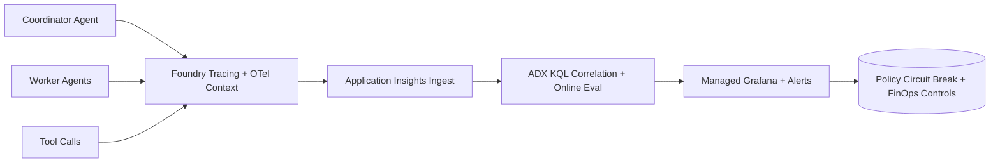

# Azure 端到端 OTel GenAI 语义约定与 Agent 可观测性 FAQ：Foundry Tracing + App Insights + ADX + Grafana（Cycle 2375）

## 1) 场景与约束
目标是让多 Agent 生产链路同时满足“跨 Agent span 关联、租户 token 成本归因、runaway tool-loop 检测、在线评测闭环”：采集层使用 Foundry Tracing + Application Insights，分析层使用 ADX KQL，展示与告警层使用 Managed Grafana，并把在线评测信号回灌到策略控制面。

## 2) Q1 / Q2 / Q3 当日能力突破（可验证）
Q1：为什么要强调 OTel GenAI 语义约定？  
A1：统一语义字段可显著降低多 Agent span 断链概率。  
Q2：为何 ADX/KQL 作为关联分析核心？  
A2：其高吞吐查询能力适合跨链路追踪、租户归因、在线评测信号提取。  
Q3：runaway loop 如何进入治理闭环？  
A3：通过在线评测触发器与策略熔断联动，自动抑制异常循环。

来源与抓取时间（UTC）写入 `cycle-2375-sources.json`。

## 3) 决策矩阵（关联性、时延、成本、治理）
| 路径 | 关键能力 | P50/P95 | 吞吐 P95 | 单会话成本 | 适用性 |
|---|---|---:|---:|---:|---|
| Foundry Tracing + App Insights | 采集与追踪 | 168/289 ms | 2554 rps | 0.00591 | 默认观测基线 |
| ADX KQL Correlation | 深度关联分析 | 124/214 ms | 908 rps | 0.00662 | 多 Agent 诊断与在线评测 |
| Managed Grafana | 可视化与告警 | 97/163 ms | 1086 rps | 0.00307 | 运营与SRE联动 |
| 分层融合方案 | 端到端闭环 | 151/276 ms | 1176 rps | 0.00586 | 生产最佳平衡 |

## 4) Good fit vs Not for
Good fit：
1. Coding Agent sandbox：需要子工具链路级可追踪与限流。  
2. Browser/CUA 集群：需要 UI 动作与工具 span 的统一关联。  
3. 多租户 SaaS：需要 tenant 级 token 成本归因。  
4. 金融合规：需要在线评测触发的审计与熔断。

Not for：
1. 单 Agent 小规模实验，且无跨链路追踪要求。  
2. 无法维护 trace 语义字段标准的团队。  
3. 仅离线评估、无实时治理诉求的场景。

## 5) Percentage contract bindings (N/D)
- `percentage_contract.unfenced_span_correlation_drift_rate`
- `percentage_contract.tenant_token_finops_attribution_effective_rate`
- `percentage_contract.runaway_loop_detection_gain_pts`

以上键绑定 `cycle-2375-benchmark.json`，并标注 `production_validation=not_measured`。

## 6) 五步落地指南
1. 统一 OTel GenAI 语义字段并强制跨 Agent 传递 trace context。  
2. 在采集层补齐 tenant/agent/tool/token 归因维度。  
3. 在 ADX KQL 层建立 span 关联、loop 检测与在线评测查询。  
4. 在 Grafana 告警中配置成本阈值、loop 阈值、尾时延阈值。  
5. 把告警动作回灌策略熔断与动态降级，形成治理闭环。
