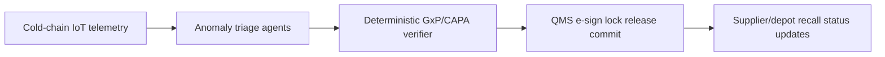

# Pharma Cold-Chain, GxP Batch Release & QMS Agent Infra FAQ (Round 1037 / Cycle 2442)

## 1) Executive Summary
This cycle targets pharmaceutical cold-chain quality operations under burst telemetry and strict compliance constraints. The reference architecture combines IoT telemetry ingestion, agentic anomaly triage, deterministic GxP/CAPA verification, QMS e-sign release locks, and recall fan-out observability.

## 2) Q1 / Q2 / Q3
Q1: Why does pure LLM quality triage fail regulated batch-release production?  
A1: cGMP and 21 CFR Part 11 controls require deterministic, auditable gates for release transitions; advisory-only flows are insufficient.

Q2: How is consistency preserved during operator and supplier burst updates?  
A2: Optimistic concurrency and idempotent release/hold locks prevent conflicting state transitions under parallel updates.

Q3: How are excursion and recall delays reduced without bypassing controls?  
A3: Event-driven triage plus deterministic CAPA verification shortens root-cause loops and drives synchronized supplier/depot notification.

## 3) End-to-end architecture flow

## 4) Decision matrix
| Option | Release speed | Compliance confidence | Burst resilience | Ops complexity | Best use |
|---|---:|---:|---:|---:|---|
| Legacy manual QA board | Low | Medium | Low | Medium | Low-volume product lines |
| Pure LLM quality advisory | Medium | Low | Medium | Low | Pre-screening only |
| Hybrid agent + deterministic GxP verifier | High | High | High | High | Production lot release and recall governance |

## 5) Production checklist
- Ingest lot telemetry, route states, and quality events with replay-capable lineage.
- Enforce deterministic GxP/CAPA/e-sign constraints as non-bypassable controls.
- Implement optimistic concurrency and idempotent lock keys for hold/release transitions.
- Validate chain-of-custody continuity before release or depot transfer.
- Publish recall/hold status via near-real-time notification channels with SLA dashboards.
- Track cycle-time, compliance pass, excursion prevention, and investigation-cost KPIs continuously.

## 6) Good fit vs Not for and percentage contract binding
Good fit: regulated pharma operations requiring scalable and auditable cold-chain release automation.  
Not for: advisory-only pipelines that cannot enforce deterministic GxP boundaries.

Percentage-contract keys (bound to `evidence/cycle-2442-benchmark.json`, `production_validation=not_measured`):
- `percentage_contract.batch_release_cycle_time_reduction_rate`
- `percentage_contract.gxp_compliance_gate_pass_rate`
- `percentage_contract.coldchain_excursion_prevented_rate`
- `percentage_contract.deviation_investigation_cost_reduction_rate`
