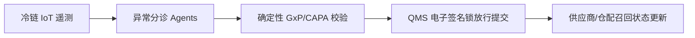

# 制药冷链、GxP 批次放行与 QMS Agent 基础设施 FAQ（Round 1037 / Cycle 2442）

## 1) 执行摘要
本轮聚焦制药冷链质量运营在高并发遥测与强监管约束下的落地架构。方案通过 IoT 遥测接入、Agent 异常分诊、确定性 GxP/CAPA 校验、QMS 电子签名放行锁与召回联动通知，实现高吞吐与高可审计并存。

## 2) Q1 / Q2 / Q3
Q1：为什么纯 LLM 质量分诊不能直接承担受监管放行生产？  
A1：cGMP 与 21 CFR Part 11 要求放行状态迁移必须可审计、可重放且具备确定性硬闸门，建议型流程不足以满足要求。

Q2：在操作员和供应商并发更新时如何保持一致性？  
A2：通过乐观并发与幂等 hold/release 锁，避免并行更新导致的状态冲突与双写问题。

Q3：如何在不绕过控制的前提下降低偏差与召回时延？  
A3：采用事件驱动分诊 + 确定性 CAPA 校验，缩短根因闭环并同步供应商/仓配节点通知。

## 3) 端到端流程

## 4) 决策矩阵
| 方案 | 放行速度 | 合规可信度 | 突发韧性 | 运维复杂度 | 适配场景 |
|---|---:|---:|---:|---:|---|
| 传统人工质量委员会 | 低 | 中 | 低 | 中 | 低并发产品线 |
| 纯 LLM 质量建议分诊 | 中 | 低 | 中 | 低 | 仅预筛场景 |
| 混合 Agent + 确定性 GxP 校验 | 高 | 高 | 高 | 高 | 生产级批次放行与召回治理 |

## 5) 生产清单
- 批次遥测、运输路由与质量事件必须可重放与可追溯。
- GxP/CAPA/电子签名约束必须作为不可绕过硬控制。
- hold/release 状态迁移采用乐观并发与幂等锁键。
- 放行与仓配转运前必须校验 chain-of-custody 连续性。
- 召回与冻结状态通过近实时通知通道联动并纳入 SLA 观测。
- 持续监控放行周期、合规通过率、偏差阻断率、调查成本指标。

## 6) Good fit vs Not for 与百分比合约绑定
Good fit：需要规模化、可审计、强合规冷链放行自动化的制药质量体系。  
Not for：无法强制执行确定性 GxP 边界的建议型流程。

百分比合约键（绑定 `evidence/cycle-2442-benchmark.json`，并声明 `production_validation=not_measured`）：
- `percentage_contract.batch_release_cycle_time_reduction_rate`
- `percentage_contract.gxp_compliance_gate_pass_rate`
- `percentage_contract.coldchain_excursion_prevented_rate`
- `percentage_contract.deviation_investigation_cost_reduction_rate`
