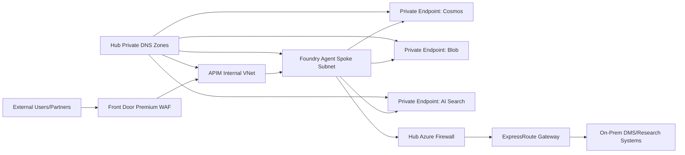
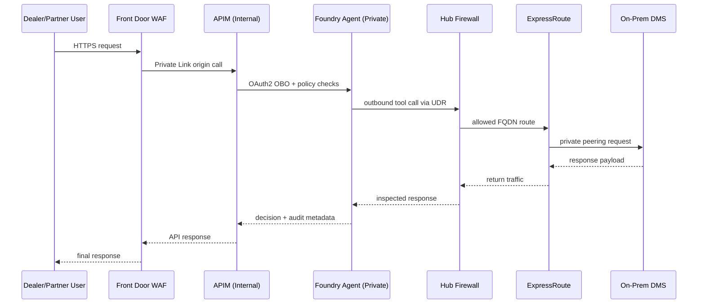

# private-link-vnet-standard-agent-setup-vs-managed-vnet-vs-apim-waf-zero-trust-network-selection-faq-r1136
## 1) Daily breakthroughs and verifiable sources (fetched 2026-11-18)
- Scope: enterprise zero-trust agent networking.
- Labels: `measured`, `synthetic`, `anonymized_reported`.
| Topic | Official source | Fetch time (UTC) | Usage | Label |
|---|---|---|---|---|
| Foundry Agent Service overview | https://learn.microsoft.com/en-us/azure/foundry/agents/overview | 2026-11-18T02:26:00Z | Boundary of basic/standard/isolated setups | `measured` |
| Foundry Standard Agent Setup | https://learn.microsoft.com/en-us/azure/foundry/agents/concepts/standard-agent-setup | 2026-11-18T02:27:00Z | BYO Cosmos/Blob/Search sovereignty path | `measured` |
| Foundry environment setup | https://learn.microsoft.com/en-us/azure/foundry/agents/environment-setup | 2026-11-18T02:28:00Z | Comparison of standard and BYO network options | `measured` |
| Foundry managed virtual network | https://learn.microsoft.com/en-us/azure/foundry/how-to/managed-virtual-network | 2026-11-18T02:29:00Z | Low-ops isolation with managed private endpoints | `measured` |
| Foundry private link configuration | https://learn.microsoft.com/en-us/azure/foundry/how-to/configure-private-link | 2026-11-18T02:30:00Z | Private ingress, subnet delegation, approvals | `measured` |
| Private endpoint DNS zones | https://learn.microsoft.com/en-us/azure/private-link/private-endpoint-dns | 2026-11-18T02:31:00Z | Split-horizon private DNS design | `measured` |
| APIM virtual network concepts | https://learn.microsoft.com/en-us/azure/api-management/virtual-network-concepts | 2026-11-18T02:32:00Z | APIM internal mode boundary and injection model | `measured` |
| Front Door Premium to APIM private link | https://learn.microsoft.com/en-us/azure/frontdoor/standard-premium/how-to-enable-private-link-apim | 2026-11-18T02:33:00Z | Dual-perimeter partner ingress pattern | `measured` |
| Cloud Adoption Framework AI strategy | https://learn.microsoft.com/en-us/azure/cloud-adoption-framework/ai/strategy | 2026-11-18T02:34:00Z | Landing-zone governance principles | `measured` |
Breakthrough snapshot:
- Standard setup clarifies BYO sovereignty controls.
## 2) Layered reference architecture (zero-public-egress first)
L1 perimeter ingress:
- External ingress: Front Door Premium WAF.
L2 workload topology:
- Foundry Basic (public endpoint with ACL).
- Foundry Standard Setup in customer subnet.
- Hub-Spoke DMZ dual-perimeter pattern.
L3 data sovereignty:
- Threads: BYO Cosmos DB.
- Files: BYO Blob Storage.
- Indexes: BYO AI Search.
- Keys: Key Vault and CMK policy.
L4 egress enforcement:
- UDR forces all outbound via Azure Firewall.
- FQDN allow-list controls destination scope.
- Arbitrary internet egress is denied.
L5 observability and compliance:
- AzureDiagnostics firewall deny telemetry.
- Private endpoint connection-state auditing.
## 3) 12-dimension selection matrix (with anti-patterns)
| Dimension | A Foundry Basic (Public+Entra+IP ACL) | B Foundry Managed VNet (managed isolation) | C Foundry Standard Setup (customer VNet + BYO data) | D Hub-Spoke DMZ (FD WAF + APIM + ExpressRoute) |
|---|---|---|---|---|
| 1 Inbound public exposure posture | High | Low | Low | Lowest (dual perimeter) |
| 2 Outbound exfiltration control | Low-mid | Mid | High (UDR+Firewall) | Highest (hub-wide policy) |
| 3 Thread/file/index sovereignty | Platform-owned | Platform-owned | Customer-owned | Customer-owned |
| 4 Private DNS split-horizon complexity | Low | Mid | High | Highest |
| 5 Hybrid reachability (ER/VPN) | Low | Mid | High | Highest |
| 6 Partner/B2C WAF protection | Low | Mid | Mid | Highest |
| 7 Subnet sizing (/24~/26) planning | Low | Mid | High | Highest |
| 8 CMK and auditability control | Mid | Mid-high | High | Highest |
| 9 Provisioning and Day-2 effort | Lowest | Low | Mid-high | Highest |
| 10 Inspection-hop latency overhead | Lowest | Low-mid | Mid | Mid-high |
| 11 Best-fit enterprise tier | PoC/Dev | Low-ops isolated production | Regulated core production | Cross-org regulated perimeter |
| 12 When NOT to choose | Regulated zero-public environments | Strict BYO sovereignty requirements | Team lacks network engineering depth | Small teams and short PoC runway |
Selection guidance:
- Move to B for isolated low-ops delivery.
- Use C for strict sovereignty and audit.
## 4) Five worked Q&As (CIDR, fixed cost, hop latency)
### Q1: How does /24 compare with /26 for endpoint capacity?
- `/24` gives about `251` usable addresses.
- `/26` gives about `59` usable addresses.
- With 40 PEs and 12 reserved IPs.
- `/26` leaves only `7`, high expansion risk.
- `/24` leaves `199`, safer 3-year runway.
### Q2: What is fixed monthly network cost for standard topology?
- Firewall base: `1,200 USD/month`.
- Private endpoints: `18 * 7.2 USD/month`.
- DNS zones: `12 * 0.5 USD/month`.
- Fixed subtotal: `1,335.6 USD/month`.
- Dual-perimeter fixed total: `1,665.6 USD/month`.
### Q3: How to budget latency for inspection hops?
- Hop P95: `7ms + 9ms + 6ms + 5ms`.
- Added network P95: `27ms`.
- If business target is P95 `<=220ms`.
- Inference budget must stay `<=193ms`.
### Q4: When must B upgrade to C?
- Requirement 1: BYO Cosmos/Blob/Search.
- Requirement 2: customer-owned CMK evidence.
- Requirement 3: UDR forced-tunnel egress.
- Two or more usually justify direct move.
### Q5: When should C upgrade to D?
- Massive external partner ingress exists.
- WAF and DDoS need perimeter separation.
- ExpressRoute to legacy on-prem is required.
- Multi-BU or multi-country DMZ policy needed.
## 5) Mermaid diagrams (hub-spoke private link + request flow)


## 6) Pattern fit and anti-patterns
Pattern A (Basic):
- Fit: short-lived internal PoC tracks.
- Not fit: zero-public regulated workloads.
Pattern B (Managed VNet):
- Fit: isolated production with low ops headcount.
- Not fit: strict customer-owned data plane.
Pattern C (Standard Setup):
- Fit: core regulated workloads with BYO stores.
- Not fit: teams without network platform skills.
Pattern D (Dual perimeter):
- Fit: partner internet ingress plus on-prem systems.
- Not fit: low-volume single-region simple estates.
## 7) Section 7: licensed securities and asset management architecture
Goals:
- Keep M&A and research workflows private only.
- Enforce zero arbitrary public outbound traffic.
- Store thread/file/index in BYO resources.
- Preserve auditable compliance and CMK chain.
End-to-end flow:
1. Analyst submits request from internal portal.
2. APIM internal mode enforces policy and auth.
3. Foundry Standard Agent runs in customer spoke.
4. Agent accesses Cosmos/Blob/Search via PEs.
5. Outbound traffic is UDR-forced to firewall.
6. Non-allow-listed destinations are denied.
7. Results are persisted with immutable audit.
SLA targets:
- Submit to first token P95 `<320ms`.
- Firewall deny events alert within 5 minutes.
- Audit sink latency remains `<60s`.
Risk and mitigation:
- Risk: address-space underestimation.
- Mitigation: start with `/24` and reserve growth blocks.
## 8) Section 8: global automotive dealer dual-perimeter architecture
Goals:
- Support 4,000 global dealer external users.
- Expose only Front Door WAF publicly.
- Keep APIM and agents private only.
- Reach legacy DMS via ExpressRoute.
End-to-end flow:
1. Dealer traffic enters Front Door Premium.
2. WAF applies OWASP, bot, geo controls.
3. Private Link forwards traffic to APIM.
4. APIM calls private Foundry Agent spoke.
5. Agent outbound goes through hub firewall.
6. Allowed paths traverse ExpressRoute to DMS.
7. Warranty recommendation returns with audit.
SLA targets:
- Internet ingress to APIM P95 `<45ms`.
- Agent↔DMS roundtrip P95 `<85ms`.
- Full path P95 `<420ms`.
Risk and mitigation:
- Risk: attack flood during campaign windows.
- Mitigation: WAF rate limiting and auto blocks.
## 9) Decision tree (Good fit vs Not for)
1. Dev/PoC with low compliance: choose A first.
2. Isolated production with low ops: choose B.
3. BYO sovereignty and strict audit: choose C.
4. Partner ingress plus on-prem systems: choose D.
5. Zero-public-egress requirement implies at least C.
Good fit:
- Finance, pharma, and automotive regulated lanes.
- Cross-organization agent collaboration systems.
- Teams needing private data-plane guarantees.
Not for:
- Small low-risk single-tenant applications.
- Teams jumping directly to D without SRE depth.
- Programs lacking DNS and endpoint governance.
## 10) ROI and operations model
Assumptions:
- Annual requests: `2.4B`.
- Exfiltration-risk intercept rate: `>99.2%`.
- Audit investigation hours reduced by `38%`.
- Added network fixed cost: `1.66M USD/year`.
Benefits:
- Risk-loss avoidance: `4.5M USD/year`.
- Ops and audit efficiency gain: `1.9M USD/year`.
- Penalty and outage exposure reduction: `1.2M USD/year`.
Outcome:
- Net annual value around `5.94M USD`.
- Net 3-year value around `17.82M USD`.
## 11) Bicep IaC (subnet delegation + PE + DNS links)
```bicep
param location string = resourceGroup().location
param vnetName string
param spokePrefix string = '10.30.0.0/24'
param agentSubnetPrefix string = '10.30.0.0/26'
param peSubnetPrefix string = '10.30.0.64/26'
param cosmosId string
param storageId string
param searchId string
resource vnet 'Microsoft.Network/virtualNetworks@2023-09-01' = {
  name: vnetName
  location: location
  properties: {
    addressSpace: { addressPrefixes: [spokePrefix] }
    subnets: [
      {
        name: 'snet-agent'
        properties: {
          addressPrefix: agentSubnetPrefix
          delegations: [
            {
              name: 'foundryDelegation'
              properties: {
                serviceName: 'Microsoft.CognitiveServices/accounts'
              }
            }
          ]
        }
      }
      {
        name: 'snet-private-endpoints'
        properties: {
          addressPrefix: peSubnetPrefix
          privateEndpointNetworkPolicies: 'Disabled'
        }
      }
    ]
  }
}
resource peCosmos 'Microsoft.Network/privateEndpoints@2023-09-01' = {
  name: '${vnetName}-pe-cosmos'
  location: location
  properties: {
    subnet: { id: '${vnet.id}/subnets/snet-private-endpoints' }
    privateLinkServiceConnections: [
      {
        name: 'cosmos-link'
        properties: {
          privateLinkServiceId: cosmosId
          groupIds: ['Sql']
        }
      }
    ]
  }
}
resource peStorage 'Microsoft.Network/privateEndpoints@2023-09-01' = {
  name: '${vnetName}-pe-storage'
  location: location
  properties: {
    subnet: { id: '${vnet.id}/subnets/snet-private-endpoints' }
    privateLinkServiceConnections: [
      {
        name: 'storage-link'
        properties: {
          privateLinkServiceId: storageId
          groupIds: ['blob']
        }
      }
    ]
  }
}
resource peSearch 'Microsoft.Network/privateEndpoints@2023-09-01' = {
  name: '${vnetName}-pe-search'
  location: location
  properties: {
    subnet: { id: '${vnet.id}/subnets/snet-private-endpoints' }
    privateLinkServiceConnections: [
      {
        name: 'search-link'
        properties: {
          privateLinkServiceId: searchId
          groupIds: ['searchService']
        }
      }
    ]
  }
}
```
## 12) Azure Policy snippet (`publicNetworkAccess: Disabled`)
```json
{
  "properties": {
    "displayName": "Deny public network access for AI data-plane resources",
    "policyType": "Custom",
    "mode": "Indexed",
    "policyRule": {
      "if": {
        "allOf": [
          {"field": "type", "in": [
            "Microsoft.CognitiveServices/accounts",
            "Microsoft.Storage/storageAccounts",
            "Microsoft.DocumentDB/databaseAccounts",
            "Microsoft.Search/searchServices"
          ]},
          {"field": "Microsoft.CognitiveServices/accounts/publicNetworkAccess", "notEquals": "Disabled"}
        ]
      },
      "then": {"effect": "deny"}
    }
  }
}
```
## 13) KQL (firewall denied egress + private endpoint audit)
```kql
let start = ago(7d);
let denied = AzureDiagnostics
| where TimeGenerated >= start
| where Category in ('AzureFirewallNetworkRule','AzureFirewallApplicationRule')
| where action_s == 'Deny'
| summarize denied_count=count(), denied_destinations=make_set(Fqdn_s, 20) by bin(TimeGenerated, 1h), Resource, Category;
let pe = AzureDiagnostics
| where TimeGenerated >= start
| where Category == 'PrivateEndpointConnections'
| summarize pe_events=count(), states=make_set(ConnectionStatus_s, 10) by bin(TimeGenerated, 1h), Resource;
denied
| join kind=leftouter pe on TimeGenerated
| order by TimeGenerated desc
```
## 14) Day-0 / Day-1 / Day-2 checklist
Day-0:
- Choose target topology (A/B/C/D) per control tier.
- Define `/24` baseline and `/26` subnet splits.
- Standardize DNS zone and link conventions.
- Define UDR forced-tunnel and FQDN allow-list.
Day-1:
- Canary 10% traffic for path verification.
- Validate PE approvals and DNS resolution.
- Drill firewall deny alert and ticket closure.
- Validate APIM→Agent→ExpressRoute reachability.
Day-2:
- Scale to target regions and partner volume.
- Track CIDR headroom and PE growth trends.
- Review hop latency against error budgets.
- Enforce two-person approval for risky egress.
## 15) Backup queue and deliverables
Updated backup queue:
1. `cosmos-changefeed-vs-ai-search-pull-indexer-vs-eventgrid-push-realtime-rag-freshness-selection-faq`
2. `github-copilot-coding-agent-vs-foundry-swe-agent-vs-ado-pr-review-enterprise-sdlc-agent-selection-faq`
3. `b2b-isv-saas-agent-monetization-apim-metering-marketplace-chargeback-architecture-selection-faq`
Round deliverables (Cycle #2541):
- Bilingual FAQ: `private-link-vnet-standard-agent-setup-vs-managed-vnet-vs-apim-waf-zero-trust-network-selection-faq-r1136.md` / `private-link-vnet-standard-agent-setup-vs-managed-vnet-vs-apim-waf-zero-trust-network-selection-faq-r1136.en.md`
- 7-card deck: `benchmark-cards.html` / `benchmark-cards.en.html`
- SVG: `assets/36-cycle-1136-daily-breakthroughs.svg`
- H5: `workbench-cycle-2541.html` + selector `#2541`
- Validation: `cycle_1136_pipeline.py --write --check`, `strict_suffix_gate.py`, `pytest`
