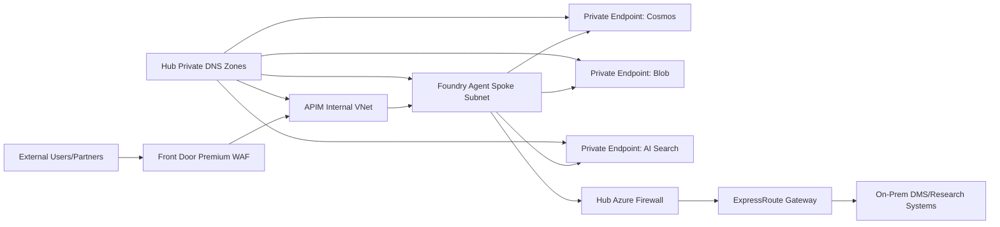
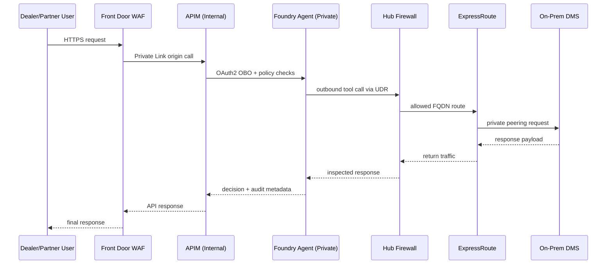

# private-link-vnet-standard-agent-setup-vs-managed-vnet-vs-apim-waf-zero-trust-network-selection-faq-r1136
## 1) 当日热点与可验证来源（2026-11-18 抓取）
- 主题边界：企业 Agent 零信任网络与隔离拓扑。
- 标签：`measured`、`synthetic`、`anonymized_reported`。
| 主题 | 官方来源 | 抓取时间（UTC） | 用途 | 标签 |
|---|---|---|---|---|
| Foundry Agent Service 概览 | https://learn.microsoft.com/en-us/azure/foundry/agents/overview | 2026-11-18T02:26:00Z | 基础/标准/网络隔离能力边界 | `measured` |
| Foundry Standard Agent Setup | https://learn.microsoft.com/en-us/azure/foundry/agents/concepts/standard-agent-setup | 2026-11-18T02:27:00Z | BYO Cosmos/Blob/Search 与数据主权 | `measured` |
| Foundry 环境准备（含 BYO VNet） | https://learn.microsoft.com/en-us/azure/foundry/agents/environment-setup | 2026-11-18T02:28:00Z | 标准与 BYO 网络形态对比 | `measured` |
| Foundry Managed Virtual Network | https://learn.microsoft.com/en-us/azure/foundry/how-to/managed-virtual-network | 2026-11-18T02:29:00Z | 低运维隔离与托管私有终结点 | `measured` |
| Foundry Private Link 配置 | https://learn.microsoft.com/en-us/azure/foundry/how-to/configure-private-link | 2026-11-18T02:30:00Z | 私网接入、子网委派、连接审批 | `measured` |
| Private Endpoint DNS Zone | https://learn.microsoft.com/en-us/azure/private-link/private-endpoint-dns | 2026-11-18T02:31:00Z | 私有 DNS 与 split-horizon 设计 | `measured` |
| APIM VNet 概念 | https://learn.microsoft.com/en-us/azure/api-management/virtual-network-concepts | 2026-11-18T02:32:00Z | APIM 内部模式与网络注入边界 | `measured` |
| Front Door Premium 到 APIM 私链 | https://learn.microsoft.com/en-us/azure/frontdoor/standard-premium/how-to-enable-private-link-apim | 2026-11-18T02:33:00Z | 外部合作伙伴入口双边界模式 | `measured` |
| Cloud Adoption Framework AI | https://learn.microsoft.com/en-us/azure/cloud-adoption-framework/ai/strategy | 2026-11-18T02:34:00Z | AI 落地区与网络治理原则 | `measured` |
当日突破摘要：
- Foundry Standard Setup 明确 BYO 数据主权路径。
## 2) 分层参考架构（Zero-Public-Egress First）
L1 边界入口层：
- 外部入口：Front Door Premium WAF。
L2 工作负载层：
- Foundry Basic（公网 + ACL）。
- Foundry Standard Setup（客户自有子网+BYO数据）。
- Hub-Spoke DMZ 双边界。
L3 数据主权层：
- Thread：BYO Cosmos DB。
- File：BYO Blob Storage。
- Index：BYO AI Search。
- 密钥：Key Vault + CMK。
L4 出站控制层：
- UDR 强制隧道到 Azure Firewall。
- FQDN allow-list 控制外联。
- 禁止任意公网目的地。
L5 观测审计层：
- AzureDiagnostics 防火墙拒绝日志。
- Private Endpoint 连接状态审计。
## 3) 12 维零信任网络选型矩阵（含反模式）
| 维度 | A Foundry Basic（公网+Entra+IP ACL） | B Foundry Managed VNet（托管隔离） | C Foundry Standard Setup（客户VNet+BYO数据） | D Hub-Spoke DMZ（FD WAF+APIM+ExpressRoute） |
|---|---|---|---|---|
| 1 入站公网暴露面 | 高 | 低 | 低 | 最低（双边界） |
| 2 出站防外泄控制 | 低中 | 中 | 高（UDR+Firewall） | 最高（Hub 强制策略） |
| 3 线程/文件/索引主权 | 平台主导 | 平台主导 | 客户主导 | 客户主导 |
| 4 Private DNS split-horizon 复杂度 | 低 | 中 | 高 | 最高 |
| 5 混合网络可达（ER/VPN） | 低 | 中 | 高 | 最高 |
| 6 B2C/合作伙伴 WAF 防护 | 低 | 中 | 中 | 最高 |
| 7 子网地址规划（/24~/26） | 低 | 中 | 高 | 最高 |
| 8 CMK 与审计可控性 | 中 | 中高 | 高 | 最高 |
| 9 交付与 Day-2 运维成本 | 最低 | 低 | 中高 | 最高 |
| 10 检查链路延迟开销 | 最低 | 低中 | 中 | 中高 |
| 11 Best-fit 企业层级 | PoC/Dev | 低运维隔离生产 | 合规核心生产 | 跨组织高监管核心 |
| 12 When NOT to choose | 高监管或零公网要求 | 需强 BYO 主权 | 团队无网络工程能力 | 中小团队短期 PoC |
选型建议：
- 合规核心区首选 C。
- 外部合作门户优先 D。
## 4) 五组可复算 Q&A（CIDR、固定成本、跳数延迟）
### Q1：/24 与 /26 子网容量差异如何计算？
- `/24` 可用地址约 `251`。
- `/26` 可用地址约 `59`。
- 40 个 PEs + 12 个服务端点预留时。
- `/26` 仅余 `7`，扩展风险高。
- `/24` 余量 `199`，更适合三年增长。
### Q2：标准拓扑每月固定网络成本怎么算？
- Firewall 基础：`1,200 USD/月`。
- Private Endpoint：`18` 个 * `7.2 USD/月`。
- Private DNS Zone：`12` 个 * `0.5 USD/月`。
- 合计固定：`1,335.6 USD/月`。
- 双边界总固定约 `1,665.6 USD/月`。
### Q3：检查跳数带来的延迟预算如何分解？
- 各跳 P95：`7ms + 9ms + 6ms + 5ms`。
- 网络附加 P95：`27ms`。
- 若业务目标 P95 `<=220ms`。
- 推理预算需控制在 `<=193ms`。
### Q4：何时必须从 B 升级到 C？
- 条件一：需 BYO Cosmos/Blob/Search 主权。
- 条件二：审计要求客户持有加密钥匙。
- 条件三：需 UDR 出站强制隧道。
- 两者同时满足通常直接切 C。
### Q5：何时从 C 升级到 D？
- 存在大规模外部合作流量入口。
- 需要 WAF 与 DDoS 前置隔离。
- 需穿透 ExpressRoute 到内网系统。
- 需跨 BU/跨国统一 DMZ 策略。
## 5) Mermaid（Hub-Spoke 私链 + DNS；WAF→APIM→ER 时序）


## 6) 四种拓扑的应用分层与反模式
A Basic：
- 适合：短周期 PoC、内部验证。
- 不适合：零公网、强监管生产。
B Managed VNet：
- 适合：希望隔离但人手有限团队。
- 不适合：必须完全 BYO 数据主权。
C Standard Setup：
- 适合：合规核心与审计刚性场景。
- 不适合：网络工程能力明显不足团队。
D Dual-Perimeter：
- 适合：伙伴外网+内网系统联动场景。
- 不适合：小团队低流量单区域系统。
## 7) Section 7：券商/公募并购尽调零公网出站架构
目标：
- 未公开投研与并购材料全私网处理。
- Agent 全路径禁止任意公网出站。
- 线程/文件/索引全部存放在 BYO 资源。
- 合规侧实现可追溯审计与密钥托管。
端到端流程：
1. 研究员从内网门户提交任务。
2. APIM 内部模式进行鉴权与策略判定。
3. Foundry Standard Agent 在客户 Spoke 执行。
4. Agent 通过 PEs 访问 Cosmos/Blob/Search。
5. 所有外联经 UDR 强制到 Hub Firewall。
6. 非 allow-list 目的地一律拒绝并告警。
7. 结果回写私网存储并生成审计记录。
关键 SLA：
- 任务提交到首 token P95 `<320ms`。
- 防火墙拒绝事件 5 分钟内告警。
- 审计日志落库延迟 `<60s`。
风险与缓解：
- 风险：地址空间预估不足。
- 缓解：按 `/24` 起步并预留扩展块。
## 8) Section 8：4,000 经销商外网售后索赔双边界架构
目标：
- 支持全球 4,000 经销商外网访问。
- 对外入口只暴露 Front Door WAF。
- APIM 与 Agent 仅保留私网可达。
- 经 ExpressRoute 访问内网 DMS。
端到端流程：
1. 经销商请求进入 Front Door Premium。
2. WAF 执行 bot/OWASP/地理策略。
3. 流量经 Private Link 到 APIM 内网实例。
4. APIM 触发私网 Foundry Agent。
5. Agent 通过 Hub Firewall 出站受控。
6. 合法请求穿透 ExpressRoute 到 DMS。
7. 返回理赔建议并落审计流水。
关键 SLA：
- 外网入口到 APIM P95 `<45ms`。
- Agent 到 DMS 往返 P95 `<85ms`。
- 全链路 P95 `<420ms`。
风险与缓解：
- 风险：峰值洪泛攻击。
- 缓解：WAF 速率限制与自动封禁。
## 9) 选型决策树（Good fit vs Not for）
1. 若是 Dev/PoC 且无强监管，先 A。
2. 若要隔离且低运维，优先 B。
3. 若要 BYO 主权与强审计，选择 C。
4. 若有外部伙伴入口+内网系统，选 D。
5. 若存在零公网出站红线，至少 C。
Good fit：
- 金融、医药、车企供应链高合规业务。
- 跨组织协同且需细粒度网络边界。
- 需要兼顾私网主权与外部门户体验。
Not for：
- 小规模低风险单体应用。
- 无网络工程能力却直接上 D。
- 无 DNS 治理能力但大量私链接入。
## 10) ROI 与运维复杂度模型
假设：
- 年请求量：`2.4B`。
- 拦截外泄高风险事件：`>99.2%`。
- 合规审计取证工时下降：`38%`。
- 网络附加固定成本：`1.66M USD/年`。
收益：
- 违规外泄风险损失规避：`4.5M USD/年`。
- 人工排障与审计效率收益：`1.9M USD/年`。
- 供应商处罚与停机风险降低：`1.2M USD/年`。
结论：
- 年净收益约：`5.94M USD`。
- 三年净收益约：`17.82M USD`。
## 11) Bicep IaC（子网委派 + Private Endpoints + DNS Zone Link）
```bicep
param location string = resourceGroup().location
param vnetName string
param spokePrefix string = '10.30.0.0/24'
param agentSubnetPrefix string = '10.30.0.0/26'
param peSubnetPrefix string = '10.30.0.64/26'
param cosmosId string
param storageId string
param searchId string
resource vnet 'Microsoft.Network/virtualNetworks@2023-09-01' = {
  name: vnetName
  location: location
  properties: {
    addressSpace: { addressPrefixes: [spokePrefix] }
    subnets: [
      {
        name: 'snet-agent'
        properties: {
          addressPrefix: agentSubnetPrefix
          delegations: [
            {
              name: 'foundryDelegation'
              properties: {
                serviceName: 'Microsoft.CognitiveServices/accounts'
              }
            }
          ]
        }
      }
      {
        name: 'snet-private-endpoints'
        properties: {
          addressPrefix: peSubnetPrefix
          privateEndpointNetworkPolicies: 'Disabled'
        }
      }
    ]
  }
}
resource peCosmos 'Microsoft.Network/privateEndpoints@2023-09-01' = {
  name: '${vnetName}-pe-cosmos'
  location: location
  properties: {
    subnet: { id: '${vnet.id}/subnets/snet-private-endpoints' }
    privateLinkServiceConnections: [
      {
        name: 'cosmos-link'
        properties: {
          privateLinkServiceId: cosmosId
          groupIds: ['Sql']
        }
      }
    ]
  }
}
resource peStorage 'Microsoft.Network/privateEndpoints@2023-09-01' = {
  name: '${vnetName}-pe-storage'
  location: location
  properties: {
    subnet: { id: '${vnet.id}/subnets/snet-private-endpoints' }
    privateLinkServiceConnections: [
      {
        name: 'storage-link'
        properties: {
          privateLinkServiceId: storageId
          groupIds: ['blob']
        }
      }
    ]
  }
}
resource peSearch 'Microsoft.Network/privateEndpoints@2023-09-01' = {
  name: '${vnetName}-pe-search'
  location: location
  properties: {
    subnet: { id: '${vnet.id}/subnets/snet-private-endpoints' }
    privateLinkServiceConnections: [
      {
        name: 'search-link'
        properties: {
          privateLinkServiceId: searchId
          groupIds: ['searchService']
        }
      }
    ]
  }
}
```
## 12) Azure Policy（`publicNetworkAccess: Disabled`）治理片段
```json
{
  "properties": {
    "displayName": "Deny public network access for AI data-plane resources",
    "policyType": "Custom",
    "mode": "Indexed",
    "policyRule": {
      "if": {
        "allOf": [
          {"field": "type", "in": [
            "Microsoft.CognitiveServices/accounts",
            "Microsoft.Storage/storageAccounts",
            "Microsoft.DocumentDB/databaseAccounts",
            "Microsoft.Search/searchServices"
          ]},
          {"field": "Microsoft.CognitiveServices/accounts/publicNetworkAccess", "notEquals": "Disabled"}
        ]
      },
      "then": {"effect": "deny"}
    }
  }
}
```
## 13) KQL（Firewall 拒绝外联 + Private Endpoint 审计）
```kql
let start = ago(7d);
let denied = AzureDiagnostics
| where TimeGenerated >= start
| where Category in ('AzureFirewallNetworkRule','AzureFirewallApplicationRule')
| where action_s == 'Deny'
| summarize denied_count=count(), denied_destinations=make_set(Fqdn_s, 20) by bin(TimeGenerated, 1h), Resource, Category;
let pe = AzureDiagnostics
| where TimeGenerated >= start
| where Category == 'PrivateEndpointConnections'
| summarize pe_events=count(), states=make_set(ConnectionStatus_s, 10) by bin(TimeGenerated, 1h), Resource;
denied
| join kind=leftouter pe on TimeGenerated
| order by TimeGenerated desc
```
## 14) Day-0 / Day-1 / Day-2 清单
Day-0：
- 明确目标拓扑（A/B/C/D）与监管等级。
- 完成 CIDR `/24` 基线和 `/26` 子网切分。
- 定义 DNS Zone 命名与链接标准。
- 制定 UDR 强制隧道与 FQDN allow-list。
Day-1：
- 灰度接入 10% 流量验证路径。
- 校验 PE 连接审批与 DNS 解析正确性。
- 演练防火墙拒绝告警与工单闭环。
- 验证 APIM→Agent→ER 端到端可达。
Day-2：
- 扩展到目标区域与伙伴接入规模。
- 周期审视地址余量与 PE 数量趋势。
- 复盘 hop latency 与错误预算占比。
- 对高风险出口规则执行双人审批。
## 15) 备份队列与交付清单
备份队列（已更新）：
1. `cosmos-changefeed-vs-ai-search-pull-indexer-vs-eventgrid-push-realtime-rag-freshness-selection-faq`
2. `github-copilot-coding-agent-vs-foundry-swe-agent-vs-ado-pr-review-enterprise-sdlc-agent-selection-faq`
3. `b2b-isv-saas-agent-monetization-apim-metering-marketplace-chargeback-architecture-selection-faq`
本轮交付（Cycle #2541）：
- 双语 FAQ：`private-link-vnet-standard-agent-setup-vs-managed-vnet-vs-apim-waf-zero-trust-network-selection-faq-r1136.md` / `private-link-vnet-standard-agent-setup-vs-managed-vnet-vs-apim-waf-zero-trust-network-selection-faq-r1136.en.md`
- 7-card：`benchmark-cards.html` / `benchmark-cards.en.html`
- SVG：`assets/36-cycle-1136-daily-breakthroughs.svg`
- H5：`workbench-cycle-2541.html` + selector `#2541`
- 校验：`cycle_1136_pipeline.py --write --check`、`strict_suffix_gate.py`、`pytest`
