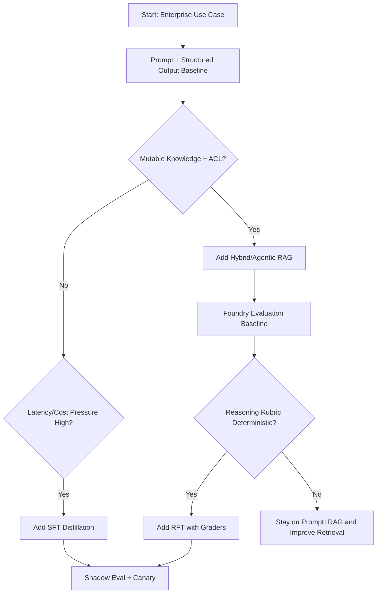
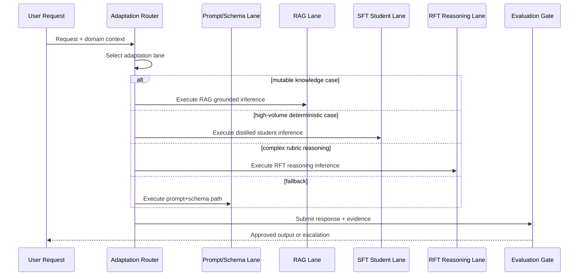

# Prompt+Structured Output vs RAG vs SFT vs RFT: Enterprise Model Customization and Domain Adaptation Selection FAQ (Round 1121 / Cycle 2526)

## 1) Executive summary and daily capability radar (2026-11-18)
- This round compares enterprise domain-adaptation approaches for agent systems and explains when to stop at prompt/RAG versus when to invest in fine-tuning.
- Most important enterprise rule: **never use fine-tuning to memorize mutable business facts** such as changing prices, policy bulletins, inventory, or eligibility lists.
- Option A (`Prompt Engineering + Structured Outputs + Prompt Caching`) is fastest for deterministic response format and low-friction rollout.
- Option B (`Hybrid/Agentic RAG`) is default for mutable knowledge with ACL-sensitive retrieval and citation requirements.
- Option C (`SFT + Distillation`) is strongest when the goal is latency/cost optimization and consistent style on relatively stable task distributions.
- Option D (`RFT with deterministic graders`) is highest-value for verifiable multi-step reasoning where reward signals can be objectively computed.
- Recommended decision ladder:
  1. start with prompt + schema controls,
  2. add RAG for freshness and permissioned grounding,
  3. establish Foundry evaluation baseline,
  4. add SFT for cost/latency distillation,
  5. add RFT for reasoning quality where deterministic graders exist.
- Capability radar captured at 2026-11-18 00:49 BJT:
  - structured-output enforcement and schema validation patterns.
  - enterprise grounding and semantic ranker retrieval composition.
  - compact-model distillation for high-volume serving economics.
  - RFT workflows with deterministic grading contracts for reasoning.
- Evidence labels:
  - measured: reproducible evaluation artifacts in repo evidence.
  - synthetic: deterministic planning and cost models.
  - anonymized_reported: de-identified operational metrics.

## 2) Decision framing: choose by failure mode, not by hype
- Enterprise teams often choose customization approach based on popularity rather than failure mode.
- Correct framing begins with dominant failure class:
  1. formatting instability -> strengthen structured output and schema constraints.
  2. stale facts or ACL leakage risk -> prioritize RAG and retrieval governance.
  3. high serving cost and latency at scale -> evaluate distillation and SFT.
  4. weak multi-step reasoning under explicit rubric -> evaluate RFT.
- Selection should score:
  - knowledge freshness requirements,
  - permissioning and citation obligations,
  - latency/cost targets,
  - model-upgrade maintainability,
  - data preparation burden and governance overhead.
- Anti-pattern warning: applying SFT to encode volatile policy catalogs creates hidden staleness debt and brittle migrations.

## 3) End-to-end reference architecture: adaptation control plane
- Ingress and orchestration:
  - request classifier routes workload to prompt-only, RAG-assisted, distilled model, or RFT-optimized reasoning lane.
- Shared policy controls:
  - schema validator for output determinism.
  - ACL-aware retrieval gateway for domain documents.
  - evaluation service with offline and shadow-online benchmarks.
- Training and adaptation loops:
  - SFT pipeline ingests curated high-quality traces for style/latency optimization.
  - RFT pipeline ingests deterministic grader signals for reasoning reward optimization.
- Runtime governance:
  - inference route decision logged with model version, prompt version, retrieval evidence IDs, and evaluator score.
  - fallback policy can route to safer higher-capability lane when confidence falls below threshold.

## 4) 12-dimension enterprise adaptation selection matrix
| Dimension | Prompt + Structured Output + Caching | Hybrid/Agentic RAG | SFT + Distillation | RFT + Deterministic Graders |
|---|---|---|---|---|
| Knowledge freshness and update latency | Medium (manual prompt refresh) | Strong (index refresh path) | Weak-medium for mutable facts | Weak-medium for mutable facts |
| ACL/row-level permission enforcement | Medium via app logic | Strong retrieval-time controls | Medium depends on serving context | Medium depends on serving context |
| Citation and auditability | Medium | Strong with source references | Medium unless paired with RAG | Medium unless paired with RAG |
| Complex domain reasoning lift | Medium | Medium-strong | Medium | Strong when reward signal quality is high |
| Output format/style determinism | Strong with schema constraints | Strong if schema retained | Strong after training | Medium-strong unless constrained |
| Labeled training data requirement | Low | Low-medium (curation) | High | High + grader design |
| Upfront engineering/training cost | Low | Medium | Medium-high | High |
| Production inference latency P95 | Low-medium | Medium (retrieval overhead) | Low with compact student | Medium |
| High-volume unit token TCO | Medium | Medium | Strong at scale | Medium |
| Model-upgrade migration burden | Low-medium | Medium | Medium-high retraining cycle | High reward and grader retuning |
| Best-fit scenario | Fast deterministic API assistants | Mutable knowledge enterprise copilots | Massive traffic cost/latency optimization | Verifiable multi-step reasoning tasks |
| When NOT to choose | Not for complex evolving knowledge reasoning alone | Not for pure style compression-only goals | Never for memorizing fast-changing facts | Not when deterministic graders are unavailable |

## 5) Quantitative model and decision formulas
### Q1: freshness-risk score
- Formula: `FreshnessRisk = FactChangeRate * StalenessWindow / RefreshAutomationLevel`.
- Example prompt-only lane: `0.72 * 6 / 1.8 = 2.40`.
- Example RAG lane: `0.72 * 1.5 / 3.2 = 0.34`.
- Interpretation: mutable policy domains should default to RAG grounding.

### Q2: adaptation ROI score
- Formula: `AdaptationROI = (QualityGain * TrafficVolume) / (TrainingCost + OpsCost)`.
- SFT example: `(0.11 * 120M)/(340k + 80k)=31.43`.
- RFT example: `(0.16 * 25M)/(510k + 140k)=6.15`.
- Decision implication: RFT should target high-value reasoning workloads rather than all traffic.

### Q3: citation integrity rate
- Formula: `CitationIntegrity = ValidCitedAnswers / TotalCitedAnswers`.
- Example RAG lane: `186,200/190,000 = 98.0%`.
- Target recommendation: maintain >97% for regulated decision-support outputs.

### Q4: cost-per-accepted-outcome
- Formula: `CPAO = TotalInferenceCost / AcceptedOutcomes`.
- Frontier baseline example: `$420,000/2,050,000 = $0.205`.
- Distilled student example: `$98,000/1,940,000 = $0.051`.
- Distillation implication: >75% unit cost reduction is realistic at scale when quality is preserved.

### Q5: reasoning-grader alignment
- Formula: `Alignment = DeterministicPasses / HumanValidatedPasses`.
- Example: `43,200/45,000 = 96.0%`.
- RFT prerequisite: if alignment <92%, improve grader quality before further reward tuning.

## 6) Mermaid: domain adaptation decision ladder

- Ladder principle: each step must be justified by measured failure mode and ROI.
- Ladder principle: RAG and tuning are complementary, not mutually exclusive.

## 7) Scenario A: hospital inpatient ICD-10/DRG coding and reimbursement audit copilot
- Scenario objective: improve coding consistency and reimbursement audit readiness in complex multi-comorbidity inpatient cases.
- Architecture pattern:
  - Hybrid RAG retrieves up-to-date regional DRG/CHS-DRG grouping rules and policy circulars.
  - reasoning lane uses RFT-tuned model trained with deterministic rule/F1 graders.
  - coder workbench presents side-by-side evidence with claimable rationale and source links.
- Deterministic grading design:
  - graders verify code selection constraints, grouping-rule consistency, and contradiction flags.
  - evaluation includes edge cases on overlapping comorbidity and exclusion logic.
- Operational controls:
  - every recommendation includes cited policy paragraph IDs.
  - low-confidence cases route to human coder review queue with structured rationale fields.
  - audit export includes versioned policy snapshot and model/grader versions.
- KPI stack:
  - coding F1 uplift on complex cases.
  - reimbursement dispute reduction rate.
  - reviewer override ratio by diagnosis category.
  - average turnaround time per inpatient record.

## 8) Scenario B: e-commerce 100M-RPD catalog attribute extraction and query rewrite distillation
- Scenario objective: reduce high-volume serving cost while preserving multilingual quality for catalog normalization and search rewrite.
- Pipeline pattern:
  - frontier teacher (`gpt-4.1`) generates and judges synthetic golden dataset.
  - SFT distills behavior into compact student model on Azure OpenAI PTU.
  - shadow evaluation continuously compares teacher/student drift on production slices.
- Performance targets:
  - student P95 inference latency <220ms.
  - unit cost reduction >75%.
  - acceptance-quality gap within predefined tolerance.
- Governance controls:
  - synthetic data generation filters sensitive and low-confidence examples.
  - multilingual quality stratified by language family and product category.
  - rollback gate triggers if drift exceeds threshold bands.
- Business outcomes:
  - sustainable cost profile at 100M+ requests/day.
  - stable rewrite quality under seasonal catalog shifts.
  - faster release cadence with measurable canary safety.

## 9) Mermaid sequence: adaptation route and evaluation gate

- Sequence guarantee: lane selection is explicit and auditable.
- Sequence guarantee: evaluation gate can block low-confidence or non-compliant outputs.

## 10) Production Bicep sample (adaptation control plane)
```bicep
param location string = resourceGroup().location
param envName string = 'agent-adaptation-prod'
param logWorkspaceId string

resource apim 'Microsoft.ApiManagement/service@2023-09-01-preview' = {
  name: '${envName}-apim'
  location: location
  sku: {
    name: 'Premium'
    capacity: 2
  }
  properties: {
    publisherEmail: 'adaptation-platform@contoso.com'
    publisherName: 'Contoso Adaptation Platform'
    publicNetworkAccess: 'Enabled'
  }
}

resource aiSearch 'Microsoft.Search/searchServices@2024-03-01-preview' = {
  name: '${envName}-search'
  location: location
  sku: {
    name: 'standard'
  }
  properties: {
    semanticSearch: 'standard'
    disableLocalAuth: true
  }
}

resource appi 'Microsoft.Insights/components@2020-02-02' = {
  name: '${envName}-appi'
  location: location
  kind: 'web'
  properties: {
    Application_Type: 'web'
    WorkspaceResourceId: logWorkspaceId
  }
}
```

## 11) Runtime policy snippets (adaptation route enforcement)
```yaml
apiVersion: v1
kind: ConfigMap
metadata:
  name: adaptation-routing-policy
data:
  default_lane: "prompt-structured"
  mutable_facts_lane: "rag-grounded"
  high_volume_lane: "sft-student"
  complex_reasoning_lane: "rft-reasoner"
  mutable_fact_finetune_allowed: "false"
  mandatory_citation_for_regulated: "true"
```

```xml
<policies>
  <inbound>
    <base />
    <set-variable name="adaptationHint" value="@(context.Request.Headers.GetValueOrDefault(&quot;x-adaptation-hint&quot;,&quot;prompt&quot;))" />
    <choose>
      <when condition="@(context.Variables.GetValueOrDefault<string>(&quot;adaptationHint&quot;) == &quot;mutable-knowledge&quot;)">
        <set-backend-service base-url="https://rag-lane.internal" />
      </when>
      <when condition="@(context.Variables.GetValueOrDefault<string>(&quot;adaptationHint&quot;) == &quot;high-volume&quot;)">
        <set-backend-service base-url="https://sft-lane.internal" />
      </when>
      <when condition="@(context.Variables.GetValueOrDefault<string>(&quot;adaptationHint&quot;) == &quot;complex-reasoning&quot;)">
        <set-backend-service base-url="https://rft-lane.internal" />
      </when>
      <otherwise>
        <set-backend-service base-url="https://prompt-lane.internal" />
      </otherwise>
    </choose>
  </inbound>
</policies>
```

## 12) KQL observability and adaptation quality queries
```kql
// Lane-level quality and latency
customEvents
| where timestamp > ago(7d)
| where name == "AdaptationInferenceResult"
| extend lane = tostring(customDimensions.lane)
| extend accepted = tostring(customDimensions.accepted)
| summarize p95Latency=percentile(todouble(customDimensions.latencyMs),95), acceptanceRate=countif(accepted=="true")*1.0/count() by lane
```

```kql
// Citation integrity and mutable-fact incidents
customEvents
| where timestamp > ago(30d)
| where name in ("CitationCheck","MutableFactViolation")
| summarize total=count() by name, tostring(customDimensions.lane), tostring(customDimensions.result)
```

```kql
// Cost efficiency by adaptation lane
customEvents
| where timestamp > ago(30d)
| where name == "AdaptationCostLedger"
| extend lane = tostring(customDimensions.lane)
| extend cost = todouble(customDimensions.totalCostUsd)
| extend outcomes = todouble(customDimensions.acceptedOutcomes)
| summarize totalCost=sum(cost), totalOutcomes=sum(outcomes), cpao=sum(cost)/sum(outcomes) by lane
```

## 13) Named 4-option weighted decision matrix
| Option | Freshness & ACL Fit (20%) | Determinism (15%) | Reasoning Lift (15%) | Cost/Latency at Scale (20%) | Engineering Complexity (10%) | Auditability (10%) | Upgrade Burden (10%) | Weighted Score |
|---|---:|---:|---:|---:|---:|---:|---:|---:|
| A. Prompt+Structured Output | 7.2 | 9.3 | 7.0 | 7.8 | 9.0 | 7.6 | 8.8 | 7.99 |
| B. Hybrid/Agentic RAG | 9.4 | 8.6 | 8.2 | 7.4 | 7.3 | 9.1 | 7.9 | 8.36 |
| C. SFT Distillation | 6.8 | 8.8 | 7.9 | 9.3 | 6.8 | 7.5 | 6.9 | 7.93 |
| D. RFT with Graders | 6.9 | 8.1 | 9.5 | 7.0 | 5.9 | 8.4 | 5.8 | 7.47 |
- Interpretation:
  - use B as default for mutable knowledge and compliance-sensitive enterprise copilots.
  - use C for high-volume cost/latency optimization after baseline quality is proven.
  - use D for high-value reasoning tasks with deterministic grading infrastructure.
  - keep A as baseline fallback and rapid control path for deterministic output APIs.

## 14) Day-0 and Day-2 checklist
### Day-0 launch checklist (10 distinct items)
1. Define adaptation-lane routing taxonomy and explicit trigger rules.
2. Enforce “no fine-tuning for mutable facts” policy in architecture review checklist.
3. Deploy structured-output schema validators across all lanes.
4. Configure RAG retrieval ACL and citation payload contracts.
5. Build Foundry evaluation baseline with offline golden and red-team cases.
6. Set SFT/RFT eligibility criteria tied to measurable failure classes.
7. Implement lane-level observability and cost ledger dimensions.
8. Create rollback policy for adaptation-lane drift incidents.
9. Validate canary release and shadow evaluation path.
10. Publish governance runbook for model and retrieval index updates.

### Day-2 optimization checklist (10 distinct items)
1. Rebalance lane traffic based on acceptance, latency, and CPAO trends.
2. Expand retrieval corpus freshness pipeline and stale-document alerts.
3. Refine schema validators for newly observed output failure classes.
4. Improve synthetic data quality filters for SFT distillation.
5. Tune deterministic graders for RFT alignment drift.
6. Re-evaluate citation integrity by domain and jurisdiction.
7. Recalculate student-vs-teacher shadow gap and update canary thresholds.
8. Audit model-upgrade migration cost and retraining cadence.
9. Validate ACL correctness under role and row-level entitlement changes.
10. Quarterly review adaptation strategy against product and compliance changes.

## 15) Final recommendation, anti-patterns, and migration strategy
- Recommended strategy:
  - baseline with prompt + schema controls,
  - add RAG for mutable and permissioned enterprise knowledge,
  - add SFT for high-volume cost/latency distillation use cases,
  - add RFT only where deterministic grading can be trusted.
- Explicit anti-patterns:
  - fine-tuning models to memorize changing business facts.
  - deploying RFT without high-quality deterministic grader design.
  - using SFT as a substitute for retrieval governance and ACL controls.
  - evaluating adaptation success only by offline benchmark scores.
- Migration path:
  1. launch with prompt+RAG and strict observability.
  2. establish evaluation baseline and policy thresholds.
  3. distill to compact student for high-volume lanes.
  4. introduce RFT selectively for reasoning-critical workflows.
- Bottom line:
  - enterprise adaptation succeeds when freshness, permissions, auditability, and economics are co-designed, not optimized in isolation.
