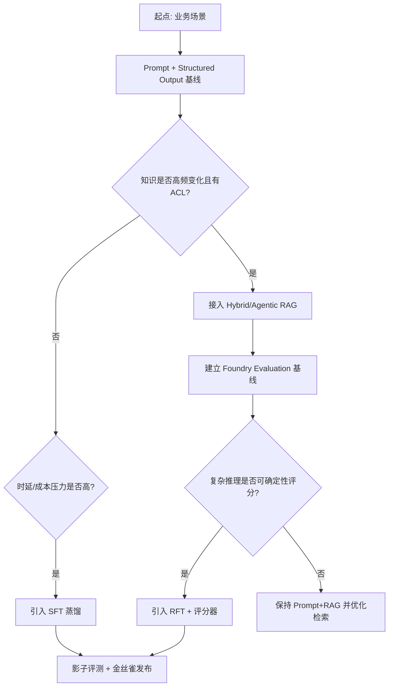
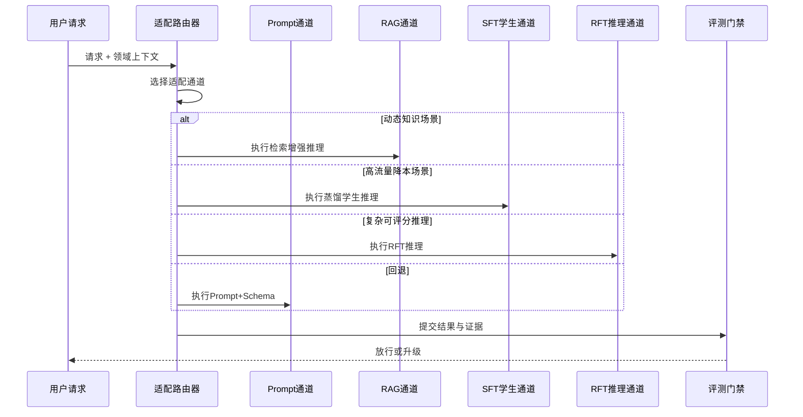

# Prompt+Structured Output vs RAG vs SFT vs RFT：企业模型定制与领域适配选型 FAQ（Round 1121 / Cycle 2526）

## 1) 执行摘要与当日能力雷达（2026-11-18）
- 本轮比较企业 Agent 的主流领域适配路径，重点回答“什么时候只做 Prompt/RAG，什么时候再引入微调”。
- 最关键企业原则：**不要用微调去记忆会频繁变化的业务事实**（价格、政策、库存、资格清单等）。
- 方案 A（`Prompt 工程 + 结构化输出 + Prompt 缓存`）最适合快速上线与输出格式稳定性控制。
- 方案 B（`企业 Hybrid/Agentic RAG`）最适合可变知识、权限裁剪与可追溯引用场景。
- 方案 C（`SFT 蒸馏`）最适合高并发场景下的时延/成本优化与风格一致性收敛。
- 方案 D（`RFT + 确定性评分器`）最适合可定义客观评分函数的多步复杂推理任务。
- 建议决策阶梯：
  1. 先做 Prompt+Schema；
  2. 再做 RAG 新鲜度与 ACL；
  3. 建立 Foundry Evaluation 基线；
  4. 再做 SFT 蒸馏；
  5. 最后对可评分复杂推理引入 RFT。
- 当日能力雷达（抓取时间：2026-11-18 00:49 BJT）关注：
  - 结构化输出约束与 schema 校验链；
  - 检索增强与语义重排在企业知识场景的组合；
  - 紧凑学生模型在高流量下的成本收益；
  - 确定性评分器驱动的推理强化训练闭环。
- 数据标签：
  - measured：仓内可复现评测结果；
  - synthetic：公式化规划和成本估算；
  - anonymized_reported：去标识化生产观测。

## 2) 决策建模：按失败模式选适配路径
- 很多团队按“技术热点”而不是“失败模式”做选型，导致投入错位。
- 推荐先识别主失败类：
  1. 输出格式不稳定 -> 加强 Structured Output 与 schema 验证；
  2. 知识过期或越权风险 -> 优先 RAG + ACL 检索；
  3. 高流量成本/时延压力 -> 引入 SFT 蒸馏；
  4. 多步推理质量不足 -> 引入 RFT（前提是评分器可靠）。
- 评估要素：
  - 知识更新频率；
  - 权限粒度与引用可审计性；
  - 成本和时延目标；
  - 升级迁移负担；
  - 标注/训练数据准备成本。
- 反模式警示：用 SFT 去固化动态业务事实会形成隐性陈旧债务。

## 3) 端到端参考架构：适配控制平面
- 入口与编排：
  - 请求分类器将流量路由到 Prompt、RAG、SFT 学生模型、RFT 推理模型通道。
- 共享控制：
  - 输出 schema 验证器保证结构稳定；
  - ACL 检索网关保证权限边界；
  - 评测服务统一离线+线上影子对比。
- 训练与迭代：
  - SFT 管道使用高质量样本收敛风格并降低推理成本；
  - RFT 管道使用确定性评分器提升复杂推理正确率。
- 运行治理：
  - 记录模型版本、Prompt 版本、检索证据 ID、评测分数；
  - 低置信场景自动回退到更安全通道。

## 4) 12 维企业领域适配选型矩阵
| 维度 | Prompt+Structured Output | Hybrid/Agentic RAG | SFT 蒸馏 | RFT + 确定性评分器 |
|---|---|---|---|---|
| 知识新鲜度与更新时延 | 中 | 强 | 弱中（对动态事实不友好） | 弱中（对动态事实不友好） |
| ACL/行级权限执行 | 中（应用层补足） | 强（检索层裁剪） | 中 | 中 |
| 引用与审计可追溯 | 中 | 强 | 中（需配 RAG） | 中（需配 RAG） |
| 复杂领域推理提升 | 中 | 中强 | 中 | 强（评分器质量高时） |
| 输出格式确定性 | 强 | 强（配 schema） | 强 | 中强 |
| 标注训练数据需求 | 低 | 低中 | 高 | 高且需评分器工程 |
| 前置工程/训练成本 | 低 | 中 | 中高 | 高 |
| 线上推理 P95 | 低中 | 中（有检索开销） | 低（学生模型） | 中 |
| 高流量单位成本 | 中 | 中 | 强 | 中 |
| 模型升级迁移负担 | 低中 | 中 | 中高 | 高 |
| 最佳适配场景 | 快速稳定结构化接口 | 可变知识企业 Copilot | 高流量成本优化 | 可评分多步推理 |
| When NOT to choose | 复杂知识推理单独使用不宜 | 纯风格压缩目标不宜单用 | 动态事实记忆严禁 | 无可靠评分器时不宜 |

## 5) 量化模型与决策公式
### Q1：新鲜度风险分
- 公式：`FreshnessRisk = FactChangeRate * StalenessWindow / RefreshAutomationLevel`。
- Prompt-only 示例：`0.72*6/1.8=2.40`。
- RAG 示例：`0.72*1.5/3.2=0.34`。
- 结论：动态政策类业务应优先采用 RAG。

### Q2：适配 ROI 分
- 公式：`AdaptationROI = (QualityGain * TrafficVolume) / (TrainingCost + OpsCost)`。
- SFT 示例：`(0.11*120M)/(340k+80k)=31.43`。
- RFT 示例：`(0.16*25M)/(510k+140k)=6.15`。
- 含义：RFT 应聚焦高价值推理链路，而非全流量铺开。

### Q3：引用完整率
- 公式：`CitationIntegrity = ValidCitedAnswers / TotalCitedAnswers`。
- RAG 示例：`186,200/190,000=98.0%`。
- 建议：监管决策辅助场景应保持 >97%。

### Q4：单位可接受结果成本
- 公式：`CPAO = TotalInferenceCost / AcceptedOutcomes`。
- 前沿模型示例：`$420,000/2,050,000=$0.205`。
- 蒸馏学生示例：`$98,000/1,940,000=$0.051`。
- 结论：在质量可控前提下，蒸馏可实现 >75% 单位成本下降。

### Q5：推理评分器一致性
- 公式：`Alignment = DeterministicPasses / HumanValidatedPasses`。
- 示例：`43,200/45,000=96.0%`。
- 约束：若低于 92%，应先优化评分器再扩大 RFT。

## 6) Mermaid：企业领域适配决策阶梯

- 原则 A：每一步都必须由可量化失败模式驱动。
- 原则 B：RAG 与微调是互补关系，不是非此即彼。

## 7) 场景 A：医院住院病案 ICD-10/DRG 编码与医保质控助手
- 场景目标：提升复杂多并发症病例编码一致性与医保审核通过率。
- 架构设计：
  - Hybrid RAG 检索最新区域 DRG/CHS-DRG 分组规则；
  - RFT 推理模型基于确定性规则/F1 评分器优化复杂病例推断；
  - 编码员工作台并排展示建议编码、证据条款与解释链。
- 评分器设计：
  - 校验编码选择约束与分组规则一致性；
  - 对冲突并发症和排除逻辑做规则判定。
- 运行控制：
  - 每条建议必须附政策段落引用 ID；
  - 低置信病例自动进入人工编码复核队列；
  - 审计包记录政策版本、模型版本、评分器版本。
- 核心指标：
  - 复杂病例编码 F1 提升；
  - 医保争议率下降；
  - 人工覆盖率与改写率；
  - 单病例处理时长。

## 8) 场景 B：电商亿级日调属性标准化与查询改写蒸馏平台
- 场景目标：在 100M+ 请求/日规模下显著降本并保持多语种改写质量。
- 管道设计：
  - 前沿教师模型（`gpt-4.1`）生成并评判合成黄金样本；
  - SFT 蒸馏到紧凑学生模型并部署到 AOAI PTU；
  - 持续影子评测监控教师/学生漂移。
- 目标约束：
  - 学生模型 P95 < 220ms；
  - 单位成本下降 >75%；
  - 质量差距控制在阈值内。
- 治理控制：
  - 合成样本过滤敏感与低置信内容；
  - 多语种质量按语系与类目分层评测；
  - 漂移超阈值触发自动回滚。
- 业务收益：
  - 高流量场景可持续成本结构；
  - 促销季波动下改写质量稳定；
  - 在可验证指标下提升发布频率。

## 9) Mermaid：适配通道路由与评测门禁时序

- 保障 A：通道路由可追溯，可审计。
- 保障 B：低质量或不合规结果可被门禁阻断。

## 10) 生产级 Bicep 示例（领域适配控制面）
```bicep
param location string = resourceGroup().location
param envName string = 'agent-adaptation-prod'
param logWorkspaceId string

resource apim 'Microsoft.ApiManagement/service@2023-09-01-preview' = {
  name: '${envName}-apim'
  location: location
  sku: {
    name: 'Premium'
    capacity: 2
  }
  properties: {
    publisherEmail: 'adaptation-platform@contoso.com'
    publisherName: 'Contoso Adaptation Platform'
    publicNetworkAccess: 'Enabled'
  }
}

resource aiSearch 'Microsoft.Search/searchServices@2024-03-01-preview' = {
  name: '${envName}-search'
  location: location
  sku: {
    name: 'standard'
  }
  properties: {
    semanticSearch: 'standard'
    disableLocalAuth: true
  }
}

resource appi 'Microsoft.Insights/components@2020-02-02' = {
  name: '${envName}-appi'
  location: location
  kind: 'web'
  properties: {
    Application_Type: 'web'
    WorkspaceResourceId: logWorkspaceId
  }
}
```

## 11) 运行策略片段（适配通道约束）
```yaml
apiVersion: v1
kind: ConfigMap
metadata:
  name: adaptation-routing-policy
data:
  default_lane: "prompt-structured"
  mutable_facts_lane: "rag-grounded"
  high_volume_lane: "sft-student"
  complex_reasoning_lane: "rft-reasoner"
  mutable_fact_finetune_allowed: "false"
  mandatory_citation_for_regulated: "true"
```

```xml
<policies>
  <inbound>
    <base />
    <set-variable name="adaptationHint" value="@(context.Request.Headers.GetValueOrDefault(&quot;x-adaptation-hint&quot;,&quot;prompt&quot;))" />
    <choose>
      <when condition="@(context.Variables.GetValueOrDefault<string>(&quot;adaptationHint&quot;) == &quot;mutable-knowledge&quot;)">
        <set-backend-service base-url="https://rag-lane.internal" />
      </when>
      <when condition="@(context.Variables.GetValueOrDefault<string>(&quot;adaptationHint&quot;) == &quot;high-volume&quot;)">
        <set-backend-service base-url="https://sft-lane.internal" />
      </when>
      <when condition="@(context.Variables.GetValueOrDefault<string>(&quot;adaptationHint&quot;) == &quot;complex-reasoning&quot;)">
        <set-backend-service base-url="https://rft-lane.internal" />
      </when>
      <otherwise>
        <set-backend-service base-url="https://prompt-lane.internal" />
      </otherwise>
    </choose>
  </inbound>
</policies>
```

## 12) KQL 查询（适配质量与成本）
```kql
// 通道质量与时延
customEvents
| where timestamp > ago(7d)
| where name == "AdaptationInferenceResult"
| extend lane = tostring(customDimensions.lane)
| extend accepted = tostring(customDimensions.accepted)
| summarize p95Latency=percentile(todouble(customDimensions.latencyMs),95), acceptanceRate=countif(accepted=="true")*1.0/count() by lane
```

```kql
// 引用完整率与动态事实违规
customEvents
| where timestamp > ago(30d)
| where name in ("CitationCheck","MutableFactViolation")
| summarize total=count() by name, tostring(customDimensions.lane), tostring(customDimensions.result)
```

```kql
// 各通道单位可接受结果成本
customEvents
| where timestamp > ago(30d)
| where name == "AdaptationCostLedger"
| extend lane = tostring(customDimensions.lane)
| extend cost = todouble(customDimensions.totalCostUsd)
| extend outcomes = todouble(customDimensions.acceptedOutcomes)
| summarize totalCost=sum(cost), totalOutcomes=sum(outcomes), cpao=sum(cost)/sum(outcomes) by lane
```

## 13) 命名四选一加权评分矩阵
| 方案 | 新鲜度与ACL(20%) | 确定性(15%) | 推理提升(15%) | 规模成本时延(20%) | 工程复杂度(10%) | 审计可追溯(10%) | 升级负担(10%) | 加权总分 |
|---|---:|---:|---:|---:|---:|---:|---:|---:|
| A. Prompt+Structured Output | 7.2 | 9.3 | 7.0 | 7.8 | 9.0 | 7.6 | 8.8 | 7.99 |
| B. Hybrid/Agentic RAG | 9.4 | 8.6 | 8.2 | 7.4 | 7.3 | 9.1 | 7.9 | 8.36 |
| C. SFT 蒸馏 | 6.8 | 8.8 | 7.9 | 9.3 | 6.8 | 7.5 | 6.9 | 7.93 |
| D. RFT + 评分器 | 6.9 | 8.1 | 9.5 | 7.0 | 5.9 | 8.4 | 5.8 | 7.47 |
- 解读：
  - 动态知识与合规优先场景默认 B；
  - 高流量降本场景在质量达标后优先 C；
  - 可客观评分的复杂推理场景引入 D；
  - A 作为快速稳定基线路径持续保留。

## 14) Day-0 与 Day-2 清单
### Day-0 启动清单（10 项）
1. 定义适配通道路由规则与触发条件。
2. 在架构评审中固化“动态事实禁止微调记忆”策略。
3. 全通道启用结构化输出 schema 验证。
4. 配置 RAG ACL 与引用契约。
5. 建立 Foundry 评测基线（golden + red-team）。
6. 设定 SFT/RFT 准入条件与退出条件。
7. 打通通道级观测与成本账本维度。
8. 建立漂移回滚策略与自动门禁。
9. 启用金丝雀发布与影子评测链路。
10. 发布模型/索引更新治理 runbook。

### Day-2 运维清单（10 项）
1. 根据采纳率/时延/CPAO 动态调整通道路由比例。
2. 强化检索语料新鲜度与过期文档告警。
3. 扩展 schema 校验规则覆盖新失败类型。
4. 优化 SFT 合成样本质量过滤策略。
5. 调整 RFT 评分器以降低一致性漂移。
6. 按领域与辖区复核引用完整率。
7. 复盘教师/学生影子差距并调优阈值。
8. 核算模型升级后的重训与迁移成本。
9. 验证角色变化下 ACL 裁剪正确性。
10. 季度复盘适配策略与业务变化匹配度。

## 15) 结论、反模式与演进路径
- 推荐策略：
  - 先 Prompt+Schema；
  - 再 RAG 解决新鲜度与权限问题；
  - 再 SFT 做高流量降本；
  - 再 RFT 做可评分复杂推理提升。
- 反模式：
  - 用微调记忆动态业务事实；
  - 无高质量评分器就大规模上 RFT；
  - 用 SFT 替代检索治理与 ACL；
  - 仅凭离线分数判断生产成功。
- 演进路径：
  1. Prompt+RAG 建立稳态基线；
  2. 评测门禁建立可度量准入；
  3. 蒸馏学生模型承接高流量；
  4. 对关键推理链路按需引入 RFT。
- 总结：企业领域适配要把“新鲜度、权限、审计、经济性”协同设计，而非单点最优。
