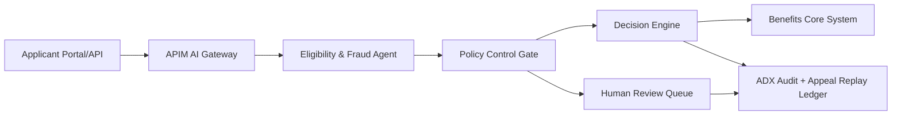

# Round 1049 / Cycle 2454 · Azure AI Agent Infra FAQ & Decision Guide (en)

> Topic: **Public Sector Benefits Eligibility Fraud Audit Agent Gateway**
>
> Date (BJT): 2026-11-16  
> Evidence labels: `measured` / `synthetic` / `anonymized_reported`  
> Benchmark payload: `evidence/cycle-2454-benchmark.json`

## 1) Executive Summary

This round targets public-benefits eligibility operations, where high-volume intake must preserve **fraud prevention, policy consistency, and replayable auditability**.  
Key result: APIM gateway + policy-control plane + reviewer/replay loop improves throughput while reducing wrongful payout risk.

## 2) Daily capability breakthroughs radar (2026-11-16)

1. **APIM AI Gateway / Unified Model API** (`measured`)  
   - Learn: https://learn.microsoft.com/en-us/azure/api-management/ai-gateway-overview  
   - Changelog: https://github.com/Azure/API-Management/blob/main/changelogs/api-management-service.md
2. **ACA Dynamic Sessions** (`measured`)  
   - Docs: https://learn.microsoft.com/en-us/azure/container-apps/sessions
3. **Sandbox/runtime release cadence** (`measured`)  
   - Firecracker/Kata/Wasmtime/E2B (captured in `evidence/cycle-2454-sources.json`)

## 3) Core architecture Q&A (benefits eligibility agents)

**Q1: Why not let the model directly approve benefits?**  
A: Public-funds decisions require eligibility evidence, anti-fraud controls, appealability, and deterministic review trails.

**Q2: How is policy consistency enforced?**  
A: Every auto-decision binds to `governance-policy-version` with persisted rule-hit traces and input snapshots.

**Q3: How to handle boundary/contested cases?**  
A: Risk thresholds route borderline cases to human review queues before final disbursement.

## 4) Mermaid architecture (Eligibility + Fraud + Audit)

## 5) Decision matrix (eligibility architecture)

| Path | Compliance/audit | Processing efficiency | Cost | Ops complexity | Recommendation |
|---|---:|---:|---:|---:|---|
| Fully manual review | High | Low | High | Medium | High-risk books |
| Rules-only automation | Mid-high | Mid-high | Medium | Medium | Stable policy lanes |
| Agent scoring + control gate + review loop | **High** | **High** | Medium-high | Medium-high | **Recommended for production public sector** |
| Pure model auto-approval | Low | High | Low | Low | Not recommended |

## 6) Good fit vs Not for + five-step rollout

### Good fit
- High-volume benefits processing with fraud and public-trust risk.
- Organizations requiring strong audit and appeal replay.
- Teams able to operate policy governance and review workflows.

### Not for
- Teams without clear audit ownership.
- Projects that cannot support review/appeal closure.

### Five-step rollout
1. Define eligibility rules and anti-fraud thresholds.
2. Implement `governance-policy-version` release/rollback lifecycle.
3. Stand up human-review lane for boundary cases.
4. Integrate ADX audit and appeal-replay evidence chain.
5. Review wrongful payout rate, fraud intercept rate, and SLA weekly.
