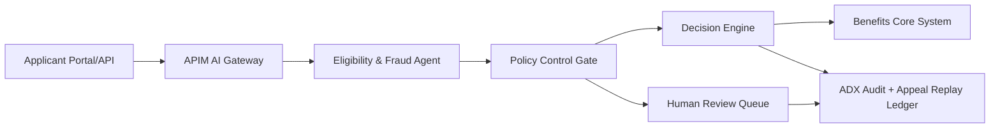

# Round 1049 / Cycle 2454 · Azure AI Agent Infra FAQ & 决策指南（zh-CN）

> Topic: **Public Sector Benefits Eligibility Fraud Audit Agent Gateway**
>
> Date (BJT): 2026-11-16  
> Evidence labels: `measured` / `synthetic` / `anonymized_reported`  
> Benchmark payload: `evidence/cycle-2454-benchmark.json`

## 1) Executive Summary

本轮聚焦政务福利资格审核：需要在高并发申领处理中实现 **防欺诈、资格一致性、审计可追溯**。  
核心结论：使用 APIM 网关 + 资格策略控制面 + 复核回放链，可在提升处理速度的同时降低误发放风险。

## 2) Daily capability breakthroughs radar（2026-11-16）

1. **APIM AI Gateway / Unified Model API**（`measured`）  
   - Learn: https://learn.microsoft.com/en-us/azure/api-management/ai-gateway-overview  
   - Changelog: https://github.com/Azure/API-Management/blob/main/changelogs/api-management-service.md
2. **ACA Dynamic Sessions**（`measured`）  
   - Docs: https://learn.microsoft.com/en-us/azure/container-apps/sessions
3. **Sandbox/runtime releases**（`measured`）  
   - Firecracker/Kata/Wasmtime/E2B（见 `evidence/cycle-2454-sources.json`）

## 3) Core architecture Q&A（福利审核 Agent）

**Q1: 为什么不能直接让 Agent 决定发放？**  
A: 福利发放涉及公共资金，必须满足资格证明链、反欺诈规则、可申诉与可复核要求。

**Q2: 如何确保资格规则执行一致？**  
A: 所有自动决策绑定 `governance-policy-version`，并保存规则命中证据与输入快照。

**Q3: 怎样处理边界样本与争议案件？**  
A: 通过风险阈值将边界样本路由到人工复核队列，防止高误判直接落账。

## 4) Mermaid architecture（Eligibility + Fraud + Audit）

## 5) Decision matrix（资格审核架构）

| 路径 | 合规与审计 | 处理效率 | 成本 | 运维复杂度 | 推荐 |
|---|---:|---:|---:|---:|---|
| 全人工审核 | 高 | 低 | 高 | 中 | 高风险场景 |
| 规则自动化 | 中高 | 中高 | 中 | 中 | 规则稳定场景 |
| Agent 评分 + 控制网关 + 复核 | **高** | **高** | 中高 | 中高 | **政务生产推荐** |
| 纯模型自动放行 | 低 | 高 | 低 | 低 | 不建议 |

## 6) Good fit vs Not for + 五步落地

### Good fit
- 大规模福利申领处理，欺诈风险与舆情风险高。  
- 需要审计追踪与申诉复盘能力。  
- 能承接策略治理与人工复核运营。

### Not for
- 无审计责任分工的轻量团队。  
- 无法处理复核/申诉闭环的项目。

### 五步落地
1. 明确资格规则与反欺诈阈值。  
2. 实施 `governance-policy-version` 发布/回滚治理。  
3. 建立边界样本人工复核通道。  
4. 打通 ADX 审计与申诉回放证据。  
5. 周期复盘误发放率、欺诈拦截率、处理 SLA。  
