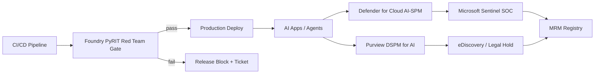
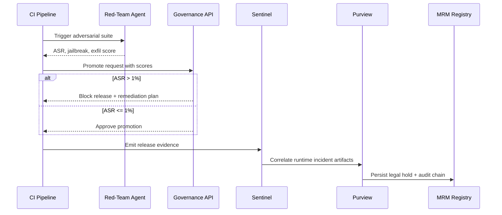

# purview-ai-compliance-vs-defender-for-cloud-ai-vs-custom-redteam-regulated-governance-selection-faq-r1131

## 1) Daily breakthroughs and verifiable sources (fetched 2026-11-18)
- Scope: CISO/CCO/SOC enterprise AI security posture, red-team release gates, runtime XDR hunting, and statutory evidence retention.
- Distinction: unlike r1113 request-level guardrails, this round targets **platform-wide governance and legal defensibility**.
- Labels: `measured` (officially verifiable), `synthetic` (formula-derived), `anonymized_reported` (de-identified replay).
| Topic | Official source | Fetched at (UTC) | Purpose | Label |
|---|---|---|---|---|
| Microsoft Purview AI Hub / DSPM for AI | https://learn.microsoft.com/purview/ai-overview | 2026-11-18T18:08:00Z | Shadow-AI and oversharing governance | `measured` |
| Purview eDiscovery / Legal Hold | https://learn.microsoft.com/purview/ediscovery | 2026-11-18T18:09:00Z | 7-year evidence hold strategy | `measured` |
| Defender for Cloud AI security posture | https://learn.microsoft.com/azure/defender-for-cloud/ai-security-posture | 2026-11-18T18:10:00Z | AI-SPM and runtime threat detection | `measured` |
| Microsoft Sentinel overview | https://learn.microsoft.com/azure/sentinel/overview | 2026-11-18T18:11:00Z | SOC fusion and automated response | `measured` |
| Azure AI Foundry red-teaming | https://learn.microsoft.com/azure/ai-foundry/concepts/red-teaming | 2026-11-18T18:12:00Z | PyRIT baseline and CI/CD gate design | `measured` |
| ISO/IEC 42001 overview | https://www.iso.org/standard/81230.html | 2026-11-18T18:13:00Z | AI management-system evidence framework | `measured` |
| EU AI Act portal | https://artificialintelligenceact.eu/ | 2026-11-18T18:14:00Z | High-risk system control mapping | `measured` |
| SR 11-7 guidance | https://www.federalreserve.gov/supervisionreg/srletters/sr1107.htm | 2026-11-18T18:15:00Z | Model risk governance expectations | `measured` |

Incremental findings:
- Risk discovery and compliance attestation are separate capability chains and must be owned separately.
- Red-team release gates belong pre-production, SOC/XDR controls belong runtime, evidence hold spans both.
- For regulated sectors, audit-chain architecture is as critical as model quality optimization.

## 2) Layered reference architecture (security and compliance twin-track)
L1 Business interaction:
- Covers SaaS Copilots, Foundry agents, AKS custom agents, and third-party AI integrations.
- Every interaction carries `business_unit`, `data_classification`, `model_version`, and `risk_tier`.

L2 Risk-control layer:
- Pre-release: Foundry/PyRIT adversarial simulation with ASR promotion gate.
- Runtime: Defender for Cloud AI alerts routed to Sentinel playbooks.
- Governance: Purview DSPM for AI detects shadow AI and oversharing assets.

L3 Compliance and evidence:
- Purview eDiscovery + Legal Hold + immutable retention.
- MRM registry stores model versions, approvals, exceptions, and remediation SLAs.

L4 Regulatory mapping:
- SR 11-7: validation, change control, and ongoing monitoring.
- EU AI Act: high-risk documentation, traceability, and transparency controls.
- ISO 42001: organization-level AI management-system evidence trail.

## 3) 12-dimension selection matrix with anti-patterns
| Dimension | A Purview AI Hub / DSPM | B Defender for Cloud AI-SPM + Runtime | C Foundry PyRIT Red-Team Gate | D Enterprise MRM & Regulatory Registry |
|---|---|---|---|---|
| 1 Lifecycle phase | Discovery and governance | Runtime protection and detection | Pre-release adversarial validation | Full-lifecycle attestation |
| 2 Primary buyer | CCO/Legal/GRC | CISO/SOC | AI platform engineering | Model risk office |
| 3 Shadow-AI visibility | Strongest | Medium | Low | Medium |
| 4 Adversarial coverage | Medium | Medium-high anomaly detection | Strongest adversarial simulation | Medium institutional controls |
| 5 SIEM/XDR integration | Medium-high | Strongest via Sentinel | Medium | Medium |
| 6 Legal hold and eDiscovery | Strongest | Medium | Low | High |
| 7 EU AI Act / SR11-7 evidence | High | Medium | Medium-high (test evidence) | Strongest |
| 8 SaaS + custom coverage | High | High | Medium-high | High |
| 9 Licensing/cost shape | Compliance subscription | Security + logging subscription | Test compute and pipeline cost | Governance operational overhead |
| 10 Deployment friction | Medium | Medium | Medium-high pipeline integration | Medium-high process adoption |
| 11 Best-fit scenario | Shadow AI and data governance | SOC runtime threat control | Pre-release hard security gate | Regulatory audit and accountability |
| 12 When NOT to choose | Only need runtime threat alerts | Only need legal evidence retention | No CI/CD gate ownership | Small low-regulation teams |

Decision summary:
- “Find data exposure first” -> A.
- “Contain runtime threat surface first” -> B.
- “Stop unsafe releases first” -> C.
- “Prove regulatory accountability first” -> D.

## 4) Five reproducible Q&As (ASR gate, alert capacity, compliance storage)
### Q1: How to calculate ASR release gate?
- Define `ASR = successful_attacks / total_attacks`.
- Example: `successful_attacks=27`, `total_attacks=2800`.
- `ASR = 27/2800 = 0.964%`.
- Policy: block promotion when `ASR > 1.0%`.
- Conclusion: threshold must map to business risk tier, not an arbitrary absolute number.

### Q2: How to size SOC alert throughput in multi-subscription AI estate?
- Subscriptions `N=32`, AI-related alerts per subscription/day `a=180`.
- Total alerts/day: `A_day = N * a = 5760`.
- With automation rate `r=62%`, human queue is `A_human = 2189/day`.
- Two 12-hour shifts imply about `91` human triage items per hour.
- Conclusion: without auto-triage, queue debt compounds quickly.

### Q3: How to estimate 7-year evidence storage?
- Daily retained interaction artifacts `D=540 GB/day` (compressed).
- Annual volume: `D_year = 540 * 365 = 197,100 GB`.
- Seven-year volume: `1,379,700 GB ≈ 1.38 PB`.
- With tiered archive and 72% cold ratio, annualized storage cost can drop by ~41%.
- Conclusion: evidence retention cost must be budgeted at program start.

### Q4: Why does `0.995^N` matter for governance reliability?
- For a 5-hop governance chain: `0.995^5 = 0.9752`.
- Dual-active controls plus idempotent compensation can raise effective availability above `0.987`.
- Release gate, runtime SOC, and legal retention should not share a single approval bottleneck.
- Conclusion: governance systems themselves require SRE-grade reliability design.

### Q5: How to estimate token amplification for red-team suites?
- Average context per adversarial case: `2.8k tokens`.
- One run has 2800 cases across five strategy profiles.
- Total token load: `2.8k * 2800 * 5 = 39.2M`.
- At `0.0038 USD` per 1k tokens, estimated test cost is `148.96 USD/run`.
- Conclusion: red-team cost is manageable; value comes from release risk reduction.

## 5) Mermaid diagrams (governance topology + runtime sequence)




## 6) Section 7 scenario: G-SIB SR 11-7 + EU AI Act governance architecture
Business objective:
- High-risk advisor-client AI interactions must pass adversarial release gate before production.
- Runtime threats flow into Sentinel SOC while legal evidence is retained for seven years.

End-to-end flow:
1. CI/CD triggers Foundry PyRIT suites for jailbreak, injection, exfiltration, and unsafe advice.
2. If `ASR > 1%`, promotion is blocked and remediation tickets are created.
3. Runtime exfiltration anomalies from Defender for Cloud are routed into Sentinel playbooks.
4. Purview applies legal hold and WORM-compatible retention to advisor interaction records.
5. MRM registry records model version, approval actor, exception decision, and remediation lineage.

SLA and governance KPIs:
- Red-team gate result feedback `< 30 min`
- High-severity runtime alert to playbook execution `< 5 min`
- Compliance evidence retrievability `>= 99.9%`

Failure modes and mitigations:
- Failure: release passes gate but new runtime attack pattern appears.
  - Mitigation: 72-hour post-release heightened monitoring and rapid rule updates.
- Failure: cross-region legal evidence chain breaks.
  - Mitigation: dual-region retention with integrity verification.
- Failure: approval exception not persisted in registry.
  - Mitigation: strong transaction coupling between approval API and MRM write.

## 7) Section 8 scenario: global biopharma shadow-AI and DSPM oversharing remediation
Business objective:
- Discover shadow AI and sensitive data oversharing risk across 30+ R&D subscriptions.
- Correct labeling and access-control posture before enterprise Copilot rollout.

End-to-end flow:
1. Purview DSPM for AI scans SharePoint, OneLake, and collaboration artifacts.
2. High-risk unlabeled clinical/genomic datasets exposed to AI workflows are flagged.
3. Defender AI-SPM identifies cross-subscription attack paths and policy gaps.
4. Sentinel correlates signals and triggers remediation runbooks.
5. Compliance team writes remediation attestation into MRM and audit portal.

SLA and governance KPIs:
- High-risk asset discovery cycle `< 24h`
- Critical policy-gap median remediation time `< 72h`
- Monthly oversharing incident reduction target `>= 60%`

Failure modes and mitigations:
- Failure: delayed labels drive false assessment.
  - Mitigation: event-driven incremental rescans on label updates.
- Failure: unclear ownership across subscriptions slows remediation.
  - Mitigation: BU-level accountability matrix and escalation clocks.
- Failure: SOC signal noise overwhelms analysts.
  - Mitigation: sensitivity-tiered alert thresholds and suppression tuning.

## 8) Selection tree (Good fit vs Not for)
1. If primary pain is shadow AI and oversharing visibility, start with A.
2. If primary pain is runtime threat exposure and attack-path closure, start with B.
3. If primary pain is release safety quality gate, start with C.
4. If primary pain is regulatory attestation and model accountability, start with D.
5. For regulated enterprises, use phased A+B+C+D full-stack rollout.

Good fit:
- Multi-jurisdiction programs requiring legal evidence, SOC operations, and platform controls together.
- Estates combining SaaS copilots with custom Foundry/AKS agents.

Not for:
- Small internal PoCs without formal audit or compliance obligations.
- Organizations lacking log and ticketing backbone for governance closure.

## 9) ROI and risk-value model
Assumptions:
- Annual major compliance audits `N=18`
- Manual evidence operation cost per audit `C_manual=280k USD`
- Automated evidence operation cost per audit `C_auto=110k USD`
- Avoided penalties and brand-damage proxy `R_avoid=12M USD`

Formulas:
- Annual direct savings: `Saving = N*(C_manual-C_auto)`
- Total value: `Value = Saving + R_avoid`
- Annual platform cost: `Platform = 5.1M USD`
- ROI: `(Value-Platform)/Platform`

Example:
- `Saving = 3.06M`
- `Value = 15.06M`
- `ROI = 1.95x`

## 10) Five-step implementation guide
1. Unify evidence identity: red-team result, SOC alert, and legal record share one trace key.
2. Unify gates: ASR threshold, exfiltration threshold, and compliance exception policy.
3. Unify response chain: Sentinel playbook to ticketing lifecycle automation.
4. Unify retention tiers: hot storage for SOC, cold immutable retention for audits.
5. Unify regulation mapping: versioned control matrix for SR 11-7, EU AI Act, and ISO 42001 with quarterly evidence refresh.

## 11) Bicep IaC (Defender + Sentinel/Log Analytics + Policy)
```bicep
param location string = resourceGroup().location
param workspaceName string
param lawSku string = 'PerGB2018'

resource law 'Microsoft.OperationalInsights/workspaces@2023-09-01' = {
  name: workspaceName
  location: location
  properties: { sku: { name: lawSku } }
}

resource sentinel 'Microsoft.SecurityInsights/onboardingStates@2022-12-01-preview' = {
  name: '${workspaceName}/default'
  scope: law
  properties: {}
}

resource policyDef 'Microsoft.Authorization/policyDefinitions@2023-04-01' = {
  name: 'enforce-ai-logging-and-retention'
  properties: {
    policyType: 'Custom'
    mode: 'All'
    displayName: 'Enforce AI logging and retention baseline'
    policyRule: {
      if: { field: 'type', equals: 'Microsoft.CognitiveServices/accounts' }
      then: { effect: 'audit' }
    }
  }
}
```

## 12) CI/CD PyRIT red-team gate config snippet
```yaml
redteam_gate:
  suite: "pyrit-enterprise-banking-v4"
  attack_categories:
    - jailbreak
    - prompt_injection
    - data_exfiltration
    - unsafe_financial_advice
  thresholds:
    asr_max: 0.01
    critical_findings_max: 0
  release_policy:
    on_fail: "block"
    create_ticket: true
    require_ciso_signoff_for_override: true
```

## 13) Microsoft Sentinel `SecurityAlert` KQL hunting queries
```kql
let start = ago(7d);
SecurityAlert
| where TimeGenerated >= start
| where ProductName in ("Microsoft Defender for Cloud", "Microsoft Sentinel")
| where AlertName has_any ("AI", "Prompt Injection", "Data Exfiltration", "Copilot")
| extend Severity=tostring(AlertSeverity), CompromisedEntity=tostring(CompromisedEntity)
| summarize Alerts=count(), High=countif(Severity=="High"), Medium=countif(Severity=="Medium") by CompromisedEntity, bin(TimeGenerated,1h)
| order by TimeGenerated desc
```

```kql
let start = ago(14d);
SecurityAlert
| where TimeGenerated >= start
| where AlertName has "AI"
| summarize DistinctTechniques=dcount(Techniques), Total=count() by tostring(AlertName), tostring(AlertSeverity)
| order by Total desc
```

## 14) Day-0 / Day-1 / Day-2 checklist
Day-0:
- Build control mapping baseline for SR 11-7, EU AI Act, and ISO 42001.
- Define ASR gate threshold and formal override process.
- Define retention policy: period, WORM controls, geo-redundancy, legal retrieval flow.

Day-1:
- Run limited business canary and monitor red-team block rate plus false-positive profile.
- Complete Defender -> Sentinel -> ticketing closure integration.
- Validate Purview DSPM sensitivity detection precision on real datasets.

Day-2:
- Weekly review alert noise and tune detections.
- Monthly rebalance gate thresholds versus business friction.
- Quarterly regulatory drill for evidence replay, incident notification, and audit package generation.

## 15) Backup queue and delivery manifest
Backup queue (updated):
1. `migration-autogen-semantic-kernel-langgraph-to-microsoft-agent-framework-enterprise-modernization-faq`
2. `salesforce-agentforce-vs-servicenow-nowassist-vs-dynamics-copilot-vs-custom-foundry-enterprise-crm-erp-selection-faq`
3. `eventhubs-fabric-rti-vs-servicebus-vs-kafka-streaming-proactive-agent-selection-faq`

Cycle #2536 deliverables:
- Bilingual FAQ: `r1131.md` and `r1131.en.md`
- 7-card deck: `benchmark-cards.html` and `benchmark-cards.en.html`
- SVG: `assets/34-cycle-1131-daily-breakthroughs.svg`
- H5: `workbench-cycle-2536.html` plus selector entry `#2536`
- Validation: `cycle_1131_pipeline.py --write --check`, `strict_suffix_gate.py`, `pytest`
