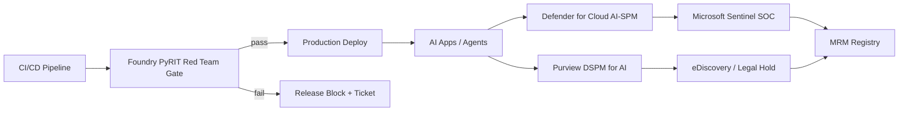
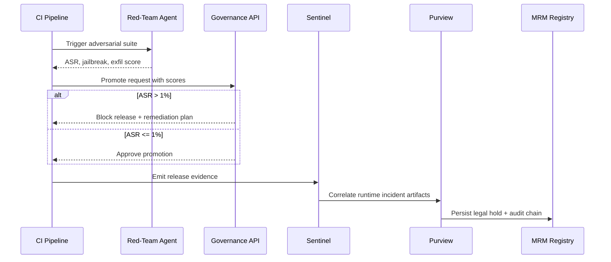

# purview-ai-compliance-vs-defender-for-cloud-ai-vs-custom-redteam-regulated-governance-selection-faq-r1131

## 1) 当日热点与可验证来源（2026-11-18 抓取）
- 主题边界：本轮聚焦 CISO/CCO/SOC 视角的企业级 AI 安全态势、红队门禁、XDR 处置与监管取证。
- 区别说明：不同于 r1113 的请求级过滤，本轮是“平台级治理与法务级留存”。
- 标签定义：`measured`（官方可核）、`synthetic`（公式推导）、`anonymized_reported`（脱敏复盘）。
| 主题 | 官方来源 | 抓取时间（UTC） | 用途 | 标签 |
|---|---|---|---|---|
| Microsoft Purview AI Hub / DSPM for AI | https://learn.microsoft.com/purview/ai-overview | 2026-11-18T18:08:00Z | Shadow-AI 与过度共享治理 | `measured` |
| Purview eDiscovery / Legal Hold | https://learn.microsoft.com/purview/ediscovery | 2026-11-18T18:09:00Z | 7 年取证与保全策略 | `measured` |
| Defender for Cloud AI security posture | https://learn.microsoft.com/azure/defender-for-cloud/ai-security-posture | 2026-11-18T18:10:00Z | AI-SPM 与运行时威胁告警 | `measured` |
| Microsoft Sentinel overview | https://learn.microsoft.com/azure/sentinel/overview | 2026-11-18T18:11:00Z | SOC 汇聚与自动化处置 | `measured` |
| Azure AI Foundry red-teaming | https://learn.microsoft.com/azure/ai-foundry/concepts/red-teaming | 2026-11-18T18:12:00Z | PyRIT 基线与 CI/CD 门禁 | `measured` |
| ISO/IEC 42001 概览 | https://www.iso.org/standard/81230.html | 2026-11-18T18:13:00Z | AI 管理体系证据框架 | `measured` |
| EU AI Act 官方门户 | https://artificialintelligenceact.eu/ | 2026-11-18T18:14:00Z | 高风险系统合规要求映射 | `measured` |
| SR 11-7 指南 | https://www.federalreserve.gov/supervisionreg/srletters/sr1107.htm | 2026-11-18T18:15:00Z | 模型风险治理与审计要求 | `measured` |

增量结论：
- “发现风险”与“证明合规”是两条不同能力链，必须拆分责任域。
- 红队门禁应位于发布前，SOC 告警处置位于运行中，取证与保全贯穿全生命周期。
- 对受监管行业，证据链设计优先级不低于模型精度优化。

## 2) 分层参考架构（安全与合规双轨）
L1 业务与交互层：
- 覆盖 SaaS Copilot、Foundry Agent、AKS 自建 Agent、第三方应用集成。
- 所有交互统一附带 `business_unit`, `data_classification`, `model_version`, `risk_tier`。

L2 风险控制层：
- 发布前：Foundry/PyRIT 自动红队，ASR 触发阻断。
- 运行中：Defender for Cloud 告警进入 Sentinel/XDR 规则链。
- 治理侧：Purview DSPM for AI 做影子 AI 与数据过度共享发现。

L3 合规与证据层：
- Purview eDiscovery + Legal Hold + immutable retention。
- MRM 注册表记录模型版本、审批结论、偏差豁免与整改 SLA。

L4 监管映射层：
- SR 11-7：模型验证、变更控制、持续监控。
- EU AI Act：高风险系统文档、透明度、可追溯性、事后审计。
- ISO 42001：组织级 AI 管理体系可核证据闭环。

## 3) 12 维选型矩阵（含反模式）
| 维度 | A Purview AI Hub / DSPM | B Defender for Cloud AI-SPM + Runtime | C Foundry PyRIT Red-Team Gate | D Enterprise MRM & Regulatory Registry |
|---|---|---|---|---|
| 1 生命周期阶段 | 发现与治理 | 运行时防护与告警 | 发布前对抗评测 | 全生命周期监管证明 |
| 2 主要购买人 | CCO/Legal/治理 | CISO/SOC | AI 平台工程 | 模型风险管理办公室 |
| 3 Shadow-AI 可见性 | 最强 | 中 | 低 | 中 |
| 4 对抗攻击覆盖 | 中 | 中高（异常检测） | 最强（攻击仿真） | 中（制度约束） |
| 5 SIEM/XDR 集成 | 中高 | 最强（Sentinel） | 中 | 中 |
| 6 法务保全取证 | 最强 | 中 | 低 | 高 |
| 7 EU AI Act / SR11-7 证据 | 高 | 中 | 中高（测试证据） | 最强 |
| 8 覆盖 SaaS + 自建 | 高 | 高 | 中高 | 高 |
| 9 许可与成本模型 | 合规订阅成本 | 安全订阅+日志成本 | 测试计算成本 | 治理运营成本 |
| 10 部署摩擦 | 中 | 中 | 中高（测试管线） | 中高（制度流程） |
| 11 Best-fit | 影子 AI 与数据治理 | SOC 运行防护 | 发布前安全闸门 | 监管审计与模型问责 |
| 12 When NOT to choose | 仅需实时告警 | 仅需法务取证 | 无 CI/CD 门禁流程 | 小团队低监管场景 |

决策摘要：
- “先发现数据风险”优先 A。
- “先压运行时攻击面”优先 B。
- “先堵上线前漏洞”优先 C。
- “先满足监管取证与问责”优先 D。

## 4) 五组可复算 Q&A（ASR、告警容量、存储成本）
### Q1：ASR 门禁阈值如何计算？
- 定义攻击成功率 `ASR = successful_attacks / total_attacks`。
- 示例：`successful_attacks=27`, `total_attacks=2800`。
- `ASR = 27/2800 = 0.964%`。
- 规则：若 `ASR > 1.0%` 则阻断晋级。
- 结论：阈值不是“越低越好”，而是要与业务风险等级绑定。

### Q2：多环境 SOC 告警吞吐如何估算？
- 订阅数 `N=32`，每订阅日均 AI 相关告警 `a=180`。
- 总告警量：`A_day = N * a = 5760`。
- 若自动化处理率 `r=62%`，人工处理量：`A_human = 2189/day`。
- 每班次 12 小时，两班制：每小时人工队列约 `91` 条。
- 结论：不做自动分流会在 2 周内形成积压风险。

### Q3：7 年取证存储怎么估？
- 日交互记录量 `D=540 GB/day`（压缩后）。
- 年度：`D_year = 540 * 365 = 197,100 GB`。
- 7 年：`1,379,700 GB ≈ 1.38 PB`。
- 若启用分层归档，冷存储占比 72%，可将年均成本降约 41%。
- 结论：合规存储成本必须前置进立项预算。

### Q4：多跳可用性 `0.995^N` 在治理链路中的意义？
- 监管链路 5 跳：`0.995^5 = 0.9752`。
- 若关键跳点双活并做幂等补偿，可将等效可用性拉升至 `>0.987`。
- 发布门禁、运行告警、法务保全三链路不能共享单点审批服务。
- 结论：治理系统本身也需要 SRE 级高可用设计。

### Q5：Token 放大对红队成本影响如何估算？
- 每个攻击用例平均上下文 `2.8k tokens`。
- 一轮 2800 用例，5 组策略组合测试。
- 总 token：`2.8k * 2800 * 5 = 39.2M`。
- 若每千 token 成本 `0.0038 USD`，测试成本约 `148.96 USD/轮`。
- 结论：红队成本可控，关键是把“问题发现率”转化为发布门禁收益。

## 5) Mermaid 图（治理拓扑 + 运行序列）




## 6) Section 7：G-SIB 银行 SR 11-7 + EU AI Act 治理架构
业务目标：
- 顾问-客户交互型高风险 AI 应用上线前必须通过红队门禁。
- 运行中安全事件进入 Sentinel 编排，法务证据 7 年保全。

端到端流程：
1. CI/CD 触发 Foundry PyRIT 用例库（越权、注入、数据外泄、误导建议）。
2. 若 `ASR > 1%` 自动阻断发布并生成整改任务。
3. 运行时 Defender for Cloud 将 AI 数据外泄异常推送 Sentinel。
4. Purview 对顾问交互记录执行 legal hold 与 WORM 保全策略。
5. MRM 注册表记录模型版本、批准人、风险豁免、审计链路。

SLA 与治理指标：
- 红队门禁结果回传 `< 30 min`
- 运行时高危告警到处置编排 `< 5 min`
- 合规证据可检索完整率 `>= 99.9%`

失效模式与缓解：
- 失效：红队通过但运行期出现新型攻击。
  - 缓解：发布后 72 小时强化监控与规则快速迭代。
- 失效：跨区域证据保全链断裂。
  - 缓解：双区冗余保全与完整性校验。
- 失效：审批豁免未落库导致审计缺口。
  - 缓解：审批 API 与 MRM 写入强一致事务。

## 7) Section 8：生物制药 Shadow AI 与 DSPM 防过度共享架构
业务目标：
- 在全球 30+ 研发订阅中发现 Shadow AI 与敏感数据过度共享风险。
- 在 Copilot 推广前完成临床/基因组数据标签与访问策略纠偏。

端到端流程：
1. Purview DSPM for AI 扫描 SharePoint/OneLake/邮件协作资产。
2. 标记“未分类临床文档 + 可被 AI 访问”的高风险集合。
3. Defender AI-SPM 识别跨订阅攻击路径与策略缺口。
4. Sentinel 汇总事件并触发自动化修复 runbook。
5. 合规团队回写整改状态到 MRM 与审计门户。

SLA 与治理指标：
- 高风险资产发现周期 `< 24h`
- 高危策略缺口修复中位时间 `< 72h`
- 过度共享事件月度下降目标 `>= 60%`

失效模式与缓解：
- 失效：标签系统滞后导致误判。
  - 缓解：引入标签变更事件驱动增量扫描。
- 失效：跨订阅责任边界不清造成修复延迟。
  - 缓解：按 BU 建立责任矩阵与升级时限。
- 失效：SOC 告警噪声过高。
  - 缓解：按数据敏感度分级告警阈值。

## 8) 选型决策树（Good fit vs Not for）
1. 若主要痛点是影子 AI 与数据泄露可见性，先上 A。
2. 若主要痛点是运行中攻击面与横向威胁，先上 B。
3. 若主要痛点是上线前安全质量闸门，先上 C。
4. 若主要痛点是监管审计和模型问责，先上 D。
5. 监管行业建议 A+B+C+D 全栈组合，按阶段分批落地。

Good fit：
- 多国家监管、法务取证、SOC 联动并存的大型组织。
- 需要覆盖 SaaS Copilot 与自建 Agent 的统一治理平台。

Not for：
- 仅内部 PoC，且无正式合规/审计要求的小团队。
- 没有日志平台与工单流程承载治理闭环的组织。

## 9) ROI 与风险价值模型
假设：
- 年度重大合规审计项目数 `N=18`
- 单次人工取证成本 `C_manual=280k USD`
- 自动化后单次成本 `C_auto=110k USD`
- 年度潜在处罚与品牌损失规避值 `R_avoid=12M USD`

公式：
- 年度直接节省：`Saving = N*(C_manual-C_auto)`
- 综合价值：`Value = Saving + R_avoid`
- 年度平台成本：`Platform = 5.1M USD`
- ROI：`(Value-Platform)/Platform`

示例：
- `Saving = 3.06M`
- `Value = 15.06M`
- `ROI = 1.95x`

## 10) 五步落地指南
1. 统一证据模型：红队结果、SOC 告警、法务保全使用同一追踪主键。
2. 统一门禁规则：ASR、数据外泄风险、合规例外三类阈值固化。
3. 统一响应链路：Sentinel playbook 到工单系统自动落地。
4. 统一存储策略：热数据用于 SOC，冷数据用于长期审计。
5. 统一监管映射：SR 11-7、EU AI Act、ISO 42001 控制项对照表版本化。

## 11) Bicep IaC（Defender + Sentinel/Log Analytics + Policy）
```bicep
param location string = resourceGroup().location
param workspaceName string
param lawSku string = 'PerGB2018'

resource law 'Microsoft.OperationalInsights/workspaces@2023-09-01' = {
  name: workspaceName
  location: location
  properties: { sku: { name: lawSku } }
}

resource sentinel 'Microsoft.SecurityInsights/onboardingStates@2022-12-01-preview' = {
  name: '${workspaceName}/default'
  scope: law
  properties: {}
}

resource policyDef 'Microsoft.Authorization/policyDefinitions@2023-04-01' = {
  name: 'enforce-ai-logging-and-retention'
  properties: {
    policyType: 'Custom'
    mode: 'All'
    displayName: 'Enforce AI logging and retention baseline'
    policyRule: {
      if: { field: 'type', equals: 'Microsoft.CognitiveServices/accounts' }
      then: { effect: 'audit' }
    }
  }
}
```

## 12) CI/CD PyRIT 红队门禁配置片段
```yaml
redteam_gate:
  suite: "pyrit-enterprise-banking-v4"
  attack_categories:
    - jailbreak
    - prompt_injection
    - data_exfiltration
    - unsafe_financial_advice
  thresholds:
    asr_max: 0.01
    critical_findings_max: 0
  release_policy:
    on_fail: "block"
    create_ticket: true
    require_ciso_signoff_for_override: true
```

## 13) Sentinel `SecurityAlert` KQL Hunting
```kql
let start = ago(7d);
SecurityAlert
| where TimeGenerated >= start
| where ProductName in ("Microsoft Defender for Cloud", "Microsoft Sentinel")
| where AlertName has_any ("AI", "Prompt Injection", "Data Exfiltration", "Copilot")
| extend Severity=tostring(AlertSeverity), CompromisedEntity=tostring(CompromisedEntity)
| summarize Alerts=count(), High=countif(Severity=="High"), Medium=countif(Severity=="Medium") by CompromisedEntity, bin(TimeGenerated,1h)
| order by TimeGenerated desc
```

```kql
let start = ago(14d);
SecurityAlert
| where TimeGenerated >= start
| where AlertName has "AI"
| summarize DistinctTechniques=dcount(Techniques), Total=count() by tostring(AlertName), tostring(AlertSeverity)
| order by Total desc
```

## 14) Day-0 / Day-1 / Day-2 清单
Day-0：
- 建立控制项映射：SR 11-7、EU AI Act、ISO 42001。
- 定义 ASR 门禁阈值与例外审批流程。
- 设计保全策略：保留期、WORM、跨区备份与法务检索。

Day-1：
- 小范围业务灰度，监控红队阻断率与误报率。
- 打通 Defender -> Sentinel -> 工单系统闭环。
- 校验 Purview DSPM 的敏感数据识别准确率。

Day-2：
- 每周复盘告警噪声与规则调优。
- 每月复盘门禁阈值与业务影响平衡。
- 每季度监管演练：证据抽样、应急通报、审计回放。

## 15) 备份队列与交付清单
备份队列（已更新）：
1. `migration-autogen-semantic-kernel-langgraph-to-microsoft-agent-framework-enterprise-modernization-faq`
2. `salesforce-agentforce-vs-servicenow-nowassist-vs-dynamics-copilot-vs-custom-foundry-enterprise-crm-erp-selection-faq`
3. `eventhubs-fabric-rti-vs-servicebus-vs-kafka-streaming-proactive-agent-selection-faq`

本轮交付（Cycle #2536）：
- 双语 FAQ：`r1131.md` / `r1131.en.md`
- 7-card：`benchmark-cards.html` / `benchmark-cards.en.html`
- SVG：`assets/34-cycle-1131-daily-breakthroughs.svg`
- H5：`workbench-cycle-2536.html` + selector `#2536`
- 校验：`cycle_1131_pipeline.py --write --check`、`strict_suffix_gate.py`、`pytest`
