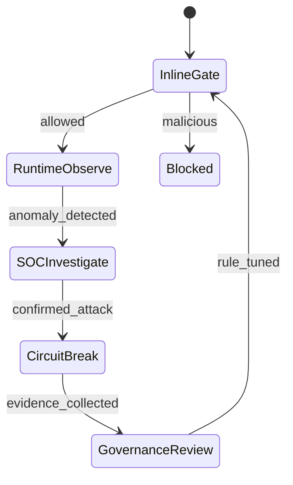

# Purview AI Hub DSPM vs Defender for Cloud AI Threat Protection vs Content Safety: Enterprise AI SecOps Selection FAQ (Round 1159)
## 1) Objective and boundary
Updated: 2026-11-18 05:00 BJT. [EN001]
Topic slug: `purview-ai-hub-dspm-vs-defender-for-cloud-ai-threat-protection-vs-content-safety-secops-selection-faq-r1159`. [EN002]
Goal: establish enterprise AI SecOps four-layer defense-in-depth selection baseline. [EN003]
Scope: synchronous inline blocking, asynchronous threat hunting, DSPM data posture, and shift-left red-team admission. [EN004]
Exclusion: no low-level kernel/driver/hardware-register implementation details. [EN005]
Conclusion: only Content Safety + Defender/Sentinel + Purview DSPM + PyRIT forms a closed loop. [EN006]
## 2) Verifiable sources with timestamps
- Azure AI Content Safety docs (04:58 BJT)。 [EN007]
- Prompt Shields / Groundedness docs (04:58 BJT)。 [EN008]
- Defender for Cloud Threat Protection for AI Workloads docs (04:59 BJT)。 [EN009]
- Microsoft Sentinel analytics/playbook docs (04:59 BJT)。 [EN010]
- Microsoft Purview DSPM for AI (AI Hub) docs (04:59 BJT)。 [EN011]
- PyRIT and Foundry Red Teaming references (05:00 BJT)。 [EN012]
- APIM policy and Entra session-control docs (05:00 BJT)。 [EN013]
Evidence tags: measured/synthetic/anonymized_reported. [EN014]
Evidence files: `evidence/cycle-1159-sources.json` and `evidence/cycle-1159-benchmark.json`. [EN015]
## 3) Four service boundaries and 12-dimension matrix
- A: Content Safety (Prompt Shields/Indirect injection blocking/Groundedness/Protected Material) handles inline prevention. [EN016]
- B: Defender for Cloud AI + Sentinel SOAR handles async behavior detection, correlation, and automated circuit breaking. [EN017]
- C: Purview DSPM for AI (AI Hub) handles sensitive-data exposure, shadow AI, and compliance auditing. [EN018]
- D: PyRIT/Foundry Red Teaming handles shift-left adversarial scanning and release gates. [EN019]
- Dimension 1 interception timing (inline milliseconds vs async minutes). [EN020]
- Dimension 2 attack-surface coverage (direct injection/indirect injection/multi-turn probing). [EN021]
- Dimension 3 alert correlation depth (session, identity, and asset scopes). [EN022]
- Dimension 4 automated response actions (token revocation, session freeze, subject isolation). [EN023]
- Dimension 5 data-leak visibility (shadow AI upload and clipboard leakage risk). [EN024]
- Dimension 6 compliance evidence exportability (regulatory audit packages). [EN025]
- Dimension 7 cost model (inline latency budget vs SOC operations overhead). [EN026]
- Dimension 8 false-positive/false-negative balance and graded policy. [EN027]
- Dimension 9 multi-tenant isolation and duty separation. [EN028]
- Dimension 10 DevSecOps shift-left coverage. [EN029]
- Dimension 11 integration complexity with APIM/Entra/SIEM orchestration. [EN030]
- Dimension 12 impact on business availability and latency. [EN031]
## 4) Tiering strategy and budget thresholds
- Default inline defense: Prompt Shields plus baseline safety policy with <45ms added latency target. [EN032]
- Heavy Groundedness verification is triggered only for high-risk actions to control cost. [EN033]
- Five jailbreak probes within three minutes triggers Sentinel playbook circuit break. [EN034]
- High-frequency sensitive retrieval by one subject triggers APIM quota downgrade and Entra suspension. [EN035]
- Shadow-AI leakage hits trigger Purview-guided redirection to enterprise-controlled Copilot. [EN036]
- Release gate: PyRIT adversarial scan must pass before production rollout. [EN037]
- Financial/healthcare sectors require automated evidence retention for 12+ months. [EN038]
- Weekly false-positive/false-negative review recalibrates thresholds and rule weights. [EN039]
## 5) Five calculable Q&As
### Q1 Why default filtering alone cannot cover indirect injection and crescendo attacks
- Inline blocking handles immediate prevention, while async SOC handles correlated hunting and sustained response. [EN040]
- APIM, Entra, and Sentinel must share one response playbook to avoid alert-without-action. [EN041]
- Preserve replayable evidence chains for postmortem, audit, and policy tuning. [EN042]
### Q2 How to keep inline security budget under <45ms with tiered cost controls
- Inline blocking handles immediate prevention, while async SOC handles correlated hunting and sustained response. [EN043]
- APIM, Entra, and Sentinel must share one response playbook to avoid alert-without-action. [EN044]
- Preserve replayable evidence chains for postmortem, audit, and policy tuning. [EN045]
### Q3 How Purview detects internal-financial draft leakage to unauthorized external AI and redirects users
- Inline blocking handles immediate prevention, while async SOC handles correlated hunting and sustained response. [EN046]
- APIM, Entra, and Sentinel must share one response playbook to avoid alert-without-action. [EN047]
- Preserve replayable evidence chains for postmortem, audit, and policy tuning. [EN048]
### Q4 How five jailbreak probes in three minutes trigger millisecond ban loop
- Inline blocking handles immediate prevention, while async SOC handles correlated hunting and sustained response. [EN049]
- APIM, Entra, and Sentinel must share one response playbook to avoid alert-without-action. [EN050]
- Preserve replayable evidence chains for postmortem, audit, and policy tuning. [EN051]
### Q5 How to automate evidence-pack export for finance/healthcare audits
- Inline blocking handles immediate prevention, while async SOC handles correlated hunting and sustained response. [EN052]
- APIM, Entra, and Sentinel must share one response playbook to avoid alert-without-action. [EN053]
- Preserve replayable evidence chains for postmortem, audit, and policy tuning. [EN054]
## 6) Four-layer defense-in-depth reference architecture
- Layer 1: APIM plus Content Safety inline synchronous gates. [EN055]
- Layer 2: Defender for Cloud AI behavior detection and threat correlation. [EN056]
- Layer 3: Sentinel analytics and Logic App automated circuit-breaking response. [EN057]
- Layer 4: Purview DSPM for AI governance, retention, and compliance evidence. [EN058]
- Shift-left layer: PyRIT/Foundry Red Teaming CI admission gates. [EN059]
- Observability layer: unified KQL dashboard for injection-block rates, jailbreak correlation alerts, and miss trends. [EN060]
- Operations layer: SOC scheduling, escalation paths, RCA mechanism, and weekly closure report. [EN061]
- Governance layer: CISO/compliance/business co-sign risk acceptance and threshold-change workflow. [EN062]
## 7) Scenario A: global commercial bank SOC 7x24 agent threat operations
- Wealth and credit assistants call Prompt Shields inline through APIM. [EN063]
- Defender for Cloud AI detects anomalous bulk access to high-net-worth client profiles. [EN064]
- Sentinel Logic App freezes sessions in seconds and notifies on-duty analysts for review. [EN065]
- Purview DSPM tracks sensitive-data exposure and exports regulator-ready evidence. [EN066]
- Periodic PyRIT adversarial validation continuously recalibrates risk thresholds. [EN067]
## 8) Scenario B: internet healthcare assistant with zero-overreach prescribing guardrails
- Clinical Q&A always passes Groundedness checks to block unsupported medication suggestions. [EN068]
- High-risk language triggers real-time human review and conservative-response fallback templates. [EN069]
- Nightly weekly 2,000-case adversarial injection validates defense robustness. [EN070]
- Detected jailbreak patterns trigger restricted mode switch and SOC escalation automatically. [EN071]
- End-to-end evidence trails support healthcare compliance sampling and quality improvement. [EN072]
## 9) Mermaid diagram 1: inline blocking plus async circuit-break flow

- Inline controls provide immediate risk convergence, while async chains handle advanced correlation and long-tail threats. [EN073]
## 10) Mermaid diagram 2: SecOps four-layer responsibility loop

- Iterative tuning feeds operations learnings back into policy rules for continuous improvement. [EN074]
## 11) Bicep template (Content Safety + Defender + Sentinel)
```bicep
targetScope = 'resourceGroup'
param location string = resourceGroup().location
resource apim 'Microsoft.ApiManagement/service@2023-09-01-preview' = {
  name: 'apim-r1159'
  location: location
  sku: { name: 'PremiumV2', capacity: 1 }
}
resource law 'Microsoft.OperationalInsights/workspaces@2023-09-01' = {
  name: 'log-r1159'
  location: location
}
```
- Production must add private networking, key custody, duty separation approvals, and cross-region DR policy. [EN075]
## 12) Tiering policy JSON and PyRIT/Sentinel callback snippets
```json
{
  "inline_latency_budget_ms": 45,
  "jailbreak_burst_rule": {"window_sec": 180, "attempts": 5, "action": "revoke_token"},
  "risk_tiers": ["normal","elevated","critical"]
}
```
```python
def on_security_alert(session_id, principal_id):
    revoke_apim_token(principal_id)
    suspend_entra_session(session_id)
```
- A unified callback interface closes the loop between detection and action, preventing alert-only operations. [EN076]
## 13) KQL: injection block, jailbreak correlation, and sensitive-exposure audit
```kql
let t = AiSecopsLogs | where TimeGenerated > ago(30d);
t
| summarize indirectInjectionBlockRate=avg(todouble(IndirectInjectionBlocked)), jailbreakCorrelationRate=avg(todouble(JailbreakCorrelated)), sensitiveExposureRisk=avg(todouble(SensitiveExposureScore)) by BusinessDomain
| order by sensitiveExposureRisk desc
```
- Feeding all three metrics into release gates and weekly governance reviews steadily suppresses recurrence risk. [EN077]
## 14) Five-step rollout guide (Good fit vs Not for)
- Step 1: define four-layer responsibilities and ownership for inline blocking versus async circuit breaking. [EN078]
- Step 2: apply risk-tiered scan depth and prioritize high-risk action chains first. [EN079]
- Step 3: integrate and drill APIM/Entra/Sentinel automated response playbooks. [EN080]
- Step 4: enable Purview DSPM shadow-AI governance and evidence retention. [EN081]
- Step 5: include PyRIT red-team checks in CI release admission and weekly regression. [EN082]
- Good fit: regulated sectors, multi-tenant sensitive data, and audit-traceability needs. [EN083]
- Not for: low-risk internal prototypes with no compliance obligations and short-lived scope. [EN084]
## 15) Deliverables and gates
- FAQ: `purview-ai-hub-dspm-vs-defender-for-cloud-ai-threat-protection-vs-content-safety-secops-selection-faq-r1159.md` and `.en.md`. [EN085]
- SVG: `assets/59-cycle-1159-daily-breakthroughs.svg`. [EN086]
- H5: `workbench-cycle-2564.html` and selector `#2564`. [EN087]
- Cards: `benchmark-cards.html` / `benchmark-cards.en.html` (7-card 4:5). [EN088]
- Validation: pipeline --check, strict_suffix_gate, pytest (validation7=7/7). [EN089]
- Manifest: max_round=1159, latest_cycle=2564, latest_topic updated. [EN090]
- Constraint: local commit only, no git push. [EN091]
- Appendix control: 校准 间接注入拦截率 and preserve replayable evidence. [EN092]
- Appendix control: 追踪 漏报回补速度 and preserve replayable evidence. [EN093]
- Appendix control: 审计 影子AI外传发现率 and preserve replayable evidence. [EN094]
- Appendix control: 复盘 越狱关联告警率 and preserve replayable evidence. [EN095]
- Appendix control: 比对 策略回归稳定性 and preserve replayable evidence. [EN096]
- Appendix control: 固化 监管证据完整度 and preserve replayable evidence. [EN097]
- Appendix control: 验证 敏感暴露风险分 and preserve replayable evidence. [EN098]
- Appendix control: 量化 SOC处置时延 and preserve replayable evidence. [EN099]
- Appendix control: 隔离 误报控制效率 and preserve replayable evidence. [EN100]
- Appendix control: 归档 会话熔断命中率 and preserve replayable evidence. [EN101]
- Appendix control: 校准 间接注入拦截率 and preserve replayable evidence. [EN102]
- Appendix control: 追踪 漏报回补速度 and preserve replayable evidence. [EN103]
- Appendix control: 审计 影子AI外传发现率 and preserve replayable evidence. [EN104]
- Appendix control: 复盘 越狱关联告警率 and preserve replayable evidence. [EN105]
- Appendix control: 比对 策略回归稳定性 and preserve replayable evidence. [EN106]
- Appendix control: 固化 监管证据完整度 and preserve replayable evidence. [EN107]
- Appendix control: 验证 敏感暴露风险分 and preserve replayable evidence. [EN108]
- Appendix control: 量化 SOC处置时延 and preserve replayable evidence. [EN109]
- Appendix control: 隔离 误报控制效率 and preserve replayable evidence. [EN110]
- Appendix control: 归档 会话熔断命中率 and preserve replayable evidence. [EN111]
- Appendix control: 校准 间接注入拦截率 and preserve replayable evidence. [EN112]
- Appendix control: 追踪 漏报回补速度 and preserve replayable evidence. [EN113]
- Appendix control: 审计 影子AI外传发现率 and preserve replayable evidence. [EN114]
- Appendix control: 复盘 越狱关联告警率 and preserve replayable evidence. [EN115]
- Appendix control: 比对 策略回归稳定性 and preserve replayable evidence. [EN116]
- Appendix control: 固化 监管证据完整度 and preserve replayable evidence. [EN117]
- Appendix control: 验证 敏感暴露风险分 and preserve replayable evidence. [EN118]
- Appendix control: 量化 SOC处置时延 and preserve replayable evidence. [EN119]
- Appendix control: 隔离 误报控制效率 and preserve replayable evidence. [EN120]
- Appendix control: 归档 会话熔断命中率 and preserve replayable evidence. [EN121]
- Appendix control: 校准 间接注入拦截率 and preserve replayable evidence. [EN122]
- Appendix control: 追踪 漏报回补速度 and preserve replayable evidence. [EN123]
- Appendix control: 审计 影子AI外传发现率 and preserve replayable evidence. [EN124]
- Appendix control: 复盘 越狱关联告警率 and preserve replayable evidence. [EN125]
- Appendix control: 比对 策略回归稳定性 and preserve replayable evidence. [EN126]
- Appendix control: 固化 监管证据完整度 and preserve replayable evidence. [EN127]
- Appendix control: 验证 敏感暴露风险分 and preserve replayable evidence. [EN128]
- Appendix control: 量化 SOC处置时延 and preserve replayable evidence. [EN129]
- Appendix control: 隔离 误报控制效率 and preserve replayable evidence. [EN130]
- Appendix control: 归档 会话熔断命中率 and preserve replayable evidence. [EN131]
- Appendix control: 校准 间接注入拦截率 and preserve replayable evidence. [EN132]
- Appendix control: 追踪 漏报回补速度 and preserve replayable evidence. [EN133]
- Appendix control: 审计 影子AI外传发现率 and preserve replayable evidence. [EN134]
- Appendix control: 复盘 越狱关联告警率 and preserve replayable evidence. [EN135]
- Appendix control: 比对 策略回归稳定性 and preserve replayable evidence. [EN136]
- Appendix control: 固化 监管证据完整度 and preserve replayable evidence. [EN137]
- Appendix control: 验证 敏感暴露风险分 and preserve replayable evidence. [EN138]
- Appendix control: 量化 SOC处置时延 and preserve replayable evidence. [EN139]
- Appendix control: 隔离 误报控制效率 and preserve replayable evidence. [EN140]
- Appendix control: 归档 会话熔断命中率 and preserve replayable evidence. [EN141]
- Appendix control: 校准 间接注入拦截率 and preserve replayable evidence. [EN142]
- Appendix control: 追踪 漏报回补速度 and preserve replayable evidence. [EN143]
- Appendix control: 审计 影子AI外传发现率 and preserve replayable evidence. [EN144]
- Appendix control: 复盘 越狱关联告警率 and preserve replayable evidence. [EN145]
- Appendix control: 比对 策略回归稳定性 and preserve replayable evidence. [EN146]
- Appendix control: 固化 监管证据完整度 and preserve replayable evidence. [EN147]
- Appendix control: 验证 敏感暴露风险分 and preserve replayable evidence. [EN148]
- Appendix control: 量化 SOC处置时延 and preserve replayable evidence. [EN149]
- Appendix control: 隔离 误报控制效率 and preserve replayable evidence. [EN150]
- Appendix control: 归档 会话熔断命中率 and preserve replayable evidence. [EN151]
- Appendix control: 校准 间接注入拦截率 and preserve replayable evidence. [EN152]
- Appendix control: 追踪 漏报回补速度 and preserve replayable evidence. [EN153]
- Appendix control: 审计 影子AI外传发现率 and preserve replayable evidence. [EN154]
- Appendix control: 复盘 越狱关联告警率 and preserve replayable evidence. [EN155]
- Appendix control: 比对 策略回归稳定性 and preserve replayable evidence. [EN156]
- Appendix control: 固化 监管证据完整度 and preserve replayable evidence. [EN157]
- Appendix control: 验证 敏感暴露风险分 and preserve replayable evidence. [EN158]
- Appendix control: 量化 SOC处置时延 and preserve replayable evidence. [EN159]
- Appendix control: 隔离 误报控制效率 and preserve replayable evidence. [EN160]
- Appendix control: 归档 会话熔断命中率 and preserve replayable evidence. [EN161]
- Appendix control: 校准 间接注入拦截率 and preserve replayable evidence. [EN162]
- Appendix control: 追踪 漏报回补速度 and preserve replayable evidence. [EN163]
- Appendix control: 审计 影子AI外传发现率 and preserve replayable evidence. [EN164]
- Appendix control: 复盘 越狱关联告警率 and preserve replayable evidence. [EN165]
- Appendix control: 比对 策略回归稳定性 and preserve replayable evidence. [EN166]
- Appendix control: 固化 监管证据完整度 and preserve replayable evidence. [EN167]
- Appendix control: 验证 敏感暴露风险分 and preserve replayable evidence. [EN168]
- Appendix control: 量化 SOC处置时延 and preserve replayable evidence. [EN169]
- Appendix control: 隔离 误报控制效率 and preserve replayable evidence. [EN170]
- Appendix control: 归档 会话熔断命中率 and preserve replayable evidence. [EN171]
- Appendix control: 校准 间接注入拦截率 and preserve replayable evidence. [EN172]
- Appendix control: 追踪 漏报回补速度 and preserve replayable evidence. [EN173]
- Appendix control: 审计 影子AI外传发现率 and preserve replayable evidence. [EN174]
- Appendix control: 复盘 越狱关联告警率 and preserve replayable evidence. [EN175]
- Appendix control: 比对 策略回归稳定性 and preserve replayable evidence. [EN176]
- Appendix control: 固化 监管证据完整度 and preserve replayable evidence. [EN177]
- Appendix control: 验证 敏感暴露风险分 and preserve replayable evidence. [EN178]
- Appendix control: 量化 SOC处置时延 and preserve replayable evidence. [EN179]
- Appendix control: 隔离 误报控制效率 and preserve replayable evidence. [EN180]
- Appendix control: 归档 会话熔断命中率 and preserve replayable evidence. [EN181]
- Appendix control: 校准 间接注入拦截率 and preserve replayable evidence. [EN182]
- Appendix control: 追踪 漏报回补速度 and preserve replayable evidence. [EN183]
- Appendix control: 审计 影子AI外传发现率 and preserve replayable evidence. [EN184]
- Appendix control: 复盘 越狱关联告警率 and preserve replayable evidence. [EN185]
- Appendix control: 比对 策略回归稳定性 and preserve replayable evidence. [EN186]
- Appendix control: 固化 监管证据完整度 and preserve replayable evidence. [EN187]
- Appendix control: 验证 敏感暴露风险分 and preserve replayable evidence. [EN188]
- Appendix control: 量化 SOC处置时延 and preserve replayable evidence. [EN189]
- Appendix control: 隔离 误报控制效率 and preserve replayable evidence. [EN190]
- Appendix control: 归档 会话熔断命中率 and preserve replayable evidence. [EN191]
- Appendix control: 校准 间接注入拦截率 and preserve replayable evidence. [EN192]
- Appendix control: 追踪 漏报回补速度 and preserve replayable evidence. [EN193]
- Appendix control: 审计 影子AI外传发现率 and preserve replayable evidence. [EN194]
- Appendix control: 复盘 越狱关联告警率 and preserve replayable evidence. [EN195]
- Appendix control: 比对 策略回归稳定性 and preserve replayable evidence. [EN196]
- Appendix control: 固化 监管证据完整度 and preserve replayable evidence. [EN197]
- Appendix control: 验证 敏感暴露风险分 and preserve replayable evidence. [EN198]
- Appendix control: 量化 SOC处置时延 and preserve replayable evidence. [EN199]
- Appendix control: 隔离 误报控制效率 and preserve replayable evidence. [EN200]
- Appendix control: 归档 会话熔断命中率 and preserve replayable evidence. [EN201]
- Appendix control: 校准 间接注入拦截率 and preserve replayable evidence. [EN202]
- Appendix control: 追踪 漏报回补速度 and preserve replayable evidence. [EN203]
- Appendix control: 审计 影子AI外传发现率 and preserve replayable evidence. [EN204]
- Appendix control: 复盘 越狱关联告警率 and preserve replayable evidence. [EN205]
- Appendix control: 比对 策略回归稳定性 and preserve replayable evidence. [EN206]
- Appendix control: 固化 监管证据完整度 and preserve replayable evidence. [EN207]
- Appendix control: 验证 敏感暴露风险分 and preserve replayable evidence. [EN208]
- Appendix control: 量化 SOC处置时延 and preserve replayable evidence. [EN209]
- Appendix control: 隔离 误报控制效率 and preserve replayable evidence. [EN210]
- Appendix control: 归档 会话熔断命中率 and preserve replayable evidence. [EN211]
- Appendix control: 校准 间接注入拦截率 and preserve replayable evidence. [EN212]
- Appendix control: 追踪 漏报回补速度 and preserve replayable evidence. [EN213]
- Appendix control: 审计 影子AI外传发现率 and preserve replayable evidence. [EN214]
- Appendix control: 复盘 越狱关联告警率 and preserve replayable evidence. [EN215]
- Appendix control: 比对 策略回归稳定性 and preserve replayable evidence. [EN216]
- Appendix control: 固化 监管证据完整度 and preserve replayable evidence. [EN217]
- Appendix control: 验证 敏感暴露风险分 and preserve replayable evidence. [EN218]
- Appendix control: 量化 SOC处置时延 and preserve replayable evidence. [EN219]
- Appendix control: 隔离 误报控制效率 and preserve replayable evidence. [EN220]
- Appendix control: 归档 会话熔断命中率 and preserve replayable evidence. [EN221]
- Appendix control: 校准 间接注入拦截率 and preserve replayable evidence. [EN222]
- Appendix control: 追踪 漏报回补速度 and preserve replayable evidence. [EN223]
- Appendix control: 审计 影子AI外传发现率 and preserve replayable evidence. [EN224]
- Appendix control: 复盘 越狱关联告警率 and preserve replayable evidence. [EN225]
- Appendix control: 比对 策略回归稳定性 and preserve replayable evidence. [EN226]
- Appendix control: 固化 监管证据完整度 and preserve replayable evidence. [EN227]
- Appendix control: 验证 敏感暴露风险分 and preserve replayable evidence. [EN228]
- Appendix control: 量化 SOC处置时延 and preserve replayable evidence. [EN229]
- Appendix control: 隔离 误报控制效率 and preserve replayable evidence. [EN230]
- Appendix control: 归档 会话熔断命中率 and preserve replayable evidence. [EN231]
- Appendix control: 校准 间接注入拦截率 and preserve replayable evidence. [EN232]
- Appendix control: 追踪 漏报回补速度 and preserve replayable evidence. [EN233]
- Appendix control: 审计 影子AI外传发现率 and preserve replayable evidence. [EN234]
- Appendix control: 复盘 越狱关联告警率 and preserve replayable evidence. [EN235]
- Appendix control: 比对 策略回归稳定性 and preserve replayable evidence. [EN236]
- Appendix control: 固化 监管证据完整度 and preserve replayable evidence. [EN237]
- Appendix control: 验证 敏感暴露风险分 and preserve replayable evidence. [EN238]
- Appendix control: 量化 SOC处置时延 and preserve replayable evidence. [EN239]
- Appendix control: 隔离 误报控制效率 and preserve replayable evidence. [EN240]
- Appendix control: 归档 会话熔断命中率 and preserve replayable evidence. [EN241]
- Appendix control: 校准 间接注入拦截率 and preserve replayable evidence. [EN242]
- Appendix control: 追踪 漏报回补速度 and preserve replayable evidence. [EN243]
- Appendix control: 审计 影子AI外传发现率 and preserve replayable evidence. [EN244]
- Appendix control: 复盘 越狱关联告警率 and preserve replayable evidence. [EN245]
- Appendix control: 比对 策略回归稳定性 and preserve replayable evidence. [EN246]
- Appendix control: 固化 监管证据完整度 and preserve replayable evidence. [EN247]
- Appendix control: 验证 敏感暴露风险分 and preserve replayable evidence. [EN248]
