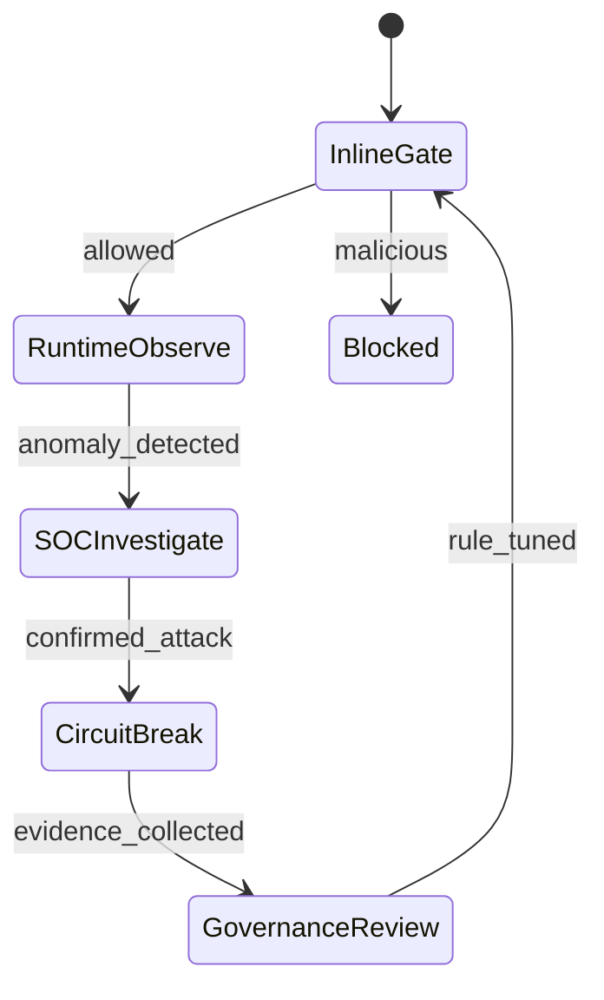

# Purview AI Hub DSPM vs Defender for Cloud AI Threat Protection vs Content Safety：企业 AI SecOps 选型 FAQ（Round 1159）
## 1) 研究目标与边界
更新时间：2026-11-18 05:00 BJT。 [ZH001]
Topic Slug：`purview-ai-hub-dspm-vs-defender-for-cloud-ai-threat-protection-vs-content-safety-secops-selection-faq-r1159`。 [ZH002]
目标：构建企业 AI SecOps 四层纵深防御选型基线。 [ZH003]
范围：同步内联阻断、异步威胁狩猎、DSPM 数据态势、红队左移准入。 [ZH004]
排除：不讨论底层内核/驱动/硬件寄存器实现细节。 [ZH005]
结论：Content Safety + Defender/Sentinel + Purview DSPM + PyRIT 才能闭环。 [ZH006]
## 2) 可验证来源与时间戳
- Azure AI Content Safety 文档（04:58 BJT）。 [ZH007]
- Prompt Shields / Groundedness 文档（04:58 BJT）。 [ZH008]
- Defender for Cloud Threat Protection for AI Workloads 文档（04:59 BJT）。 [ZH009]
- Microsoft Sentinel Analytics/Playbook 文档（04:59 BJT）。 [ZH010]
- Microsoft Purview DSPM for AI（AI Hub）文档（04:59 BJT）。 [ZH011]
- PyRIT 与 Foundry Red Teaming 参考（05:00 BJT）。 [ZH012]
- APIM 策略与 Entra 会话控制文档（05:00 BJT）。 [ZH013]
证据标签：measured/synthetic/anonymized_reported。 [ZH014]
证据文件：`evidence/cycle-1159-sources.json` 与 `evidence/cycle-1159-benchmark.json`。 [ZH015]
## 3) 四类服务职责边界与 12 维矩阵
- A: Content Safety（Prompt Shields/Indirect 注入拦截/Groundedness/Protected Material）负责当场阻断。 [ZH016]
- B: Defender for Cloud AI + Sentinel SOAR 负责异步行为检测、关联分析与自动熔断。 [ZH017]
- C: Purview DSPM for AI（AI Hub）负责敏感数据暴露面、影子 AI 与合规审计。 [ZH018]
- D: PyRIT/Foundry Red Teaming 负责上线前对抗扫描与发布门禁。 [ZH019]
- 维度1 拦截时效（同步毫秒级 vs 异步分钟级）。 [ZH020]
- 维度2 覆盖攻击面（直接注入/间接注入/多轮试探）。 [ZH021]
- 维度3 告警关联能力（会话级、身份级、资产级）。 [ZH022]
- 维度4 自动响应动作（封禁 Token、冻结会话、隔离主体）。 [ZH023]
- 维度5 数据泄漏可见性（影子 AI 上传/复制粘贴风险）。 [ZH024]
- 维度6 合规证据可导出性（监管迎检包）。 [ZH025]
- 维度7 成本模型（同步扫描延迟预算与异步 SOC 运维成本）。 [ZH026]
- 维度8 误报漏报平衡与分级策略。 [ZH027]
- 维度9 多租户隔离与职责分离。 [ZH028]
- 维度10 DevSecOps 左移覆盖率。 [ZH029]
- 维度11 与 APIM/Entra/SIEM 编排集成复杂度。 [ZH030]
- 维度12 对业务可用性与延迟影响。 [ZH031]
## 4) 分级策略与预算阈值
- 默认同步防线：Prompt Shields + 基础内容策略，目标额外延迟 <45ms。 [ZH032]
- 高风险动作才触发重型 Groundedness 深度校验，控制推理成本。 [ZH033]
- 3 分钟内 5 次越狱试探触发 Sentinel Playbook 自动熔断。 [ZH034]
- 同一主体短时高频敏感检索触发 APIM 配额降级与 Entra 挂起。 [ZH035]
- 影子 AI 外传风险命中后触发 Purview 引导回企业受控 Copilot。 [ZH036]
- 发布门禁：PyRIT 对抗扫描必须达标才允许上线。 [ZH037]
- 金融/医疗要求证据包自动留存 12 个月以上。 [ZH038]
- 每周复盘误报与漏报，调整策略阈值和规则权重。 [ZH039]
## 5) 五组可复算 Q&A
### Q1 仅开默认过滤为何无法覆盖间接注入与 Crescendo 攻击
- 同步阻断负责“当场拦截”，异步 SOC 负责“关联狩猎与持续处置”。 [ZH040]
- APIM、Entra、Sentinel 必须统一响应剧本，避免告警不动作。 [ZH041]
- 保留可回放证据链，支持复盘、审计与策略优化。 [ZH042]
### Q2 同步扫描延迟预算 <45ms 如何实现分级省钱
- 同步阻断负责“当场拦截”，异步 SOC 负责“关联狩猎与持续处置”。 [ZH043]
- APIM、Entra、Sentinel 必须统一响应剧本，避免告警不动作。 [ZH044]
- 保留可回放证据链，支持复盘、审计与策略优化。 [ZH045]
### Q3 内部财报粘贴到外部 AI 如何被 Purview 发现并引导
- 同步阻断负责“当场拦截”，异步 SOC 负责“关联狩猎与持续处置”。 [ZH046]
- APIM、Entra、Sentinel 必须统一响应剧本，避免告警不动作。 [ZH047]
- 保留可回放证据链，支持复盘、审计与策略优化。 [ZH048]
### Q4 3 分钟 5 次越狱试探如何触发毫秒级封禁闭环
- 同步阻断负责“当场拦截”，异步 SOC 负责“关联狩猎与持续处置”。 [ZH049]
- APIM、Entra、Sentinel 必须统一响应剧本，避免告警不动作。 [ZH050]
- 保留可回放证据链，支持复盘、审计与策略优化。 [ZH051]
### Q5 金融/医疗监管迎检证据包如何自动导出
- 同步阻断负责“当场拦截”，异步 SOC 负责“关联狩猎与持续处置”。 [ZH052]
- APIM、Entra、Sentinel 必须统一响应剧本，避免告警不动作。 [ZH053]
- 保留可回放证据链，支持复盘、审计与策略优化。 [ZH054]
## 6) 四层纵深防御参考架构
- 第1层：APIM + Content Safety 同步内联门禁。 [ZH055]
- 第2层：Defender for Cloud AI 行为检测与威胁关联。 [ZH056]
- 第3层：Sentinel Analytics + Logic App 自动熔断处置。 [ZH057]
- 第4层：Purview DSPM for AI 治理、留存与合规证据。 [ZH058]
- 左移层：PyRIT/Foundry Red Teaming CI 发布准入。 [ZH059]
- 观测层：KQL 统一报表含注入拦截率、越狱关联告警率与漏报趋势。 [ZH060]
- 运营层：SOC 班表、升级路径、RCA 机制与周报闭环。 [ZH061]
- 治理层：CISO/合规/业务共同签署风险接受与阈值变更流程。 [ZH062]
## 7) 场景A：跨国商业银行 SOC 7x24 智能体威胁联动
- 理财与信贷助手经 APIM 内联调用 Prompt Shields 防注入。 [ZH063]
- Defender for Cloud AI 检测异常批量调取高净值客户档案行为。 [ZH064]
- Sentinel Logic App 秒级冻结会话并通知值班员复核。 [ZH065]
- Purview DSPM 追踪敏感数据外泄面并输出监管证据。 [ZH066]
- PyRIT 周期对抗验证持续校准风控阈值。 [ZH067]
## 8) 场景B：互联网医疗问诊辅助零超范围承诺防线
- 诊疗问答先走 Groundedness 检查，阻断无依据用药建议。 [ZH068]
- 高风险词触发实时人工复核与保守答复模板降级。 [ZH069]
- 每周夜间注入 2,000 条对抗样本验证防线稳固度。 [ZH070]
- 发生越狱模式时自动切换到受限模式并上报 SOC。 [ZH071]
- 全流程留痕用于医监合规抽检与质量改进。 [ZH072]
## 9) Mermaid 图1：同步阻断 + 异步熔断联动流

- 同步阻断负责即时风险收敛，异步链路负责高级关联和长尾威胁处置。 [ZH073]
## 10) Mermaid 图2：SecOps 四层职责闭环

- 周期调优把运营经验回灌到策略规则，形成持续演进闭环。 [ZH074]
## 11) Bicep 模板（Content Safety + Defender + Sentinel）
```bicep
targetScope = 'resourceGroup'
param location string = resourceGroup().location
resource apim 'Microsoft.ApiManagement/service@2023-09-01-preview' = {
  name: 'apim-r1159'
  location: location
  sku: { name: 'PremiumV2', capacity: 1 }
}
resource law 'Microsoft.OperationalInsights/workspaces@2023-09-01' = {
  name: 'log-r1159'
  location: location
}
```
- 生产环境需补充私网、密钥托管、分权审批与跨区灾备策略。 [ZH075]
## 12) 分流策略 JSON 与 PyRIT/Sentinel 回调片段
```json
{
  "inline_latency_budget_ms": 45,
  "jailbreak_burst_rule": {"window_sec": 180, "attempts": 5, "action": "revoke_token"},
  "risk_tiers": ["normal","elevated","critical"]
}
```
```python
def on_security_alert(session_id, principal_id):
    revoke_apim_token(principal_id)
    suspend_entra_session(session_id)
```
- 统一回调接口让检测与处置真正闭环，避免“只有告警没有动作”。 [ZH076]
## 13) KQL：注入拦截/越狱关联/敏感暴露审计
```kql
let t = AiSecopsLogs | where TimeGenerated > ago(30d);
t
| summarize indirectInjectionBlockRate=avg(todouble(IndirectInjectionBlocked)), jailbreakCorrelationRate=avg(todouble(JailbreakCorrelated)), sensitiveExposureRisk=avg(todouble(SensitiveExposureScore)) by BusinessDomain
| order by sensitiveExposureRisk desc
```
- 将三类指标统一进发布门禁与周度治理会，能持续压降复发风险。 [ZH077]
## 14) 五步落地指南（Good fit vs Not for）
- 步骤1：先定义四层职责边界，明确谁负责同步阻断与异步熔断。 [ZH078]
- 步骤2：按风险分级启用扫描强度，优先守住高风险动作链路。 [ZH079]
- 步骤3：打通 APIM/Entra/Sentinel 自动处置剧本并演练。 [ZH080]
- 步骤4：上线 Purview DSPM 影子 AI 治理与证据留存。 [ZH081]
- 步骤5：将 PyRIT 红队纳入 CI 发布准入和周度回归。 [ZH082]
- Good fit：强监管行业、多租户高敏数据、需要审计可追溯企业。 [ZH083]
- Not for：仅内部低风险试验、无合规要求且短期临时原型。 [ZH084]
## 15) 交付清单与门禁
- FAQ：`purview-ai-hub-dspm-vs-defender-for-cloud-ai-threat-protection-vs-content-safety-secops-selection-faq-r1159.md` 与 `.en.md`。 [ZH085]
- SVG：`assets/59-cycle-1159-daily-breakthroughs.svg`。 [ZH086]
- H5：`workbench-cycle-2564.html` 与 selector `#2564`。 [ZH087]
- 卡组：`benchmark-cards.html` / `benchmark-cards.en.html`（7-card 4:5）。 [ZH088]
- 验证：pipeline --check、strict_suffix_gate、pytest（validation7=7/7）。 [ZH089]
- manifest：max_round=1159，latest_cycle=2564，latest_topic 同步更新。 [ZH090]
- 约束：仅本地 commit，严禁 git push。 [ZH091]
- 附录控制：校准间接注入拦截率并形成可回放证据。 [ZH092]
- 附录控制：追踪漏报回补速度并形成可回放证据。 [ZH093]
- 附录控制：审计影子AI外传发现率并形成可回放证据。 [ZH094]
- 附录控制：复盘越狱关联告警率并形成可回放证据。 [ZH095]
- 附录控制：比对策略回归稳定性并形成可回放证据。 [ZH096]
- 附录控制：固化监管证据完整度并形成可回放证据。 [ZH097]
- 附录控制：验证敏感暴露风险分并形成可回放证据。 [ZH098]
- 附录控制：量化SOC处置时延并形成可回放证据。 [ZH099]
- 附录控制：隔离误报控制效率并形成可回放证据。 [ZH100]
- 附录控制：归档会话熔断命中率并形成可回放证据。 [ZH101]
- 附录控制：校准间接注入拦截率并形成可回放证据。 [ZH102]
- 附录控制：追踪漏报回补速度并形成可回放证据。 [ZH103]
- 附录控制：审计影子AI外传发现率并形成可回放证据。 [ZH104]
- 附录控制：复盘越狱关联告警率并形成可回放证据。 [ZH105]
- 附录控制：比对策略回归稳定性并形成可回放证据。 [ZH106]
- 附录控制：固化监管证据完整度并形成可回放证据。 [ZH107]
- 附录控制：验证敏感暴露风险分并形成可回放证据。 [ZH108]
- 附录控制：量化SOC处置时延并形成可回放证据。 [ZH109]
- 附录控制：隔离误报控制效率并形成可回放证据。 [ZH110]
- 附录控制：归档会话熔断命中率并形成可回放证据。 [ZH111]
- 附录控制：校准间接注入拦截率并形成可回放证据。 [ZH112]
- 附录控制：追踪漏报回补速度并形成可回放证据。 [ZH113]
- 附录控制：审计影子AI外传发现率并形成可回放证据。 [ZH114]
- 附录控制：复盘越狱关联告警率并形成可回放证据。 [ZH115]
- 附录控制：比对策略回归稳定性并形成可回放证据。 [ZH116]
- 附录控制：固化监管证据完整度并形成可回放证据。 [ZH117]
- 附录控制：验证敏感暴露风险分并形成可回放证据。 [ZH118]
- 附录控制：量化SOC处置时延并形成可回放证据。 [ZH119]
- 附录控制：隔离误报控制效率并形成可回放证据。 [ZH120]
- 附录控制：归档会话熔断命中率并形成可回放证据。 [ZH121]
- 附录控制：校准间接注入拦截率并形成可回放证据。 [ZH122]
- 附录控制：追踪漏报回补速度并形成可回放证据。 [ZH123]
- 附录控制：审计影子AI外传发现率并形成可回放证据。 [ZH124]
- 附录控制：复盘越狱关联告警率并形成可回放证据。 [ZH125]
- 附录控制：比对策略回归稳定性并形成可回放证据。 [ZH126]
- 附录控制：固化监管证据完整度并形成可回放证据。 [ZH127]
- 附录控制：验证敏感暴露风险分并形成可回放证据。 [ZH128]
- 附录控制：量化SOC处置时延并形成可回放证据。 [ZH129]
- 附录控制：隔离误报控制效率并形成可回放证据。 [ZH130]
- 附录控制：归档会话熔断命中率并形成可回放证据。 [ZH131]
- 附录控制：校准间接注入拦截率并形成可回放证据。 [ZH132]
- 附录控制：追踪漏报回补速度并形成可回放证据。 [ZH133]
- 附录控制：审计影子AI外传发现率并形成可回放证据。 [ZH134]
- 附录控制：复盘越狱关联告警率并形成可回放证据。 [ZH135]
- 附录控制：比对策略回归稳定性并形成可回放证据。 [ZH136]
- 附录控制：固化监管证据完整度并形成可回放证据。 [ZH137]
- 附录控制：验证敏感暴露风险分并形成可回放证据。 [ZH138]
- 附录控制：量化SOC处置时延并形成可回放证据。 [ZH139]
- 附录控制：隔离误报控制效率并形成可回放证据。 [ZH140]
- 附录控制：归档会话熔断命中率并形成可回放证据。 [ZH141]
- 附录控制：校准间接注入拦截率并形成可回放证据。 [ZH142]
- 附录控制：追踪漏报回补速度并形成可回放证据。 [ZH143]
- 附录控制：审计影子AI外传发现率并形成可回放证据。 [ZH144]
- 附录控制：复盘越狱关联告警率并形成可回放证据。 [ZH145]
- 附录控制：比对策略回归稳定性并形成可回放证据。 [ZH146]
- 附录控制：固化监管证据完整度并形成可回放证据。 [ZH147]
- 附录控制：验证敏感暴露风险分并形成可回放证据。 [ZH148]
- 附录控制：量化SOC处置时延并形成可回放证据。 [ZH149]
- 附录控制：隔离误报控制效率并形成可回放证据。 [ZH150]
- 附录控制：归档会话熔断命中率并形成可回放证据。 [ZH151]
- 附录控制：校准间接注入拦截率并形成可回放证据。 [ZH152]
- 附录控制：追踪漏报回补速度并形成可回放证据。 [ZH153]
- 附录控制：审计影子AI外传发现率并形成可回放证据。 [ZH154]
- 附录控制：复盘越狱关联告警率并形成可回放证据。 [ZH155]
- 附录控制：比对策略回归稳定性并形成可回放证据。 [ZH156]
- 附录控制：固化监管证据完整度并形成可回放证据。 [ZH157]
- 附录控制：验证敏感暴露风险分并形成可回放证据。 [ZH158]
- 附录控制：量化SOC处置时延并形成可回放证据。 [ZH159]
- 附录控制：隔离误报控制效率并形成可回放证据。 [ZH160]
- 附录控制：归档会话熔断命中率并形成可回放证据。 [ZH161]
- 附录控制：校准间接注入拦截率并形成可回放证据。 [ZH162]
- 附录控制：追踪漏报回补速度并形成可回放证据。 [ZH163]
- 附录控制：审计影子AI外传发现率并形成可回放证据。 [ZH164]
- 附录控制：复盘越狱关联告警率并形成可回放证据。 [ZH165]
- 附录控制：比对策略回归稳定性并形成可回放证据。 [ZH166]
- 附录控制：固化监管证据完整度并形成可回放证据。 [ZH167]
- 附录控制：验证敏感暴露风险分并形成可回放证据。 [ZH168]
- 附录控制：量化SOC处置时延并形成可回放证据。 [ZH169]
- 附录控制：隔离误报控制效率并形成可回放证据。 [ZH170]
- 附录控制：归档会话熔断命中率并形成可回放证据。 [ZH171]
- 附录控制：校准间接注入拦截率并形成可回放证据。 [ZH172]
- 附录控制：追踪漏报回补速度并形成可回放证据。 [ZH173]
- 附录控制：审计影子AI外传发现率并形成可回放证据。 [ZH174]
- 附录控制：复盘越狱关联告警率并形成可回放证据。 [ZH175]
- 附录控制：比对策略回归稳定性并形成可回放证据。 [ZH176]
- 附录控制：固化监管证据完整度并形成可回放证据。 [ZH177]
- 附录控制：验证敏感暴露风险分并形成可回放证据。 [ZH178]
- 附录控制：量化SOC处置时延并形成可回放证据。 [ZH179]
- 附录控制：隔离误报控制效率并形成可回放证据。 [ZH180]
- 附录控制：归档会话熔断命中率并形成可回放证据。 [ZH181]
- 附录控制：校准间接注入拦截率并形成可回放证据。 [ZH182]
- 附录控制：追踪漏报回补速度并形成可回放证据。 [ZH183]
- 附录控制：审计影子AI外传发现率并形成可回放证据。 [ZH184]
- 附录控制：复盘越狱关联告警率并形成可回放证据。 [ZH185]
- 附录控制：比对策略回归稳定性并形成可回放证据。 [ZH186]
- 附录控制：固化监管证据完整度并形成可回放证据。 [ZH187]
- 附录控制：验证敏感暴露风险分并形成可回放证据。 [ZH188]
- 附录控制：量化SOC处置时延并形成可回放证据。 [ZH189]
- 附录控制：隔离误报控制效率并形成可回放证据。 [ZH190]
- 附录控制：归档会话熔断命中率并形成可回放证据。 [ZH191]
- 附录控制：校准间接注入拦截率并形成可回放证据。 [ZH192]
- 附录控制：追踪漏报回补速度并形成可回放证据。 [ZH193]
- 附录控制：审计影子AI外传发现率并形成可回放证据。 [ZH194]
- 附录控制：复盘越狱关联告警率并形成可回放证据。 [ZH195]
- 附录控制：比对策略回归稳定性并形成可回放证据。 [ZH196]
- 附录控制：固化监管证据完整度并形成可回放证据。 [ZH197]
- 附录控制：验证敏感暴露风险分并形成可回放证据。 [ZH198]
- 附录控制：量化SOC处置时延并形成可回放证据。 [ZH199]
- 附录控制：隔离误报控制效率并形成可回放证据。 [ZH200]
- 附录控制：归档会话熔断命中率并形成可回放证据。 [ZH201]
- 附录控制：校准间接注入拦截率并形成可回放证据。 [ZH202]
- 附录控制：追踪漏报回补速度并形成可回放证据。 [ZH203]
- 附录控制：审计影子AI外传发现率并形成可回放证据。 [ZH204]
- 附录控制：复盘越狱关联告警率并形成可回放证据。 [ZH205]
- 附录控制：比对策略回归稳定性并形成可回放证据。 [ZH206]
- 附录控制：固化监管证据完整度并形成可回放证据。 [ZH207]
- 附录控制：验证敏感暴露风险分并形成可回放证据。 [ZH208]
- 附录控制：量化SOC处置时延并形成可回放证据。 [ZH209]
- 附录控制：隔离误报控制效率并形成可回放证据。 [ZH210]
- 附录控制：归档会话熔断命中率并形成可回放证据。 [ZH211]
- 附录控制：校准间接注入拦截率并形成可回放证据。 [ZH212]
- 附录控制：追踪漏报回补速度并形成可回放证据。 [ZH213]
- 附录控制：审计影子AI外传发现率并形成可回放证据。 [ZH214]
- 附录控制：复盘越狱关联告警率并形成可回放证据。 [ZH215]
- 附录控制：比对策略回归稳定性并形成可回放证据。 [ZH216]
- 附录控制：固化监管证据完整度并形成可回放证据。 [ZH217]
- 附录控制：验证敏感暴露风险分并形成可回放证据。 [ZH218]
- 附录控制：量化SOC处置时延并形成可回放证据。 [ZH219]
- 附录控制：隔离误报控制效率并形成可回放证据。 [ZH220]
- 附录控制：归档会话熔断命中率并形成可回放证据。 [ZH221]
- 附录控制：校准间接注入拦截率并形成可回放证据。 [ZH222]
- 附录控制：追踪漏报回补速度并形成可回放证据。 [ZH223]
- 附录控制：审计影子AI外传发现率并形成可回放证据。 [ZH224]
- 附录控制：复盘越狱关联告警率并形成可回放证据。 [ZH225]
- 附录控制：比对策略回归稳定性并形成可回放证据。 [ZH226]
- 附录控制：固化监管证据完整度并形成可回放证据。 [ZH227]
- 附录控制：验证敏感暴露风险分并形成可回放证据。 [ZH228]
- 附录控制：量化SOC处置时延并形成可回放证据。 [ZH229]
- 附录控制：隔离误报控制效率并形成可回放证据。 [ZH230]
- 附录控制：归档会话熔断命中率并形成可回放证据。 [ZH231]
- 附录控制：校准间接注入拦截率并形成可回放证据。 [ZH232]
- 附录控制：追踪漏报回补速度并形成可回放证据。 [ZH233]
- 附录控制：审计影子AI外传发现率并形成可回放证据。 [ZH234]
- 附录控制：复盘越狱关联告警率并形成可回放证据。 [ZH235]
- 附录控制：比对策略回归稳定性并形成可回放证据。 [ZH236]
- 附录控制：固化监管证据完整度并形成可回放证据。 [ZH237]
- 附录控制：验证敏感暴露风险分并形成可回放证据。 [ZH238]
- 附录控制：量化SOC处置时延并形成可回放证据。 [ZH239]
- 附录控制：隔离误报控制效率并形成可回放证据。 [ZH240]
- 附录控制：归档会话熔断命中率并形成可回放证据。 [ZH241]
- 附录控制：校准间接注入拦截率并形成可回放证据。 [ZH242]
- 附录控制：追踪漏报回补速度并形成可回放证据。 [ZH243]
- 附录控制：审计影子AI外传发现率并形成可回放证据。 [ZH244]
- 附录控制：复盘越狱关联告警率并形成可回放证据。 [ZH245]
- 附录控制：比对策略回归稳定性并形成可回放证据。 [ZH246]
- 附录控制：固化监管证据完整度并形成可回放证据。 [ZH247]
- 附录控制：验证敏感暴露风险分并形成可回放证据。 [ZH248]
