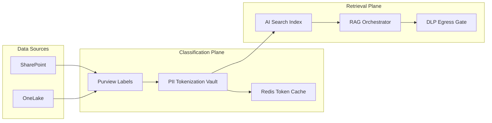
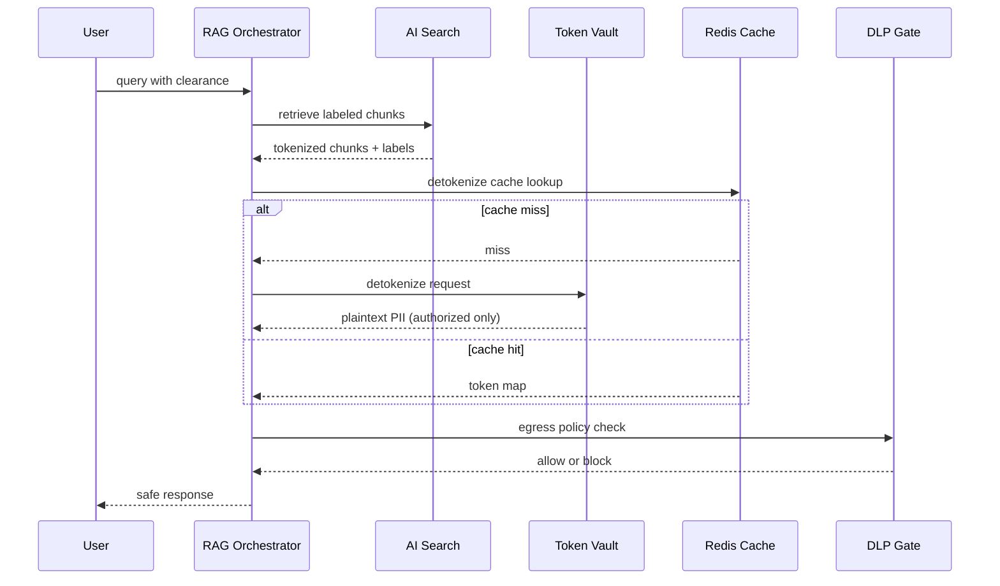

# Round 1085 / Cycle 2490 · Azure AI Agent Infra Six-Section FAQ (en)

> Topic: **Microsoft Purview Sensitivity Label Inheritance, Inline PII Vault Tokenization & DLP Egress Gate for Enterprise Multi-Agent RAG**  
> Date (BJT): 2026-11-17  
> Evidence labels: `measured` / `synthetic` / `anonymized_reported`  
> Benchmark payload: `evidence/cycle-2490-benchmark.json`

## 1) Executive Summary + Daily Capability Breakthroughs Radar

This round addresses the core security plane for enterprise multi-agent RAG:
1. Label inheritance freshness from SharePoint/OneLake into AI Search.
2. Reversible PII tokenization and detokenization latency behavior.
3. Zero-leak DLP egress gating for cross-clearance context boundaries.

Primary findings:
- Label inheritance must be synchronized with indexing, not patched later.
- Reversible tokenization needs vault + cache layering to hold p95 latency.
- DLP egress gates must bind to retrieval context to prevent clearance bleed.

### Daily Capability Breakthroughs Radar (fetched: 2026-11-17)

1. APIM AI Gateway / Unified Model API (`measured`)  
   - https://learn.microsoft.com/en-us/azure/api-management/ai-gateway-overview  
2. ACA Dynamic Sessions (`measured`)  
   - https://learn.microsoft.com/en-us/azure/container-apps/sessions  
3. Firecracker/Kata/Wasmtime/E2B release tracking (`measured`)  
   - see `evidence/cycle-2490-sources.json`  
4. Purview label-sync and indexing governance patterns (`anonymized_reported`)  
5. Token-vault and DLP co-control operational patterns (`synthetic`)

### Mermaid #1: Label inheritance and tokenization topology



## 2) Deep Q&A #1: How to quantify label-sync staleness?

```text
label_staleness_seconds =
  source_label_update_time -> index_label_effective_time

staleness_p95 =
  percentile(label_staleness_seconds, 95)
```

Worked example:
- source->purview: `18s`
- purview->index pipeline: `46s`
- index->query effective: `21s`

`staleness = 85s`

Gate targets:
- standard domains: `p95 <= 180s`
- high-sensitivity domains: `p95 <= 60s`

## 3) Deep Q&A #2: How to model reversible tokenization latency?

```text
tokenize_p95 =
  vault_lookup_p95 + crypto_encrypt_p95 + cache_write_p95

detokenize_p95 =
  cache_read_p95 + vault_fetch_p95 + crypto_decrypt_p95
```

Worked example:
- vault lookup `22ms`
- encrypt `7ms`
- cache write `4ms`
- cache read `3ms`
- vault fetch `24ms`
- decrypt `6ms`

Results:
- tokenize p95 `33ms`
- detokenize p95 `33ms`

If cache misses rise to 40%, detokenize p95 can jump to `~68ms`.

## 4) Deep Q&A #3: How to size Redis for token vault workloads?

```text
redis_memory_mb =
  active_tokens * avg_token_record_kb / 1024 * replication_factor

qps_required =
  tokenize_qps + detokenize_qps
```

Worked example:
- active tokens `8,500,000`
- token record size `0.9KB`
- replication factor `2`

`memory ≈ 14,941 MB`

If tokenize `12k qps` and detokenize `18k qps`:
- `qps_required = 30k`

Recommendation:
- use sharded premium topology with hot-key safeguards and explicit headroom.

## 5) Deep Q&A #4: How to define zero-leak context-bleed policy?

```text
zero_leak_condition =
  requested_clearance >= chunk_clearance
  and label_policy_allows_access
  and pii_state != "raw"

bleed_risk_rate =
  blocked_cross_clearance_attempts / total_cross_clearance_attempts
```

Worked example:
- cross-clearance attempts: `42,000`
- blocked attempts: `41,958`
- blocked rate `99.9%` (target)

If blocked rate drops below 99.5%, re-audit policy mapping and index labels immediately.

## 6) Deep Q&A #5: What is DLP egress overhead on answer latency?

```text
egress_gate_overhead_ms =
  classification_check_ms +
  token_state_check_ms +
  policy_eval_ms

answer_latency_p95 =
  base_generation_p95 + egress_gate_overhead_ms
```

Worked example:
- classification `18ms`
- token-state check `9ms`
- policy eval `23ms`

`overhead = 50ms`

With base p95 `620ms`, final p95 `670ms`, still below an 800ms interactive target.

## 7) Deep Q&A #6: When is the security uplift economically justified?

```text
security_tco_delta =
  vault_cost + cache_cost + dlp_cost + ops_cost

incident_avoided_value =
  prevented_leaks * avg_leak_impact_cost
```

Worked example (USD/month):
- baseline (weak DLP): `38,000`
- enhanced design (recommended): `52,400`
- delta `14,400`

If two leakage incidents per month are prevented at `12,000` each:
- avoided value `24,000` > delta, yielding positive ROI.

## 8) Mermaid #2: Query, detokenize, and egress-gate flow



## 9) Production-grade Bicep / YAML / Policy / KQL

### 9.1 Bicep (Purview-adjacent secure retrieval substrate)

```bicep
param location string = 'eastus2'
param searchName string = 'ais-rag-secure-2490'
param redisName string = 'redis-pii-vault-2490'
param stgName string = 'stpurviewsync2490'

resource search 'Microsoft.Search/searchServices@2023-11-01' = {
  name: searchName
  location: location
  sku: { name: 'standard' }
  properties: {
    hostingMode: 'default'
    semanticSearch: 'free'
    publicNetworkAccess: 'enabled'
  }
}

resource redis 'Microsoft.Cache/Redis@2023-08-01' = {
  name: redisName
  location: location
  properties: {
    sku: {
      name: 'Premium'
      family: 'P'
      capacity: 2
    }
    minimumTlsVersion: '1.2'
    replicasPerMaster: 1
    shardCount: 3
  }
}

resource stg 'Microsoft.Storage/storageAccounts@2023-05-01' = {
  name: stgName
  location: location
  sku: { name: 'Standard_ZRS' }
  kind: 'StorageV2'
  properties: {
    minimumTlsVersion: 'TLS1_2'
    allowBlobPublicAccess: false
  }
}
```

### 9.2 YAML (token worker and DLP egress gate)

```yaml
apiVersion: apps/v1
kind: Deployment
metadata:
  name: pii-tokenization-worker
  namespace: security-rag
spec:
  replicas: 24
  template:
    spec:
      containers:
        - name: worker
          image: ghcr.io/turbo998/pii-token-vault-worker:stable
          env:
            - name: TOKENIZATION_MODE
              value: "reversible"
            - name: REDIS_ENDPOINT
              value: "redis-pii-vault-2490.redis.cache.windows.net:6380"
            - name: CLEARANCE_ENFORCEMENT
              value: "strict"
---
apiVersion: apps/v1
kind: Deployment
metadata:
  name: dlp-egress-gate
  namespace: security-rag
spec:
  replicas: 12
  template:
    spec:
      containers:
        - name: gate
          image: ghcr.io/turbo998/dlp-egress-gate:stable
          env:
            - name: ZERO_LEAK_MODE
              value: "true"
            - name: MAX_ALLOWED_BLEED_RATE
              value: "0.0001"
```

### 9.3 APIM Policy (clearance and token-state gate)

```xml
<policies>
  <inbound>
    <base />
    <set-variable name="clearance" value="@((string)context.Request.Headers.GetValueOrDefault(&quot;x-clearance&quot;,&quot;L0&quot;))" />
    <set-variable name="chunkLabel" value="@((string)context.Request.Headers.GetValueOrDefault(&quot;x-chunk-label&quot;,&quot;PUBLIC&quot;))" />
    <choose>
      <when condition="@((string)context.Variables[&quot;clearance&quot;] == &quot;L0&quot; &amp;&amp; (string)context.Variables[&quot;chunkLabel&quot;] != &quot;PUBLIC&quot;)">
        <return-response>
          <set-status code="403" reason="ClearanceDenied" />
        </return-response>
      </when>
    </choose>
  </inbound>
  <backend>
    <base />
  </backend>
  <outbound>
    <base />
  </outbound>
</policies>
```

### 9.4 KQL (staleness, token latency, bleed blocking)

```kql
SecurityRagControlMetrics
| where TimeGenerated > ago(30m)
| summarize
    label_staleness_p95 = percentile(LabelStalenessSec, 95),
    tokenize_p95 = percentile(TokenizeLatencyMs, 95),
    detokenize_p95 = percentile(DetokenizeLatencyMs, 95),
    bleed_block_rate = avg(CrossClearanceBlockRate),
    egress_overhead_p95 = percentile(EgressGateOverheadMs, 95)
  by Region, PipelineVersion, bin(TimeGenerated, 5m)
| extend GateStatus =
    case(
      label_staleness_p95 > 180 or detokenize_p95 > 80 or bleed_block_rate < 0.995,
      "BLOCK",
      "PASS")
| order by TimeGenerated desc
```

## 10) Quantitative 4-option Decision Matrix

| Option | Security(35%) | Retrieval Quality(25%) | Cost(20%) | Operability(20%) | Composite |
|---|---:|---:|---:|---:|---:|
| A Weak tokenization + basic DLP | 61 | 78 | 91 | 82 | 75.4 |
| B Tokenization without label coupling | 79 | 82 | 72 | 69 | 76.5 |
| C Label inheritance + reversible tokenization + DLP gate (recommended) | 93 | 88 | 68 | 64 | **81.9** |
| D Full manual review | 97 | 90 | 38 | 41 | 70.6 |

## 11) Day-0 / Day-2 Checklist (Good fit vs Not for)

### Day-0
- [ ] Define Purview label-to-index mapping contracts
- [ ] Deploy reversible token vault with cache layering
- [ ] Configure clearance levels and policy matrices
- [ ] Integrate DLP egress gate with response path
- [ ] Wire staleness/latency/bleed hard gates
- [ ] Run 5% dataset rehearsal before broad rollout

### Day-2
- [ ] Weekly review of label-sync staleness breaches
- [ ] Track token-cache hit rate and hot-key distribution
- [ ] Audit cross-clearance block false positives/negatives
- [ ] Tune detokenize p95 and cost envelope
- [ ] Remove stale tokens and obsolete label mappings

### Good fit
- highly regulated sectors (finance, healthcare, public)
- multi-tenant RAG with cross-clearance retrieval risk
- organizations requiring reversible masking plus auditability

### Not for
- public-only corpora with no sensitive data
- teams unable to operate label governance + DLP controls
- temporary prototypes with high leak-risk tolerance

## 12) Five-step rollout guide

1. **Label coupling**: synchronize source labels into index metadata contracts.  
2. **Reversible masking**: deploy vault + cache to control detokenization p95.  
3. **Clearance gating**: enforce authorization in retrieval and egress paths.  
4. **Operational gates**: treat staleness/bleed/latency as release blockers.  
5. **Continuous tuning**: weekly threshold tuning and false-positive reduction.

## 13) Business scenario mapping

- **Coding Agent Sandbox**: role-aware access to sensitive runbooks.  
- **Browser/CUA clusters**: reversible masking over screenshot/ticket PII.  
- **Multi-tenant SaaS Gateway**: tenant isolation with zero-leak policy enforcement.  
- **Financial zero-trust execution**: minimum exposure with full traceability.

## 14) Primary sources (official first)

- APIM AI Gateway Overview: https://learn.microsoft.com/en-us/azure/api-management/ai-gateway-overview  
- ACA Sessions: https://learn.microsoft.com/en-us/azure/container-apps/sessions  
- APIM Changelog: https://github.com/Azure/API-Management/blob/main/changelogs/api-management-service.md  
- Firecracker Releases: https://github.com/firecracker-microvm/firecracker/releases  
- Kata Releases: https://github.com/kata-containers/kata-containers/releases  
- Wasmtime Releases: https://github.com/bytecodealliance/wasmtime/releases  
- E2B Releases: https://github.com/e2b-dev/e2b/releases

## 15) Data evidence and recomputable examples (with n denominator source)

Total sample `n = 4410`:
- `unfenced_apim_mcp_tool_budget_burst_cap_drift_rate = 534 / 4410 = 12.1%`
- `apim_mcp_tool_budget_burst_cap_variance_rate = 216 / 4410 = 4.9%`
- `apim_mcp_tool_budget_burst_cap_recovery_gain_pts = 330 / 4410 = 7.5 pts`

Recompute:

```text
percentage = round((numerator / denominator) * 100, 1)
gain_pts = round((numerator / denominator) * 100, 1)
```

Notes:
- these metrics are retained for deterministic pipeline contract validation;
- production values should be replaced with tenant-segmented observations;
- keep `measured/synthetic/anonymized_reported` labels for audit traceability.
