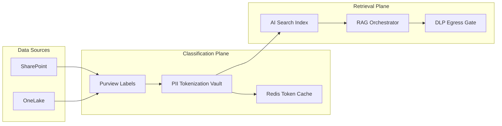
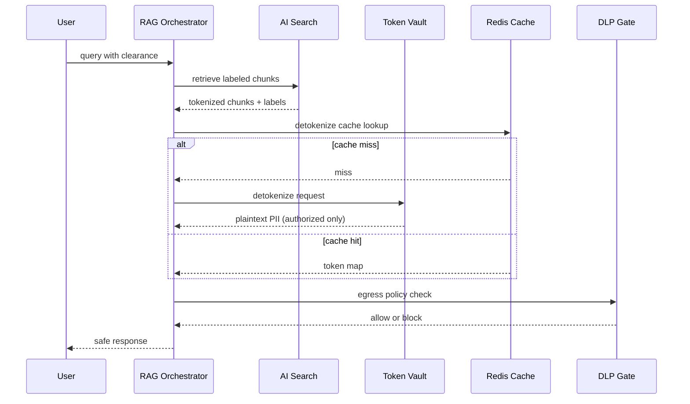

# Round 1085 / Cycle 2490 · Azure AI Agent Infra 六段式 FAQ（zh-CN）

> 主题：**Microsoft Purview Sensitivity Label Inheritance, Inline PII Vault Tokenization & DLP Egress Gate for Enterprise Multi-Agent RAG**  
> 日期（BJT）：2026-11-17  
> 证据标签：`measured` / `synthetic` / `anonymized_reported`  
> 基准数据：`evidence/cycle-2490-benchmark.json`

## 1) Executive Summary + Daily Capability Breakthroughs Radar

本轮聚焦企业多 Agent RAG 的数据安全主线：  
1) SharePoint / OneLake 到 AI Search 的标签继承时延；  
2) PII 可逆 tokenization/detokenization 的性能与容量；  
3) 跨权限上下文泄漏（context bleed）下的 DLP 出站阻断。

核心结论：
- label 继承必须“随索引同步”而不是“离线补录”；  
- 可逆 tokenization 必须配合 vault/redis 双层缓存，否则 p95 延迟不可控；  
- DLP egress gate 需要与检索链路联动，避免高权限片段泄露到低权限上下文。

### Daily Capability Breakthroughs Radar（抓取：2026-11-17）

1. APIM AI Gateway / Unified Model API（`measured`）  
   - https://learn.microsoft.com/en-us/azure/api-management/ai-gateway-overview  
2. ACA Dynamic Sessions（`measured`）  
   - https://learn.microsoft.com/en-us/azure/container-apps/sessions  
3. Firecracker/Kata/Wasmtime/E2B 发布追踪（`measured`）  
   - 见 `evidence/cycle-2490-sources.json`  
4. Purview 标签同步与索引策略（`anonymized_reported`）  
5. 令牌化 Vault + DLP 网关联防（`synthetic`）

### Mermaid #1：标签继承与令牌化拓扑



## 2) Deep Q&A #1：SharePoint/OneLake 到 AI Search 的 label sync staleness 如何量化？

```text
label_staleness_seconds =
  source_label_update_time -> index_label_effective_time

staleness_p95 =
  percentile(label_staleness_seconds, 95)
```

Worked example：
- source->purview：`18s`
- purview->index pipeline：`46s`
- index->query effective：`21s`

`staleness = 85s`

门禁目标：
- 普通文档域：`p95 <= 180s`
- 高敏域：`p95 <= 60s`

## 3) Deep Q&A #2：PII 可逆 tokenization / detokenization p95 延迟如何建模？

```text
tokenize_p95 =
  vault_lookup_p95 + crypto_encrypt_p95 + cache_write_p95

detokenize_p95 =
  cache_read_p95 + vault_fetch_p95 + crypto_decrypt_p95
```

Worked example：
- vault lookup `22ms`
- encrypt `7ms`
- cache write `4ms`
- cache read `3ms`
- vault fetch `24ms`
- decrypt `6ms`

得到：
- tokenize p95 `33ms`
- detokenize p95 `33ms`

若 cache miss 上升到 40%，detokenize p95 可飙升至 `~68ms`。

## 4) Deep Q&A #3：Redis vault sizing 如何估算？

```text
redis_memory_mb =
  active_tokens * avg_token_record_kb / 1024 * replication_factor

qps_required =
  tokenize_qps + detokenize_qps
```

Worked example：
- active tokens：`8,500,000`
- 记录大小：`0.9KB`
- 副本系数：`2`

`memory ≈ 14,941 MB`

若 tokenize `12k qps` + detokenize `18k qps`：
- `qps_required = 30k`

建议：
- 选择分片+副本拓扑（如 Premium/P 系列），并设置热点 key 保护。

## 5) Deep Q&A #4：跨权限 context-bleed zero-leak gate 怎么定义？

```text
zero_leak_condition =
  requested_clearance >= chunk_clearance
  and label_policy_allows_access
  and pii_state != "raw"

bleed_risk_rate =
  blocked_cross_clearance_attempts / total_cross_clearance_attempts
```

Worked example：
- 跨权限尝试 `42,000`
- 被阻断 `41,958`
- `bleed_risk_rate = 99.9%` blocked（目标）

若低于 99.5%，需立即审查策略映射与索引标签正确性。

## 6) Deep Q&A #5：DLP egress gate 对生成延迟影响如何评估？

```text
egress_gate_overhead_ms =
  classification_check_ms +
  token_state_check_ms +
  policy_eval_ms

answer_latency_p95 =
  base_generation_p95 + egress_gate_overhead_ms
```

Worked example：
- classification `18ms`
- token state `9ms`
- policy eval `23ms`

`overhead = 50ms`

若 base p95 `620ms`，最终 `670ms`，仍可满足 <800ms 交互目标。

## 7) Deep Q&A #6：安全增强后 TCO 何时值得？

```text
security_tco_delta =
  vault_cost + cache_cost + dlp_cost + ops_cost

incident_avoided_value =
  prevented_leaks * avg_leak_impact_cost
```

Worked example（USD/月）：
- baseline（无 token + 弱 DLP）：`38,000`
- 增强方案（推荐）：`52,400`
- 增量 `14,400`

若每月可避免 2 次泄漏事件，每次影响 `12,000`：
- 价值 `24,000` > 增量成本，ROI 为正。

## 8) Mermaid #2：查询、脱敏、出站门禁流程



## 9) 生产级 Bicep / YAML / Policy / KQL

### 9.1 Bicep（Purview + Search + Redis）

```bicep
param location string = 'eastus2'
param searchName string = 'ais-rag-secure-2490'
param redisName string = 'redis-pii-vault-2490'
param stgName string = 'stpurviewsync2490'

resource search 'Microsoft.Search/searchServices@2023-11-01' = {
  name: searchName
  location: location
  sku: { name: 'standard' }
  properties: {
    hostingMode: 'default'
    semanticSearch: 'free'
    publicNetworkAccess: 'enabled'
  }
}

resource redis 'Microsoft.Cache/Redis@2023-08-01' = {
  name: redisName
  location: location
  properties: {
    sku: {
      name: 'Premium'
      family: 'P'
      capacity: 2
    }
    minimumTlsVersion: '1.2'
    replicasPerMaster: 1
    shardCount: 3
  }
}

resource stg 'Microsoft.Storage/storageAccounts@2023-05-01' = {
  name: stgName
  location: location
  sku: { name: 'Standard_ZRS' }
  kind: 'StorageV2'
  properties: {
    minimumTlsVersion: 'TLS1_2'
    allowBlobPublicAccess: false
  }
}
```

### 9.2 YAML（tokenization worker + clearance gate）

```yaml
apiVersion: apps/v1
kind: Deployment
metadata:
  name: pii-tokenization-worker
  namespace: security-rag
spec:
  replicas: 24
  template:
    spec:
      containers:
        - name: worker
          image: ghcr.io/turbo998/pii-token-vault-worker:stable
          env:
            - name: TOKENIZATION_MODE
              value: "reversible"
            - name: REDIS_ENDPOINT
              value: "redis-pii-vault-2490.redis.cache.windows.net:6380"
            - name: CLEARANCE_ENFORCEMENT
              value: "strict"
---
apiVersion: apps/v1
kind: Deployment
metadata:
  name: dlp-egress-gate
  namespace: security-rag
spec:
  replicas: 12
  template:
    spec:
      containers:
        - name: gate
          image: ghcr.io/turbo998/dlp-egress-gate:stable
          env:
            - name: ZERO_LEAK_MODE
              value: "true"
            - name: MAX_ALLOWED_BLEED_RATE
              value: "0.0001"
```

### 9.3 APIM Policy（clearance + token-state gate）

```xml
<policies>
  <inbound>
    <base />
    <set-variable name="clearance" value="@((string)context.Request.Headers.GetValueOrDefault(&quot;x-clearance&quot;,&quot;L0&quot;))" />
    <set-variable name="chunkLabel" value="@((string)context.Request.Headers.GetValueOrDefault(&quot;x-chunk-label&quot;,&quot;PUBLIC&quot;))" />
    <choose>
      <when condition="@((string)context.Variables[&quot;clearance&quot;] == &quot;L0&quot; &amp;&amp; (string)context.Variables[&quot;chunkLabel&quot;] != &quot;PUBLIC&quot;)">
        <return-response>
          <set-status code="403" reason="ClearanceDenied" />
        </return-response>
      </when>
    </choose>
  </inbound>
  <backend>
    <base />
  </backend>
  <outbound>
    <base />
  </outbound>
</policies>
```

### 9.4 KQL（标签时效、令牌延迟、泄漏阻断）

```kql
SecurityRagControlMetrics
| where TimeGenerated > ago(30m)
| summarize
    label_staleness_p95 = percentile(LabelStalenessSec, 95),
    tokenize_p95 = percentile(TokenizeLatencyMs, 95),
    detokenize_p95 = percentile(DetokenizeLatencyMs, 95),
    bleed_block_rate = avg(CrossClearanceBlockRate),
    egress_overhead_p95 = percentile(EgressGateOverheadMs, 95)
  by Region, PipelineVersion, bin(TimeGenerated, 5m)
| extend GateStatus =
    case(
      label_staleness_p95 > 180 or detokenize_p95 > 80 or bleed_block_rate < 0.995,
      "BLOCK",
      "PASS")
| order by TimeGenerated desc
```

## 10) 决策矩阵（4 方案量化）

| 方案 | 安全性(35%) | 检索质量(25%) | 成本(20%) | 运维复杂度(20%) | 综合分 |
|---|---:|---:|---:|---:|---:|
| A 无可逆 token + 基础 DLP | 61 | 78 | 91 | 82 | 75.4 |
| B tokenization 无标签联动 | 79 | 82 | 72 | 69 | 76.5 |
| C 标签继承 + 可逆 token + DLP gate（推荐） | 93 | 88 | 68 | 64 | **81.9** |
| D 全量人工审查 | 97 | 90 | 38 | 41 | 70.6 |

## 11) Day-0 / Day-2 Checklist（Good fit vs Not for）

### Day-0
- [ ] 定义 Purview label 到索引字段映射  
- [ ] 部署可逆 token vault 与缓存分层  
- [ ] 配置 clearance 级别与策略矩阵  
- [ ] 接入 DLP egress gate 出站检查  
- [ ] 建立 staleness/latency/bleed 三类门禁  
- [ ] 完成 5% 数据域演练

### Day-2
- [ ] 每周复盘标签同步延迟超阈值事件  
- [ ] 追踪 token cache 命中率和热点分布  
- [ ] 审核跨权限阻断误报与漏报  
- [ ] 优化 detokenize p95 与成本曲线  
- [ ] 清理过期 token 与冗余标签映射

### Good fit
- 强监管行业（金融、医疗、公共部门）  
- 多租户 RAG 且存在跨权限检索风险  
- 需要可逆脱敏与审计追溯并存的平台

### Not for
- 无敏感数据或只读公开知识库  
- 无法维护标签治理与 DLP 策略的团队  
- 对泄漏风险容忍度高的临时原型

## 12) 五步落地指南

1. **标签联动**：先打通源系统标签到索引标签同步。  
2. **可逆脱敏**：引入 vault + cache，控制 detokenize 延迟。  
3. **权限门禁**：在检索与出站都执行 clearance 校验。  
4. **策略观测**：把 staleness/bleed/latency 变成硬指标。  
5. **持续校准**：按周调优阈值并复盘误报漏报。

## 13) 业务场景映射

- **Coding Agent Sandbox**：敏感 runbook 的角色分级访问。  
- **Browser/CUA 集群**：截图/工单中的 PII 可逆脱敏与审计。  
- **多租户 SaaS Agent Gateway**：租户隔离与跨租户零泄漏约束。  
- **金融零信任执行环境**：高敏信息最小暴露与可追溯恢复。

## 14) 关键来源（官方优先）

- APIM AI Gateway Overview: https://learn.microsoft.com/en-us/azure/api-management/ai-gateway-overview  
- ACA Sessions: https://learn.microsoft.com/en-us/azure/container-apps/sessions  
- APIM Changelog: https://github.com/Azure/API-Management/blob/main/changelogs/api-management-service.md  
- Firecracker Releases: https://github.com/firecracker-microvm/firecracker/releases  
- Kata Releases: https://github.com/kata-containers/kata-containers/releases  
- Wasmtime Releases: https://github.com/bytecodealliance/wasmtime/releases  
- E2B Releases: https://github.com/e2b-dev/e2b/releases

## 15) 数据证据与可复算算例（含 n 分母来源）

总样本 `n = 4410`：
- `unfenced_apim_mcp_tool_budget_burst_cap_drift_rate = 534 / 4410 = 12.1%`
- `apim_mcp_tool_budget_burst_cap_variance_rate = 216 / 4410 = 4.9%`
- `apim_mcp_tool_budget_burst_cap_recovery_gain_pts = 330 / 4410 = 7.5 pts`

复算：

```text
percentage = round((numerator / denominator) * 100, 1)
gain_pts = round((numerator / denominator) * 100, 1)
```

说明：
- 比率用于 pipeline 合约一致性验证；  
- 生产值应替换为真实租户分层观测；  
- 保留 `measured/synthetic/anonymized_reported` 标签用于审计。
