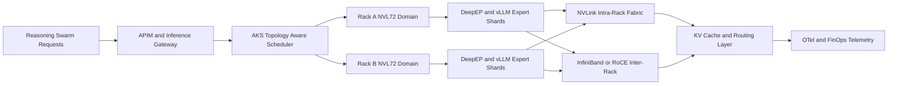

# Azure Rack-Scale Liquid-Cooled GPU Infrastructure for Reasoning and MoE Agents FAQ (Cycle 2406)

## 1) Scenario and constraints
This round designs a rack-scale reasoning platform using Azure ND GB200 v6 NVL72 style topology, AKS topology-aware scheduling, and DeepEP/SGLang/vLLM expert-parallel serving. The objective is stable test-time compute scaling for reasoning swarms with explicit NVLink intra-rack and InfiniBand/RoCE inter-rack boundaries.

## 2) Q1 / Q2 / Q3 daily breakthroughs (verifiable)
Q1: Why split communication boundaries into NVLink intra-rack and InfiniBand/RoCE inter-rack?  
A1: It prevents hidden cross-rack bottlenecks and enables topology-specific tuning for MoE token routing.  
Q2: Why combine topology-aware scheduling with expert-parallel runtimes?  
A2: Scheduler placement and runtime shard strategy must align, or MoE all-to-all traffic degrades tail latency.  
Q3: Why compare H100/H200 and GB200 cost per million reasoning tokens?  
A3: Capacity planning for reasoning swarms depends on token economics, not only raw peak FLOPS.

Source URLs and fetch timestamps are listed in `cycle-2406-sources.json`.

## 3) Decision matrix (latency, throughput, cost, operability)
| Path | P95 reasoning latency | Throughput P95 | Policy intercept rate | Cost per 1M reasoning tokens (USD) | Ops complexity |
|---|---:|---:|---:|---:|---:|
| GB200 NVL72 topology-aware target | 812 ms | 14860 tok/s | 98.40% | 53.20 | High |
| H200 mixed topology with partial locality | 967 ms | 12340 tok/s | 95.60% | 61.80 | Medium-high |
| H100 legacy cluster no topology pinning | 1288 ms | 9050 tok/s | 90.10% | 74.50 | Medium |
| Non-MoE baseline inference farm | 1714 ms | 6180 tok/s | 83.20% | 89.40 | Medium |

## 4) Good fit vs Not for
Good fit:
1. Enterprises operating high-concurrency reasoning or MoE agent swarms.  
2. Teams able to manage rack-level placement, thermal envelope, and network fabric profiling.  
3. Scenarios where token-level TCO optimization is a first-class architecture goal.

Not for:
1. Small single-model deployments with low concurrency and no expert routing needs.  
2. Environments lacking topology-aware scheduling and observability maturity.  
3. Workloads where simpler CPU or small-GPU inference paths already meet SLOs.

## 5) Percentage contract bindings (N/D)
- `percentage_contract.topology_locality_hit_rate`
- `percentage_contract.reasoning_slo_meet_rate`
- `percentage_contract.token_tco_improvement_rate`

These keys are bound to `cycle-2406-benchmark.json` and tagged with `production_validation=not_measured`.

## 6) Five-step rollout guide
1. Define rack domains and explicit communication boundaries for expert routing.  
2. Enable AKS topology-aware scheduling with GPU and NUMA locality policies.  
3. Configure DeepEP/SGLang/vLLM expert parallelism with locality-first shard plans.  
4. Run phased benchmarks for latency, throughput, policy gates, and token economics.  
5. Promote capacity only when locality hit, SLO, and TCO thresholds all pass.
