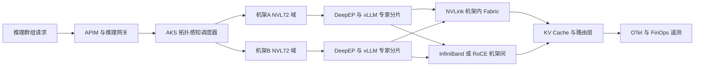

# Azure 机架级液冷 GPU 推理与 MoE Agent 基础设施 FAQ（Cycle 2406）

## 1) 场景与约束
本轮设计面向推理与 MoE Agent 群组的机架级平台：以 Azure ND GB200 v6 NVL72 拓扑为主，结合 AKS 拓扑感知调度与 DeepEP/SGLang/vLLM 专家并行运行时。目标是在推理群组 test-time compute 扩展下，明确 NVLink 机架内与 InfiniBand/RoCE 机架间通信边界。

## 2) Q1 / Q2 / Q3 当日能力突破（可验证）
Q1：为什么要区分 NVLink 机架内与 IB/RoCE 机架间边界？  
A1：可避免隐藏的跨机架瓶颈，并为 MoE token 路由做拓扑专用调优。  
Q2：为什么拓扑感知调度必须与专家并行运行时联动？  
A2：若调度与分片策略脱节，MoE all-to-all 通信会显著拉高尾延迟。  
Q3：为什么要比较 H100/H200 与 GB200 的百万推理 token 成本？  
A3：推理群组容量规划的核心是 token 经济性，而不仅是峰值算力。

来源与抓取时间见 `cycle-2406-sources.json`。

## 3) 决策矩阵（时延、吞吐、成本、可运维性）
| 路径 | P95 推理时延 | 吞吐 P95 | 策略拦截率 | 每百万推理 token 成本（USD） | 运维复杂度 |
|---|---:|---:|---:|---:|---:|
| GB200 NVL72 拓扑感知目标路径 | 812 ms | 14860 tok/s | 98.40% | 53.20 | 高 |
| H200 混合拓扑局部优化路径 | 967 ms | 12340 tok/s | 95.60% | 61.80 | 中高 |
| H100 无拓扑 pinning 传统集群 | 1288 ms | 9050 tok/s | 90.10% | 74.50 | 中 |
| 非 MoE 基线推理农场 | 1714 ms | 6180 tok/s | 83.20% | 89.40 | 中 |

## 4) Good fit vs Not for
Good fit：
1. 运行高并发推理或 MoE Agent 群组的企业场景。  
2. 具备机架级放置、热设计与网络 fabric 剖析能力的团队。  
3. 以 token 级 TCO 优化为核心目标的生产平台。

Not for：
1. 并发较低且无需专家路由的小规模单模型部署。  
2. 缺乏拓扑感知调度与可观测性能力的环境。  
3. CPU 或小规模 GPU 已满足 SLO 的轻量负载场景。

## 5) Percentage contract bindings (N/D)
- `percentage_contract.topology_locality_hit_rate`
- `percentage_contract.reasoning_slo_meet_rate`
- `percentage_contract.token_tco_improvement_rate`

以上键绑定 `cycle-2406-benchmark.json`，并标注 `production_validation=not_measured`。

## 6) 五步落地指南
1. 定义机架域与专家路由通信边界。  
2. 在 AKS 启用 GPU/NUMA 拓扑感知调度策略。  
3. 配置 DeepEP/SGLang/vLLM 专家并行与 locality-first 分片。  
4. 分阶段跑时延、吞吐、策略门禁与 token 经济性基准。  
5. 仅在 locality、SLO、TCO 同时达标后扩容上线。
