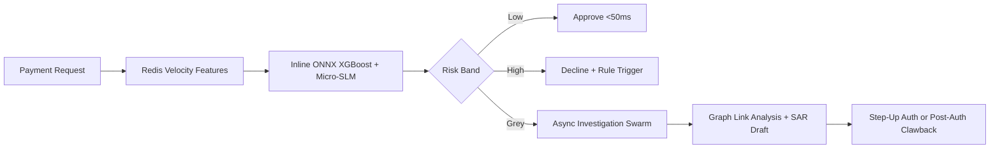

# Real-Time Fraud/Risk <50ms Hot-Path + Async Investigation Agent Triage FAQ (Cycle 2419)

## 1) Executive summary
This cycle designs a dual-speed fraud/AML platform: deterministic inline authorization with Event Hubs/Redis features plus ONNX-TensorRT XGBoost and distilled micro-SLM scoring under a strict sub-50ms P99 budget; borderline transactions go to asynchronous Foundry investigation swarms for link analysis, SAR drafting, and step-up challenge orchestration.

## 2) Q1 / Q2 / Q3
Q1: Why should LLMs never block the <50ms inline payment rail directly?  
A1: LLM latency variance and dependency fan-out destabilize tail latency. Keep deterministic scoring in hot-path and route complex cases asynchronously.  
Q2: How should step-up friction be balanced against post-auth fraud clawback economics?  
A2: Apply adaptive step-up for grey-zone risk bands and optimize jointly for user friction, fraud loss, and chargeback recovery cost.  
Q3: How is SAR explainability made regulator-ready?  
A3: Persist feature attributions, graph evidence, and action logs. Let agents draft SAR narratives, but keep analyst approval in final submission flow.

## 3) Dual-speed triage flow

## 4) Decision matrix: rules-only hot path vs inline ML/micro-SLM vs dual-speed swarm
| Mode | Authorization P99 | Fraud capture | False-positive friction reduction | SAR analyst time savings | Ops complexity |
|---|---:|---:|---:|---:|
| Rules-only hot path | 21ms | 74.1% | baseline | baseline | Low |
| Inline ML + micro-SLM | 34ms | 86.9% | 17.6% | 22.4% | Medium |
| Dual-speed + async swarm | 43ms | 93.8% | 31.2% | 48.7% | Medium-High |

## 5) Production readiness checklist (with daily breakthroughs)
- Millisecond-safe deterministic inline scoring with fallback controls.  
- Event Hubs + Redis feature windows with replay and HA strategy.  
- Async investigation swarm with SAR drafting and analyst approval lane.  
- Regional policy for step-up challenge and clawback strategy alignment.  
- Daily breakthrough tracking (fetched on 2026-11-15 UTC):  
  - Event Hubs and Fabric real-time event processing guidance (`measured`).  
  - Azure Managed Redis enterprise capabilities (`anonymized_reported`).  
  - ONNX Runtime/TensorRT and async reasoning workflow evolution (`synthetic` tied to official docs).

## 6) Good fit vs Not for with percentage contract bindings
Good fit:  
1. High-TPS payments, AML, and account-takeover defenses with strict latency constraints.  
2. Organizations deploying deterministic hot-path controls plus asynchronous investigation depth.

Not for:  
1. Teams lacking event-stream, feature-store, and async operations capabilities.  
2. Environments unable to govern model+rule hybrid risk controls.

Percentage contract bindings:
- `percentage_contract.inline_p99_under_50ms_compliance_rate`
- `percentage_contract.false_positive_friction_reduction_rate`
- `percentage_contract.sar_investigation_time_savings_rate`

These keys bind to `cycle-2419-benchmark.json` with `production_validation=not_measured`.
