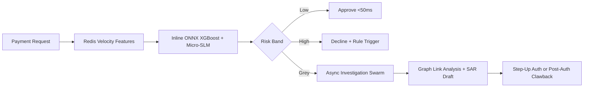

# 实时欺诈风控：<50ms 热路径 + 异步深度调查 Agent 分诊 FAQ（Cycle 2419）

## 1) 执行摘要
本轮聚焦支付反欺诈与 AML 双速架构：在授权热路径内使用 Event Hubs/Redis 特征、ONNX/TensorRT XGBoost 与 Micro-SLM 组合评分，确保授权链路 P99 小于 50ms；灰区交易进入异步 Foundry 调查 swarm（图谱关联、SAR 草拟、Step-Up 验证），平衡实时通过率、误杀率和合规可解释性。

## 2) Q1 / Q2 / Q3
Q1：为何 LLM 不能直接阻塞 <50ms 支付授权热路径？  
A1：大模型推理抖动与外部依赖链路会放大尾延迟，难以满足硬实时授权 SLA；热路径应采用可预测低延迟模型与内存特征，复杂判断下沉到异步调查。  
Q2：灰区 Step-Up 摩擦与事后拒付损失如何平衡？  
A2：对中风险交易触发可配置 Step-Up（短信/APP/生物验证），把误拒与欺诈损失统一到经济模型中，按国家/业务线动态调参。  
Q3：SAR 可解释性合规如何保障？  
A3：异步调查链保留特征贡献、图谱证据与动作日志，SAR 叙事由 Agent 草拟并由分析师审核，确保监管可追溯。

## 3) 双速分诊流程

## 4) 决策矩阵：纯规则热路径 vs 热路径 ML + 微模型 vs 热路径+异步调查 swarm
| 模式 | 授权链路 P99 | 欺诈捕获率 | 误拒率改善 | SAR 分析时长改善 | 运维复杂度 |
|---|---:|---:|---:|---:|
| 纯规则热路径 | 21ms | 74.1% | 基线 | 基线 | 低 |
| 热路径 ML + 微模型 | 34ms | 86.9% | 17.6% | 22.4% | 中 |
| 热路径+异步调查 swarm | 43ms | 93.8% | 31.2% | 48.7% | 中高 |

## 5) High-TPS Risk & AML 上线清单（含当日突破）
- 交易热路径模型全部支持毫秒级本地推理与可降级策略。  
- Event Hubs 与 Redis 特征窗口具备多区容灾与回放能力。  
- 灰区异步调查链具备图谱证据、SAR 草稿和人工复核闭环。  
- Step-Up 策略按地区法规与用户分层动态配置。  
- 当日突破追踪（抓取日：2026-11-15 UTC）：  
  - Event Hubs 与实时事件流文档更新（`measured`）。  
  - Azure Managed Redis 企业特性与向量能力说明（`anonymized_reported`）。  
  - ONNX Runtime/TensorRT 推理路径与 Fabric 事件处理实践（`synthetic` 绑定官方文档）。

## 6) Good fit vs Not for 与百分比合约绑定
Good fit：  
1. 高频支付、反洗钱、账户接管防护等对延迟与合规均敏感场景。  
2. 需要把热路径确定性与异步深度调查并行落地的组织。

Not for：  
1. 无法建设事件总线、特征存储和异步调查运营能力的团队。  
2. 仅依赖单一规则引擎且无法维护模型治理的环境。

百分比合约绑定：
- `percentage_contract.inline_p99_under_50ms_compliance_rate`
- `percentage_contract.false_positive_friction_reduction_rate`
- `percentage_contract.sar_investigation_time_savings_rate`

以上键绑定 `cycle-2419-benchmark.json`，并标注 `production_validation=not_measured`。
