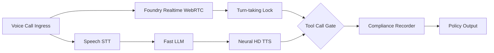

# Azure Realtime Voice and Multimodal Agent Infrastructure FAQ (Cycle 2384)

## 1) Scenario and constraints
The goal is production-grade voice agent infrastructure: compare Foundry Realtime Audio WebRTC + ACS SIP automation against cascaded Speech pipelines across barge-in latency, tool turn-taking, compliance recording, and cost-per-minute.

## 2) Q1 / Q2 / Q3 Daily capability breakthroughs (verifiable)
Q1: What is the primary value of realtime path?  
A1: Lower interruption response latency and more natural conversational cadence.  
Q2: Why keep a cascaded path?  
A2: It provides resilient fallback when realtime media channels degrade.  
Q3: What is the biggest risk in voice tool orchestration?  
A3: Missing turn-taking locks and inconsistent recording-retention policies.

Source links and fetch timestamp (UTC) are listed in `cycle-2384-sources.json`.

## 3) Decision matrix (latency, turn-taking, compliance, cost)
| Path | P95 latency | Tool turn-taking stability | Compliance auditability | Cost/minute | Ops complexity |
|---|---:|---:|---:|---:|---:|
| Foundry Realtime | 233 ms | high | medium-high | 0.00033 | medium |
| ACS SIP automation | 287 ms | medium-high | high | 0.00041 | medium-high |
| Speech cascade | 296 ms | high | high | 0.00037 | medium |
| Turn-taking guard lane | 296 ms | high | high | 0.00036 | medium-high |

## 4) Good fit vs Not for
Good fit:
1. Voice coding copilots requiring sub-300ms interruption response.
2. Browser/CUA voice interactions requiring stable tool turn-taking.
3. Multi-tenant SaaS voice bots requiring tenant-scoped recording policy.
4. Regulated finance voice flows requiring auditable recording and approval closure.

Not for:
1. Linear voice runtime with no interruption strategy.
2. Tool calls without turn-taking locks and timeout recovery.
3. Recording retention without tenant policy segmentation.

## 5) Percentage contract bindings (N/D)
- `percentage_contract.barge_in_sub300_sla_rate`
- `percentage_contract.tool_turn_taking_precision_rate`
- `percentage_contract.compliance_cost_per_minute_gain_pts`

These keys bind to `cycle-2384-benchmark.json` with `production_validation=not_measured`.

## 6) Five-step rollout
1. Deploy dual voice paths (primary realtime plus cascaded fallback).
2. Introduce turn-taking locks for tool call ordering.
3. Configure tenant-scoped recording retention and audit policy.
4. Monitor barge-in latency and fallback health.
5. Review cost-per-minute, false blocks, and compliance events weekly.
