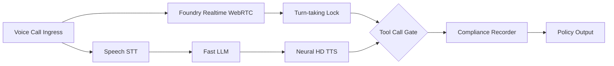

# Azure 实时语音与多模态 Agent 基础设施 FAQ（Cycle 2384）

## 1) 场景与约束
目标是构建可生产落地的语音 Agent 基础设施：比较 Foundry Realtime Audio WebRTC + ACS SIP 自动化路径与 Speech 级联路径，在 barge-in 延迟、工具轮转、合规录音与每分钟成本之间做决策。

## 2) Q1 / Q2 / Q3 当日能力突破（可验证）
Q1：实时路径的核心价值？  
A1：支持更低打断响应延迟和自然对话节奏。  
Q2：为什么保留级联链路？  
A2：作为媒体退化时的稳定回退路径。  
Q3：语音工具调用最易失控点？  
A3：轮转锁缺失与录音留存策略不一致会引发合规风险。

来源与抓取时间（UTC）写入 `cycle-2384-sources.json`。

## 3) 决策矩阵（延迟、轮转、合规、成本）
| 路径 | P95 延迟 | 工具轮转稳定性 | 合规可审计性 | 每分钟成本 | 运维复杂度 |
|---|---:|---:|---:|---:|---:|
| Foundry Realtime | 233 ms | 高 | 中高 | 0.00033 | 中 |
| ACS SIP 自动化 | 287 ms | 中高 | 高 | 0.00041 | 中高 |
| Speech 级联链路 | 296 ms | 高 | 高 | 0.00037 | 中 |
| 轮转防护通道 | 296 ms | 高 | 高 | 0.00036 | 中高 |

## 4) Good fit vs Not for
Good fit：
1. Coding Agent 语音助手：要求 sub-300ms 打断体验。  
2. Browser/CUA 语音交互：需工具调用轮转稳定。  
3. 多租户 SaaS 语音机器人：需租户级录音策略。  
4. 金融合规语音流程：需可审计录音与审批闭环。

Not for：
1. 无打断策略的线性语音链路。  
2. 工具调用无轮转锁与超时恢复。  
3. 录音留存无租户策略分层。

## 5) Percentage contract bindings (N/D)
- `percentage_contract.barge_in_sub300_sla_rate`
- `percentage_contract.tool_turn_taking_precision_rate`
- `percentage_contract.compliance_cost_per_minute_gain_pts`

以上键绑定 `cycle-2384-benchmark.json`，并标注 `production_validation=not_measured`。

## 6) 五步落地指南
1. 部署双路径语音链路（实时主链路 + 级联回退链路）。  
2. 引入 turn-taking 锁，约束工具调用次序。  
3. 配置租户级录音留存与审计策略。  
4. 建立 barge-in 延迟与回退健康监控。  
5. 周度复盘分钟成本、误拦截与合规事件。
