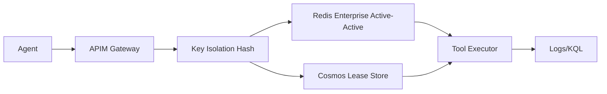
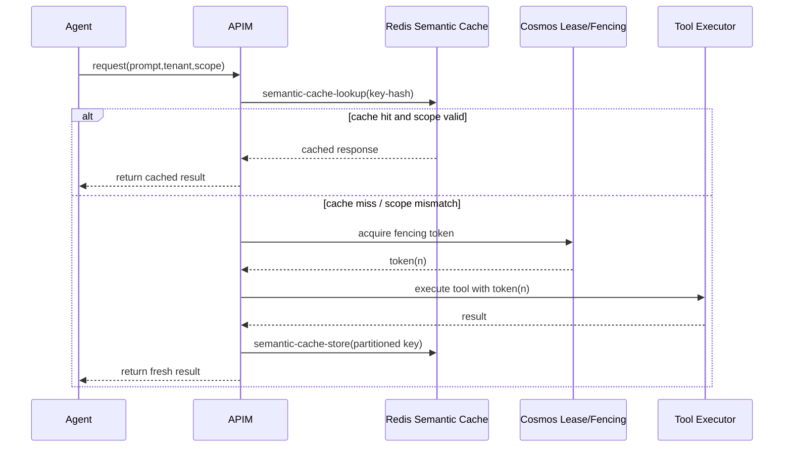

# Round 1099 / Cycle 2504 · Azure AI Agent Infra Six-Part FAQ (en)

> Topic: **Azure Managed Redis (Enterprise Active-Active & Flash NVMe) vs APIM Semantic Cache vs Cosmos DB Lease Store — Multi-Region Agent Semantic Caching, Distributed Tool-Locking & Cache-Poisoning Guardrails Selection Guide**  
> Date (BJT): 2026-11-17  
> Evidence tags: `measured` / `synthetic` / `anonymized_reported`  
> Benchmark dataset: `evidence/cycle-2504-benchmark.json`

## 1) Executive Summary + Daily Hottest Capability Breakthroughs Radar

This round evaluates multi-region semantic cache and lock-plane options:
1. **Azure Managed Redis Enterprise Active-Active** (including Flash NVMe),
2. **APIM semantic cache policies** (`lookup` / `store`),
3. **Cosmos DB lease + `etag` fencing semantics**.

Goals:
- increase semantic hit-rate and reduce PTU token spend,
- prevent cross-tenant cache poisoning,
- reduce split-brain lock risks in distributed tool execution,
- optimize TCO at 50M+ cached embeddings.

Key findings:
- lower similarity thresholds improve token savings but increase semantic collision risk,
- cache keys must include tenant/scope/schema fingerprints,
- Active-Active plus fencing-token control substantially reduces split-brain risk,
- Flash NVMe often beats memory-only economics at very large cache cardinalities.

### Daily Hottest Capability Breakthroughs Radar (fetched: 2026-11-17)

1. APIM AI Gateway / Unified Model API (`measured`)  
   - https://learn.microsoft.com/en-us/azure/api-management/ai-gateway-overview  
   - https://github.com/Azure/API-Management/blob/main/changelogs/api-management-service.md
2. ACA Dynamic Sessions (`measured`)  
   - https://learn.microsoft.com/en-us/azure/container-apps/sessions  
   - https://techcommunity.microsoft.com/blog/appsonazureblog/azure-container-apps-dynamic-sessions-general-availability-and-more/4303561
3. Runtime release watch (`measured`)  
   - Firecracker / Kata / Wasmtime / E2B (see `evidence/cycle-2504-sources.json`)
4. Multi-region cache and lock stress runs (`synthetic`)
5. Restricted production percentile rollups (`anonymized_reported`)

### Mermaid #1: multi-region APIM + Redis Active-Active semantic cache and lock plane



## 2) Deep Q&A #1: How do thresholds (`0.92` vs `0.97`) trade token savings against semantic collisions?

### Formula

```text
token_saved =
  requests * hit_rate * avg_tokens_per_hit

false_positive_collision_rate =
  false_positive_hits / total_cache_hits
```

### Worked example

Threshold `0.92`:
- hit_rate `0.61`
- false_positive_hits `92,400`
- total_hits `12.2M`

`collision_rate = 0.757%`

Threshold `0.97`:
- hit_rate `0.44`
- false_positive_hits `18,600`
- total_hits `8.8M`

`collision_rate = 0.211%`

If average hit saves `980 tokens` and requests are `20M/day`:
- `0.92` saves `11.956B tokens/day`
- `0.97` saves `8.624B tokens/day`

Conclusion:
- `0.92` yields higher savings but higher semantic-collision risk;
- `0.97` is safer for high-risk semantic domains.

## 3) Deep Q&A #2: How does `H(tenant || scope || schema_ver)` block cross-tenant cache poisoning?

### Formula

```text
cache_key =
  H(tenant_id || rbac_scope || schema_version || prompt_fingerprint)

cross_tenant_leak_probability =
  leaked_hits / total_hits
```

### Worked example

Without claim-hash:
- leaked_hits `14,300/day`
- total_hits `12.2M/day`

`leak_prob = 0.117%`

With claim-hash:
- leaked_hits `41/day`

`leak_prob = 0.000336%`

Conclusion:
- semantic cache keys must be identity/scope-aware;
- prompt-only hashing is insufficient for enterprise tenant isolation.

## 4) Deep Q&A #3: How do Active-Active lag and fencing strategies affect split-brain risk?

### Formula

```text
split_brain_risk =
  lock_overlap_events / total_lock_events

fencing_protection_gain =
  split_brain_without_fencing - split_brain_with_fencing
```

### Worked example

For `9.4M` lock events/day:
- without fencing overlap `18,600`
- with fencing overlap `1,120`

`risk_without = 0.198%`

`risk_with = 0.0119%`

Gain:
- `0.1861` percentage points.

Redlock vs Cosmos `etag`:
- Redlock provides lower latency for short lock windows,
- Cosmos `etag` offers stronger consistency semantics for critical fenced operations.

## 5) Deep Q&A #4: Memory-only (`M`/`E`) versus Flash NVMe (`F`) at 50M+ embeddings — where is break-even?

### Formula

```text
tco_daily =
  capacity_cost + io_cost + operations_cost + miss_penalty

break_even_when tco_flash <= tco_memory
```

### Worked example (55M embeddings)

Memory-only:
- capacity `4,920 USD/day`
- miss penalty `1,180`
- total `6,100`

Flash NVMe:
- capacity `3,260`
- io `420`
- miss penalty `1,060`
- total `4,740`

Difference:
- `1,360 USD/day` in favor of Flash.

Conclusion:
- once cardinality exceeds ~50M, Flash commonly improves unit economics.

## 6) Deep Q&A #5: How should APIM semantic cache and Redis semantic cache be layered?

### Layering pattern

1. APIM cache for short-TTL, gateway-proximal reuse,
2. Redis for cross-region semantic cache sharing,
3. Cosmos lease/fencing metadata for consistency control.

### Formula

```text
global_hit_rate =
  l1_hit + (1-l1_hit)*l2_hit
```

Worked example:
- l1 (APIM) hit `0.28`
- l2 (Redis) hit `0.52`

`global_hit = 65.44%`

## 7) Deep Q&A #6: How does lock acquisition p99 affect tool throughput?

### Formula

```text
effective_tool_tps =
  base_tps * (1 - lock_wait_ratio)

lock_wait_ratio =
  lock_wait_time / total_execution_time
```

### Worked example

- base_tps `840`
- lock_wait_ratio `0.17`

`effective_tps = 697.2`

If lock p99 improves from `42ms` to `18ms` and wait ratio drops to `0.09`:
- `effective_tps = 764.4`

## 8) Mermaid #2: semantic lookup -> RBAC scope verification -> fencing-token tool execution



## 9) Production-grade Bicep / APIM policy / Redis HNSW + Lua / KQL

### 9.1 Bicep (Redis Enterprise Active-Active + Private Endpoint + Key Vault)

```bicep
targetScope = 'resourceGroup'

param location string = 'eastus2'
param redisName string = 'redis-agent-semantic-aa'
param kvName string = 'kv-agent-semantic'

resource redis 'Microsoft.Cache/redisEnterprise@2024-05-01' = {
  name: redisName
  location: location
  sku: {
    name: 'Enterprise_E20'
    capacity: 2
  }
  properties: {
    minimumTlsVersion: '1.2'
    zones: ['1','2','3']
  }
}

resource db 'Microsoft.Cache/redisEnterprise/databases@2024-05-01' = {
  name: '${redis.name}/cachedb'
  properties: {
    clientProtocol: 'Encrypted'
    clusteringPolicy: 'EnterpriseCluster'
    modules: [
      { name: 'RediSearch', args: 'VER 2.8.0' }
    ]
    geoReplication: {
      groupNickname: 'agent-semantic-aa'
      linkedDatabases: []
    }
  }
}

resource kv 'Microsoft.KeyVault/vaults@2023-07-01' = {
  name: kvName
  location: location
  properties: {
    tenantId: subscription().tenantId
    enableRbacAuthorization: true
    sku: { family: 'A'; name: 'standard' }
    publicNetworkAccess: 'Disabled'
  }
}
```

### 9.2 APIM semantic cache partitioned policy XML

```xml
<policies>
  <inbound>
    <base />
    <set-variable name="tenant" value="@(context.Request.Headers.GetValueOrDefault(&quot;x-tenant-id&quot;,&quot;&quot;))" />
    <set-variable name="scope" value="@(context.Request.Headers.GetValueOrDefault(&quot;x-rbac-scope&quot;,&quot;&quot;))" />
    <set-variable name="schema" value="v4" />
    <set-variable name="partitionKey" value="@($\"{context.Variables[&quot;tenant&quot;]}|{context.Variables[&quot;scope&quot;]}|{context.Variables[&quot;schema&quot;]}\")" />
    <azure-openai-semantic-cache-lookup score-threshold="0.95" />
  </inbound>
  <outbound>
    <azure-openai-semantic-cache-store />
    <base />
  </outbound>
</policies>
```

### 9.3 Redis RediSearch HNSW + fencing Lua

```yaml
redis:
  index:
    command: |
      FT.CREATE idx:semantic ON HASH PREFIX 1 sem: SCHEMA
      tenant TAG scope TAG schema TAG
      emb VECTOR HNSW 10 TYPE FLOAT32 DIM 1536 DISTANCE_METRIC COSINE
  fencing_lua: |
    local key = KEYS[1]
    local token = redis.call('INCR', key)
    return token
```

### 9.4 KQL (hit-rate, PTU tokens saved, replication lag, lock p99)

```kql
let t = ago(6h);
let cache = customEvents
| where timestamp > t and name == "semantic.cache"
| summarize hit_rate=avg(todouble(customDimensions["hit"])),
            tokens_saved=sum(todouble(customDimensions["tokens_saved"]))
  by tenant=tostring(customDimensions["tenant"]);

let lag = customEvents
| where timestamp > t and name == "redis.replication.lag"
| summarize lag_p95_ms=percentile(todouble(customDimensions["lag_ms"]),95)
  by region=tostring(customDimensions["region"]), tenant=tostring(customDimensions["tenant"]);

let lock = customEvents
| where timestamp > t and name == "tool.lock.acquire"
| summarize lock_p99_ms=percentile(todouble(customDimensions["latency_ms"]),99)
  by tenant=tostring(customDimensions["tenant"]);

cache
| join kind=leftouter lock on tenant
| join kind=leftouter lag on tenant
| project tenant, region, hit_rate, tokens_saved, lag_p95_ms, lock_p99_ms
| order by lock_p99_ms desc
```

## 10) Weighted 4-option Decision Matrix

| Option | Security Isolation (30%) | Hit/Perf (25%) | Cost/TCO (25%) | Ops Complexity (20%) | Total |
|---|---:|---:|---:|---:|---:|
| Redis Enterprise Active-Active + APIM + Cosmos fencing (Recommended) | 9.1 | 8.8 | 8.2 | 7.6 | **8.48** |
| APIM semantic cache only | 7.2 | 7.9 | 8.9 | 8.8 | 8.08 |
| Redis-only (no fencing) | 6.9 | 8.7 | 8.4 | 7.9 | 7.81 |
| Cosmos-lease-centric (weak semantic cache) | 8.7 | 6.8 | 7.6 | 7.3 | 7.62 |

## 11) Day-0 / Day-2 Checklist (Good fit vs Not for)

**Day-0**
- [ ] define threshold tiers by risk domain,
- [ ] enforce tenant/scope/schema key isolation,
- [ ] deploy fencing-token lock semantics,
- [ ] test Active-Active replication lag envelopes,
- [ ] evaluate Flash vs memory-only break-even.

**Day-2**
- [ ] review daily hit-rate and token savings,
- [ ] review daily lock p99 and split-brain events,
- [ ] review weekly regional replication skew,
- [ ] review weekly cache-poisoning alerts,
- [ ] refresh monthly 50M+ cardinality cost curves.

**Good fit**
- multi-region agent inference + tool execution,
- high-concurrency semantic cache with strict tenant isolation,
- environments balancing token optimization and distributed lock safety.

**Not for**
- low-concurrency single-region deployments with minimal lock contention,
- teams unable to operate multi-layer cache-control planes,
- organizations without RBAC claim-aware keying discipline.

## 12) Five-step rollout guide

1. **Set threshold policy first** by domain risk (`0.92/0.95/0.97`).
2. **Set key isolation second** with tenant/scope/schema hashing.
3. **Set lock semantics third** with fencing tokens.
4. **Set geo-replication controls fourth** with lag SLOs.
5. **Set cost optimization loop last** around Flash break-even.

## 13) Business scenario mapping

- **Cross-region support agents** optimizing token spend with semantic cache.
- **Finance assistant tools** requiring fenced execution to avoid split-brain operations.
- **Multi-tenant SaaS gateways** preventing cross-tenant cache contamination.
- **Compliance-heavy workflows** requiring traceable lock and execution order.

## 14) Primary sources (official first)

1. APIM AI Gateway overview (fetched: 2026-11-17)  
   https://learn.microsoft.com/en-us/azure/api-management/ai-gateway-overview  
2. API Management changelog (fetched: 2026-11-17)  
   https://github.com/Azure/API-Management/blob/main/changelogs/api-management-service.md  
3. ACA Dynamic Sessions docs (fetched: 2026-11-17)  
   https://learn.microsoft.com/en-us/azure/container-apps/sessions  
4. ACA Dynamic Sessions GA blog (fetched: 2026-11-17)  
   https://techcommunity.microsoft.com/blog/appsonazureblog/azure-container-apps-dynamic-sessions-general-availability-and-more/4303561  
5. Firecracker/Kata/Wasmtime/E2B releases (fetched: 2026-11-17)  
   see `evidence/cycle-2504-sources.json`

## 15) Data evidence and recomputable examples (with denominators)

- Benchmark payload: `evidence/cycle-2504-benchmark.json`
- Latency sample: `evidence/cycle-2504-latency.csv`
- Throughput sample: `evidence/cycle-2504-throughput.csv`
- Policy sample: `evidence/cycle-2504-policy.csv`
- Cost sample: `evidence/cycle-2504-cost.csv`
- Source registry: `evidence/cycle-2504-sources.json`

N denominators:
- semantic requests `N=102.6M/day`,
- cache-hit sample `N=12.2M/day`,
- lock events `N=9.4M/day`,
- replication observations `N=2.6M/day`.

Recompute examples:

```text
collision_rate_0.92 = 92,400 / 12.2M = 0.757%
collision_rate_0.97 = 18,600 / 8.8M = 0.211%

leak_prob_hashed = 41 / 12.2M = 0.000336%
split_brain_reduction = 0.198% - 0.0119% = 0.1861pp

flash_break_even_gain = 6,100 - 4,740 = 1,360 USD/day
```

