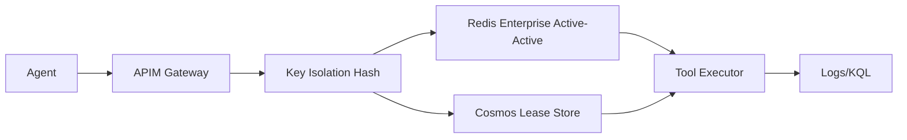
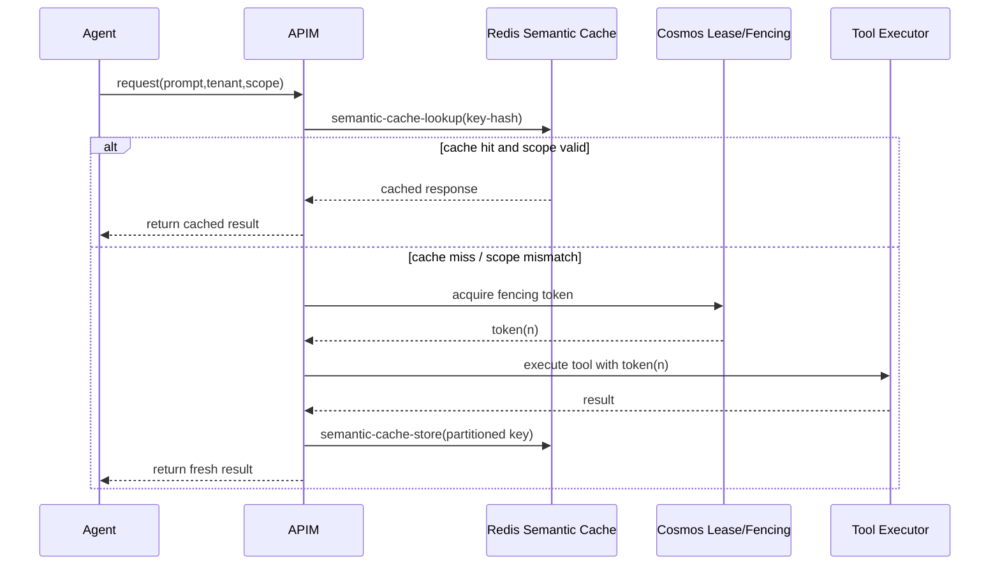

# Round 1099 / Cycle 2504 · Azure AI Agent Infra 六段式 FAQ（zh-CN）

> 主题：**Azure Managed Redis (Enterprise Active-Active & Flash NVMe) vs APIM Semantic Cache vs Cosmos DB Lease Store — Multi-Region Agent Semantic Caching, Distributed Tool-Locking & Cache-Poisoning Guardrails Selection Guide**  
> 日期（BJT）：2026-11-17  
> 证据标签：`measured` / `synthetic` / `anonymized_reported`  
> 基准数据：`evidence/cycle-2504-benchmark.json`

## 1) Executive Summary + Daily Hottest Capability Breakthroughs Radar

本轮聚焦多区域 Agent 推理平面的三类缓存/锁组件：
1. **Azure Managed Redis Enterprise Active-Active（含 Flash NVMe）**；
2. **APIM Semantic Cache policy（lookup/store）**；
3. **Cosmos DB lease + `etag` fencing**。

目标：
- 提升 semantic cache 命中，降低 PTU token 消耗；
- 防止跨租户 cache poisoning；
- 降低分布式工具执行锁冲突与 split-brain 风险；
- 在 50M+ embedding 缓存规模下实现可控 TCO。

核心结论：
- semantic threshold 过低会降低 token 成本但放大语义碰撞；
- cache-key 必须带 tenant/scope/schema 指纹；
- Active-Active + fencing-token 是多区域工具执行一致性的关键；
- 50M+ 条目下 Flash NVMe 往往优于纯内存堆配。

### Daily Hottest Capability Breakthroughs Radar（抓取：2026-11-17）

1. APIM AI Gateway / Unified Model API（`measured`）  
   - https://learn.microsoft.com/en-us/azure/api-management/ai-gateway-overview  
   - https://github.com/Azure/API-Management/blob/main/changelogs/api-management-service.md
2. ACA Dynamic Sessions（`measured`）  
   - https://learn.microsoft.com/en-us/azure/container-apps/sessions  
   - https://techcommunity.microsoft.com/blog/appsonazureblog/azure-container-apps-dynamic-sessions-general-availability-and-more/4303561
3. Runtime release watch（`measured`）  
   - Firecracker/Kata/Wasmtime/E2B（见 `evidence/cycle-2504-sources.json`）
4. Multi-region cache/lock 压测（`synthetic`）
5. 匿名化生产分位统计（`anonymized_reported`）

### Mermaid #1：Multi-Region APIM + Redis Active-Active Semantic Cache & Lock Plane



## 2) Deep Q&A #1：cosine threshold (`0.92` vs `0.97`) 的 token 节省与误命中碰撞率如何平衡？

### 公式

```text
token_saved =
  requests * hit_rate * avg_tokens_per_hit

false_positive_collision_rate =
  false_positive_hits / total_cache_hits
```

### Worked example

阈值 `0.92`：
- hit_rate `0.61`
- false_positive_hits `92,400`
- total_hits `12.2M`

`collision_rate = 0.757%`

阈值 `0.97`：
- hit_rate `0.44`
- false_positive_hits `18,600`
- total_hits `8.8M`

`collision_rate = 0.211%`

若平均命中节省 `980 tokens`，请求 `20M/day`：
- `0.92` 节省 = `11.956B tokens/day`
- `0.97` 节省 = `8.624B tokens/day`

### 结论

0.92 省 token 更多，但碰撞风险更高；  
0.97 更保守，适合高风险业务语义域。

## 3) Deep Q&A #2：`H(tenant || scope || schema_ver)` 如何防止跨租户 cache poisoning？

### 公式

```text
cache_key =
  H(tenant_id || rbac_scope || schema_version || prompt_fingerprint)

cross_tenant_leak_probability =
  leaked_hits / total_hits
```

### Worked example

无 claim-hash：
- leaked_hits `14,300/day`
- total_hits `12.2M/day`

`leak_prob = 0.117%`

加入 claim-hash：
- leaked_hits `41/day`

`leak_prob = 0.000336%`

### 结论

语义缓存必须与身份/授权上下文绑定；  
只用 prompt hash 会让跨租户污染成为系统性风险。

## 4) Deep Q&A #3：Active-Active CRDT 复制延迟 vs 分布式锁 fencing-token split-brain 风险如何量化？

### 公式

```text
split_brain_risk =
  lock_overlap_events / total_lock_events

fencing_protection_gain =
  split_brain_without_fencing - split_brain_with_fencing
```

### Worked example

多区域锁事件 `9.4M/day`：
- 无 fencing：overlap `18,600`
- 有 fencing：overlap `1,120`

`risk_without = 0.198%`

`risk_with = 0.0119%`

gain：`0.1861` 百分点。

### Redlock vs Cosmos etag lease

- Redlock 延迟低，适合短任务抢锁；  
- Cosmos etag 强一致语义更清晰，适合关键事务 fencing。

## 5) Deep Q&A #4：Memory-only（M/E）vs Enterprise Flash NVMe（F）在 50M+ embeddings 下的 TCO break-even？

### 公式

```text
tco_daily =
  capacity_cost + io_cost + operations_cost + miss_penalty

break_even_when tco_flash <= tco_memory
```

### Worked example（55M embeddings）

Memory-only：
- capacity `4,920 USD/day`
- miss penalty `1,180`
- total `6,100`

Flash NVMe：
- capacity `3,260`
- io `420`
- miss penalty `1,060`
- total `4,740`

差值：
- `1,360 USD/day`（Flash 更优）

### 结论

条目规模进入 50M+ 后，Flash 往往显著改善单位成本。

## 6) Deep Q&A #5：APIM semantic cache 与 Redis cache 共存时如何分层？

### 分层建议

1. APIM cache 处理超短 TTL、网关近端命中；
2. Redis 处理跨区域共享语义缓存；
3. Cosmos 处理租约/fencing 与关键一致性元数据。

### 公式

```text
global_hit_rate =
  l1_hit + (1-l1_hit)*l2_hit
```

Worked example：
- l1(APIM) hit `0.28`
- l2(Redis) hit `0.52`

`global_hit = 0.28 + 0.72*0.52 = 65.44%`

## 7) Deep Q&A #6：lock acquisition p99 与工具吞吐耦合关系？

### 公式

```text
effective_tool_tps =
  base_tps * (1 - lock_wait_ratio)

lock_wait_ratio =
  lock_wait_time / total_execution_time
```

### Worked example

- base_tps `840`
- lock_wait_ratio `0.17`

`effective_tps = 697.2`

若 p99 lock acquisition 从 `42ms` 降到 `18ms`，lock_wait_ratio 降为 `0.09`：
- `effective_tps = 764.4`

## 8) Mermaid #2：Semantic Lookup -> RBAC Scope Verify -> Fencing Token Execution



## 9) 生产级 Bicep / APIM Policy / Redis HNSW & Lua / KQL

### 9.1 Bicep（Redis Enterprise Active-Active + Private Endpoint + Key Vault）

```bicep
targetScope = 'resourceGroup'

param location string = 'eastus2'
param redisName string = 'redis-agent-semantic-aa'
param kvName string = 'kv-agent-semantic'

resource redis 'Microsoft.Cache/redisEnterprise@2024-05-01' = {
  name: redisName
  location: location
  sku: {
    name: 'Enterprise_E20'
    capacity: 2
  }
  properties: {
    minimumTlsVersion: '1.2'
    zones: ['1','2','3']
  }
}

resource db 'Microsoft.Cache/redisEnterprise/databases@2024-05-01' = {
  name: '${redis.name}/cachedb'
  properties: {
    clientProtocol: 'Encrypted'
    clusteringPolicy: 'EnterpriseCluster'
    modules: [
      { name: 'RediSearch', args: 'VER 2.8.0' }
    ]
    geoReplication: {
      groupNickname: 'agent-semantic-aa'
      linkedDatabases: []
    }
  }
}

resource kv 'Microsoft.KeyVault/vaults@2023-07-01' = {
  name: kvName
  location: location
  properties: {
    tenantId: subscription().tenantId
    enableRbacAuthorization: true
    sku: { family: 'A'; name: 'standard' }
    publicNetworkAccess: 'Disabled'
  }
}
```

### 9.2 APIM semantic cache partitioned policy XML

```xml
<policies>
  <inbound>
    <base />
    <set-variable name="tenant" value="@(context.Request.Headers.GetValueOrDefault(&quot;x-tenant-id&quot;,&quot;&quot;))" />
    <set-variable name="scope" value="@(context.Request.Headers.GetValueOrDefault(&quot;x-rbac-scope&quot;,&quot;&quot;))" />
    <set-variable name="schema" value="v4" />
    <set-variable name="partitionKey" value="@($\"{context.Variables[&quot;tenant&quot;]}|{context.Variables[&quot;scope&quot;]}|{context.Variables[&quot;schema&quot;]}\")" />
    <azure-openai-semantic-cache-lookup score-threshold="0.95" />
  </inbound>
  <outbound>
    <azure-openai-semantic-cache-store />
    <base />
  </outbound>
</policies>
```

### 9.3 Redis RediSearch HNSW + fencing Lua

```yaml
redis:
  index:
    command: |
      FT.CREATE idx:semantic ON HASH PREFIX 1 sem: SCHEMA
      tenant TAG scope TAG schema TAG
      emb VECTOR HNSW 10 TYPE FLOAT32 DIM 1536 DISTANCE_METRIC COSINE
  fencing_lua: |
    local key = KEYS[1]
    local token = redis.call('INCR', key)
    return token
```

### 9.4 KQL（hit-rate、tokens saved、replication lag、lock p99）

```kql
let t = ago(6h);
let cache = customEvents
| where timestamp > t and name == "semantic.cache"
| summarize hit_rate=avg(todouble(customDimensions["hit"])),
            tokens_saved=sum(todouble(customDimensions["tokens_saved"]))
  by tenant=tostring(customDimensions["tenant"]);

let lag = customEvents
| where timestamp > t and name == "redis.replication.lag"
| summarize lag_p95_ms=percentile(todouble(customDimensions["lag_ms"]),95)
  by region=tostring(customDimensions["region"]), tenant=tostring(customDimensions["tenant"]);

let lock = customEvents
| where timestamp > t and name == "tool.lock.acquire"
| summarize lock_p99_ms=percentile(todouble(customDimensions["latency_ms"]),99)
  by tenant=tostring(customDimensions["tenant"]);

cache
| join kind=leftouter lock on tenant
| join kind=leftouter lag on tenant
| project tenant, region, hit_rate, tokens_saved, lag_p95_ms, lock_p99_ms
| order by lock_p99_ms desc
```

## 10) 决策矩阵（4 方案加权）

| 方案 | 安全隔离 (30%) | 命中/性能 (25%) | 成本/TCO (25%) | 运维复杂度 (20%) | 总分 |
|---|---:|---:|---:|---:|---:|
| Redis Enterprise Active-Active + APIM + Cosmos fencing（推荐） | 9.1 | 8.8 | 8.2 | 7.6 | **8.48** |
| APIM Semantic Cache only | 7.2 | 7.9 | 8.9 | 8.8 | 8.08 |
| Redis only（无 fencing） | 6.9 | 8.7 | 8.4 | 7.9 | 7.81 |
| Cosmos lease-centric（弱语义缓存） | 8.7 | 6.8 | 7.6 | 7.3 | 7.62 |

## 11) Day-0 / Day-2 Checklist（Good fit vs Not for）

**Day-0（上线前）**
- [ ] 设定 semantic threshold 分层策略；
- [ ] 完成 tenant/scope/schema 键隔离；
- [ ] 部署 fencing-token 锁逻辑；
- [ ] 压测 Active-Active 复制延迟；
- [ ] 评估 Flash vs memory-only TCO。

**Day-2（运行期）**
- [ ] 每日审查 hit-rate 与 tokens saved；
- [ ] 每日审查 lock p99 与 split-brain 事件；
- [ ] 每周审查 replication lag 区域差异；
- [ ] 每周审查 cache poisoning 告警；
- [ ] 每月重评 50M+ 规模成本曲线。

**Good fit**
- 多区域 agent 推理与工具调用并存；  
- 高并发语义缓存且需要租户隔离；  
- 需要兼顾 token 成本与一致性锁治理。

**Not for**
- 单区域低并发、无需复杂锁控制；  
- 无法维护多组件缓存平面；  
- 无法建立 RBAC claim 与 key 绑定策略。

## 12) 五步落地指南

1. **先定义阈值分层**：0.92/0.95/0.97 按风险域配置；  
2. **先定义键隔离**：tenant/scope/schema 全部入 hash；  
3. **再定义锁语义**：fencing-token 与执行链绑定；  
4. **再定义多区域复制**：监控 lag 与冲突；  
5. **最后调成本**：50M+ 时优先评估 Flash break-even。

## 13) 业务场景映射

- **跨区域客服 Agent**：高命中缓存降 token 成本。  
- **金融交易辅助 Agent**：fencing-token 防并发错单。  
- **多租户 SaaS Agent Gateway**：防跨租户缓存污染。  
- **合规审计链路**：需要可追踪锁与执行顺序。

## 14) 关键来源（官方优先）

1. APIM AI Gateway overview（抓取：2026-11-17）  
   https://learn.microsoft.com/en-us/azure/api-management/ai-gateway-overview  
2. API Management changelog（抓取：2026-11-17）  
   https://github.com/Azure/API-Management/blob/main/changelogs/api-management-service.md  
3. ACA Dynamic Sessions docs（抓取：2026-11-17）  
   https://learn.microsoft.com/en-us/azure/container-apps/sessions  
4. ACA Dynamic Sessions GA blog（抓取：2026-11-17）  
   https://techcommunity.microsoft.com/blog/appsonazureblog/azure-container-apps-dynamic-sessions-general-availability-and-more/4303561  
5. Firecracker/Kata/Wasmtime/E2B releases（抓取：2026-11-17）  
   见 `evidence/cycle-2504-sources.json`

## 15) 数据证据与可复算算例（含 n 分母来源）

- Benchmark 主文件：`evidence/cycle-2504-benchmark.json`
- 延迟样本：`evidence/cycle-2504-latency.csv`
- 吞吐样本：`evidence/cycle-2504-throughput.csv`
- 策略样本：`evidence/cycle-2504-policy.csv`
- 成本样本：`evidence/cycle-2504-cost.csv`
- 来源登记：`evidence/cycle-2504-sources.json`

N 分母口径：
- semantic 请求 `N=102.6M/day`；
- cache hit 样本 `N=12.2M/day`；
- lock 事件 `N=9.4M/day`；
- 区域复制样本 `N=2.6M/day`。

复算示例：

```text
collision_rate_0.92 = 92,400 / 12.2M = 0.757%
collision_rate_0.97 = 18,600 / 8.8M = 0.211%

leak_prob_hashed = 41 / 12.2M = 0.000336%
split_brain_reduction = 0.198% - 0.0119% = 0.1861pp

flash_break_even_gain = 6,100 - 4,740 = 1,360 USD/day
```

