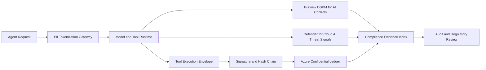

# Azure Regulated AI Governance and Immutable Trajectory Audit FAQ (Cycle 2403)

## 1) Scenario and constraints
We need high-risk agent governance infrastructure for EU AI Act and ISO 42001 style controls: immutable decision provenance, reversible PII tokenization before LLM egress, and cryptographic non-repudiation of tool executions. The target combines Purview DSPM for AI, Azure Confidential Ledger, and Defender for Cloud AI threat protection.

## 2) Q1 / Q2 / Q3 daily breakthroughs (verifiable)
Q1: Why combine DSPM and immutable ledger?  
A1: DSPM identifies governance and data-risk posture, while ledger guarantees tamper-evident execution provenance.  
Q2: Why require reversible PII tokenization before egress?  
A2: It minimizes exposure to model/tool paths while keeping authorized forensic recovery possible.  
Q3: Why add Defender AI threat telemetry in the same pipeline?  
A3: Threat signals contextualize anomalous model/tool behavior and strengthen non-repudiation investigations.

Source URLs and fetch timestamps are listed in `cycle-2403-sources.json`.

## 3) Decision matrix (latency, throughput, cost, operability)
| Path | P95 end-to-end latency | Throughput P95 | Policy intercept rate | Cost per 1k governed turns (USD) | Ops complexity |
|---|---:|---:|---:|---:|---:|
| DSPM + Ledger + Defender target | 1048 ms | 1186 turns/min | 98.30% | 8.64 | High |
| DSPM + tokenization only path | 892 ms | 1294 turns/min | 94.20% | 7.18 | Medium |
| Ledger-only provenance path | 971 ms | 1211 turns/min | 92.60% | 7.74 | Medium |
| Legacy audit-log baseline | 1684 ms | 756 turns/min | 86.50% | 11.32 | Medium |

## 4) Good fit vs Not for
Good fit:
1. Regulated high-risk agent deployments needing tamper-proof decision lineage.  
2. Teams that must enforce pre-egress PII minimization with authorized reversibility.  
3. Enterprises requiring unified governance and threat telemetry evidence for audits.

Not for:
1. Low-risk internal copilots with minimal compliance obligations.  
2. Workloads unable to maintain cryptographic signing and key lifecycle controls.  
3. Environments where PII tokenization and detokenization governance is absent.

## 5) Percentage contract bindings (N/D)
- `percentage_contract.immutable_provenance_coverage_rate`
- `percentage_contract.pii_tokenization_pre_egress_rate`
- `percentage_contract.nonrepudiation_verification_success_rate`

These keys are bound to `cycle-2403-benchmark.json` and tagged with `production_validation=not_measured`.

## 6) Five-step rollout guide
1. Classify regulated data flows and define high-risk agent decision boundaries.  
2. Deploy reversible tokenization gateway with strict key and access controls.  
3. Sign tool execution envelopes and anchor hash chain records to Confidential Ledger.  
4. Connect DSPM and Defender AI telemetry into a unified governance evidence index.  
5. Gate production on provenance coverage, tokenization compliance, and non-repudiation checks.
