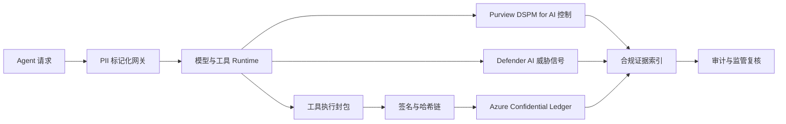

# Azure 受监管 AI 治理与不可篡改轨迹审计 FAQ（Cycle 2403）

## 1) 场景与约束
目标是为 EU AI Act / ISO 42001 类高风险 Agent 构建治理基础设施：不可篡改决策溯源、LLM 出站前可逆 PII 标记化、工具执行的密码学不可抵赖。方案采用 Purview DSPM for AI、Azure Confidential Ledger、Defender for Cloud AI Threat Protection。

## 2) Q1 / Q2 / Q3 当日能力突破（可验证）
Q1：为什么 DSPM 与不可篡改账本要组合？  
A1：DSPM 给出数据治理与风险面，账本提供防篡改执行溯源。  
Q2：为什么出站前必须做可逆 PII 标记化？  
A2：在保持授权可追溯恢复能力的同时，最大化降低模型与工具路径中的敏感信息暴露。  
Q3：为什么要把 Defender AI 威胁信号纳入同一证据链？  
A3：可将异常行为检测与执行溯源关联，增强不可抵赖取证能力。

来源与抓取时间见 `cycle-2403-sources.json`。

## 3) 决策矩阵（时延、吞吐、成本、可运维性）
| 路径 | P95 端到端时延 | 吞吐 P95 | 策略拦截率 | 每千治理轮次成本（USD） | 运维复杂度 |
|---|---:|---:|---:|---:|---:|
| DSPM+Ledger+Defender 目标路径 | 1048 ms | 1186 turns/min | 98.30% | 8.64 | 高 |
| DSPM+标记化路径 | 892 ms | 1294 turns/min | 94.20% | 7.18 | 中 |
| 仅 Ledger 溯源路径 | 971 ms | 1211 turns/min | 92.60% | 7.74 | 中 |
| 传统日志基线路径 | 1684 ms | 756 turns/min | 86.50% | 11.32 | 中 |

## 4) Good fit vs Not for
Good fit：
1. 需要不可篡改决策链路的高监管 Agent 场景。  
2. 需在出站前执行 PII 最小化且可授权恢复的组织。  
3. 需要统一治理与威胁证据满足审计要求的企业。

Not for：
1. 合规要求较低、无强审计义务的轻量内部助手。  
2. 无法维护签名密钥生命周期与审计流程的环境。  
3. 缺失 PII 标记化与去标记化治理机制的部署。

## 5) Percentage contract bindings (N/D)
- `percentage_contract.immutable_provenance_coverage_rate`
- `percentage_contract.pii_tokenization_pre_egress_rate`
- `percentage_contract.nonrepudiation_verification_success_rate`

以上键绑定 `cycle-2403-benchmark.json`，并标注 `production_validation=not_measured`。

## 6) 五步落地指南
1. 划定高风险 Agent 决策边界并分级治理数据流。  
2. 部署可逆标记化网关与密钥访问控制。  
3. 对工具执行封包签名并把哈希链锚定到 Confidential Ledger。  
4. 汇聚 DSPM 与 Defender AI 信号到统一证据索引。  
5. 以溯源覆盖率、标记化达标率、不可抵赖验证通过率作为发布门禁。
