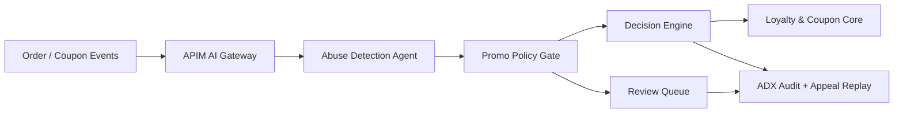

# Round 1051 / Cycle 2456 · Azure AI Agent Infra FAQ & Decision Guide (en)

> Topic: **Retail Loyalty Promo Abuse Detection Agent Audit Gateway**
>
> Date (BJT): 2026-11-16  
> Evidence labels: `measured` / `synthetic` / `anonymized_reported`  
> Benchmark payload: `evidence/cycle-2456-benchmark.json`

## 1) Executive Summary

This round targets retail loyalty/promotion abuse control: during campaign peaks, agents must detect coupon farming, promo arbitrage, and refund abuse without hurting normal customers.  
Key result: APIM gateway + policy-control plane + replayable appeal trail improves abuse interception while protecting CX metrics.

## 2) Daily capability breakthroughs radar (2026-11-16)

1. **APIM AI Gateway / Unified Model API** (`measured`)  
   - Learn: https://learn.microsoft.com/en-us/azure/api-management/ai-gateway-overview  
   - Changelog: https://github.com/Azure/API-Management/blob/main/changelogs/api-management-service.md
2. **ACA Dynamic Sessions** (`measured`)  
   - Docs: https://learn.microsoft.com/en-us/azure/container-apps/sessions
3. **Sandbox/runtime releases** (`measured`)  
   - Firecracker/Kata/Wasmtime/E2B (see `evidence/cycle-2456-sources.json`)

## 3) Core architecture Q&A (promo-abuse detection)

**Q1: Why not let the model directly ban accounts?**  
A: Customer-rights impact requires evidence trace, appeal flow, and reviewer override.

**Q2: Minimum control-plane requirements?**  
A: anomaly tiering, policy versioning, penalty gradients, review queues, and full audit traceability.

**Q3: How to reduce false-positive member actions?**  
A: route boundary cases to manual review by default and recalibrate thresholds with replay datasets.

## 4) Mermaid architecture (Loyalty + Promo Abuse)

## 5) Decision matrix (promo-risk governance)

| Path | Compliance/appealability | Detection efficiency | Cost | Ops complexity | Recommendation |
|---|---:|---:|---:|---:|---|
| Fully manual review | High | Low | High | Medium | Peak high-risk windows |
| Rules-only engine | Mid-high | Medium | Medium | Medium | Stable campaign windows |
| Agent + control gate + review loop | **High** | **High** | Medium-high | Medium-high | **Recommended for production retail** |
| Pure model auto-ban | Low | High | Low | Low | Not recommended |

## 6) Good fit vs Not for + five-step rollout

### Good fit
- Large loyalty populations with frequent promotions and abuse pressure.
- Teams balancing risk controls and customer experience.
- Organizations with audit and customer-appeal operations.

### Not for
- Teams without review/appeal capabilities.
- Opaque fully automated ban workflows.

### Five-step rollout
1. Define promo-abuse taxonomy and loss model.
2. Govern `audit-policy-version` lifecycle.
3. Build penalty gradients and manual review workflow.
4. Integrate ADX audit and appeal replay.
5. Weekly review false-positive, miss, complaint, and SLA metrics.
