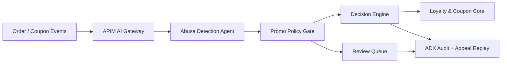

# Round 1051 / Cycle 2456 · Azure AI Agent Infra FAQ & 决策指南（zh-CN）

> Topic: **Retail Loyalty Promo Abuse Detection Agent Audit Gateway**
>
> Date (BJT): 2026-11-16  
> Evidence labels: `measured` / `synthetic` / `anonymized_reported`  
> Benchmark payload: `evidence/cycle-2456-benchmark.json`

## 1) Executive Summary

本轮聚焦零售会员与促销滥用治理：在大促高峰下，Agent 需识别薅羊毛、券套利与异常退款链路，同时避免误伤正常用户。  
核心结论：使用 APIM 网关 + 促销策略控制面 + 审计回放链，可提升异常检出并控制客户体验损失。

## 2) Daily capability breakthroughs radar（2026-11-16）

1. **APIM AI Gateway / Unified Model API**（`measured`）  
   - Learn: https://learn.microsoft.com/en-us/azure/api-management/ai-gateway-overview  
   - Changelog: https://github.com/Azure/API-Management/blob/main/changelogs/api-management-service.md
2. **ACA Dynamic Sessions**（`measured`）  
   - Docs: https://learn.microsoft.com/en-us/azure/container-apps/sessions
3. **Sandbox/runtime releases**（`measured`）  
   - Firecracker/Kata/Wasmtime/E2B（见 `evidence/cycle-2456-sources.json`）

## 3) Core architecture Q&A（促销滥用检测）

**Q1: 为什么不能模型直接封禁账户？**  
A: 促销风控涉及消费者权益，必须保留证据链、申诉链与人工复核机制。

**Q2: 最小控制面要求是什么？**  
A: 异常分级、策略版本、处罚梯度、复核队列、全链路审计。

**Q3: 如何降低误杀会员？**  
A: 边界样本默认人工复核，结合回放集周期调参，逐步收敛阈值。

## 4) Mermaid architecture（Loyalty + Promo Abuse）

## 5) Decision matrix（促销风控治理）

| 路径 | 合规与可申诉 | 检出效率 | 成本 | 运维复杂度 | 推荐 |
|---|---:|---:|---:|---:|---|
| 全人工稽核 | 高 | 低 | 高 | 中 | 高风险期 |
| 规则引擎 | 中高 | 中 | 中 | 中 | 稳定活动期 |
| Agent + 控制网关 + 复核 | **高** | **高** | 中高 | 中高 | **零售生产推荐** |
| 纯模型自动封禁 | 低 | 高 | 低 | 低 | 不建议 |

## 6) Good fit vs Not for + 五步落地

### Good fit
- 会员体量大、活动频繁、滥用风险高的零售平台。  
- 需要平衡风险控制与用户体验。  
- 具备审计与客服申诉能力。

### Not for
- 无复核能力且无申诉通道的团队。  
- 将封禁完全自动化且不可解释的场景。

### 五步落地
1. 建立促销滥用类型与损失模型。  
2. 实施 `audit-policy-version` 版本治理。  
3. 构建处罚梯度与人工复核流程。  
4. 打通 ADX 审计与申诉回放。  
5. 周期复盘误杀率、漏检率、客诉率、SLA。  
