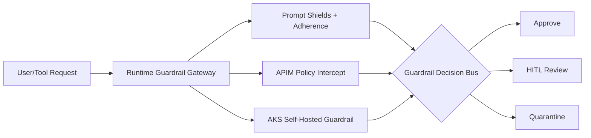

# Azure Runtime Guardrails and Indirect Prompt Injection Defense FAQ (Cycle 2378)

## 1) Scenario and constraints
The objective is production-grade indirect prompt-injection defense for tool-calling agents. We compare Azure AI Content Safety Prompt Shields + task-adherence/groundedness, APIM AI Gateway content-safety policy, and AKS self-hosted guardrail models for P99 latency tax, async parallel checks, and false-positive tuning.

## 2) Q1 / Q2 / Q3 Daily capability breakthroughs (verifiable)
Q1: Why prioritize async parallel guardrails?  
A1: Serial checks amplify P99 latency tax; parallel checks preserve interception while reducing latency overhead.  
Q2: What is the value of APIM gateway safety policy?  
A2: It provides low-latency policy interception before tool execution, reducing overreach traffic entering execution planes.  
Q3: When are self-hosted guardrails justified?  
A3: When deep custom policy/model governance is required and the team can own higher ops complexity.

Source links and fetch timestamp (UTC) are recorded in `cycle-2378-sources.json`.

## 3) Decision matrix (latency tax, false positives, governance, cost)
| Path | P95 latency | Injection intercept | False-positive tuning flexibility | Cost/session | Ops complexity |
|---|---:|---:|---:|---:|---:|
| Prompt Shields + Adherence | 289 ms | 95.4% | medium-high | 0.00648 | medium |
| APIM Gateway Policy | 241 ms | 95.8% | medium | 0.00533 | low-medium |
| AKS self-hosted guardrail | 362 ms | 93.1% | high | 0.00874 | high |
| Async parallel composition | 233 ms | 95.8% | high | 0.00597 | medium |

## 4) Good fit vs Not for
Good fit:
1. Coding Agent sandboxes that require pre-tool parallel guardrail checks.
2. Browser/CUA clusters where injected page instructions must be intercepted pre-execution.
3. Multi-tenant SaaS gateways requiring tenant-scoped false-positive tuning.
4. Regulated finance requiring custody-proof guardrail audit and HITL fallback.

Not for:
1. Serializing all guardrail checks without latency budget.
2. Failing to separate trusted system prompts from untrusted retrieval context.
3. Applying one global threshold across tenants without replay tuning loops.

## 5) Percentage contract bindings (N/D)
- `percentage_contract.indirect_prompt_injection_intercept_rate`
- `percentage_contract.async_parallel_guardrail_sla_rate`
- `percentage_contract.false_positive_tuning_gain_pts`

These keys bind to `cycle-2378-benchmark.json` with `production_validation=not_measured`.

## 6) Five-step rollout
1. Define risk tiers and pre-tool validation contracts for indirect-injection defense.
2. Compose parallel guardrails across Prompt Shields, gateway policy, and self-hosted checks.
3. Map guardrail outcomes into Approve/HITL/Quarantine tri-state actions.
4. Introduce tenant profile thresholds and false-positive replay tuning.
5. Replay high-risk samples weekly and optimize P99 tax and false-positive rate.
