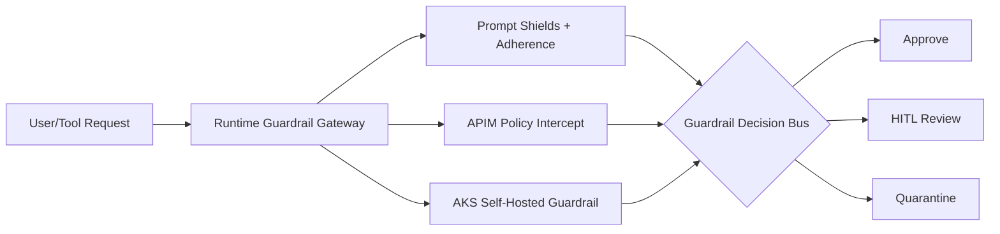

# Azure Runtime Guardrails 与间接提示注入防御 FAQ（Cycle 2378）

## 1) 场景与约束
目标是为 Tool-Calling Agents 构建可生产落地的间接提示注入防御：比较 Azure AI Content Safety Prompt Shields + Task Adherence/Groundedness、APIM AI Gateway Content Safety Policy、以及 AKS 自托管 Guardrail 模型在 P99 时延税、并行异步校验、误报调优方面的取舍。

## 2) Q1 / Q2 / Q3 当日能力突破（可验证）
Q1：为什么强调异步并行护栏？  
A1：串行检查会显著放大 P99 时延税，并行检查可在保持拦截率同时降低时延。  
Q2：APIM 网关策略的价值是什么？  
A2：在工具调用前进行低延迟策略拦截，减少越权流量进入执行平面。  
Q3：自托管 Guardrail 何时有价值？  
A3：需要深度可定制规则和本地模型治理时，但要承担更高运维复杂度。

来源与抓取时间（UTC）写入 `cycle-2378-sources.json`。

## 3) 决策矩阵（时延税、误报、治理、成本）
| 路径 | P95 延迟 | 注入拦截率 | 误报调优灵活度 | 单会话成本 | 运维复杂度 |
|---|---:|---:|---:|---:|---:|
| Prompt Shields + Adherence | 289 ms | 95.4% | 中高 | 0.00648 | 中 |
| APIM Gateway Policy | 241 ms | 95.8% | 中 | 0.00533 | 低中 |
| AKS 自托管 Guardrail | 362 ms | 93.1% | 高 | 0.00874 | 高 |
| 异步并行组合 | 233 ms | 95.8% | 高 | 0.00597 | 中 |

## 4) Good fit vs Not for
Good fit：
1. Coding Agent sandbox：敏感工具前置并行护栏校验。  
2. Browser/CUA 集群：页面注入指令在网关预检阶段拦截。  
3. 多租户 SaaS 网关：租户级误报阈值可调。  
4. 高合规金融：护栏判定具备 custody-proof 审计链和 HITL 回退。

Not for：
1. 把所有护栏检查串行化且无时延预算。  
2. 不区分可信系统提示与不可信检索上下文。  
3. 全租户共用单一阈值且无复盘调优闭环。

## 5) Percentage contract bindings (N/D)
- `percentage_contract.indirect_prompt_injection_intercept_rate`
- `percentage_contract.async_parallel_guardrail_sla_rate`
- `percentage_contract.false_positive_tuning_gain_pts`

以上键绑定 `cycle-2378-benchmark.json`，并标注 `production_validation=not_measured`。

## 6) 五步落地指南
1. 定义间接注入风险分层和工具调用前置校验契约。  
2. 建立 Prompt Shields、网关策略、自托管模型的并行护栏链。  
3. 将护栏结果映射到 Approve/HITL/Quarantine 三态。  
4. 引入租户级阈值模板与误报复盘机制。  
5. 周度回放高风险样本，持续优化 P99 税与误报率。
