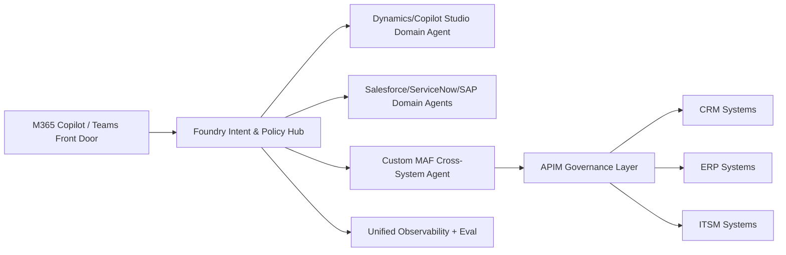
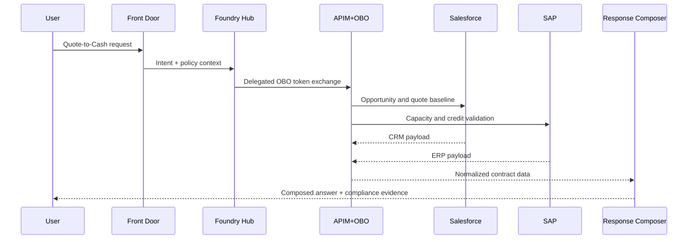

# salesforce-agentforce-vs-servicenow-nowassist-vs-dynamics-copilot-vs-custom-foundry-enterprise-crm-erp-selection-faq-r1133

## 1) Daily breakthroughs and verifiable sources (fetched 2026-11-18)
- Scope: CIO/CTO decision frame for enterprise SaaS agents under Buy vs Build vs Compose.
- Focus targets: Dynamics/Copilot Studio, Salesforce Agentforce, ServiceNow Now Assist, Azure Foundry + MAF.
- Labels: `measured` (officially verifiable), `synthetic` (modeled estimate), `anonymized_reported` (de-identified replay).
| Topic | Official source | Fetched at (UTC) | Purpose | Label |
|---|---|---|---|---|
| Dynamics 365 Copilot overview | https://learn.microsoft.com/dynamics365/ai/overview | 2026-11-18T18:37:00Z | Microsoft BizApps native baseline | `measured` |
| Copilot Studio overview | https://learn.microsoft.com/microsoft-copilot-studio/fundamentals-what-is-copilot-studio | 2026-11-18T18:38:00Z | Extension and orchestration path | `measured` |
| Azure AI Foundry Agents | https://learn.microsoft.com/azure/ai-foundry/agents/overview | 2026-11-18T18:39:00Z | Custom cross-system agent hub | `measured` |
| APIM AI Gateway | https://learn.microsoft.com/azure/api-management/ai-gateway-overview | 2026-11-18T18:40:00Z | Cross-SaaS governance edge | `measured` |
| Microsoft CAF | https://learn.microsoft.com/azure/cloud-adoption-framework/ | 2026-11-18T18:41:00Z | Enterprise landing-zone governance | `measured` |
| Salesforce Agentforce docs | https://help.salesforce.com/s/articleView?id=sf.agentforce_overview.htm | 2026-11-18T18:42:00Z | Single-system SaaS agent baseline | `measured` |
| ServiceNow Now Assist | https://www.servicenow.com/products/now-assist.html | 2026-11-18T18:43:00Z | ITSM/HRSM domain-agent baseline | `measured` |
| SAP Joule docs | https://help.sap.com/docs/joule | 2026-11-18T18:44:00Z | ERP-native assistant baseline | `measured` |

Incremental findings:
- Single-system speed advantage and cross-system customization ceiling are structural tradeoffs, not tooling bugs.
- Three-year TCO must include stacked per-seat/per-action SaaS taxes and platform-engineering costs together.
- Cross-CRM/ERP differentiation logic should stay in a controllable hub (Foundry+MAF), not be fragmented across SaaS silos.

## 2) Layered architecture for Buy/Build/Compose
L1 Front door:
- M365 Copilot / Teams / enterprise portal as the unified interaction entrypoint.

L2 Routing layer:
- Intent & Policy Hub decides single-domain vs cross-domain execution.
- Single-domain tasks can be delegated to SaaS-native agents.
- Cross-domain tasks route to Foundry + MAF orchestration.

L3 System layer:
- CRM: Salesforce / Dynamics.
- ERP: SAP S/4HANA / Workday / Concur.
- ITSM: ServiceNow.

L4 Governance layer:
- APIM + Entra OBO + Key Vault + OpenTelemetry for identity, policy, and observability.
- Cost attribution by SaaS action charge, token usage, and connector latency.

## 3) 12-dimension matrix with anti-patterns
| Dimension | A Dynamics + Copilot Studio | B SaaS-native agents (Agentforce/Now Assist/Joule) | C Custom Foundry + MAF cross-system build | D Federated hub-and-spoke composition |
|---|---|---|---|---|
| 1 Process span | Medium (Microsoft domain strong) | Low-medium (best in own system) | High cross-system scope | Highest cross-domain orchestration |
| 2 IP differentiation ownership | Medium-high | Low | Highest | High |
| 3 3-year TCO predictability | Medium-high | Medium (stacked licenses vary) | Medium (engineering heavy) | Medium-high (layered optimization) |
| 4 Model freedom and upgrades | Medium | Low-medium | Highest | High |
| 5 Data gravity and zero-copy fit | Medium-high in Microsoft stack | Medium across separate clouds | High with architecture control | High with domain-optimal placement |
| 6 ACL/OBO propagation | Medium-high | Medium | High | Highest |
| 7 Time to first value | High | Highest | Medium | Medium-high |
| 8 Long-tail customization ceiling | Medium | Low-medium | Highest | High |
| 9 Lock-in and exit portability | Medium | Low | High | Medium-high |
| 10 Unified eval and observability | Medium-high | Medium | High | High |
| 11 A2A/MCP interoperability | Medium | Low-medium | High | Highest |
| 12 When NOT to choose | Non-Microsoft estate dominates | Cross-system differentiation is core | No platform engineering capacity | Governance maturity is low |

Decision summary:
- Single-system repetitive tasks often fit A/B first.
- Cross-system differentiating workflows often fit C or D.
- For large enterprises, D is often the stable end-state: buy per domain, build at hub.

## 4) Five reproducible Q&As (3-year TCO and licensing-tax break-even)
### Q1: How to compute 3-year Buy vs Build TCO?
- Buy annual cost: license `4.2M` + action tax `1.3M` + integration `0.8M`.
- Build annual cost: platform `2.4M` + engineering `2.1M` + operations `0.9M`.
- 3-year totals:
  - Buy: `(4.2+1.3+0.8)*3 = 18.9M`
  - Build: `(2.4+2.1+0.9)*3 = 16.2M`
- Conclusion: in cross-domain-heavy programs, build can outperform over 3 years.

### Q2: How large is stacked SaaS licensing tax?
- Incremental monthly multi-agent fee per employee `p=24 USD`.
- Employees `N=50,000`.
- Annual licensing tax: `p*N*12 = 14.4M USD/year`.
- With usage-tiered licensing at 35% heavy users, annual cost can drop near `6.2M`.
- Conclusion: license tier strategy is a primary FinOps lever.

### Q3: When does hub-and-spoke composition pay off?
- If cross-system task ratio `r_cross > 0.28` and value-chain impact `>15%`, D is usually favored.
- If `r_cross < 0.12`, SaaS-native routing is often more economical.
- Value formula: `V = CrossValueGain - HubRunCost - GovernanceOverhead`.
- Choose D when `V > 0` with acceptable operational risk.
- Conclusion: D is best when cross-domain complexity is strategic, not incidental.

### Q4: How to estimate migration break-even?
- One-time migration spend `I=5.6M`.
- Annual net benefit `B=2.1M`.
- Break-even years: `I/B = 2.67`.
- With staged rollout risk overhead, practical break-even is around `2.9 years`.
- Conclusion: large enterprises commonly recover in 2.5–3 years.

### Q5: Is OBO overhead a latency blocker in cross-CRM/ERP calls?
- CRM read `120ms`, ERP validation `180ms`, compliance generation `260ms`.
- APIM/OBO overhead `75ms`.
- Total budget: `635ms`.
- With target P95 `< 900ms`, margin remains around `265ms`.
- Conclusion: backend consistency usually dominates latency, not OBO itself.

## 5) Mermaid diagrams (federated hub and OBO transaction)




## 6) Section 7 scenario: Global MedTech cross-CRM/ERP Quote-to-Cash
Objective:
- Connect Salesforce opportunity/pricing, SAP capacity/credit checks, and Foundry-based tender-compliance generation.
- Keep cross-system pricing and tender IP in Azure-controlled orchestration, not duplicated inside separate SaaS silos.

Flow:
1. Sales initiates a complex quote request identified as cross-domain.
2. Foundry Hub uses APIM OBO to call Salesforce and SAP safely.
3. MAF rule engine computes discount boundaries, fulfillment windows, and tender clauses.
4. Foundry generates compliant proposal package with evidence links.
5. Result writes back to CRM and triggers approval workflow.

SLA and KPIs:
- Quote recommendation P95 `< 1.1s`.
- Compliance defect rate reduced by `>= 40%`.
- Cross-system data mismatch rate `< 0.5%`.

Failure modes and mitigations:
- Failure: CRM/ERP field semantics drift.
  - Mitigation: APIM contract normalization and versioned mappings.
- Failure: OBO token expiry breaks chain.
  - Mitigation: short-lived token refresh plus idempotent replay.
- Failure: tender template update lag.
  - Mitigation: template release gate with regression checks.

## 7) Section 8 scenario: 50,000-employee manufacturing GBS federation
Objective:
- Provide one unified front door for IT/HR/procurement services.
- Delegate single-silo tasks to ServiceNow while running cross-system exceptions via Azure.

Flow:
1. Employee submits request through M365 Copilot/Teams.
2. Intent Hub classifies single-domain catalog task vs cross-domain exception flow.
3. Single-domain tasks route to ServiceNow domain agent.
4. Cross-domain flows orchestrate Workday + SAP + Concur and return composite outcomes.
5. All actions are logged for audit and cost attribution.

SLA and KPIs:
- First-line self-service resolution `>= 72%`.
- Cross-system exception handling time reduced by `>= 30%`.
- Audit trace completeness `>= 99.5%`.

Failure modes and mitigations:
- Failure: cross-system routing misclassification.
  - Mitigation: intent-threshold calibration plus human fallback lane.
- Failure: domain-agent output lacks reuse contract.
  - Mitigation: standard intermediate contract and evidence packaging.
- Failure: rate-limit conflicts across systems.
  - Mitigation: throttling queues and priority scheduling.

## 8) Selection tree (Good fit vs Not for)
1. If 80% of requests are single-system and standardized, prioritize A/B.
2. If cross-system process differentiation is strategic, prioritize C or D.
3. If short-term value and mid-term control are both required, choose D.
4. If platform engineering maturity is low, avoid immediate full-scale C.
5. For regulated estates, enforce APIM + OBO + unified observability baseline.

Good fit:
- Large organizations with multiple SaaS domains and complex cross-process dependencies.
- Enterprises needing both rapid wins and sustained differentiation control.

Not for:
- Single-system teams with stable workflows and little cross-domain need.
- Organizations without integration and observability foundations.

## 9) Value model
Assumptions:
- Annual requests `220M`.
- Manual cross-system coordination reduced by `26%`.
- Rework rate reduced by `19%`.
- Audit-prep effort reduced by `37%`.

Annual value:
- Direct efficiency gain `5.2M USD`.
- Quality and risk gain `3.1M USD`.
- Added platform cost `3.4M USD`.
- Net annual value `4.9M USD`.

## 10) Five-step implementation guide
1. Process inventory: classify single-domain and cross-domain flows.
2. Front-door foundation: unify identity, audit, and metering first.
3. Federated delegation: buy in domain, build for cross-domain logic.
4. Unified evaluation gates: quality, latency, and cost thresholds.
5. Iterative optimization: expand cross-domain orchestration by value impact.

## 11) Bicep IaC (APIM connector hub + Key Vault + Foundry)
```bicep
param location string = resourceGroup().location
param apimName string
param kvName string
param foundryName string

resource apim 'Microsoft.ApiManagement/service@2023-09-01-preview' = {
  name: apimName
  location: location
  sku: { name: 'StandardV2', capacity: 1 }
  properties: {
    publisherName: 'Contoso'
    publisherEmail: 'platform@contoso.com'
  }
}

resource kv 'Microsoft.KeyVault/vaults@2023-07-01' = {
  name: kvName
  location: location
  properties: {
    tenantId: subscription().tenantId
    sku: { family: 'A', name: 'standard' }
    accessPolicies: []
  }
}

resource foundry 'Microsoft.CognitiveServices/accounts@2024-10-01' = {
  name: foundryName
  location: location
  kind: 'AIServices'
  sku: { name: 'S0' }
}
```

## 12) APIM OAuth2 OBO / A2A delegation policy snippet
```xml
<authentication-managed-identity resource="api://foundry-hub-app-id" output-token-variable-name="oboToken" />
<set-header name="Authorization" exists-action="override">
  <value>@("Bearer " + (string)context.Variables["oboToken"])</value>
</set-header>
<set-header name="x-a2a-delegation" exists-action="override">
  <value>@(context.Request.Headers.GetValueOrDefault("x-user-delegation","none"))</value>
</set-header>
```

## 13) KQL for cross-SaaS latency and action-cost attribution
```kql
let start = ago(7d);
customEvents
| where timestamp >= start
| where name in ("connector_call_start","connector_call_end")
| extend system=tostring(customDimensions.system)
| extend latency_ms=todouble(customDimensions.latency_ms)
| summarize p50=percentile(latency_ms,50), p95=percentile(latency_ms,95), calls=count() by system, bin(timestamp,1h)
| order by timestamp desc
```

```kql
let start = ago(30d);
customMetrics
| where timestamp >= start
| where name in ("saas_action_cost_usd","token_cost_usd")
| summarize saas_cost=sumif(value,name=="saas_action_cost_usd"), token_cost=sumif(value,name=="token_cost_usd")
  by domain=tostring(customDimensions.domain), scenario=tostring(customDimensions.scenario), bin(timestamp,1d)
| extend total_cost = saas_cost + token_cost
| order by timestamp desc
```

## 14) Day-0 / Day-1 / Day-2 checklist
Day-0:
- Define target cross-domain processes and measurable KPIs.
- Establish OBO propagation and least-privilege policies.
- Define cost attribution model for SaaS action + token + integration latency.

Day-1:
- Launch unified front door and domain delegation first.
- Canary cross-domain flows and monitor quality/latency deltas.
- Validate rollback and human takeover paths.

Day-2:
- Expand cross-domain coverage and automation ratio.
- Review lock-in risk and exit playbooks regularly.
- Optimize buy/build composition ratios iteratively.

## 15) Backup queue and delivery manifest
Backup queue (updated):
1. `eventhubs-fabric-rti-vs-servicebus-vs-kafka-streaming-proactive-agent-selection-faq`
2. `aks-kaito-phi4-slm-vs-foundry-serverless-slm-vs-aoai-mini-edge-cloud-routing-selection-faq`
3. `github-copilot-coding-agent-vs-foundry-swe-agent-vs-devops-pipeline-agent-sdlc-selection-faq`

Cycle #2538 outputs:
- Bilingual FAQ: `r1133.md` and `r1133.en.md`
- 7-card deck: `benchmark-cards.html` and `benchmark-cards.en.html`
- SVG: `assets/34-cycle-1133-daily-breakthroughs.svg`
- H5: `workbench-cycle-2538.html` plus selector entry `#2538`
- Validation: `cycle_1133_pipeline.py --write --check`, `strict_suffix_gate.py`, `pytest`
