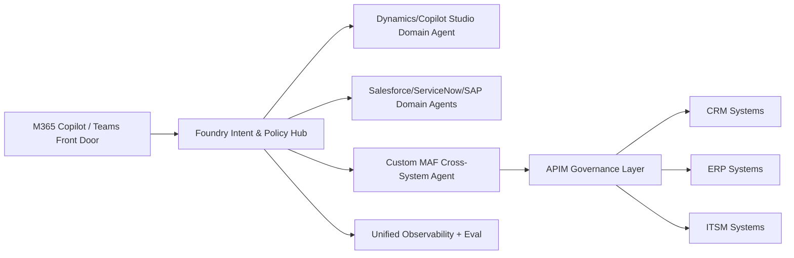
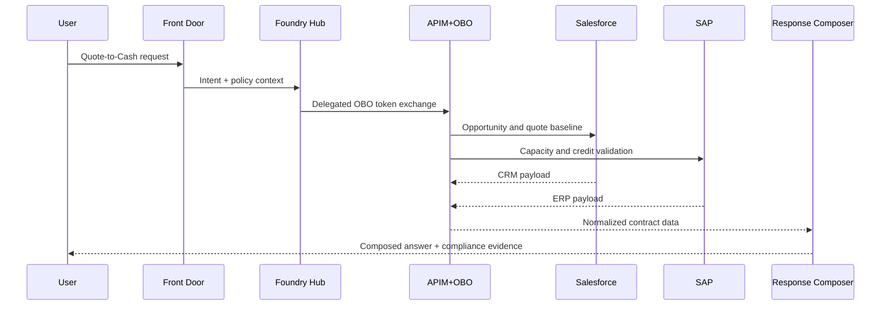

# salesforce-agentforce-vs-servicenow-nowassist-vs-dynamics-copilot-vs-custom-foundry-enterprise-crm-erp-selection-faq-r1133

## 1) 当日热点与可验证来源（2026-11-18 抓取）
- 主题边界：CIO/CTO 视角下企业级 SaaS Agent “Buy vs Build vs Compose”。
- 聚焦对象：Dynamics/Copilot Studio、Salesforce Agentforce、ServiceNow Now Assist、Azure Foundry + MAF。
- 标签定义：`measured`（官方可核）、`synthetic`（推导估算）、`anonymized_reported`（脱敏复盘）。
| 主题 | 官方来源 | 抓取时间（UTC） | 用途 | 标签 |
|---|---|---|---|---|
| Dynamics 365 Copilot 概览 | https://learn.microsoft.com/dynamics365/ai/overview | 2026-11-18T18:37:00Z | BizApps 原生 Agent 基线 | `measured` |
| Copilot Studio 概览 | https://learn.microsoft.com/microsoft-copilot-studio/fundamentals-what-is-copilot-studio | 2026-11-18T18:38:00Z | 扩展与编排能力 | `measured` |
| Azure AI Foundry Agents | https://learn.microsoft.com/azure/ai-foundry/agents/overview | 2026-11-18T18:39:00Z | 自建跨系统 Agent 中枢 | `measured` |
| APIM AI Gateway | https://learn.microsoft.com/azure/api-management/ai-gateway-overview | 2026-11-18T18:40:00Z | 跨 SaaS 连接治理 | `measured` |
| Microsoft CAF | https://learn.microsoft.com/azure/cloud-adoption-framework/ | 2026-11-18T18:41:00Z | 企业云治理框架 | `measured` |
| Salesforce Agentforce 文档 | https://help.salesforce.com/s/articleView?id=sf.agentforce_overview.htm | 2026-11-18T18:42:00Z | SaaS 原生单域代理能力 | `measured` |
| ServiceNow Now Assist 文档 | https://www.servicenow.com/products/now-assist.html | 2026-11-18T18:43:00Z | ITSM/HRSM 域内 Agent 参考 | `measured` |
| SAP Joule 参考 | https://help.sap.com/docs/joule | 2026-11-18T18:44:00Z | ERP 域内智能助手参考 | `measured` |

增量结论：
- 单系统 Agent 的上线速度优势与跨系统流程能力上限之间存在天然张力。
- 3 年 TCO 评估必须把“多 SaaS 叠加授权税”与“平台工程人力”同时计入。
- 跨 CRM/ERP 的差异化业务规则通常应落在可控中枢（Foundry+MAF），而不是分散嵌入单一 SaaS。

## 2) 分层参考架构（Buy / Build / Compose）
L1 入口层：
- M365 Copilot / Teams / Portal 作为统一前门，接入身份、审计、会话上下文。

L2 路由层：
- Intent & Policy Hub 识别是“单域任务”还是“跨域任务”。
- 单域任务可委派给各 SaaS 原生 Agent。
- 跨域任务统一走 Foundry + MAF 跨系统编排。

L3 系统层：
- CRM：Salesforce / Dynamics
- ERP：SAP S/4HANA / Workday / Concur 等
- ITSM：ServiceNow

L4 治理层：
- APIM + Entra OBO + Key Vault 凭据治理 + OpenTelemetry 统一可观测。
- 成本计量按“调用动作 + token + 连接器延迟”三维度归因。

## 3) 12 维选型矩阵（含反模式）
| 维度 | A Dynamics + Copilot Studio | B 第三方 SaaS 原生 Agent（Agentforce/Now Assist/Joule） | C Foundry + MAF 自建跨系统 Agent | D 联邦 Hub-and-Spoke 组合 |
|---|---|---|---|---|
| 1 流程跨度 | 中（微软域强） | 低中（单系统最强） | 高（跨系统） | 最高（跨域编排+域内专长） |
| 2 IP 差异化所有权 | 中高 | 低 | 最高 | 高 |
| 3 3 年 TCO 可预测性 | 中高 | 中（叠加授权波动） | 中（工程投入高） | 中高（可分层优化） |
| 4 模型自由度 | 中 | 低中 | 最高 | 高 |
| 5 数据重力与零拷贝 | 中高（微软生态） | 中（各自云） | 高（可设计零拷贝策略） | 高（按域最优） |
| 6 ACL/OBO 跨系统传播 | 中高 | 中 | 高 | 最高 |
| 7 上线速度 | 高 | 最高 | 中 | 中高 |
| 8 长尾定制上限 | 中 | 低中 | 最高 | 高 |
| 9 锁定与可退出性 | 中 | 低 | 高 | 中高 |
| 10 统一评测与观测 | 中高 | 中 | 高 | 高 |
| 11 A2A/MCP 互操作 | 中 | 低中 | 高 | 最高 |
| 12 When NOT to choose | 非微软域占主导 | 需跨系统高差异化 | 团队无平台工程能力 | 组织治理成熟度不足 |

决策摘要：
- 单系统高频标准化任务可优先 A/B。
- 跨系统高差异化流程优先 C 或 D。
- 对大型集团，D 常是最稳态（域内 buy + 中枢 build）。

## 4) 五组可复算 Q&A（3 年 TCO、授权税、break-even）
### Q1：Buy vs Build 的 3 年 TCO 如何算？
- Buy（多 SaaS）年成本：授权 `4.2M` + 增量动作费 `1.3M` + 集成 `0.8M`。
- Build（Foundry）年成本：平台 `2.4M` + 工程 `2.1M` + 运维 `0.9M`。
- 3 年总成本：
  - Buy：`(4.2+1.3+0.8)*3 = 18.9M`
  - Build：`(2.4+2.1+0.9)*3 = 16.2M`
- 结论：在高跨域调用场景，Build 3 年期可能更优。

### Q2：多 SaaS 授权叠加税如何估算？
- 假设每员工每月多系统 Agent 增量费用 `p=24 USD`。
- 员工数 `N=50,000`。
- 年度授权税：`p*N*12 = 14.4M USD/year`。
- 若仅 35% 员工重度使用，可通过分层许可降至 `~6.2M/year`。
- 结论：许可证分层策略是 TCO 控制核心手段。

### Q3：何时采用 Hub-and-Spoke 组合最划算？
- 当跨系统任务占比 `r_cross > 0.28` 且跨域价值链路占营收影响 `>15%`。
- 若 `r_cross < 0.12`，纯 SaaS 原生 Agent 常更经济。
- 组合策略价值公式：`V = CrossValueGain - HubRunCost - GovernanceOverhead`。
- 当 `V > 0` 且风险可控时，选择 D。
- 结论：D 适合“跨域复杂度高、单域效率也要保留”的组织。

### Q4：迁移 break-even 如何评估？
- 初始迁移投入 `I=5.6M`。
- 年净收益（节省许可+减少返工+合规效率）`B=2.1M`。
- break-even 年限：`I/B = 2.67 年`。
- 若引入分阶段灰度，风险成本折损后约 `2.9 年`。
- 结论：2.5~3 年是大企业跨域 Agent 平台常见回收区间。

### Q5：跨系统 OBO 事务额外时延预算？
- CRM 调用 `120ms`，ERP 校验 `180ms`，合规生成 `260ms`。
- APIM/OBO 鉴权与策略开销 `75ms`。
- 总时延预算：`635ms`。
- 若目标 P95 `< 900ms`，仍有 `~265ms` 弹性。
- 结论：OBO 安全并非性能瓶颈，关键在后端系统稳定性。

## 5) Mermaid（联邦 Hub-and-Spoke + OBO 跨系统事务）




## 6) Section 7：医疗器械集团 Quote-to-Cash 跨系统架构
目标：
- 贯通 Salesforce 商机报价、SAP 产能/信用校验、Foundry 标书合规生成。
- 把跨系统定价和投标规则 IP 放在 Azure 可控中枢，而非散落在 SaaS 内。

流程：
1. 销售发起机会评估，前门识别为跨系统复杂任务。
2. Foundry Hub 调用 APIM OBO，分别访问 Salesforce 与 SAP。
3. MAF 规则引擎计算折扣边界、交付窗口、投标条款。
4. Foundry 生成合规模板并附证据链。
5. 结果回写 CRM 并触发审批流。

SLA 与指标：
- 报价建议 P95 `< 1.1s`
- 合规缺陷率下降 `>= 40%`
- 跨系统数据错配率 `< 0.5%`

失效模式与缓解：
- 失效：CRM/ERP 字段语义不一致。
  - 缓解：APIM 合同规范化层 + 字段映射版本治理。
- 失效：OBO token 失效导致调用链中断。
  - 缓解：短时令牌刷新与幂等重放。
- 失效：投标模板更新滞后。
  - 缓解：模板版本发布门禁与回归检查。

## 7) Section 8：5 万人制造集团 GBS 联邦路由架构
目标：
- 建立单一入口，统一处理 IT/HR/采购跨系统请求。
- 单域任务委派给 ServiceNow，跨域例外由 Foundry 执行。

流程：
1. 员工在 M365 Copilot/Teams 发起服务请求。
2. Intent Hub 判断是单域目录任务还是跨系统异常。
3. 单域任务走 ServiceNow 域内 Agent。
4. 跨系统流程调用 Workday + SAP + Concur，并返回整合结果。
5. 所有动作统一落审计与成本归因。

SLA 与指标：
- 一线请求自助解决率 `>= 72%`
- 跨系统异常处理时长下降 `>= 30%`
- 审计可追溯完整率 `>= 99.5%`

失效模式与缓解：
- 失效：跨系统路由误判。
  - 缓解：Intent 分类器阈值校准 + 人工兜底。
- 失效：单域 Agent 结果不可复用。
  - 缓解：标准化中间合同与证据封装。
- 失效：多系统速率限制冲突。
  - 缓解：节流队列与优先级调度。

## 8) 选型决策树（Good fit vs Not for）
1. 若 80% 请求属于单系统标准任务，优先 A/B。
2. 若跨系统流程是核心差异化，优先 C 或 D。
3. 若组织希望“短期见效 + 中期可控扩展”，优先 D。
4. 若平台工程能力薄弱，避免直接全量 C。
5. 若有强监管与审计要求，必须引入 APIM + OBO + 统一观测。

Good fit：
- 多 SaaS 并存、跨域流程复杂、需要统一治理的大型组织。
- 既要快速价值，又要保留差异化业务规则的企业。

Not for：
- 单系统单团队、流程稳定且无跨域需求的场景。
- 缺乏集成与观测基建的组织。

## 9) 价值模型
假设：
- 年请求量 `220M`
- 多系统人工协同时间缩短 `26%`
- 返工率下降 `19%`
- 审计准备时间下降 `37%`

年度价值：
- 直接效率收益 `5.2M USD`
- 质量与风险收益 `3.1M USD`
- 平台新增成本 `3.4M USD`
- 年净收益 `4.9M USD`

## 10) 五步落地指南
1. 盘点业务流程：识别单域与跨域任务边界。
2. 建立前门中枢：先统一入口、身份、审计、计量。
3. 实施联邦委派：域内 buy，跨域 build。
4. 建立统一评测：质量、时延、成本三维门禁。
5. 迭代优化：按业务价值逐步扩大跨域编排覆盖。

## 11) Bicep IaC（APIM 连接中枢 + Key Vault + Foundry）
```bicep
param location string = resourceGroup().location
param apimName string
param kvName string
param foundryName string

resource apim 'Microsoft.ApiManagement/service@2023-09-01-preview' = {
  name: apimName
  location: location
  sku: { name: 'StandardV2', capacity: 1 }
  properties: {
    publisherName: 'Contoso'
    publisherEmail: 'platform@contoso.com'
  }
}

resource kv 'Microsoft.KeyVault/vaults@2023-07-01' = {
  name: kvName
  location: location
  properties: {
    tenantId: subscription().tenantId
    sku: { family: 'A', name: 'standard' }
    accessPolicies: []
  }
}

resource foundry 'Microsoft.CognitiveServices/accounts@2024-10-01' = {
  name: foundryName
  location: location
  kind: 'AIServices'
  sku: { name: 'S0' }
}
```

## 12) APIM OAuth2 OBO / A2A 委派策略片段
```xml
<authentication-managed-identity resource="api://foundry-hub-app-id" output-token-variable-name="oboToken" />
<set-header name="Authorization" exists-action="override">
  <value>@("Bearer " + (string)context.Variables["oboToken"])</value>
</set-header>
<set-header name="x-a2a-delegation" exists-action="override">
  <value>@(context.Request.Headers.GetValueOrDefault("x-user-delegation","none"))</value>
</set-header>
```

## 13) KQL（跨 SaaS 连接延迟与动作成本归因）
```kql
let start = ago(7d);
customEvents
| where timestamp >= start
| where name in ("connector_call_start","connector_call_end")
| extend system=tostring(customDimensions.system)
| extend latency_ms=todouble(customDimensions.latency_ms)
| summarize p50=percentile(latency_ms,50), p95=percentile(latency_ms,95), calls=count() by system, bin(timestamp,1h)
| order by timestamp desc
```

```kql
let start = ago(30d);
customMetrics
| where timestamp >= start
| where name in ("saas_action_cost_usd","token_cost_usd")
| summarize saas_cost=sumif(value,name=="saas_action_cost_usd"), token_cost=sumif(value,name=="token_cost_usd")
  by domain=tostring(customDimensions.domain), scenario=tostring(customDimensions.scenario), bin(timestamp,1d)
| extend total_cost = saas_cost + token_cost
| order by timestamp desc
```

## 14) Day-0 / Day-1 / Day-2 清单
Day-0：
- 识别跨域关键流程与目标 KPI。
- 建立 OBO 身份传播与最小权限策略。
- 定义成本归因模型（SaaS 动作费 + token + 集成时延）。

Day-1：
- 先上线统一前门与域内委派能力。
- 对跨域流程做小流量灰度并监测质量。
- 建立故障回滚与人工接管路径。

Day-2：
- 扩大跨域流程覆盖与自动化比例。
- 定期复盘供应商锁定与退出预案。
- 迭代优化 buy/build 组合比例。

## 15) 备份队列与交付清单
备份队列（已更新）：
1. `eventhubs-fabric-rti-vs-servicebus-vs-kafka-streaming-proactive-agent-selection-faq`
2. `aks-kaito-phi4-slm-vs-foundry-serverless-slm-vs-aoai-mini-edge-cloud-routing-selection-faq`
3. `github-copilot-coding-agent-vs-foundry-swe-agent-vs-devops-pipeline-agent-sdlc-selection-faq`

本轮交付（Cycle #2538）：
- 双语 FAQ：`r1133.md` / `r1133.en.md`
- 7-card：`benchmark-cards.html` / `benchmark-cards.en.html`
- SVG：`assets/34-cycle-1133-daily-breakthroughs.svg`
- H5：`workbench-cycle-2538.html` + selector `#2538`
- 校验：`cycle_1133_pipeline.py --write --check`、`strict_suffix_gate.py`、`pytest`
