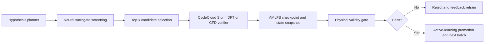

# Scientific Discovery, HPC, and Simulator-in-the-Loop R&D Agent Infrastructure FAQ (Cycle 2426)

## 1) Executive summary
This cycle designs an AI-for-Science closed-loop architecture: frontier planners orchestrate neural surrogates and deterministic physics simulators, while AKS Kueue plus CycleCloud Slurm, ND H100/GB200 RDMA compute, and AMLFS checkpointing enable high-throughput screening with physically trustworthy verification.

## 2) Q1 / Q2 / Q3
Q1: How do multi-hour Slurm MPI jobs coordinate with stateful agents?  
A1: Bind run-state, seeds, intermediate tensors, and checkpoint paths to persistent agent run IDs so each phase can deterministically resume.  
Q2: Why can surrogate-to-DFT funnels cut compute by ~1000x?  
A2: Surrogates reject low-value candidates early, allowing expensive DFT/CFD validation to focus on high-value subsets only.  
Q3: How do we enforce IP/export-control isolation for proprietary molecular libraries?  
A3: Separate storage, indexes, and execution domains by project and sovereignty boundaries with minimal metadata-only logging.

## 3) Hypothesis-to-physics active-learning loop

## 4) Decision matrix: cloud-burst batch vs AKS Kueue vs CycleCloud Slurm InfiniBand
| Mode | Throughput | Scheduling elasticity | MPI fitness | Best-fit |
|---|---:|---:|---:|---|
| Cloud-burst batch | Medium | High | Medium | Large offline screening waves |
| AKS Kueue | High | High | Medium-High | Containerized multi-queue research |
| CycleCloud Slurm IB | Highest | Medium-High | Highest | RDMA/MPI intensive verification |

## 5) AI-for-Science HPC readiness checklist (daily breakthroughs)
- Surrogate and physics outcomes must map to the same candidate lineage ID.  
- Checkpoint strategy must handle node preemption and long-horizon resume.  
- Physically invalid candidates must be rejected before promotion.  
- R&D datasets require project isolation and export-control policy enforcement.  
- Daily breakthrough tracking (fetched on 2026-11-15):  
  - Discovery/Foundry orchestration for staged experiments (`measured`).  
  - Kueue plus Slurm hybrid queue governance (`anonymized_reported`).  
  - AMLFS checkpoint acceleration and active-learning simulation (`synthetic`).

## 6) Good fit vs Not for with percentage contract bindings
Good fit:  
1. Research teams needing rapid candidate screening with physically grounded validation.  
2. Enterprise labs operating both container platforms and HPC queue controls.

Not for:  
1. Organizations without reproducible lineage tracking and checkpoint recovery discipline.  
2. Teams relying on brute-force-only workflows with no multi-fidelity funnel strategy.

Percentage contract bindings:
- `percentage_contract.gpu_hour_reduction_vs_bruteforce_rate`
- `percentage_contract.amlfs_checkpoint_throughput_improvement_rate`
- `percentage_contract.invalid_candidate_rejection_rate`
- `percentage_contract.slurm_long_horizon_resume_reliability_rate`

These keys bind to `cycle-2426-benchmark.json` with `production_validation=not_measured`.
