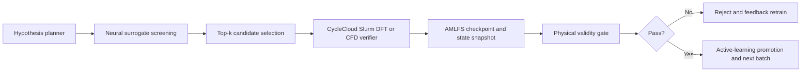

# 科学发现、HPC 与 Simulator-in-the-Loop 研发 Agent 基础设施 FAQ（Cycle 2426）

## 1) 执行摘要
本轮聚焦 AI-for-Science 闭环架构：由 Frontier planner 编排神经 surrogate 与确定性物理仿真，结合 AKS Kueue + CycleCloud Slurm 混合调度、ND H100/GB200 RDMA 计算与 AMLFS 高速检查点，实现“高吞吐筛选 + 高可信验证”的多保真主动学习漏斗。

## 2) Q1 / Q2 / Q3
Q1：多小时 Slurm MPI 任务如何与有状态 Agent 协同？  
A1：任务状态、随机种子、中间能量面与检查点路径必须与 agent run-id 绑定，恢复时按 phase 精确回放。  
Q2：为何 surrogate -> DFT 的多保真漏斗可降本 1000x 量级？  
A2：先用神经模型淘汰大量低价值候选，再将高价值样本进入 DFT/CFD 验证，大幅减少昂贵 GPU/CPU 小时消耗。  
Q3：如何处理专有分子库的出口管制/IP 隔离？  
A3：按项目与主权域拆分存储、索引和执行域，训练与推理日志仅保留最小必要元数据。

## 3) 假设规划到物理验证的主动学习闭环

## 4) 决策矩阵：Cloud-burst Batch vs AKS Kueue vs CycleCloud Slurm IB
| 模式 | 吞吐 | 调度弹性 | MPI 适配 | 适用场景 |
|---|---:|---:|---:|---|
| Cloud-burst Batch | 中 | 高 | 中 | 大批离线筛选 |
| AKS Kueue | 高 | 高 | 中高 | 容器化多队列研发 |
| CycleCloud Slurm IB | 最高 | 中高 | 最高 | RDMA/MPI 重计算 |

## 5) AI-for-Science HPC Readiness 清单（含当日突破）
- Surrogate 与物理仿真结果必须可追溯到同一候选 ID。  
- 检查点落盘策略需覆盖节点抢占与长任务恢复。  
- 物理不合理候选必须在 promotion 前被自动拒绝。  
- 研发数据集需执行项目隔离与出口管制策略。  
- 当日突破追踪（抓取日：2026-11-15）：  
  - Foundry/Discovery 编排与多阶段实验工作流（`measured`）。  
  - Kueue + Slurm 混合提交的队列治理实践（`anonymized_reported`）。  
  - AMLFS 检查点加速与主动学习仿真（`synthetic`）。

## 6) Good fit vs Not for 与百分比合约绑定
Good fit：  
1. 需要在大规模候选空间中快速筛选并保持物理可信的科研团队。  
2. 同时拥有容器化平台与 HPC 队列治理能力的企业实验室。  

Not for：  
1. 无法维护实验可追溯链路与检查点恢复机制的组织。  
2. 仅依赖单一路径 brute-force、无多保真漏斗策略的团队。  

百分比合约绑定：
- `percentage_contract.gpu_hour_reduction_vs_bruteforce_rate`
- `percentage_contract.amlfs_checkpoint_throughput_improvement_rate`
- `percentage_contract.invalid_candidate_rejection_rate`
- `percentage_contract.slurm_long_horizon_resume_reliability_rate`

以上键绑定 `cycle-2426-benchmark.json`，并标注 `production_validation=not_measured`。
