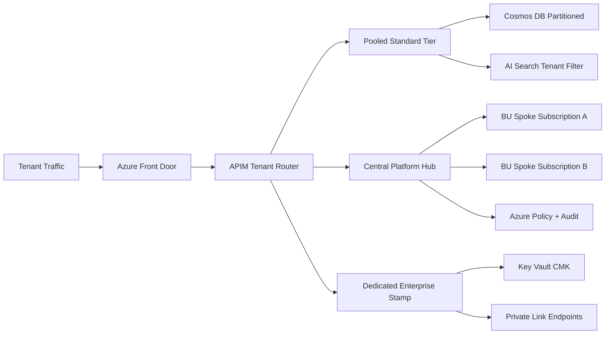
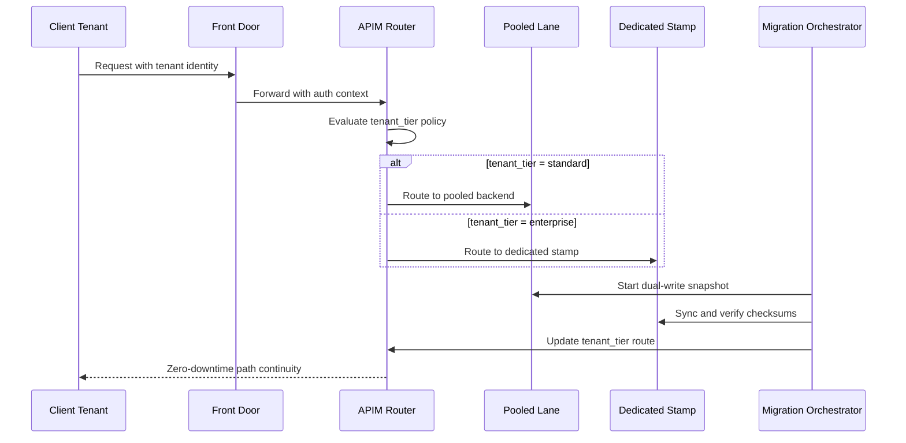

# Shared Hub vs Spoke Subscription vs Deployment Stamp: Enterprise Multi-Tenant AI Landing Zone Selection FAQ (Round 1118 / Cycle 2523)

## 1) Executive summary and daily capability radar (2026-11-18)
- This round analyzes enterprise AI landing-zone topology decisions for multi-tenant agent platforms, at architecture and governance level only.
- Strategic conclusion: tenancy isolation should be tiered by regulatory profile and business value, not by one universal infrastructure pattern.
- Pattern A (`Pooled logical multi-tenancy`) maximizes shared efficiency and onboarding speed but needs strong logical isolation and noisy-neighbor controls.
- Pattern B (`Federated hub-and-spoke`) balances central governance with business-unit autonomy and is often the default for large enterprises.
- Pattern C (`Dedicated deployment stamp`) maximizes ring-fenced isolation and audit confidence but increases Day-2 operational overhead.
- Pattern D (`Hybrid tiered SaaS`) combines pooled standard tier with dedicated enterprise stamps and usually delivers the best risk-adjusted economics.
- Enterprise architecture recommendation: use a policy-driven tenant tier router (Front Door + APIM) and automate tier transitions with migration runbooks.
- Daily capability radar captured at 2026-11-18 00:36 BJT:
  - APIM tenant-aware routing and policy controls for AI gateway governance.
  - Azure Policy inheritance through management-group hierarchy for ring-fencing.
  - Deployment Stacks and Bicep automation for deterministic enterprise stamp provisioning.
  - Cost attribution maturity using token ledger + infrastructure tags + subscription boundaries.
- Data label policy in this round:
  - measured: reproducible benchmark and validation artifacts.
  - synthetic: transparent planning and capacity formulas.
  - anonymized_reported: field-observed de-identified workload behavior.

## 2) Decision framing: isolation is a business-control matrix, not a binary switch
- Multi-tenant AI platforms fail when architecture treats isolation as “shared or dedicated” only.
- Effective decision factors are multidimensional:
  1. legal ring-fencing requirements by customer or subsidiary.
  2. data residency and CMK obligations by jurisdiction.
  3. burst profile and PTU utilization economics.
  4. onboarding speed expectations by customer segment.
  5. quota ceilings across subscriptions and private endpoints.
- Recommended control lens:
  - determine minimum acceptable blast radius.
  - determine required billing and attribution granularity.
  - determine acceptable Day-2 platform engineering load.
- A robust landing-zone strategy should allow non-disruptive tier upgrades (pooled to dedicated) without app-layer contract breaks.

## 3) End-to-end reference architecture: tier-aware tenant routing and policy envelope
- Northbound traffic path:
  - Azure Front Door receives global traffic and enforces tenant-aware path/auth entry.
  - APIM validates tenant claims, enforces policy, and routes to pooled or dedicated backend lanes.
- Core platform controls:
  - central AI gateway, model routing, and shared PTU burst pool.
  - centralized policy artifacts and compliance evidence pipeline.
  - shared observability schema for latency, saturation, and cost per tenant cohort.
- Tenant execution lanes:
  - pooled lane: logical partitioning through tenant filters and partition keys.
  - federated lane: per-BU spoke subscriptions with policy inheritance.
  - dedicated lane: per-tenant stamp with Private Link + CMK + strict network segmentation.
- Migration lane:
  - zero-downtime tenant promotion workflow moves a tenant from pooled to dedicated resources with dual-write and cutover checks.

## 4) 12-dimension enterprise landing-zone selection matrix
| Dimension | Pooled Logical Multi-Tenancy | Federated Hub-and-Spoke | Dedicated Silo / Deployment Stamp | Hybrid Tiered SaaS |
|---|---|---|---|---|
| Data-plane and network isolation strength | Medium logical controls | Medium-strong with spoke boundaries | Strong ring-fenced isolation | Strong where needed, shared where possible |
| Noisy-neighbor blast radius | Medium-high without strict quotas | Medium with per-spoke capacity controls | Low per-tenant blast radius | Low for enterprise tier, medium for pooled tier |
| CMK and regional residency flexibility | Medium, shared constraints | Strong per-spoke policy flexibility | Strong per-tenant flexibility | Strong by tier policy mapping |
| PTU and base-infra cost efficiency | Strong efficiency | Medium-strong | Low-medium due to duplication | Strong blended efficiency |
| Tenant onboarding lead time | Fast | Medium | Slowest | Fast for standard, medium for enterprise |
| Subscription/Private Endpoint quota scalability | Medium, central limits | Strong distributed limits | Medium, high count management overhead | Strong with tiered spread |
| FinOps attribution accuracy | Medium with token ledger tags | Strong by subscription + tags | Strongest by tenant boundary | Strong blended (tier + ledger) |
| Azure Policy governance enforcement | Medium centralized policy | Strong hierarchical policy | Strong per-stamp strict policy | Strong with tier-specific baselines |
| Day-2 IaC upgrade overhead | Low-medium | Medium | High | Medium with automation |
| Compliance audit readiness | Medium with compensating controls | Strong for enterprise groups | Strongest for ring-fencing audits | Strong where high-risk tenants isolated |
| Best-fit organization/SaaS stage | Early growth SaaS | Large enterprise platform teams | Regulated premium tenants | Scale-stage SaaS with mixed tenant profiles |
| When NOT to choose | Not ideal for strict ring-fence mandates | Not ideal for tiny teams needing minimal ops | Not ideal for low-ARPU long-tail tenants | Not ideal if org cannot operate dual patterns |

## 5) Quantitative model and planning formulas
### Q1: tenant-tier cost efficiency index
- Formula: `CostEfficiency = (SharedInfraReuse * PTUUtilization) / (IsolationOverhead + OpsComplexity)`.
- Example pooled cohort: `(0.82*0.76)/(0.28+0.31)=1.06`.
- Example dedicated cohort: `(0.34*0.61)/(0.66+0.74)=0.15`.
- Insight: dedicated isolation should be targeted to compliance-critical tenants, not default for all.

### Q2: onboarding lead-time model
- Formula: `OnboardingHours = PolicyBootstrap + NetworkProvision + DataInit + Validation`.
- Example pooled tenant: `2 + 1 + 2 + 1 = 6h`.
- Example dedicated enterprise stamp: `6 + 14 + 10 + 6 = 36h`.
- Planning implication: sales commitments should be aligned with tier-specific onboarding SLA.

### Q3: blast-radius impact estimator
- Formula: `BlastImpact = AffectedTenants * AvgRevenuePerTenant * IncidentHours`.
- Example pooled outage: `190 * $420 * 1.4h = $111,720`.
- Example dedicated outage: `1 * $12,000 * 1.4h = $16,800`.
- Architecture implication: high-value tenants justify dedicated stamps when blast tolerance is low.

### Q4: quota scaling envelope
- Formula: `QuotaHeadroom = (AvailablePE + AvailableSubQuota) / PlannedTenantGrowth`.
- Example federated design: `(920 + 44) / 420 = 2.29`.
- Recommendation: keep quota headroom >1.50 for two-quarter growth confidence.

### Q5: migration downtime risk score
- Formula: `MigrationRisk = (CutoverSteps * DataSkewFactor) / ValidationAutomationCoverage`.
- Example with automated dual-write checks: `(11*1.2)/8.5=1.55`.
- Operational goal: maintain migration risk score below `2.0` for zero-downtime promotion workflows.

## 6) Mermaid: hybrid tiered SaaS landing-zone topology

- Topology rule: routing logic must be claim-driven and deterministic (`tenant_tier`, `regulatory_profile`, `region_code`).
- Topology rule: policy and observability should be shared even when data-plane isolation is dedicated.

## 7) Scenario A: B2B tax & audit SaaS tiered multi-tenant agent platform
- Scenario objective: serve 5,000 SMB tenants efficiently while isolating 50 listed-enterprise tenants with strict CMK and private connectivity.
- Ingress and routing:
  - Front Door terminates global entry.
  - APIM reads JWT `tenant_tier` claim and routes to pooled or dedicated lane.
- SMB pooled lane design:
  - Cosmos DB hierarchical partition key (`tenantId`, `fiscalYear`, `workspaceId`).
  - AI Search tenant filters enforce logical document boundaries.
  - shared PTU lane with fairness controls and per-tenant quotas.
- Enterprise dedicated lane design:
  - Deployment Stacks create isolated resource groups/subscriptions.
  - stamp includes Private Link, Key Vault CMK, isolated storage/search boundary.
  - enterprise tenant policy set enforces `publicNetworkAccess: Disabled`.
- Zero-downtime promotion flow (SMB -> enterprise):
  1. create enterprise stamp in parallel.
  2. initialize dual-write + checksum validation.
  3. switch APIM route based on `tenant_tier` update.
  4. keep rollback route window until consistency SLO is met.
- Operational KPIs:
  - SMB onboarding median <8h.
  - enterprise onboarding median <48h.
  - migration cutover outage target = 0s user-visible downtime.
  - attribution variance between ledger and bill under 3%.

## 8) Scenario B: financial holding conglomerate federated AI landing zone
- Scenario objective: provide shared AI platform acceleration while preserving strict ring-fencing across banking, insurance, and asset-management subsidiaries.
- Governance architecture:
  - management group hierarchy applies baseline Azure Policy guardrails.
  - required controls include `publicNetworkAccess: Disabled` and allowlisted regions/models.
- Central hub responsibilities:
  - APIM AI gateway governance.
  - shared PTU burst capacity with policy-bounded routing.
  - central monitoring and compliance evidence packaging.
- Spoke subsidiary boundaries:
  - each license entity owns isolated VNet, storage, search, and Purview boundary.
  - data-plane never crosses subsidiary scope without policy-approved interfaces.
- Compliance operations:
  - subsidiary-specific logs retained per regulator requirements.
  - central oversight receives only minimum metadata needed for risk operations.
- Business outcome:
  - shared platform speed with legally auditable separation.
  - reduced duplicated platform spend compared with fully standalone stacks.

## 9) Mermaid sequence: tenant routing and promotion workflow

- Sequence guarantee: route decision is policy-evaluated per request, not hardcoded in app services.
- Sequence guarantee: promotion uses verification and rollback window before final route lock-in.

## 10) Production Bicep sample (hub, policy, and stamp baseline)
```bicep
param location string = resourceGroup().location
param envName string = 'ai-landingzone-prod'
param logWorkspaceId string

resource apim 'Microsoft.ApiManagement/service@2023-09-01-preview' = {
  name: '${envName}-apim'
  location: location
  sku: {
    name: 'Premium'
    capacity: 2
  }
  properties: {
    publisherEmail: 'platform@contoso.com'
    publisherName: 'Contoso AI Platform'
    publicNetworkAccess: 'Enabled'
  }
}

resource cosmos 'Microsoft.DocumentDB/databaseAccounts@2024-05-15' = {
  name: '${envName}-cosmos'
  location: location
  kind: 'GlobalDocumentDB'
  properties: {
    databaseAccountOfferType: 'Standard'
    publicNetworkAccess: 'Disabled'
    disableLocalAuth: true
  }
}

resource policyAssign 'Microsoft.Authorization/policyAssignments@2024-04-01' = {
  name: '${envName}-policy-baseline'
  properties: {
    displayName: 'AI landing-zone baseline'
    policyDefinitionId: '/providers/Microsoft.Authorization/policyDefinitions/00000000-0000-0000-0000-000000000000'
    enforcementMode: 'Default'
  }
}
```

## 11) Runtime policy and tenant-routing snippets
```yaml
apiVersion: v1
kind: ConfigMap
metadata:
  name: tenant-routing-config
data:
  default_tier: "standard-pooled"
  enterprise_tier: "dedicated-stamp"
  migration_mode: "dual-write-cutover"
  token_ledger_mode: "enabled"
  max_smb_tenants_per_pool: "5000"
  dedicated_stamp_cmk_required: "true"
  public_network_access_required_state: "disabled"
```

```xml
<policies>
  <inbound>
    <base />
    <validate-jwt header-name="Authorization" failed-validation-httpcode="401">
      <openid-config url="https://login.microsoftonline.com/{tenant}/v2.0/.well-known/openid-configuration" />
      <required-claims>
        <claim name="tenant_tier">
          <value>standard</value>
          <value>enterprise</value>
        </claim>
      </required-claims>
    </validate-jwt>
    <choose>
      <when condition="@(context.Principal.Claims.GetValueOrDefault(&quot;tenant_tier&quot;,&quot;standard&quot;) == &quot;enterprise&quot;)">
        <set-backend-service base-url="https://enterprise-stamp.internal" />
      </when>
      <otherwise>
        <set-backend-service base-url="https://pooled-tier.internal" />
      </otherwise>
    </choose>
  </inbound>
</policies>
```

## 12) KQL observability and FinOps queries
```kql
// APIM tenant-tier routing latency and throughput
ApiManagementGatewayLogs
| where TimeGenerated > ago(24h)
| extend tier = tostring(parse_json(Properties_s).tenantTier)
| summarize p50_ms=percentile(DurationMs,50), p95_ms=percentile(DurationMs,95), calls=count() by tier
| order by p95_ms asc
```

```kql
// Migration reliability dashboard
customEvents
| where timestamp > ago(30d)
| where name == "TenantPromotionRun"
| extend result = tostring(customDimensions.result)
| extend durationMin = todouble(customDimensions.durationMinutes)
| summarize runs=count(), success=countif(result=="success"), p95Duration=percentile(durationMin,95)
```

```kql
// FinOps allocation consistency
customEvents
| where timestamp > ago(30d)
| where name == "TenantCostLedgerClose"
| extend billed = todouble(customDimensions.nativeBilledUsd)
| extend ledger = todouble(customDimensions.ledgerComputedUsd)
| extend variancePct = abs((ledger-billed)/iif(billed==0,1,billed))*100.0
| summarize avgVariance=avg(variancePct), p95Variance=percentile(variancePct,95) by customDimensions.tenantTier
```

## 13) Named 4-option weighted decision matrix
| Option | Isolation Strength (20%) | Cost Efficiency (20%) | Onboarding Speed (15%) | Policy Governance (15%) | Scale Quota Fit (10%) | Day-2 Ops Overhead (10%) | Audit Readiness (10%) | Weighted Score |
|---|---:|---:|---:|---:|---:|---:|---:|---:|
| A. Pooled Logical Multi-Tenancy | 6.8 | 9.2 | 9.4 | 7.3 | 7.1 | 8.4 | 7.0 | 7.94 |
| B. Federated Hub-and-Spoke | 8.5 | 8.1 | 7.5 | 9.1 | 8.8 | 7.4 | 8.9 | 8.35 |
| C. Dedicated Deployment Stamp | 9.7 | 5.9 | 4.8 | 9.3 | 6.9 | 4.9 | 9.6 | 7.62 |
| D. Hybrid Tiered SaaS | 9.0 | 8.8 | 8.1 | 9.0 | 8.7 | 7.2 | 9.1 | 8.63 |
- Selection interpretation:
  - choose D as default for mixed portfolio SaaS with both long-tail and regulated premium cohorts.
  - choose B for large enterprises with strong central platform governance and BU autonomy.
  - choose A only when risk profile allows logical isolation and strong guardrails are in place.
  - choose C for strict contractual or regulatory ring-fencing that cannot accept shared boundaries.

## 14) Day-0 and Day-2 execution checklist
### Day-0 launch checklist (10 distinct items)
1. Define tenant-tier taxonomy and policy-to-tier mapping contracts.
2. Establish APIM routing claims and fallback behavior for missing tier claims.
3. Deploy pooled baseline with partition-key and tenant-filter controls validated.
4. Build enterprise stamp template with Private Link and CMK required checks.
5. Set Azure Policy assignments at management-group and subscription scopes.
6. Configure quota dashboards for subscription and private endpoint headroom.
7. Enable token-ledger and native billing reconciliation pipeline.
8. Implement migration runbook with dual-write and checksum verification.
9. Validate compliance evidence export paths for SOC2/ISO/financial audits.
10. Run failover and rollback drills for pooled lane and dedicated stamp lane.

### Day-2 operations checklist (10 distinct items)
1. Rebalance pooled tenant placement based on hotspot and noisy-neighbor trends.
2. Tune APIM throttling and fairness policies for tier-specific traffic behavior.
3. Rotate CMK governance controls and verify key-usage policy compliance.
4. Review quota consumption and forecast subscription expansion windows.
5. Automate policy drift detection and remediation pull requests.
6. Track migration backlog and prioritize high-risk tenants for promotion.
7. Optimize retention and analytics costs for multi-tenant observability datasets.
8. Audit enterprise stamp patch cadence and baseline version divergence.
9. Recompute attribution variance and adjust ledger normalization rules.
10. Revalidate audit evidence completeness before external compliance reviews.

## 15) Final recommendation, anti-patterns, and migration strategy
- Recommended baseline:
  - start with hybrid tiered architecture for growth-stage B2B SaaS.
  - retain federated hub-and-spoke controls for enterprise governance scale.
  - reserve dedicated stamps for tenants requiring strict legal ring-fencing.
- Explicit anti-patterns:
  - forcing all tenants into dedicated stamps regardless of revenue and compliance profile.
  - keeping all tenants pooled while promising contractual hard isolation.
  - relying only on tags for cost attribution without token ledger and reconciliation checks.
  - introducing tenant migration without dual-write verification and rollback windows.
- Migration path:
  1. establish pooled baseline with strong policy and telemetry.
  2. add tier-aware APIM routing and promotion runbooks.
  3. automate dedicated stamp provisioning for high-regulation tenants.
  4. continuously optimize FinOps and compliance evidence workflows.
- Bottom line:
  - enterprise AI landing zones should be policy-tiered and migration-ready, enabling both shared efficiency and ring-fenced trust where it matters.
