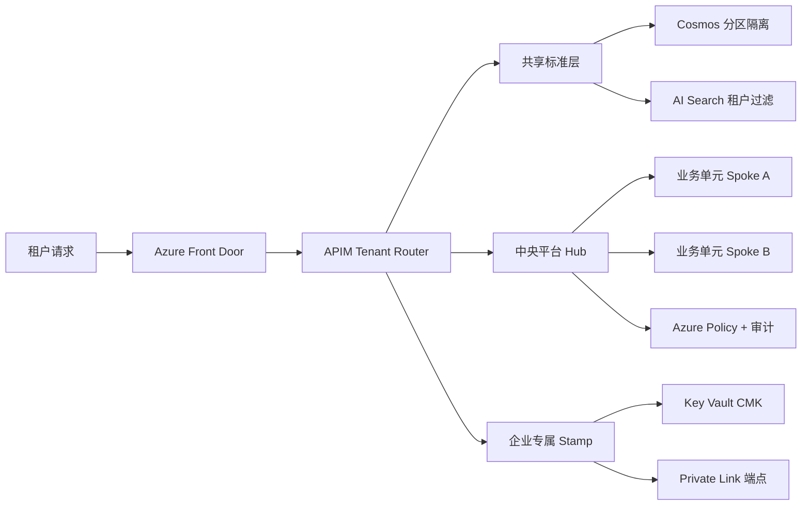
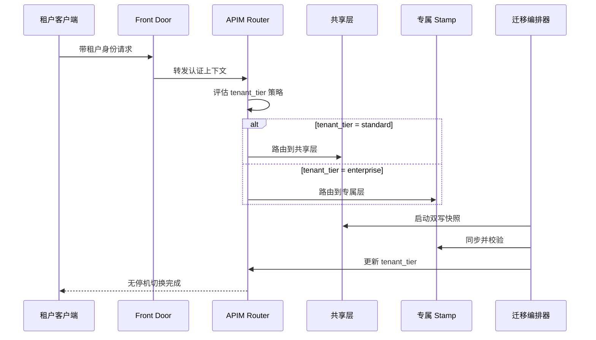

# Shared Hub vs Spoke Subscription vs Deployment Stamp：企业多租户 AI Landing Zone 选型 FAQ（Round 1118 / Cycle 2523）

## 1) 执行摘要与当日能力雷达（2026-11-18）
- 本轮聚焦企业多租户 AI Landing Zone 与隔离拓扑设计，严格限定在云架构治理层，不涉及底层硬件/驱动优化。
- 核心结论：租户隔离策略必须“按风险分层”，不能用单一拓扑覆盖全部客户画像。
- 方案 A（`共享池逻辑多租户`）在成本与上线速度方面最优，但需要强化逻辑隔离和噪声邻居治理。
- 方案 B（`联邦 Hub-and-Spoke`）兼顾中央治理与业务单元自治，是大型企业常见默认路径。
- 方案 C（`专属 Stamp`）审计与隔离最强，但 Day-2 运维负担最高。
- 方案 D（`混合分层 SaaS`）将共享标准层与专属企业层组合，通常实现最佳风险收益比。
- 推荐策略：以 Front Door + APIM 进行租户分层路由，并通过自动化迁移流程支持“共享 -> 专属”无停机升级。
- 当日能力雷达（抓取时间：2026-11-18 00:36 BJT）关注：
  - APIM 的租户感知路由与策略治理能力；
  - 管理组层级 Azure Policy 的跨订阅合规下发能力；
  - Bicep Deployment Stacks 在专属 Stamp 快速交付中的可重复性；
  - FinOps 成本归因从标签到 token ledger 的精度提升路径。
- 本轮数据标签：
  - measured：可复现产物与验证结果；
  - synthetic：公式化容量与成本估算；
  - anonymized_reported：去标识化现场观测指标。

## 2) 决策建模：隔离不是二选一，而是控制面矩阵
- 多租户方案常见误区是把隔离简化为“共享或专属”二元选择。
- 实际决策需要同时考虑：
  1. 数据面与网络面最小可接受隔离强度；
  2. CMK 与区域驻留合规要求；
  3. PTU 利用率与基础设施摊销效率；
  4. 租户入驻时效要求；
  5. 订阅与 Private Endpoint 配额扩展空间。
- 建议先回答三件事：
  - 允许的最大爆炸半径是多少；
  - 成本归因要到部门、租户还是牌照实体；
  - 团队可承受的 Day-2 复杂度上限是多少。
- 高质量架构必须支持“策略驱动分层”，并允许租户在不中断业务前提下升档。

## 3) 端到端参考架构：分层路由 + 统一治理 + 可迁移隔离
- 北向入口：
  - Front Door 统一全球入口与加速；
  - APIM 读取租户声明并执行 tier-aware 路由。
- 中央平台能力：
  - 统一 AI Gateway 与共享 PTU 爆发池；
  - 统一策略、审计、观测与成本归集；
  - 统一门禁规范，确保跨层一致治理。
- 执行平面分层：
  - 共享层：逻辑分区（PartitionKey + Security Filter）；
  - 联邦层：每业务单元独立 Spoke 订阅与网络边界；
  - 专属层：每租户 Stamp（Private Link + CMK + 独立资源边界）。
- 迁移平面：
  - 提供双写校验、路由切换、回滚窗口的无停机迁移机制。

## 4) 12 维企业多租户 Landing Zone 选型矩阵
| 维度 | 共享池逻辑多租户 | 联邦 Hub-and-Spoke | 专属 Stamp | 混合分层 SaaS |
|---|---|---|---|---|
| 数据面与网络隔离强度 | 中，依赖逻辑隔离 | 中强，Spoke 边界清晰 | 强，天然硬隔离 | 强，按层精准隔离 |
| 噪声邻居爆炸半径 | 中高，需严格配额 | 中，可按 Spoke 控制 | 低，单租户影响可控 | 企业层低、共享层中 |
| CMK 与区域驻留灵活性 | 中，受共享约束 | 强，分 Spoke 策略 | 强，按租户定制 | 强，按层组合策略 |
| PTU 与基础设施成本效率 | 强，共享效率高 | 中强 | 中低，重复建设较多 | 强，综合效率最优 |
| 租户入驻时长 | 快 | 中 | 慢 | 标准层快、企业层中 |
| 订阅/PE 配额扩展性 | 中，中心化瓶颈 | 强，分散扩展 | 中，规模化管理复杂 | 强，分层分散压力 |
| FinOps 归因精度 | 中，依赖 ledger 补偿 | 强，订阅+标签清晰 | 强，天然按租户归集 | 强，分层归因清楚 |
| Azure Policy 落地力度 | 中，中心策略为主 | 强，管理组层级好 | 强，租户级严控 | 强，层级化策略明确 |
| Day-2 IaC 升级开销 | 低中 | 中 | 高 | 中（需自动化支撑） |
| 合规审计就绪度 | 中，需补充控制 | 强 | 最强 | 强（高风险租户可专属） |
| 最佳适配组织阶段 | 早中期 SaaS | 大型企业平台化 | 高监管高价值租户 | 混合客群规模化 SaaS |
| When NOT to choose | 强监管硬隔离场景不宜 | 小团队极简运维场景不宜 | 低 ARPU 长尾租户不宜 | 组织无法运营双模式时不宜 |

## 5) 量化模型与规划公式
### Q1：分层成本效率指数
- 公式：`CostEfficiency = (SharedInfraReuse * PTUUtilization) / (IsolationOverhead + OpsComplexity)`。
- 共享层示例：`(0.82*0.76)/(0.28+0.31)=1.06`。
- 专属层示例：`(0.34*0.61)/(0.66+0.74)=0.15`。
- 解释：专属隔离应保留给高监管高价值租户，而非全量默认。

### Q2：入驻时长估算
- 公式：`OnboardingHours = PolicyBootstrap + NetworkProvision + DataInit + Validation`。
- 共享层示例：`2+1+2+1=6h`。
- 专属层示例：`6+14+10+6=36h`。
- 含义：销售承诺必须与租户层级 SLA 对齐。

### Q3：爆炸半径影响模型
- 公式：`BlastImpact = AffectedTenants * AvgRevenuePerTenant * IncidentHours`。
- 共享层示例：`190*$420*1.4h=$111,720`。
- 专属层示例：`1*$12,000*1.4h=$16,800`。
- 决策：高价值租户应优先纳入专属 Stamp。

### Q4：配额扩展余量
- 公式：`QuotaHeadroom = (AvailablePE + AvailableSubQuota) / PlannedTenantGrowth`。
- 联邦示例：`(920+44)/420=2.29`。
- 建议：维持 >1.50 的季度增长余量。

### Q5：迁移风险分
- 公式：`MigrationRisk = (CutoverSteps * DataSkewFactor) / ValidationAutomationCoverage`。
- 示例：`(11*1.2)/8.5=1.55`。
- 目标：保持 <2.0 以满足无停机迁移要求。

## 6) Mermaid：混合分层 SaaS Landing Zone 拓扑

- 原则 A：路由必须由声明驱动（`tenant_tier`、`regulatory_profile`、`region_code`）。
- 原则 B：即使数据面分层隔离，策略与观测面也应统一治理。

## 7) 场景 A：财税与审计 SaaS ISV 分层多租户平台
- 业务目标：同时承载 5,000 家中小租户与 50 家上市企业租户，实现成本效率与合规隔离双目标。
- 接入与路由：
  - Front Door 统一入口；
  - APIM 根据 JWT `tenant_tier` 执行分层路由。
- SMB 共享层：
  - Cosmos DB 分层分区键（`tenantId/fiscalYear/workspaceId`）；
  - AI Search tenant filter 强制文档隔离；
  - 共享 PTU + 公平队列控制长尾租户竞争。
- 企业专属层：
  - Deployment Stacks 自动创建独立 RG/订阅；
  - 启用 Private Link、Key Vault CMK、专属存储/搜索边界；
  - 策略强制 `publicNetworkAccess: Disabled`。
- 无停机升档流程（SMB -> Enterprise）：
  1. 并行创建专属 Stamp；
  2. 双写 + 校验和一致性校验；
  3. 切换 `tenant_tier` 路由；
  4. 保留回滚窗口直至一致性 SLO 达标。
- 核心 KPI：
  - SMB 入驻中位时长 <8h；
  - 企业入驻中位时长 <48h；
  - 升档迁移用户可见停机 = 0；
  - ledger 与账单归因偏差 <3%。

## 8) 场景 B：金融控股集团跨牌照联邦 AI Landing Zone
- 业务目标：在银行/保险/资管严格隔离前提下复用中央平台能力。
- 治理结构：
  - 管理组层级下发 Azure Policy 基线；
  - 强制策略包括 `publicNetworkAccess: Disabled` 与允许区域/模型白名单。
- 中央 Hub 职责：
  - 托管 APIM AI Gateway 治理；
  - 提供共享 PTU 爆发能力；
  - 统一审计证据与风险运营看板。
- 子公司 Spoke 边界：
  - 每牌照实体独立 VNet、Storage、Search 与 Purview 边界；
  - 数据面默认不跨牌照流动，仅通过策略批准接口交互。
- 合规运营：
  - 各子公司按监管要求保留独立日志；
  - 中央平台仅接收最小化元数据用于集团风控。
- 业务收益：
  - 保持监管隔离同时避免完全孤岛化重复投入；
  - 形成“统一治理 + 独立持牌边界”平衡架构。

## 9) Mermaid：租户路由与升档迁移时序

- 保障 A：每次请求都策略评估，不依赖硬编码分流。
- 保障 B：切换前后有验证与回滚窗口，降低迁移事故概率。

## 10) 生产级 Bicep 示例（Hub、策略、Stamp 基线）
```bicep
param location string = resourceGroup().location
param envName string = 'ai-landingzone-prod'
param logWorkspaceId string

resource apim 'Microsoft.ApiManagement/service@2023-09-01-preview' = {
  name: '${envName}-apim'
  location: location
  sku: {
    name: 'Premium'
    capacity: 2
  }
  properties: {
    publisherEmail: 'platform@contoso.com'
    publisherName: 'Contoso AI Platform'
    publicNetworkAccess: 'Enabled'
  }
}

resource cosmos 'Microsoft.DocumentDB/databaseAccounts@2024-05-15' = {
  name: '${envName}-cosmos'
  location: location
  kind: 'GlobalDocumentDB'
  properties: {
    databaseAccountOfferType: 'Standard'
    publicNetworkAccess: 'Disabled'
    disableLocalAuth: true
  }
}

resource policyAssign 'Microsoft.Authorization/policyAssignments@2024-04-01' = {
  name: '${envName}-policy-baseline'
  properties: {
    displayName: 'AI landing-zone baseline'
    policyDefinitionId: '/providers/Microsoft.Authorization/policyDefinitions/00000000-0000-0000-0000-000000000000'
    enforcementMode: 'Default'
  }
}
```

## 11) 运行策略与租户路由配置片段
```yaml
apiVersion: v1
kind: ConfigMap
metadata:
  name: tenant-routing-config
data:
  default_tier: "standard-pooled"
  enterprise_tier: "dedicated-stamp"
  migration_mode: "dual-write-cutover"
  token_ledger_mode: "enabled"
  max_smb_tenants_per_pool: "5000"
  dedicated_stamp_cmk_required: "true"
  public_network_access_required_state: "disabled"
```

```xml
<policies>
  <inbound>
    <base />
    <validate-jwt header-name="Authorization" failed-validation-httpcode="401">
      <openid-config url="https://login.microsoftonline.com/{tenant}/v2.0/.well-known/openid-configuration" />
      <required-claims>
        <claim name="tenant_tier">
          <value>standard</value>
          <value>enterprise</value>
        </claim>
      </required-claims>
    </validate-jwt>
    <choose>
      <when condition="@(context.Principal.Claims.GetValueOrDefault(&quot;tenant_tier&quot;,&quot;standard&quot;) == &quot;enterprise&quot;)">
        <set-backend-service base-url="https://enterprise-stamp.internal" />
      </when>
      <otherwise>
        <set-backend-service base-url="https://pooled-tier.internal" />
      </otherwise>
    </choose>
  </inbound>
</policies>
```

## 12) KQL 观测与 FinOps 查询
```kql
// APIM 分层路由延迟与吞吐
ApiManagementGatewayLogs
| where TimeGenerated > ago(24h)
| extend tier = tostring(parse_json(Properties_s).tenantTier)
| summarize p50_ms=percentile(DurationMs,50), p95_ms=percentile(DurationMs,95), calls=count() by tier
| order by p95_ms asc
```

```kql
// 升档迁移可靠性
customEvents
| where timestamp > ago(30d)
| where name == "TenantPromotionRun"
| extend result = tostring(customDimensions.result)
| extend durationMin = todouble(customDimensions.durationMinutes)
| summarize runs=count(), success=countif(result=="success"), p95Duration=percentile(durationMin,95)
```

```kql
// FinOps 归因一致性
customEvents
| where timestamp > ago(30d)
| where name == "TenantCostLedgerClose"
| extend billed = todouble(customDimensions.nativeBilledUsd)
| extend ledger = todouble(customDimensions.ledgerComputedUsd)
| extend variancePct = abs((ledger-billed)/iif(billed==0,1,billed))*100.0
| summarize avgVariance=avg(variancePct), p95Variance=percentile(variancePct,95) by customDimensions.tenantTier
```

## 13) 命名四选一加权评分矩阵
| 方案 | 隔离强度(20%) | 成本效率(20%) | 入驻速度(15%) | 策略治理(15%) | 配额扩展(10%) | Day-2开销(10%) | 审计就绪(10%) | 加权总分 |
|---|---:|---:|---:|---:|---:|---:|---:|---:|
| A. 共享池逻辑多租户 | 6.8 | 9.2 | 9.4 | 7.3 | 7.1 | 8.4 | 7.0 | 7.94 |
| B. 联邦 Hub-and-Spoke | 8.5 | 8.1 | 7.5 | 9.1 | 8.8 | 7.4 | 8.9 | 8.35 |
| C. 专属 Deployment Stamp | 9.7 | 5.9 | 4.8 | 9.3 | 6.9 | 4.9 | 9.6 | 7.62 |
| D. 混合分层 SaaS | 9.0 | 8.8 | 8.1 | 9.0 | 8.7 | 7.2 | 9.1 | 8.63 |
- 解释：
  - 多客群规模化 SaaS 默认优先 D；
  - 大型企业平台化治理优先 B；
  - 低风险高效率场景可选 A；
  - 强监管硬隔离场景优先 C。

## 14) Day-0 与 Day-2 落地清单
### Day-0 上线准备（10 项）
1. 定义租户分层字典与策略映射关系。
2. 配置 APIM 的声明校验与默认回退策略。
3. 完成共享层分区键与租户过滤隔离验收。
4. 建立专属 Stamp 模板并强制 Private Link + CMK。
5. 在管理组与订阅层完成 Azure Policy 下发。
6. 建立订阅/PE 配额余量看板与告警阈值。
7. 打通 token ledger 与原生账单对账管道。
8. 上线双写迁移编排与校验和校验流程。
9. 配置 SOC2/ISO/金融审计证据导出流程。
10. 演练共享层和专属层故障回滚方案。

### Day-2 持续优化（10 项）
1. 基于热点与噪声邻居趋势重平衡共享池分配。
2. 调优 APIM 分层限流与公平队列策略。
3. 定期轮换 CMK 策略并核验密钥使用审计。
4. 预测配额消耗并提前扩容订阅边界。
5. 自动检测 Policy 漂移并发起修复 PR。
6. 按风险优先级推进租户升档迁移计划。
7. 优化多租户观测数据保留与查询成本。
8. 管控专属 Stamp 基线版本分歧与补丁节奏。
9. 月度复核归因偏差并迭代 ledger 规则。
10. 外部审计前执行证据完整性预演检查。

## 15) 结论、反模式与演进路径
- 推荐基线：
  - 以混合分层架构承接规模化增长；
  - 以联邦治理框架保证集团级策略一致；
  - 以专属 Stamp 满足硬隔离客户需求。
- 明确反模式：
  - 不分客户画像一刀切全专属；
  - 明知硬隔离要求仍全量共享；
  - 只靠标签做成本归因，不做 ledger 对账；
  - 没有双写校验就做租户升档切换。
- 演进路径：
  1. 先建共享层并补齐策略与观测；
  2. 再建分层路由与升档 runbook；
  3. 随后自动化专属 Stamp 交付；
  4. 持续优化 FinOps 与合规证据闭环。
- 总结：企业 AI Landing Zone 的最佳实践是“按风险分层隔离、按价值分层投入、按策略分层治理”。
