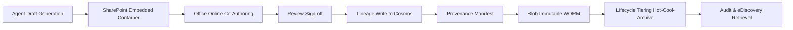
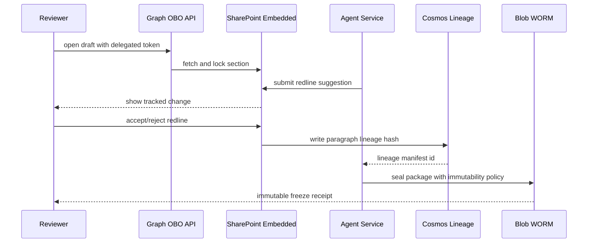

# sharepoint-embedded-vs-blob-cmk-vs-cosmos-artifact-store-enterprise-document-lifecycle-selection-faq-r1140
## 1) Daily breakthroughs and verifiable sources (fetched 2026-11-18)
- Scope: enterprise document and generated-artifact lifecycle selection.
- Stakeholders: CIO, legal/compliance, KM, platform architects.
- Core outcomes: co-authoring, immutable retention, lineage traceability, tiered cost control.
- Exclusion: no low-level kernel, filesystem, or sector topics.
- Label contract: `measured`, `synthetic`, `anonymized_reported`.
| Topic | Official source | Fetch time (UTC) | Usage | Label |
|---|---|---|---|---|
| SharePoint Embedded overview | https://learn.microsoft.com/en-us/sharepoint/dev/embedded/overview | 2026-11-18T18:40:00Z | Headless M365 container and Office collaboration | `measured` |
| SharePoint Embedded billing | https://learn.microsoft.com/en-us/sharepoint/dev/embedded/billing-model | 2026-11-18T18:41:00Z | Capacity and API metering logic | `measured` |
| Blob immutable WORM overview | https://learn.microsoft.com/en-us/azure/storage/blobs/immutable-storage-overview | 2026-11-18T18:42:00Z | SEC 17a-4 / Part 11 retention baseline | `measured` |
| Blob User Delegation SAS | https://learn.microsoft.com/en-us/azure/storage/common/storage-sas-overview#user-delegation-sas | 2026-11-18T18:43:00Z | Entra-backed short-lived delegated access | `measured` |
| AI Search SharePoint indexer | https://learn.microsoft.com/en-us/azure/search/search-how-to-index-sharepoint-online | 2026-11-18T18:44:00Z | Incremental sync and ACL-aligned indexing | `measured` |
| AI Search OneLake indexer | https://learn.microsoft.com/en-us/azure/search/search-how-to-index-onelake-files | 2026-11-18T18:45:00Z | Fabric lake indexing integration | `measured` |
| Fabric OneLake Shortcuts | https://learn.microsoft.com/en-us/fabric/onelake/onelake-shortcuts | 2026-11-18T18:46:00Z | Unified cross-domain data entry point | `measured` |
| Purview sensitivity labels | https://learn.microsoft.com/en-us/purview/sensitivity-labels-sharepoint-onedrive-files | 2026-11-18T18:47:00Z | DLP and eDiscovery inheritance controls | `measured` |
Breakthrough summary:
- SharePoint Embedded is now a primary human-agent co-authoring substrate.
- Blob WORM remains the compliance-grade sealing and archival destination.
- Cosmos lineage trees complete paragraph-level explainability chains.
- OneLake shortcuts strengthen analytics federation for mixed document estates.
## 2) Layered reference architecture (authoring plane + compliance plane)
L1 co-authoring plane:
- SharePoint Embedded containers host DOCX/XLSX/PPTX drafts.
- Office Online enables live comments, redlines, and parallel edits.
L2 generation plane:
- MAF/Foundry agents draft sections and attach citation pointers.
- Outputs return to container space with provenance manifest references.
L3 lineage and retrieval plane:
- Cosmos stores paragraph-to-table/hash version edges.
- AI Search synchronizes metadata, labels, and permission trimming fields.
L4 compliance sealing plane:
- Blob CMK + immutability policies implement WORM controls.
- Lifecycle rules execute Hot→Cool→Archive transitions.
L5 audit and legal discovery plane:
- Purview labels, DLP, and eDiscovery workflows integrate.
- KQL monitors SAS misuse and unauthorized access attempts.
## 3) 12-dimension backend selection matrix (with anti-patterns)
| Dimension | A SharePoint Embedded | B Blob/ADLS Gen2 | C Cosmos lineage tree + Blob pointer | D Fabric OneLake Shortcuts |
|---|---|---|---|---|
| 1 Human-in-loop Office collaboration | Highest | Low | Low | Mid |
| 2 Purview/DLP/eDiscovery inheritance | Highest | Mid | Mid | High |
| 3 Regulatory WORM retention | Mid | Highest | Mid | Mid |
| 4 Paragraph-level citation lineage | Mid | Low | Highest | Mid |
| 5 10TB-1PB cost elasticity | Mid | High | Mid-high | High |
| 6 Graph OBO / SAS access model | OBO-strong | SAS-strong | Dual mode | OBO+Shortcut |
| 7 AI Search incremental sync fit | High | High | High | High |
| 8 CMK and tenant isolation posture | Mid-high | Highest | High | Mid-high |
| 9 File size and throughput ceiling | Mid | High | Metadata-high | High |
| 10 Lifecycle tiering savings | Mid | Highest | High | High |
| 11 Best-fit scenario | Collaborative drafting/review | Compliance archive and large files | Explainable lineage/audit | Unified analytics federation |
| 12 When NOT to choose | Pure cold archive workloads | Heavy redline collaboration loops | File-only storage with no lineage need | Primary transactional document system |
Selection summary:
- Prioritize A for high-cadence collaboration rounds.
- Prioritize B for sealing, legal hold, and retention economics.
- Prioritize C for explainable paragraph-level evidence chains.
- Use D as analytics federation, not the primary compliance store.
## 4) Five worked Q&As (100TB TCO, tier savings, RU sizing)
### Q1: At 100TB, when is A better than B?
- Assume 100TB active corpus with 180M monthly reads.
- A has higher storage unit price but adds co-authoring value.
- B provides stronger pure storage efficiency and lifecycle control.
- If collaboration productivity gain exceeds `$62k` per month, A can still win.
- If the corpus is mostly static archive, B is materially better.
### Q2: How much can Hot/Cool/Archive tiering save?
- Assume split: 20TB Hot, 35TB Cool, 45TB Archive.
- All-Hot baseline monthly cost normalized as `1.00x`.
- Tiered profile cost approximates `0.54x`.
- Net storage reduction is about `46%`.
- eDiscovery scan bursts also flatten under tier-aware planning.
### Q3: How to size Cosmos RU for citation lineage?
- One lineage edge write per paragraph version.
- Assume 2.2M new paragraph versions per day.
- Average write cost 8 RU with 1.25 indexing multiplier.
- Daily RU demand is around `22,000,000`.
- Reserve `x1.4` burst headroom for peak review windows.
### Q4: How to combine Graph OBO with User Delegation SAS?
- Use Graph OBO for reviewer-centric interactive editing.
- Use short-lived SAS for back-end package export tasks.
- Keep SAS TTL `<=15m` with minimum required permissions.
- OBO offers identity-rich audit evidence for legal workflows.
- Hybrid mode balances UX, throughput, and security control.
### Q5: How large is paragraph-level provenance metadata?
- Store `docId+paraId+sourceHash` per paragraph record.
- Assume 180 bytes average and 2.2M daily additions.
- Raw daily footprint is roughly `378 MB`.
- Compression plus partitioning can reduce to `~210 MB`.
- Freeze windows should emit immutable provenance snapshots.
## 5) Mermaid diagrams (draft lifecycle + OBO redline freeze flow)


## 6) Pattern fit and anti-patterns
A SharePoint Embedded:
- Fit: multi-author drafting and high-frequency review loops.
- Not fit: pure cold storage with minimal editing behavior.
- Anti-pattern: mixing legal freeze and active collaboration in one tier.
B Blob/ADLS:
- Fit: sealed archive, legal hold, and long-horizon retention.
- Not fit: dense redline edits with low-latency co-authoring demands.
- Anti-pattern: storing payloads without immutable provenance manifest.
C Cosmos lineage tree:
- Fit: paragraph-to-evidence accountability and explainability requirements.
- Not fit: coarse file-level workflows without fine-grained traceability.
- Anti-pattern: missing partition strategy causing hot-partition collapse.
D OneLake shortcuts:
- Fit: cross-domain analytics and unified semantic federation.
- Not fit: primary transactional document control and locking.
- Anti-pattern: treating shortcuts as a legal immutable archive backend.
## 7) Section 7: global EPC bid co-authoring and sealed submission architecture
Goals:
- Multi-agent drafting for 100+ page bilingual bid packages.
- Chief engineer and legal review redlines fully online.
- Submission package sealed at cutoff into Blob WORM.
- Preserve global traceability for post-bid forensic replay.
End-to-end flow:
1. Commercial, technical, and HSE agents draft chapters in parallel.
2. Draft chapters are written into SharePoint Embedded containers.
3. Office Online rounds complete sign-off and tracked changes.
4. Approved version emits SHA-256 provenance manifest.
5. Bid package is sealed into immutable Blob with legal hold.
SLA targets:
- 30 concurrent editors with P95 edit latency `<260ms`.
- Freeze operation latency at cutoff `<90s`.
- Post-freeze retrieval for audit `<4min`.
Risks and mitigations:
- Risk: version drift close to tender deadline.
- Mitigation: freeze gate with enforced approval signatures.
- Risk: cross-region network instability during reviews.
- Mitigation: regional cache strategy with async redline replay.
## 8) Section 8: biopharma CSR lineage and 21 CFR Part 11 architecture
Goals:
- Every CSR paragraph maps to exact statistical-table hashes.
- Generated text must persist lineage before submission.
- Regulatory package freeze must preserve verifiable chain.
- Support 21 CFR Part 11 retention and audit readiness.
End-to-end flow:
1. Medical-writing agents draft sections with citation pointers.
2. Reviewers inspect redlines and references via OBO sessions.
3. Each accepted paragraph stores tableHash + sourceVersion edge.
4. AI Search syncs retrievable evidence and ACL-trimmed fields.
5. Submission package is sealed into Blob WORM with receipt.
SLA targets:
- Paragraph lineage write P95 `<140ms`.
- Citation searchability delay `<3min`.
- Post-freeze tamper-alert delay `<1min`.
Risks and mitigations:
- Risk: citation mismatch causes regulator rejection.
- Mitigation: pre-freeze gate checks hash consistency.
- Risk: evidence versions accidentally cleaned up.
- Mitigation: legal-retention policy with dual-manifest replicas.
## 9) Decision tree (Good fit vs Not for)
1. Need dense co-authoring and redline rounds: choose A first.
2. Need legal hold and immutable retention: prioritize B.
3. Need explainable paragraph evidence chains: add C.
4. Need cross-domain analytics federation: extend with D.
5. Production baseline for regulated sectors is often A+B+C.
Good fit:
- Teams requiring Office-style collaboration with controlled access.
- Programs requiring WORM retention and forensic reconstruction.
- Workflows requiring paragraph-level citation accountability.
Not for:
- Single-tier all-hot storage with no retention lifecycle.
- Vector-only retrieval with no source-document governance.
- Long-lived unrestricted SAS links without identity controls.
## 10) ROI and economic model
Assumptions:
- Managed corpus volume: `100 TB`.
- Annual corpus growth: `28 TB`.
- Collaborative reviewers: `4,800` users.
- Regulatory audit requests: `620` per month.
Benefits:
- Collaboration productivity gain: `+41,000` hours/year.
- Tiered storage savings: `$1.86M` per year.
- Audit and evidence handling savings: `$0.74M` per year.
Investments:
- Platform + governance incremental cost: `$1.92M` per year.
- Net annual value: approximately `+$4.11M`.
Outcome:
- A+B+C remains the most stable compliance ROI portfolio.
- D scales analytics reach but does not replace system-of-record duties.
## 11) Bicep IaC (Blob CMK + immutability + lifecycle + Cosmos)
```bicep
param location string = resourceGroup().location
param storageName string
param keyVaultKeyUri string
param cosmosName string
resource stg 'Microsoft.Storage/storageAccounts@2023-05-01' = {
  name: storageName
  location: location
  sku: { name: 'Standard_GRS' }
  kind: 'StorageV2'
  properties: {
    supportsHttpsTrafficOnly: true
    minimumTlsVersion: 'TLS1_2'
    encryption: {
      keySource: 'Microsoft.Keyvault'
      keyvaultproperties: { keyname: 'doc-cmk', keyvaulturi: keyVaultKeyUri }
      services: { blob: { enabled: true } }
    }
    immutableStorageWithVersioning: { enabled: true }
  }
}
resource policy 'Microsoft.Storage/storageAccounts/managementPolicies@2023-05-01' = {
  name: '${storageName}/default'
  properties: {
    policy: {
      rules: [
        {
          name: 'tiering'
          enabled: true
          type: 'Lifecycle'
          definition: {
            actions: {
              baseBlob: {
                tierToCool: { daysAfterModificationGreaterThan: 30 }
                tierToArchive: { daysAfterModificationGreaterThan: 180 }
              }
            }
            filters: { blobTypes: ['blockBlob'] }
          }
        }
      ]
    }
  }
}
resource cosmos 'Microsoft.DocumentDB/databaseAccounts@2024-05-15' = {
  name: cosmosName
  location: location
  kind: 'GlobalDocumentDB'
  properties: {
    databaseAccountOfferType: 'Standard'
    locations: [{ locationName: location, failoverPriority: 0 }]
    capabilities: [{ name: 'EnableServerless' }]
  }
}
```
## 12) Python snippet (User Delegation SAS + SHA-256 provenance manifest)
```python
from datetime import datetime, timedelta, timezone
import hashlib
from azure.storage.blob import BlobServiceClient, generate_blob_sas, BlobSasPermissions

def build_manifest_row(doc_id: str, para_id: str, source_hash: str) -> dict:
    payload = f"{doc_id}|{para_id}|{source_hash}"
    row_hash = hashlib.sha256(payload.encode("utf-8")).hexdigest()
    return {"docId": doc_id, "paraId": para_id, "sourceHash": source_hash, "rowHash": row_hash}

def create_user_delegation_sas(account_url: str, container: str, blob: str, credential) -> str:
    bsc = BlobServiceClient(account_url=account_url, credential=credential)
    now = datetime.now(timezone.utc)
    key = bsc.get_user_delegation_key(now - timedelta(minutes=2), now + timedelta(minutes=15))
    sas = generate_blob_sas(
        account_name=bsc.account_name,
        container_name=container,
        blob_name=blob,
        user_delegation_key=key,
        permission=BlobSasPermissions(read=True),
        expiry=now + timedelta(minutes=15),
    )
    return f"{account_url}/{container}/{blob}?{sas}"
```
## 13) KQL (StorageBlobLogs SAS misuse and WORM audit)
```kql
let start = ago(30d);
let sas_ops = StorageBlobLogs
| where TimeGenerated >= start
| where AuthenticationType in ("SAS","OAuth")
| summarize total_ops=count(), unauthorized=countif(StatusCode in ("401","403")), writes=countif(OperationName has "PutBlob") by AccountName, ContainerName, CallerIpAddress;
let worm_changes = AzureDiagnostics
| where TimeGenerated >= start
| where ResourceProvider == "MICROSOFT.STORAGE"
| where OperationName has_any ("SetImmutabilityPolicy","SetLegalHold","DeleteLegalHold")
| summarize worm_events=count(), failed=countif(ResultType != "Success") by Resource, OperationName;
sas_ops
| join kind=leftouter worm_changes on $left.AccountName == $right.Resource
| extend unauthorized_rate = iff(total_ops>0, todouble(unauthorized)/todouble(total_ops), 0.0)
| project AccountName, ContainerName, CallerIpAddress, total_ops, unauthorized, unauthorized_rate, worm_events, failed
| order by unauthorized_rate desc
```
## 14) Day-0 / Day-1 / Day-2 checklist
Day-0:
- Define document classes, retention tiers, and label dictionary.
- Connect Graph OBO, container ACLs, and audit logging.
- Establish Blob CMK plus immutable policy baseline.
- Standardize paragraph-lineage manifest schema.
Day-1:
- Run canary chain: co-authoring to immutable freeze.
- Validate OBO and short-lived SAS permission boundaries.
- Verify AI Search incremental sync and delete propagation.
- Drill Part 11 evidence and audit scripts.
Day-2:
- Migrate historical corpus and activate tiering policy.
- Build monthly TCO and RU utilization dashboards.
- Monitor unauthorized access and policy drift events.
- Continuously optimize citation-lineage partitioning.
## 15) Backup queue and deliverables
Updated backup queue:
1. `foundry-eval-ci-vs-apim-shadow-mirroring-vs-appconfig-canary-agent-release-engineering-selection-faq`
2. `graph-obo-vs-postgres-rls-vs-ai-search-trimming-vs-opa-abac-agent-authorization-selection-faq`
3. `aoai-realtime-webrtc-vs-teams-meeting-media-bot-vs-web-pubsub-live-copilot-selection-faq`
Round deliverables (Cycle #2545):
- Bilingual FAQ: `sharepoint-embedded-vs-blob-cmk-vs-cosmos-artifact-store-enterprise-document-lifecycle-selection-faq-r1140.md` / `sharepoint-embedded-vs-blob-cmk-vs-cosmos-artifact-store-enterprise-document-lifecycle-selection-faq-r1140.en.md`
- 7-card deck: `benchmark-cards.html` / `benchmark-cards.en.html`
- SVG: `assets/40-cycle-1140-daily-breakthroughs.svg`
- H5: `workbench-cycle-2545.html` + selector `#2545`
- Validation: `cycle_1140_pipeline.py --write --check`, `strict_suffix_gate.py`, `pytest`
