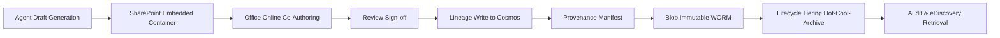
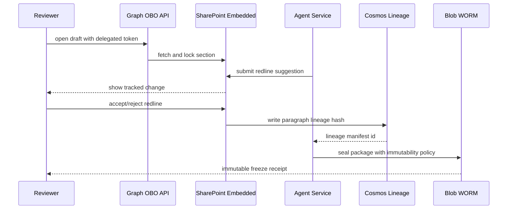

# sharepoint-embedded-vs-blob-cmk-vs-cosmos-artifact-store-enterprise-document-lifecycle-selection-faq-r1140
## 1) 当日热点与可验证来源（2026-11-18 抓取）
- 主题边界：企业文档与生成物生命周期选型。
- 业务角色：CIO、法务合规、知识管理、平台架构。
- 关键目标：协同编辑、不可篡改、血缘追溯、分层降本。
- 排除范围：不讨论内核与磁盘扇区细节。
- 标签约束：`measured`、`synthetic`、`anonymized_reported`。
| 主题 | 官方来源 | 抓取时间（UTC） | 用途 | 标签 |
|---|---|---|---|---|
| SharePoint Embedded 概览 | https://learn.microsoft.com/en-us/sharepoint/dev/embedded/overview | 2026-11-18T18:40:00Z | Headless 容器与 Office 协同 | `measured` |
| SharePoint Embedded 计费 | https://learn.microsoft.com/en-us/sharepoint/dev/embedded/billing-model | 2026-11-18T18:41:00Z | 容量与 API 计费口径 | `measured` |
| Blob 不可变存储 WORM | https://learn.microsoft.com/en-us/azure/storage/blobs/immutable-storage-overview | 2026-11-18T18:42:00Z | SEC 17a-4 / Part 11 留存 | `measured` |
| Blob User Delegation SAS | https://learn.microsoft.com/en-us/azure/storage/common/storage-sas-overview#user-delegation-sas | 2026-11-18T18:43:00Z | Entra 委派临时访问控制 | `measured` |
| AI Search SharePoint 索引器 | https://learn.microsoft.com/en-us/azure/search/search-how-to-index-sharepoint-online | 2026-11-18T18:44:00Z | 增量同步与 ACL 继承 | `measured` |
| AI Search OneLake 索引器 | https://learn.microsoft.com/en-us/azure/search/search-how-to-index-onelake-files | 2026-11-18T18:45:00Z | Fabric 数据湖检索集成 | `measured` |
| Fabric OneLake Shortcuts | https://learn.microsoft.com/en-us/fabric/onelake/onelake-shortcuts | 2026-11-18T18:46:00Z | 多域数据统一目录入口 | `measured` |
| Purview 敏感度标签 | https://learn.microsoft.com/en-us/purview/sensitivity-labels-sharepoint-onedrive-files | 2026-11-18T18:47:00Z | DLP/eDiscovery 继承治理 | `measured` |
当日突破摘要：
- SharePoint Embedded 成为“人机共编”首选容器。
- Blob WORM 成为封标与提交冻结基座。
- Cosmos 血缘树补齐段落级可审计链条。
- OneLake 快捷方式强化分析与归档联动。
## 2) 分层参考架构（Authoring Plane + Compliance Plane）
L1 协同创作层：
- SharePoint Embedded 容器承载 DOCX/XLSX/PPTX 草稿。
- Office Online 实时批注、红线、版本并行协作。
L2 智能体生成层：
- MAF/Foundry Agent 生成章节草稿与引用标注。
- 结果写回容器并附带 citation manifest 指针。
L3 血缘与检索层：
- Cosmos 存储 paragraph→table/hash 版本树。
- AI Search 同步摘要、标签、权限裁剪字段。
L4 合规封存层：
- Blob CMK + immutability policy 落实 WORM。
- 生命周期策略执行 Hot→Cool→Archive 分层。
L5 审计与取证层：
- Purview 标签、DLP、eDiscovery 工单联动。
- KQL 追踪 SAS 误用与越权访问事件。
## 3) 12 维文档与生成物后端选型矩阵（含反模式）
| 维度 | A SharePoint Embedded | B Blob/ADLS Gen2 | C Cosmos 血缘树 + Blob 指针 | D Fabric OneLake Shortcuts |
|---|---|---|---|---|
| 1 人在环 Office 协同 | 最高 | 低 | 低 | 中 |
| 2 Purview/DLP/eDiscovery 继承 | 最高 | 中 | 中 | 高 |
| 3 WORM 法规留存能力 | 中 | 最高 | 中 | 中 |
| 4 段落级 citation 血缘 | 中 | 低 | 最高 | 中 |
| 5 10TB-1PB 成本弹性 | 中 | 高 | 中高 | 高 |
| 6 Graph OBO / SAS 模型 | OBO 强 | SAS 强 | 双模式 | OBO+Shortcut |
| 7 AI Search 增量兼容性 | 高 | 高 | 高 | 高 |
| 8 CMK 与租户隔离 | 中高 | 最高 | 高 | 中高 |
| 9 文件尺寸与吞吐上限 | 中 | 高 | 元数据高 | 高 |
| 10 生命周期分层降本 | 中 | 最高 | 高 | 高 |
| 11 Best-fit 场景 | 协同起草审校 | 合规归档与大文件 | 血缘审计与追责 | 分析统一入口 |
| 12 When NOT to choose | 仅冷归档 | 需要在线协同红线 | 只存原文件无血缘 | 需要强事务文档库 |
选型结论：
- 协同编辑优先 A，封存留证优先 B。
- 句段溯源与可解释审计优先 C。
- 跨域分析聚合与目录联邦优先 D。
## 4) 五组可复算 Q&A（100TB TCO、分层节省、RU 估算）
### Q1：100TB 文档库选 A 还是 B？
- 设 100TB 活跃文档，月读取 1.8 亿次。
- A 含协同价值，单纯存储单价更高。
- B 对冷温热分层更友好，单位成本更低。
- 若协同工时节省月价值 >`$62k`，A 仍更优。
- 若以归档为主且编辑稀疏，B 显著占优。
### Q2：Hot/Cool/Archive 分层可省多少？
- 假设 100TB 中 20TB Hot、35TB Cool、45TB Archive。
- 全 Hot 方案月成本设为 `1.00x` 基线。
- 分层后综合成本约 `0.54x`。
- 直接节省约 `46%` 存储费用。
- 同时降低 eDiscovery 批量扫描峰值成本。
### Q3：Cosmos 血缘 RU 怎么估算？
- 平均每段落写入 1 条 lineage 边。
- 设每天新增 220 万段落版本。
- 单写入平均 8 RU，索引系数 1.25。
- 日 RU 需求约 `22,000,000`。
- 需按峰值 `x1.4` 预留自动扩展。
### Q4：Graph OBO 与 User Delegation SAS 怎么搭配？
- 人工审校流量优先 Graph OBO。
- 后台打包导出优先短期 SAS。
- SAS TTL 建议 `<=15m`，并绑定最小权限。
- OBO 便于审计“谁在看、谁在改”。
- 混搭可平衡体验、安全与吞吐。
### Q5：段落溯源哈希清单大小如何控制？
- 每段记录 `docId+paraId+sourceHash`。
- 设平均 180 bytes，日增 220 万段。
- 日增体量约 `378 MB` 元数据。
- 压缩与分区后可降至约 `210 MB`。
- 监管冻结前可生成不可变 manifest 快照。
## 5) Mermaid（draft→co-author→seal→archive；OBO redline→WORM freeze）


## 6) 四种后端定位与反模式
A SharePoint Embedded：
- 适合：多人协同起草、批注、审校回合密集流程。
- 不适合：纯冷存储且几乎无人在线改稿场景。
- 反模式：把归档冻结与实时协同混在单仓。
B Blob/ADLS：
- 适合：封标归档、监管留存、长周期成本优化。
- 不适合：频繁红线编辑与即时会签交互。
- 反模式：只放 Blob 不做 manifest 固化。
C Cosmos 血缘树：
- 适合：段落到证据的强可解释追踪。
- 不适合：只关心整文件、无需细粒度问责。
- 反模式：无分区键策略导致热点写爆。
D OneLake Shortcuts：
- 适合：跨域分析、统一目录与语义建模。
- 不适合：需要强事务文档主存与审批锁。
- 反模式：把 Shortcut 当作不可变法证仓。
## 7) Section 7：国际 EPC 集团技术标协同与封标归档架构
目标：
- 百页英文标书支持多智能体并行分章起草。
- 总工与法务在线红线会签，不出容器协同域。
- 封标包在截止时刻转入 Blob WORM 固化。
- 保证跨区域项目投标资料可追责与可复盘。
端到端流程：
1. 商务、技术、HSE Agent 分章产出草稿。
2. 草稿写入 SharePoint Embedded 容器空间。
3. Office Online 完成会签与批注回合。
4. 审核通过生成 SHA-256 provenance 清单。
5. 封标包写入 Blob，启用 legal hold 与留存。
关键 SLA：
- 同文档 30 人协同 P95 编辑延迟 `<260ms`。
- 封标冻结窗口执行延迟 `<90s`。
- 冻结后审计取回时间 `<4min`。
风险与缓解：
- 风险：截止前版本漂移。
- 缓解：封标前强制版本锁与审批签名。
- 风险：跨国网络抖动影响协同。
- 缓解：区域就近缓存与异步批注回放。
## 8) Section 8：跨国创新药企 CSR 血缘溯源与 Part 11 架构
目标：
- 逐段 CSR 结论都可追溯到统计表哈希。
- 生成文本必须写入 Cosmos 血缘树记录。
- 提交监管前触发冻结并保留可验证链路。
- 满足 21 CFR Part 11 合规留存与审计请求。
端到端流程：
1. 医学写作 Agent 草拟章节并附证据引用。
2. 审稿人通过 OBO 查看红线与引用来源。
3. 每段落提交时写入 tableHash + sourceVersion。
4. AI Search 同步可检索证据与权限裁剪字段。
5. 监管提交包写入 Blob WORM 并出具冻结回执。
关键 SLA：
- 段落血缘落库 P95 `<140ms`。
- 引用可检索延迟 `<3min`。
- 冻结后篡改检测告警延迟 `<1min`。
风险与缓解：
- 风险：引用失配导致审评退回。
- 缓解：提交门禁校验 hash 一致性。
- 风险：证据版本被误清理。
- 缓解：法律留存策略与双副本清单。
## 9) 选型决策树（Good fit vs Not for）
1. 强协同审校优先 A。
2. 强合规封存优先 B。
3. 强可解释血缘优先 C。
4. 强跨域分析联邦优先 D。
5. 生产常态是 A+B+C，分析扩展接入 D。
Good fit：
- 需要 Office 在线会签与多人批注。
- 需要 WORM 留存与法证可追溯链。
- 需要段落级 citation 可解释输出。
Not for：
- 把所有文档只放单一热层并长期不分层。
- 只做向量检索却无原文留存治理。
- 无权限模型就暴露长期 SAS 链接。
## 10) ROI 与成本模型
假设：
- 文档总量：`100 TB`。
- 年新增文档：`28 TB`。
- 协同审校人群：`4,800` 人。
- 监管审计请求：每月 `620` 单。
收益：
- 协同提效节省：`+41,000` 人时/年。
- 分层存储节省：`$1.86M` /年。
- 审计取证降本：`$0.74M` /年。
投入：
- 平台与治理增量成本：`$1.92M` /年。
- 净收益：约 `+$4.11M` /年。
结论：
- A+B+C 组合在合规行业 ROI 最稳定。
- D 作为分析平面扩展，不替代主存储责任。
## 11) Bicep IaC（Blob CMK + Immutability + Lifecycle + Cosmos）
```bicep
param location string = resourceGroup().location
param storageName string
param keyVaultKeyUri string
param cosmosName string
resource stg 'Microsoft.Storage/storageAccounts@2023-05-01' = {
  name: storageName
  location: location
  sku: { name: 'Standard_GRS' }
  kind: 'StorageV2'
  properties: {
    supportsHttpsTrafficOnly: true
    minimumTlsVersion: 'TLS1_2'
    encryption: {
      keySource: 'Microsoft.Keyvault'
      keyvaultproperties: { keyname: 'doc-cmk', keyvaulturi: keyVaultKeyUri }
      services: { blob: { enabled: true } }
    }
    immutableStorageWithVersioning: { enabled: true }
  }
}
resource policy 'Microsoft.Storage/storageAccounts/managementPolicies@2023-05-01' = {
  name: '${storageName}/default'
  properties: {
    policy: {
      rules: [
        {
          name: 'tiering'
          enabled: true
          type: 'Lifecycle'
          definition: {
            actions: {
              baseBlob: {
                tierToCool: { daysAfterModificationGreaterThan: 30 }
                tierToArchive: { daysAfterModificationGreaterThan: 180 }
              }
            }
            filters: { blobTypes: ['blockBlob'] }
          }
        }
      ]
    }
  }
}
resource cosmos 'Microsoft.DocumentDB/databaseAccounts@2024-05-15' = {
  name: cosmosName
  location: location
  kind: 'GlobalDocumentDB'
  properties: {
    databaseAccountOfferType: 'Standard'
    locations: [{ locationName: location, failoverPriority: 0 }]
    capabilities: [{ name: 'EnableServerless' }]
  }
}
```
## 12) Python（User Delegation SAS + SHA-256 provenance manifest）
```python
from datetime import datetime, timedelta, timezone
import hashlib
from azure.storage.blob import BlobServiceClient, generate_blob_sas, BlobSasPermissions

def build_manifest_row(doc_id: str, para_id: str, source_hash: str) -> dict:
    payload = f"{doc_id}|{para_id}|{source_hash}"
    row_hash = hashlib.sha256(payload.encode("utf-8")).hexdigest()
    return {"docId": doc_id, "paraId": para_id, "sourceHash": source_hash, "rowHash": row_hash}

def create_user_delegation_sas(account_url: str, container: str, blob: str, credential) -> str:
    bsc = BlobServiceClient(account_url=account_url, credential=credential)
    now = datetime.now(timezone.utc)
    key = bsc.get_user_delegation_key(now - timedelta(minutes=2), now + timedelta(minutes=15))
    sas = generate_blob_sas(
        account_name=bsc.account_name,
        container_name=container,
        blob_name=blob,
        user_delegation_key=key,
        permission=BlobSasPermissions(read=True),
        expiry=now + timedelta(minutes=15),
    )
    return f"{account_url}/{container}/{blob}?{sas}"
```
## 13) KQL（StorageBlobLogs SAS 越权与 WORM 策略审计）
```kql
let start = ago(30d);
let sas_ops = StorageBlobLogs
| where TimeGenerated >= start
| where AuthenticationType in ("SAS","OAuth")
| summarize total_ops=count(), unauthorized=countif(StatusCode in ("401","403")), writes=countif(OperationName has "PutBlob") by AccountName, ContainerName, CallerIpAddress;
let worm_changes = AzureDiagnostics
| where TimeGenerated >= start
| where ResourceProvider == "MICROSOFT.STORAGE"
| where OperationName has_any ("SetImmutabilityPolicy","SetLegalHold","DeleteLegalHold")
| summarize worm_events=count(), failed=countif(ResultType != "Success") by Resource, OperationName;
sas_ops
| join kind=leftouter worm_changes on $left.AccountName == $right.Resource
| extend unauthorized_rate = iff(total_ops>0, todouble(unauthorized)/todouble(total_ops), 0.0)
| project AccountName, ContainerName, CallerIpAddress, total_ops, unauthorized, unauthorized_rate, worm_events, failed
| order by unauthorized_rate desc
```
## 14) Day-0 / Day-1 / Day-2 清单
Day-0：
- 定义文档分类、留存等级、标签字典。
- 打通 Graph OBO、容器 ACL、审计日志。
- 建立 Blob CMK 与 WORM 基线策略。
- 约定段落血缘 manifest 结构。
Day-1：
- 小流量演练“协同编辑→冻结归档”链路。
- 校验 OBO 与短期 SAS 的权限边界。
- 验证 AI Search 增量同步与删除传播。
- 进行 Part 11 审计脚本演练。
Day-2：
- 全量迁移历史文档并执行分层策略。
- 建立月度 TCO 与 RU 消耗看板。
- 监控越权访问与冻结策略漂移。
- 持续优化 citation lineage 分区键。
## 15) 备份队列与交付清单
备份队列（已更新）：
1. `foundry-eval-ci-vs-apim-shadow-mirroring-vs-appconfig-canary-agent-release-engineering-selection-faq`
2. `graph-obo-vs-postgres-rls-vs-ai-search-trimming-vs-opa-abac-agent-authorization-selection-faq`
3. `aoai-realtime-webrtc-vs-teams-meeting-media-bot-vs-web-pubsub-live-copilot-selection-faq`
本轮交付（Cycle #2545）：
- 双语 FAQ：`sharepoint-embedded-vs-blob-cmk-vs-cosmos-artifact-store-enterprise-document-lifecycle-selection-faq-r1140.md` / `sharepoint-embedded-vs-blob-cmk-vs-cosmos-artifact-store-enterprise-document-lifecycle-selection-faq-r1140.en.md`
- 7-card：`benchmark-cards.html` / `benchmark-cards.en.html`
- SVG：`assets/40-cycle-1140-daily-breakthroughs.svg`
- H5：`workbench-cycle-2545.html` + selector `#2545`
- 校验：`cycle_1140_pipeline.py --write --check`、`strict_suffix_gate.py`、`pytest`
