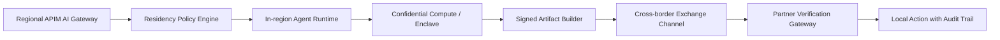

# 主权跨境数据驻留与加密边界 Agent 基础设施 FAQ（Cycle 2428）

## 1) 执行摘要
本轮聚焦跨组织/跨法域 Agent 联邦中的“主权边界不破、防护可证明、审计可追溯”：在 Azure 侧采用 APIM AI Gateway 进行区域准入与策略决策，结合 Entra Workload Identity、Managed HSM/Key Vault 与机密计算执行面，确保跨境协作只交换签名任务工件，不泄露原始敏感上下文。

## 2) Q1 / Q2 / Q3
Q1：为什么跨境 Agent 协作不能直接共享原始上下文？  
A1：主权与合规要求决定了数据应在驻留域内推理，仅输出经过最小化、脱敏和签名的任务结果。  
Q2：如何在不共享明文数据的情况下完成跨组织任务链？  
A2：通过 APIM 外围网关做策略判定，使用短时令牌 + mTLS + 签名工件，接收侧仅验证签名与策略标签。  
Q3：如何证明“未越界、未篡改、可审计”？  
A3：策略拒绝日志、签名校验记录与不可抵赖审计链共同构成证据闭环。

## 3) Sovereign 双速协作流程（驻留域内推理 + 跨域签名交换）

## 4) 决策矩阵：同域内联邦 vs 跨域签名交换 vs 直接上下文共享
| 方案 | 隔离边界 | 合规可审计性 | 延迟 | 运维复杂度 | 结论 |
|---|---|---:|---:|---:|---|
| 同域内联邦 | 最强 | 最高 | 低 | 中 | 默认首选 |
| 跨域签名交换 | 强 | 高 | 中 | 中高 | 跨组织主路径 |
| 直接上下文共享 | 弱 | 低 | 低 | 低 | 禁用于受监管场景 |

## 5) 生产上线清单（含当日热点）
- 所有跨境请求必须通过区域策略与租户策略双重门禁。  
- 令牌必须短时、可吊销，并绑定工作负载身份与请求意图。  
- 输出工件必须附签名、完整性摘要与策略标签。  
- 审计日志必须可回放：拒绝原因、签名链、跨域流向一致。  
- 当日热点（抓取日：2026-11-16，官方/Release 优先）：  
  - APIM AI Gateway 在主权边界治理中的统一入口能力（`measured`）。  
  - Azure 机密容器/机密计算在执行平面隔离中的工程化可用性（`anonymized_reported`）。  
  - Firecracker/Kata/Wasmtime 版本演进对沙箱恢复与隔离面的影响（`synthetic`）。

## 6) Good fit vs Not for 与百分比合约绑定
Good fit：  
1. 受监管行业（金融、医疗、公共部门）要求数据驻留与跨组织协作并存的场景。  
2. 需要可证明不可抵赖审计链的 B2B Agent 交易与审批流程。

Not for：  
1. 无法执行区域策略与身份最小权限治理的团队。  
2. 依赖明文跨境上下文直传、缺乏签名工件机制的系统。

百分比合约绑定：
- `percentage_contract.residency_policy_violation_block_rate`
- `percentage_contract.cross_border_token_denial_rate`
- `percentage_contract.signed_artifact_non_repudiation_rate`
- `percentage_contract.p0_data_egress_incident_reduction_rate`

以上键绑定 `cycle-2428-benchmark.json`，并标注 `production_validation=not_measured`。
